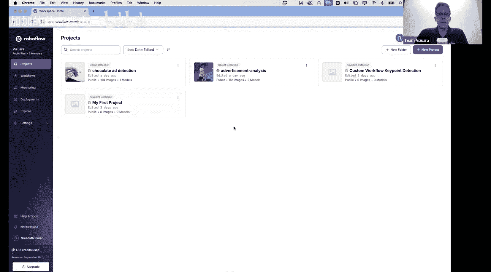
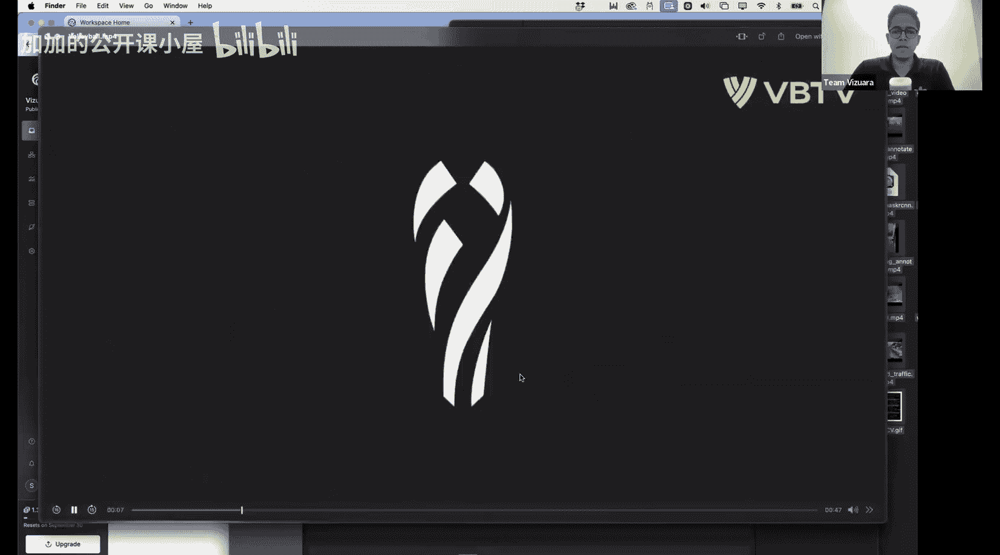
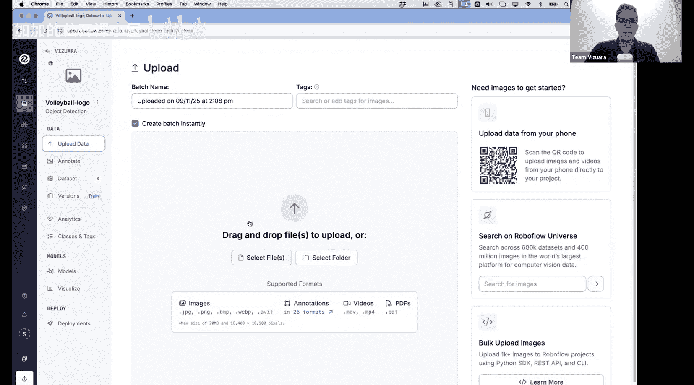
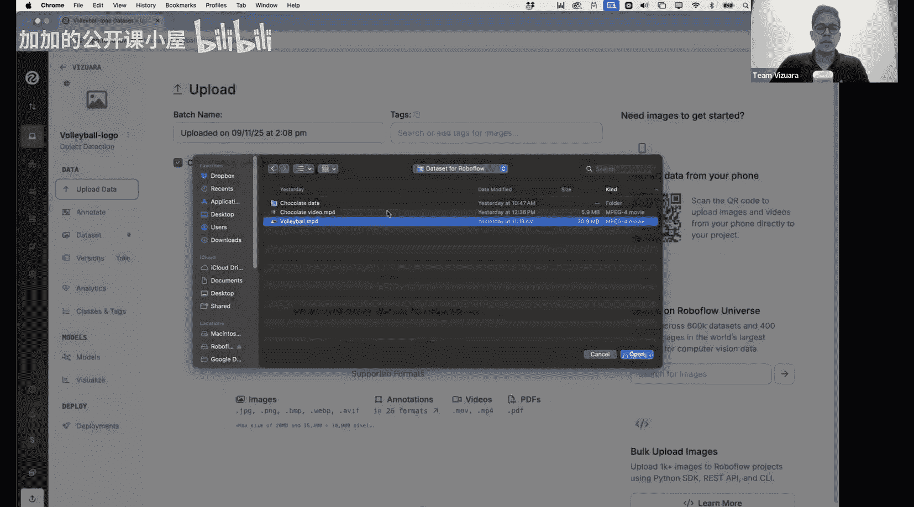
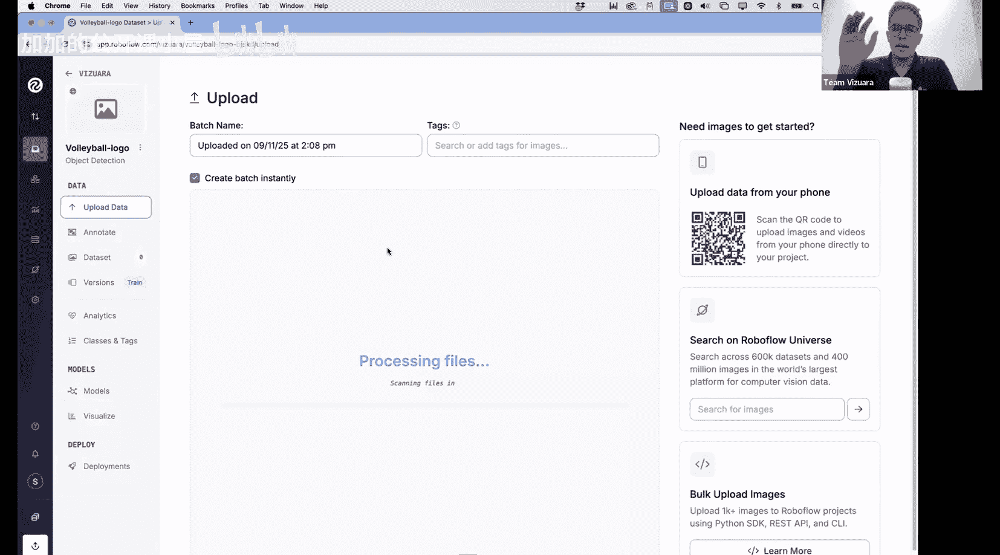
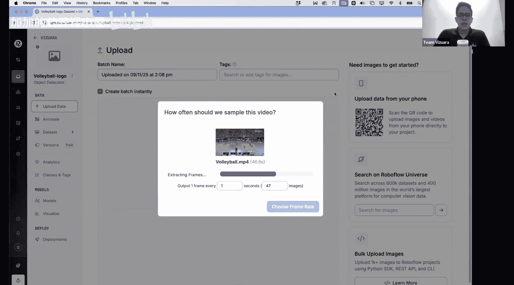
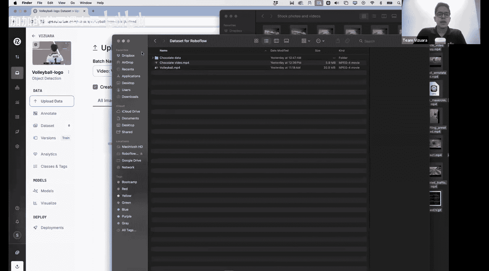
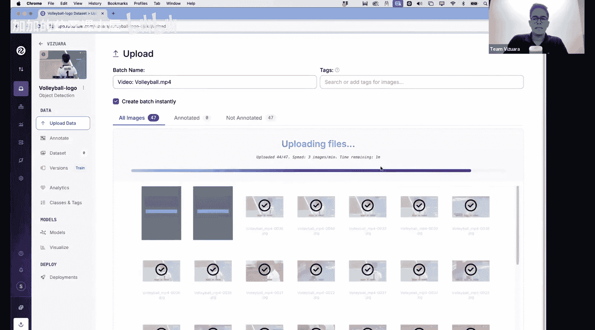
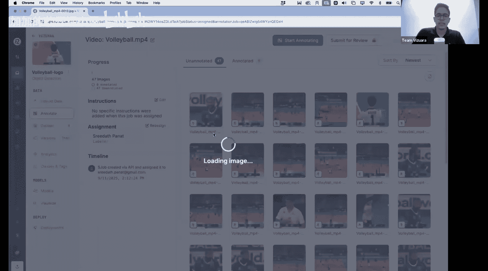

# Vizuara【中英⚡面向新手的计算机视觉｜Computer vision from scratch】 p28 P28 Roboflow - Best way to build end-to-end computer vision pipeline [BV1UMxxzPE5Y_p28]

Today we are starting a new module on Robboflow， so Robboflow is an amazing platform where you can build end to end computer vision applications starting from creating data set and notating it。

Splitting it automatically into train validation test and then using it to create different versions of the data。

 then selecting whatever model you want to select to train on this data。

And if you want to take a pretrain model， you can do that and fine tune on the data and while fine tuning is going on。

 you can see how the accuracy is progressing with epochs with dynamic graphs。

And then finally once the model is fine tuned， you can test your model and you can also deploy it so it's a very nice platform for building end to end pipelines so I first recommend everyone to go to this website Robboflow。

com。So we'll be building this together， so there are parts of today's lecture where it's purely about image annotation so since I'm just one person I won't be able to annotate it alone so I will need your help so I will be sharing the link also and I'll tell you exactly what to do。

So first thing is sign in using your Google account or your GiHub account。

 I have already signed in using my Google account。So in today's lecture， I thought we could。

Do a few things first is discuss how exactly to build a data， annotate it， etc。

And if we are building a object detection pipeline。

 we know that the data set could be frames of a video， the data set could be distinct images。

 and then the labelings would be the boxes， bounding boxes。So， let's say， we had。

A video that looks like this， so I have a。

Video here called volleyball can you see this video screen can you see this volleyball video？

So basically， this is just from the random volleyball game。

But look at the you know these advertisements， so let's say I am an advertisementr and the purpose of me sponsoring an advertisement in a player's logo。

 I mean ch or let's say an advertisement that is over here like you can see some advertisements in in these boards this Mikasa。

So the purpose of these advertisements is maybe maximum screen visibility when you are projecting it into the screen like when somebody is watching live in a TV right so as an advertiser my goal is to optimize or my goal is to see at least whether my brand logo has been shown for X percentage of time of the screen time and how much of the screen area was my logo occupying so although this logo is physically big when you are actually watching on the screen maybe this player you know this ches logo might be actually bigger for the viewer。

So for advertisement analytics， let's say you are a company and a client comes to you asking， hey。

 I would like to have some analytics of the your your particular volleyball game so that I can analyze which type of logos are getting projected the most。

The first and foremost task for doing this is to have a object detection model where the objects are these logos themselves right so the first thing is we need to convert。

This this entire video into different frames and those frames we will convert into a labeled data set by drawing bounding rectangles and then that we will use for training maybe a Yo V8 or Yo V11 model and then later if we upload a new video we can let's say hopefully we can get a annotation on that new video right so for simplicity what we will do is we will only target two logos one is this mave logo this I hope you can you see this red color logo anyone in the chat can you please mention this this player you know j logo that is the first logo that we'll track。

Second logo is this over here。This one， this this Mikasa logo。

 sometimes it's kind of blocked by people standing in front of it。

 but only two logos we will track okay， just for simplicity。

Now we could we could even make it even simpler just by tracking one logo maybe we should try that。

 but in any case the first step in this whole process is converting the video into frames so you don't need an external software for this so what I'm going to do is I will create a new project in logogo flow。

So。New project。And then it's an object detection project， and I will say volleyball。

Logo is the project name。 and here I want to。Detect logos， I just type logos。

 doesn't matter whatever we can type。Right now I'm on a free plan in Robbo flow so I don't think I can create private projects yet。

 but that's okay these are not very high stakes high stake project anyway。

So this creates an empty project now on the left hand side you can see a bunch of options uploading the data annotating it then this dataset set means whatever annotated data set you have created you will see that versions is different versions you can create different versions of your model and then analytics will show you as the model is getting trained it will show you a few things so we'll see all of that so first step is upload data。

So I will upload， click and select file。

And I will go to。This video， so here I'm uploading the data set。

 So first what I'm going to show you is。

A simple pipeline which does not work I mean by what I mean by that is a pipeline which does very well in training but does poorly in testing。

So this video is around if I'm not wrong around yeah 45 seconds。

 so if I pick one frame per second I will have roughly 4647 images right so here I'll have total 47 images depending on the frame rate so roboflow allows you to pick whatever frame rate you want if you pick a large number of frames per second the total output will be very very big and here it'll be vice versa right so I'll pick one frame per second instead of anything else so I'll have total 47 images and then based on this frame rate now Robboflow is extracting the frames from this MP4 video and then after extracting we'll upload it into this Robboflow server。

Don't worry about doing this with me right now because I will anywhere share this project workspace with all of you so that you can all assist me in doing the annotation exactly like how let's say we are all working in the same company and we have a huge data set to handle so a lot of data to be annotated well be splitting the task among ourselves right so exact same thing we'll be doing today so I'll tell you what to do once this uploading is finished。

And meanwhile， I want to show you one more video， So this is another video of like。

This is like a YouTube short， I'm not sure why this is not opening。

I'm not sure why this is not opening it was playing before， but we'll figure it out。

 but that is a video where there are a bunch of chocolates and I want。

an algorithm that annotates chocolates， different chocolate brands with a bounding rectangle whenever it appears in an image or in a video。

 right？Okay， so here Robboflow is uploading the images。

 this is pretty fast and once it is uploaded it will show that 47 are not annotated。

And zero is unnotated， so which means I'm yet to start an notation。

So first I will show you a sample annotation for one or two images and then I will invite all of you guys to annotate with me so that we can together finish this very fast。

Just give me one moment to finish。For this to finish uploading。

Al right so uploading is completed and as you can see here these are the different frames so far it's easy now here you can see few options label it myself。

😊，Label with my team auto label the entire batch so auto label is if you have a model that is already trained to predict the bounding rectangle for this case。

 you can use auto labeler。Otherwise， here is an option hire outsourced labelers， which is labelers。

 which is。Roboflow themselves will assign people to label our data set at some small cost。

 so what I'll pick initially is label myself okay so here。I'm creating a labeling job。

And initially you can see that all of them are assigned as training data set， so click any image。

This will open just that image individually。

And。We don't need this all we need to do is the following this you see this rectangle option just draw a rectangle around the logo so let's say I'm only interested in identifying this mave logo no other logo okay and then here I will name it as yeah just logo this default name is enough。

Now I just saved。So。