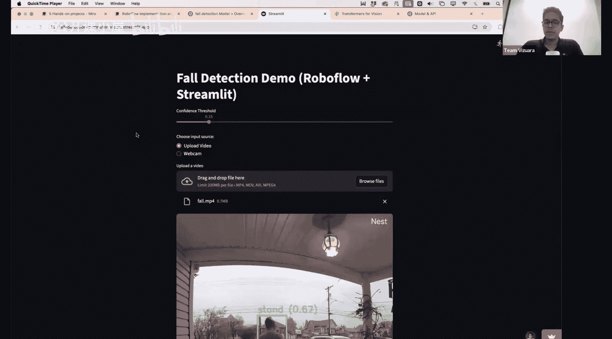
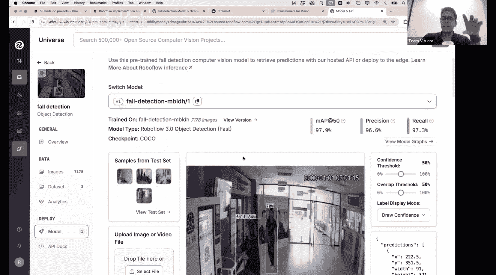

# Vizuara【中英⚡面向新手的计算机视觉｜Computer vision from scratch】 p29 P30 Build and deploy Computer Vision Model for fall detection ｜ Roboflow + Strea [BV1UMxxzPE5Y_p29]

Thank you。So welcome back to a new lecture today we'll be looking at how to build an application using the models available in RobboF and we will also see how to deploy it so in the last lecture we had discussed a brief introduction to Robboflow and its features what all can we do we also tried as a group trying to annotate images together for training it。

In this lecture， we will be using a free train model。

 but we will be deploying it so that anybody could use it。

So I also want to show you one thing which you might be interested to see from Robbo flow so the Robboflow has this thing called Robbo flow Uni so if you go to this website Uni。

roboflow。com。And if you scroll down a little bit， you should see a section called popular categories。

 so click see all and here you can see different domains in which you will find computer vision related data set and models from Robflow so this is spanning almost everything you can imagine。

The good thing is， for example， if you want to， let's say click aerial domain。

 it will open models and data set that are annotated。

 which are created by other people available public。So let's say I go to this energy aerial data set。

Here these are some data sets， some of them might be about oil fields。

 some of them might be about electrical substations， windmills， etc。

It shows how many images are originally present in the dataset which will be augmented by random rotation。

 random cropping， etc， so training data will be much bigger than these number of images。

And by reading this annotation so here you see an annotation called model is there。

 which means it is not just about the data set it also contains model so if you click this you should see the data set here if you click the data set you should see the annotation。

So see this。These are all annotated dataset sets so these bounding rectangles have been assigned already by the person so these are about insulator classification broken insulator versus normal insulator there are many different problems and then the model if you want to use you have a model here since this is an already train model you can directly use it so if you have a video of let's say electrical systems you can just upload the video here by clicking select file which I will show you today but here I'm just showing you the example and you can draw inference on that particular input which you gave these are test data sets on which input is being inferred so see this is getting the predictions and here is the predicted bounding box and here are the exact coordinates x Y width and height of the bounding box plus the class I class the confidence object confidence。

Today what we'll be doing is something very specific so in the second part of today's lecture I also want to discuss about the hands on projects which are part of the course for pro students but today we'll be building one such hands on project for detecting falling by elderly so when elderly people are walking falling is a very big hazard because if they break the hip or something there is a very high chance of them being better than musclec a trophy then it's very likely that they may not walk again so falling is something that you have to prevent or if it happens some help need to arrive immediately。

And if these elders or whoever is facing such incidents if they are in a space where some CCTV or some kind of footage is available。

 we can build good real time detection systems that can predict the falling event from happening real time so I first want to show you what we are going to build and then I'll show you how to build it so what we are going to build today is something like this so this is streamlit it's a publicly hosted link if you go to this link you can also open this。

And here this confidence threshold is a parameter that we can set for deciding。

Which bounding rectangles？We need to identify from the from the inferring video or inferring image。

 so here I'm going to select the option of uploading the video and then say I browse the file。

And I upload a video， maybe this。So here now I have given the input video a model is running behind this I will show you exactly how to build this but just see the final output that's what I want to show you and this is a video which is taking a bit of time to process you can see that it's being processed frame frame by frame not real time and I'll tell you why that is also happening because ideally we want real time processing but this is anyway not a model that we are hosting ourselves it's hosted on ro flow that's why it's a bit slow。

But now you will see a bounding rectangle coming as soon as the person is detected with a certain confidence score。

There are two classes for the objects that are there in the bounding box， one is stand。

 another is fall， so if the person has fallen down or is falling down it will show fall。

Sometimes it can cause mistakes， but you'll see in a moment that。

As soon as the person slips and falls around， it shows the fall has happened with a certain confidence score。

This video， the way this streamlit app is set up is in such a way that you can also download the annotated video at the end of processing so this video is only very short it's only7 seconds so only around 150 frames but see here once the video processing is finished you can see this annotated video and you click that the video will be downloaded and the downloaded video with the annotation you can open and just play it。

So this is the annotated video， all right。So what we are going to build is exactly this so that you can run this on pretty much any input and you can get the corresponding annotated output annotated output is anyway a fancy thing you necessarily don't want annotated output always in the in real time processing you just want to detect once the detection is there whether you annotate or not is secondary but for showing it to someone else annotation is very helpful。

So the software， which we are going to be using guess obviously first is Robboflow。

 so Robboflow is where we will find our data set。With annotation。

And model that is pre traineded on this data set， so pretrain model。

Then we have a few different options。We could host the model on Robboflow itself。

 which is definitely fine， but instead what we are going to do is we will use the model using its API。

And write a custom code in visual studio code such that we can initially draw inference on our local computer itself。

 So this will。😊，Help us have。Inference。Locally。And I will then also show you how to convert this thing into a screenreamlit application so that we can host it publicly。

嗯。And this is when things become actually useful。RightSo these are the three things that we are going to do and obviously hosting is done using Stamlit。

 so Stamlit is an application where it allows you to host Python based applications very fast。

So I'll go through this step by step。First thing， go to Robflow Uni， so Universe。roboflowaw。com。And。

In this section， so I'll just zoom in a little bit in this section type fall detection。

When you type this， it will open different set of projects so you can see that the number of images in different projects are different because it's done by varying set of people。

 but what I have found is this particular data has 7，8100 images。

 which after augmenting it can be much more because random cropping。

 random flipping all those operations can be done。Now。

 this is the data set We are not going to directly download the data set。

 but here's the pre trained model。 So this model is already trained on。This particular data set。

And you can see that some predictions are being made but there is a mistake this model what it is actually predicting is when a person is has fallen down it it's annotating that they are standing but when a person is actually standing like this it shows fallen down so the model accuracy is very good but I think what has happened is somehow the annotations they have flipped by mistake or something。

😊，So we'll see how to fix that issue but the model is good how do we know it's good because mean average precision precision and recall they are all good it's a reasonably big data set probably one of the biggest in Robflow and its it's working very nicely and these are the sample test data sets。

😊。

Now， how do we use this particular model for our use， we could use it directly from Robflow itself。

 so if we want to find whether a person has fallen down or not on an image let's open the。

The following video， so。历史。This or rather。