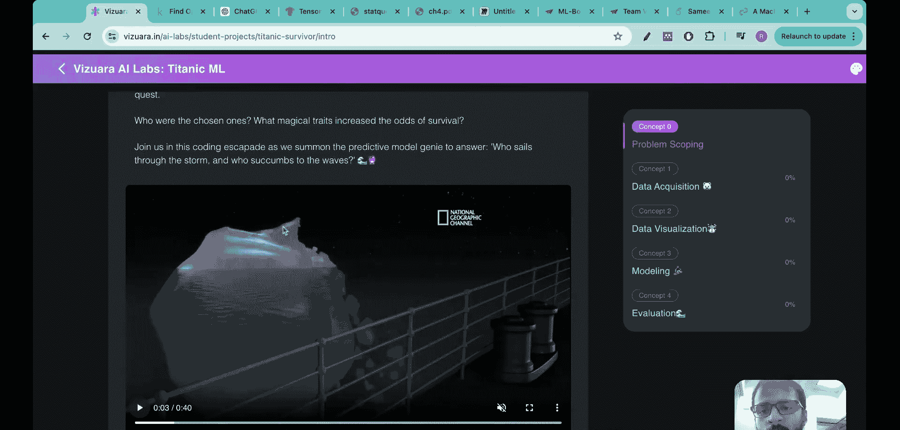
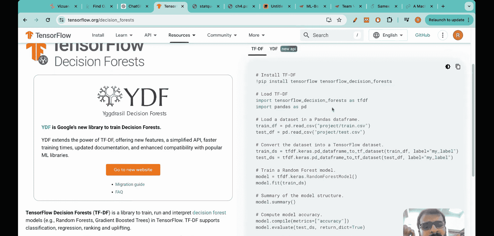
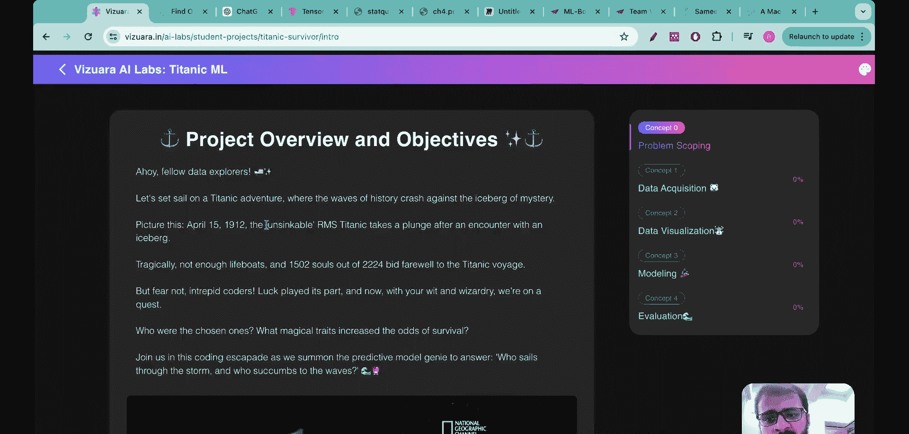
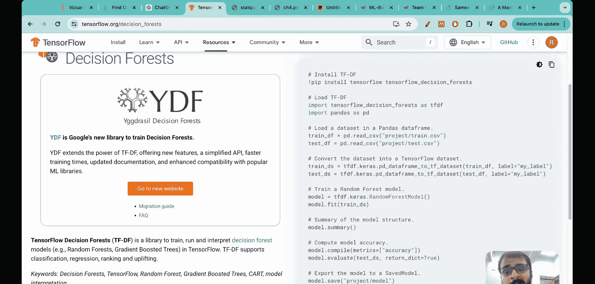
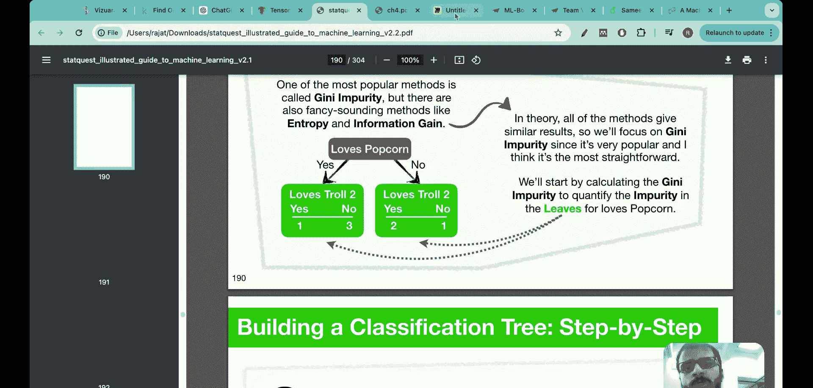
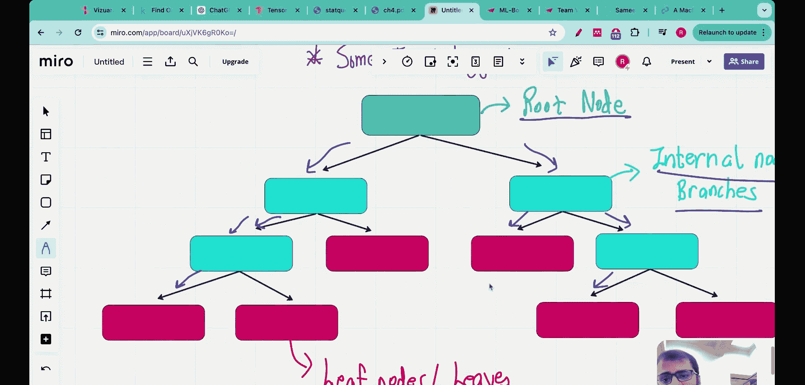

# Vizuara【中英⚡从零开始构建决策树｜Building Decision Trees from Scratch】 p01 P1 What are decision trees？ [BV1Zi4VzJEp9_p1]

🎼Yeah。Hello， everyone。Take a look at this video。It's about the Titanic ship disaster。

Where a number of people tragically lost their lives because the Titanic ship sank into the ocean。

It's also one of the most popular machine learning projects。

Which beginners typically do on websites like Kagle and add this project to their resume。

The technique which is used to solve this particular problem is decision trees。

The problem itself is pretty simple， there are a wide range of people on this ship who belong to different ages。

 there are males， there are females。

And not just that there are people also belonging to different。

Economic classes such as there are some people who who are rich and there are some people who are poor based on all these variables。

 the goal is to predict which people will survive the Titanic disaster and which people will not survive。

Decision trees is one of the most important techniques in machine learning。

And this playlist which I'm creating right now。It's titledBuilding Decion T from scratch will teach you all you need to know about decision trees。

So let's get started。My name is Dr。 Raj Daneer and I graduated from Massachusetts Institute of Technology。

In 2022 with a PhD in machine learning， since then we are on a mission to make AI accessible to all and this playlist is a part of that mission。

So this particular playlist is going to be all about decision trees but I am going to teach it to you the right way first let me motivate decision trees a bit if you go to this website called Kagle and search decision tree data sets you will see that using decision trees you can solve a wide range of problems such as machine failure prediction using sensor data bank marketing shortly predicting employee turnover。

Breast cancer。Bank marketing campaigns data set， drugs for decision trees。

 employee satisfaction survey data， Amazon business research， employee attrition。

 hotel booking cancellation。In fact， there are a huge number of other data sets also such as。

 as I mentioned， Titanic data used car price prediction。

 a wide range of machine learning problems can be solved using decisionries and not just for projects。

 even in industries I asked Cha GPT。In which industries are decision three algorithms commonly implemented。

 and you will see that they are used in finance。For credit scoring fraud detection。

 they are used in health care for diagnosis， treatment， prediction of patient outcomes。

 they are used in marketing and sales for customer segmentation。

 predicting whether a customer will buy our product or not。

 and they are used in a wide range of other industries。 In fact。

 I have few friends who are working in startups and they frequently tell me that irrespective of the generative AI hype。

The ML algorithms which bring revenues to their company are decision trees。

 random forest and gradient boost。So I believe this is enough motivation to get curious about this playlist and start with this first video where I will give you a brief outline of what we will learn in this playlist and we will also cover the first lecture which is devoted to what is decision trees。

So the next question after you are interested is that how do I start learning about decisionries？

What many students do is that they directly start from TensorFlow。

 they take the Tensorflowlow code which is available and it just 10 lines of code and you can even get great results on projects such as the Titanic project。

The problem is that through this approach you will not learn anything about the underlying building blocks of decision trees and there are many great building blocks such as gen impurity is one building block entropy misclassification error are other building blocks we will learn decision trees the right way well build decision trees step by step first we will build it from scratch and then I also show you the hands on Python demonstration。

So I'm following a channel called Stat Quest， which is a brilliant channel and it's one of the inspirations for making this lecture series。

So let's get started with today's lecture in today's lecture our agenda is to look at a simple concept which is what exactly are decision three。

And then towards the end of this lecture， Ill also tell you about what you can expect from this playlist and what is the agenda which we will follow。

So let's look at the simplest decision tree。The decision tree starts with a statement and then there are some decision points the statement is do you want to learn about decision trees if yes。

 then you can continue watching the video if no don't watch this video。

That is the simplest decision tree。😊，And from this decision tree you can look at the building blocks of decision tree。

 there is usually a statement such as do you want to learn about decision trees and then there is a decision so there is a branching into two segments if yes then do this action watch this video if no then don't watch this video。

ItIt's one of the most simplest and intuitive concepts in machine learning。So。

 that is a simple decision tree great， but decision trees themselves come in two types the first type of decision tree is classification tree。

And the second type of decision tree is regression tree another mistakes many students make is that they think that decision trees are only of one type。

 which is the classification tree， but actually regression problems can also be solved using decision three。

What is the difference between these two， the example which we saw before。

 do you want to learn about decision trees if yes， watch this video if no， don't watch this video？

That's regarding classification into categories。So。

 that is an example of a classification decision tree on the other hand in the regression decision tree。

 you are predicting numerical values。For example， this is just a sample which I have constructed the statement still remains the same Do you want to learn decision trees yes。

 then I am predicting that your age is between 15 to 40 if no then I am predicting your age is less than 15。

So you can see that here also there is a statement made and there is a branching off into two。

But here I am actually predicting numerical values rather than just a yes or a no classification right so that's why it is an example of regression problem in fact all these examples on the data sets which you saw they might be classification or regression and decision trees are powerful techniques to solve both types of machine learning problems so it is important for you to know this distinction between the two types of decision trees。

Then let me actually demonstrate a simple classification tree which Ive constructed to predict whether a patient will。

To predict the risk of diabetes for a particular patient so I start with a statement if age is less than or equal to 45 so you consider a person you look at their age if age is less than or equal to 45 so if you go in the yes then you check their weight so it is a young person you check their weight if the weight is less than 60 it is great there is a low risk。

But if it's a young person， but its weight is greater than 60。

Then the person is at a moderate risk of diabetes。On the other hand， let's look at the。

At side of this decision tree。If my answer is no to age is less than or equal to 45。

 which means the person is older。That is established now if the person is older。

 if their weight is less than or equal to 70， which means we are on this path。

 it means they are at a moderate risk。But if the person is older and if their weight is greater than or equal to 70。

 then that means the person is at a higher risk of diabetes。So。

 this is how classification decision trees are constructed and they can be as long as possible。

 so this is called as the depth of a decision tree， how deep I am going。

With the amount of segregations which I'm making。Before looking at a very nice practical example。

 there is some terminology which I will want to introduce so that this terminology stays with you。点咧。

Of this。Decision trees from scratch series its a pretty simple terminology。

 but it is important to get it right right now so that you don't make mistakes later。

The statement which is posed at the start， such as is ages less than or equal to 45 or in this case。

 do you want to learn decision trees， This is called as the root node。

 the statement which is posed at the start。Then all the blocks here which are showed in the blue color they are called as internal nodes why because internal nodes have an incoming arrow and an outgoing arrow if you look at all of these blue。

Blue boxes， all of them have with incoming arrow and an outgoing arrow look at this。

 it has an incoming arrow and it has an outgoing arrow look at this it has an incoming arrow and it has outgoing arrow。

So these ones which have some information incoming as well as outgoing are called as internal nodes。

Orルプランチェ。And then there is the third time look at the blocks which are in the red color。

 all of them only have incoming right they don't have anything out goinging look at this。

