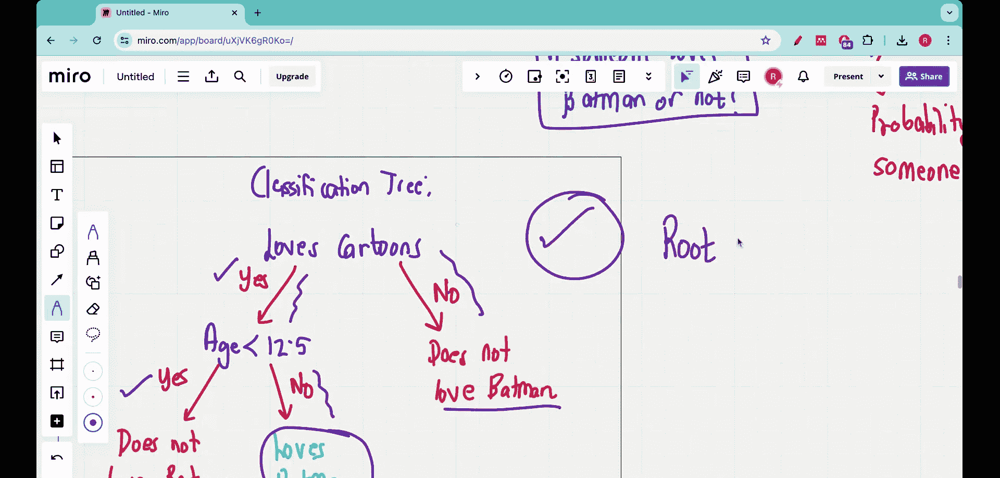

# Vizuara【中英⚡从零开始构建决策树｜Building Decision Trees from Scratch】 p02 P2 Let us start building a decision tree! [BV1Zi4VzJEp9_p2]

Hello everyone， welcome to the second lecture of the Decion Pri from Sctch series。In this lecture。

 we will start building a classification tree completely from scratch。

Just to recap in the previous lecture we looked at the definition of a decision tree and we saw that the simplest decision tree consists of a statement and then branches off into multiple decisions。

We also saw that there are two types of decision trees。

 classification trees on one hand and regulation trees on the other hand。

Although classification trees are a bit more popular。

 but decision trees have a huge amount of applications in regression as well。In classification trees。

 what we do is that our aim is to finally do a classification into categories。

And in the regression trees， the goal is to predict numerical values。

We also looked at some terminologies such as for example。

 we looked at root node which is the top level node in a decision three。

 then we looked at the terminology which is called as internal nodes or a branches so internal nodes or a branches are the nodes which have an input arrow and an output arrow and then the last terminology leaf nodes so leaf nodes only have an incoming arrow to them but they do not have an outgoing arrow。

🎼In the last lecture we also saw what we will cover in this playlist so we'll build a classification tree from scratch。

 we'll build a regression tree from scratch these will be no code approaches and finally we will have a hands on series of lectures on implementing decision increase in Python。

So as I mentioned， let's get started with today's lecture in which we will start building decision three from scratch。

The first thing which I want to show you is the data which you will be using and this data is also called as the training data。

So you can see that we have collected training data for1，2，3，4，5，6。

 seven different people and first we have asked them the question that do you love movies and they have answered yes or no。

 then we asked them the question do you love cartoons and they answered yes or no。

 then we have collected their age and the final goal is that we have collected the information about whether they love Baman or not。

So。It is divided to no NS， so this is a T example which Ive constructed and its very similar to the lectures by the Stat Que YouTube channel。

 which is one of my favorite YouTube channels。So this is also called as the training data。

 this is the data which we have and the problem which we are trying to solve is let' let's say you are given a new person let's say you meet a new person and you ask them do they love movies you ask them do they love cartoons and you ask them their age。

Can you predict whether they will love Baman or not。

This is the problem which we are trying to solve here。

So if you look at the dataset itself you will see that the dataset consists of a mixture of discrete as well as continuous data。

 so there is yes and no so loves movies loves cartoons comes in the yes and no category even will love Ba man。

 the final answer comes in yes and no whereas the age is a continuous value basically。

So we have to use this mixture of discrete and continuous data to predict if someone loves Batman or not。

 that is the problem which we are trying to solve。The first thing which I would like to emphasize is that you might think that why can't we use another regression approach for this and one common regression technique is called as logistic regression。

And that is also used for classification tasks， so you might be thinking this is a classification task right I want to predict between the S or no。

 why can't just I use a regression logistic regression。

Let me show you why you cannot use logistic regression with demonstration。

 So let's say we look at the training data and we look at the age metric and we can see that the age goes from。

The age goes from 7 to 83。So I'm plotting the age on the x axis and on the y axis I am plotting the probability So if on the y axis we are at0。

 it means that the probability that the person will like someone loves Bamin is0 and if you are on one which means that the probability that person likes batmin is equal to1。

So let me plot the age first as you can see there are people from lower ages as well as higher ages so I plot these values so 1。

2，345678 so there are 7 to eight values for the age which Ive plotted actually there is one more value which I should show you so there are three values here at the top。

Okay， so this is the age which I plotted and then you can see that for lower ages for age7 and 12 the answer to love Baman is no so for lower age for lower ages the answer is no so actually let me。

1，2，2，3，4， and。So there are seven total points right so here there should be two points。Okay。

 so these two points over here are H 7， H7 and H 2。 Actually， let me mild them。 Yeah， that's fine。

 So these two points are H 7 and H 12 and both of their answer is they don't love battman So that's why they are at the bottom of the y axis。

 Then let's look at these two points 50 and 83。 They also they say they don't love battman So they are shown over here age 50 and age 83。

 they don't love Batman So P is equal to0 for these four points。For now。

 let's look at these three points 1835 and 38。 so let me write them here 1835 and 38 all of the people of this age group said that they do love batman。

 so probability is equal to one， and I have shown these points over here。

So this is my training data now if you want to fit a logistic regression here。

 the logistic regression line will look something like this， right？

This is is how the logistic regression line would look like and you can see that the line basically has a great prediction for ages 7 until until it indeed predicts the probability0 and for ages 18。

 35 and 38 it indeed predicts that the probability is 1 but the problem is that now let's look at the predictions for ages 50 and 83。

My logistic regulation is predicting that even for these ages 50 and 83。

 the probability that they love movies is one， but that's completely false because these two data points don't like movies at all。

😊，So logistic regression is actually incorrectly classifying the older people。

And that's the big problem with logistic regression。

 the ideal curve which would pass through these data points might look something like this right。

 but in logistic regression we always get smodoidal looking curves like these so it cannot do a good job in classifying older people in this case。

 so logistic regression is not a good idea to classify this data which we are going to be looking at。

And that is where classification trees do a much better job。

Now Im going to show you a classification tree， which would classify these training data perfectly。

 so let's look at this classification tree。Right so let's say you meet a person and you ask them do they love cartoon if they say yes。

 you ask them their age， if their age is less than 12。

5 the answer is they don't love Baman if their age is greater than 25 the answer is they love Baman。

On the other hand， if you ask them， do they love cartoons and it's new。

 then the answer is they do not love Ba men。What I'm telling you now is that this decision three。

 which I shown right here， perfectly classifies for all of these data points。 Let's see。

 So let's look at the first data point the。😊，The answer to the question so the first question to be asking is loves cartoons so the first person they say yes to the love cartoon so we lie here then we look at their age the age is seven which means the age is less than 12。

5 so they do not love Baman and the answer is actually no they don't love Baman so that matches let me look at the third data point first let me ask do you love cartoon so they have said yes so great time again in this branch this branch。

Then I asked them what is the age so here the age is 18 so the age is greater than 12。

5 so I come here so then I will predict they do love Baman。

 so let's see and indeed the answer is yes， so it's correct。 Now let me take an example。

 which is here。So let's first ask this person that do you love cartoons so they have said no。

 so we are directly in this branch so without asking anything else I will predict that they don't love Batman。

And you can see that this indeed matches with the answer， which is they do not love Baman。

As an exercise， I will give you an assignment to look at this classification tree。

 which I've provided here and try to see if it's correct for all the training data points over here。

In fact， this is the most optimal and the shortest tree， which gives the best classification。

So this works and this works perfectly well now the question which we are going to ask is how do you go about constructing this classification tree from scratch there are a number of things to think about right like the first question is that what is the root node what is the question which needs to be asked at the root node here Im saying loves cartoons but。

