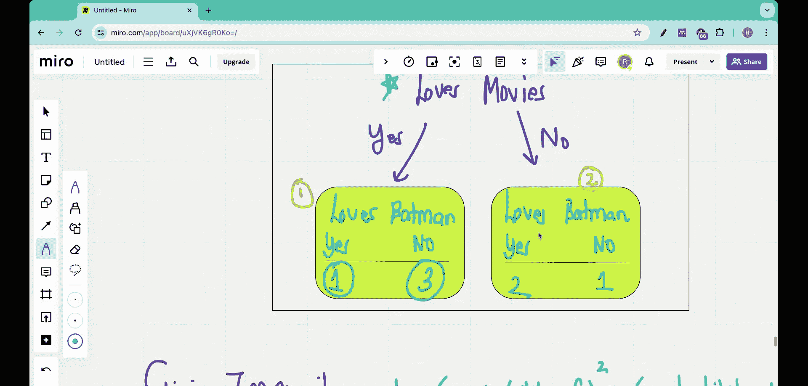

# Vizuara【中英⚡从零开始构建决策树｜Building Decision Trees from Scratch】 p03 P3 What is Gini Impurity？ [BV1Zi4VzJEp9_p3]

Hello， everyone。Welcome to this lecture in the Dec trees from Sctch series。

Today we are going to learn everything about genie impurity。We'll also be looking at entropy。

 but most of the lecture will be focused on gene impurity。

If you are coming into this series for the first time。

 no problem I have designed this lecture such that you can understand it。

But I still recommend you to go through the previous two lectures in which we looked at。

How to or the steps to build a classification tree。

 then we looked at some terminologies in the first lecture such as root node， internal nodes。

 leaf nodes， etc， and we looked at the two types of decision trees。

 classification and the regression trees。In the previous lecture。

 we also started building a classification tree and we started looking at questions such as how do we decide which question to be asked at the root node？

So let me take you through what all we have covered so far so that everyone who has dialed in for the first time。

We'll also understand this lecture。So we are going to build a classification tree completely from scratch and here is the training data which we are looking at in this particular。

Endeavour of ours。So the training data consists of four categories， loves movies， loves cartoons。

 age， and then the final goal is to predict whether the person loves battman or not。

We have the training data of seven people and we have collected their answers。

 so for Loves movies and loves cartoons they130 years or no。

 and then we have recorded their age and then we have recorded their responses to whether they love Baman or not。

The goal is that let's say whenever any new person comes and you collect their answers to the first three questions。

 do they love movies， do they love cartoons and what their age。

 the goal is for you to predict accurately whether they will love Baman or not。As you can see。

 this is a mixture of discrete data as well as continuous data。

And we will use this to predict if someone loves Baman or not。

So the best classification tree or rather the most optimal classification tree which is the answer to this data set actually looks something like this。

 the first question to be asked is does the person love cartoons if it's yes we ask them what's your age if its less than 12。

5 then we can confidently say you do not love Baman。If they love Kaul and if their age is great。

 greater than 12。5， then we can confidently say that they do love better men。On the other hand。

 if the answer to Love's cartoon question is no in the first place。

 then we can confidently say they do not love better men。

And you can test all of this from this training data set。

 all the training data points will satisfy this classification tree。

So this is the optimal classification tree。But the main question is how do we reach this point there are so many trees right。

 there are so many options at every possible stage。

 how do we conclude that this is the best possible classification tree？And for that purpose。

 we have started building the classification tree ourselves。

And the first question which we asked in the last lecture also is that what should be the question which comes at the root node。

 so this is the root node。What should be the question which comes here how do we decide that we have to get started with this question in the first place there are three options right we can either ask whether they love movies or not。

We can either ask whether they love carcos。Or we can also ask for an age。

So there are three options about how to get started at the root no。

And today we will understand quantitatively how we choose the question to be asked at the root group。

So let's get started。So first I want to compare between loves movies this is the first question which can be asked or loves cartoons in the next lecture I'm going to look at the age because the ages are different it's a numerical feature so today we are going to answer the question that among love movies and among loves cartoons which question should we asked at the root node which question is the most optimal for classifying correctly whether the person loves Baman or does not love Baman。

First let's look at this flow chart first let's look at love's movies and initially let's look at all the people who have answered yes to this question so those would be all the people who have answered yes there are four people and then let's see how many of them love Batman or no so we can see out of those out of these three people said no and one person has said yes so in this category over here loves movies yes we have one person who has said yes that they love Batman and three people have said no they do not love Batman。

So Ive written one and three here if the answer to Love's movies is no which means I have this person。

 this person and this person then let's look at the answer then we can see that two people have said that they love Batman and one person has said that they do not love Batman so we have two yes and one no。

Now let us look at the same thing for Love cartoons。

So if you look at loves cartoons and market with a different color， if you look at love cartoons。

 we can say that one， two， three and four people have said yes and let's look at the answer out of these。

1 has said no。They don't love Baman and out of them three have said yes， so three yes and no one no。

That's what I've written here 3 years and when no。And let's look at people who have said no who love cartoons so if people who have said no there is the first person here the second and the third interesting thing to notice that all the people who have said no to love cartoons all of them dont love watching Batamen so there are three nos here and0 Ss so there is zeros and there is three no。

Okay， so in the loves movies question we have two leaves。

 we have leaf one and we have leaf two in the loves cartoon question we have two leaves we have leaf number three and we have leaf number four。

This gives us more information to decide which question do we ask at the start？

So if you look at leaves number12 and three， they consists of mixtures of people who love and don't love Baman right because if you look at leaf1。

 we have people who have said yes as well as no leave two。

 we have people who have said yes as well as no leave three。

 we have said people we have people who have said yes as well as no。

 so all these three leaves consists of mixtures of people who love and don't love Baman。

Whereas if you look at leaf number four， leaf number four does not contain a mixture because all of them don't love Baman。

So there is a terminology here， leaves which consists of mixtures of classification are called as impure leaves。

So leaves one， two， and three consists of mixtures they are impure leaf number four is pure。

So in the loves movies question there are actually leaves one and two and both of these leaves are impure so in the loves movies question there are two leaves which are impure in the Loves cartoons question there is only one leaf which is impure。

Now the more impure the leaves are it is difficult to classify right whether they love Baman or not so we should not ask that question so we should look at questions which lead to pure relief for example love cartoon has a pure leaf this leaf has so okay one leaf is impure leaf number three but leaf number four is pure all of them don't love batman this is great for our classification。

So intuitively， we can see that love's movies as two imp pure leaves。

 whereas love cartoons has only one imp pure leaf。This means that the loves cartoonhos question is more pure。

 so if we ask this question， we can very easily arrive to the final answer as who loves batman and who does not so intuitively we know that we should probably choose loves movies as the root。

呃。Sorry we should probably choose love cartoons as the root node。Not loves movies。

 we should probably choose loves cartoons as the root note intuitively because asking this question leads to more pureer relief right but this is just our intuition the main question which we are going to ask in today's lecture is how do we quantify this。

How do we quantify the impurity in these two questions so if we can assign a mathematical number to the impurity for the love's movies questions and we can assign a mathematical number to the impurity for the love's cartoons questions。

 then we can easily look at two numbers look at the question which is lower impurity and choose that as the root node。

So today we are going to look at two measures to quantify this impurity。

 the first is gen impurity and the second is entropy。

So let us get started with understanding all about the gen impurity。First。

 let's look at the first question which is Love's movies。

 well calculate the genie impurity for this question and then we will calculate it for the loves carpos。

So loves no is yes and no it splits into two leaves as we have seen。

 so loves Baman in the first leaves， yes is one， no is three and loves Baman in the second leaf。

 yes is two and no is one。

