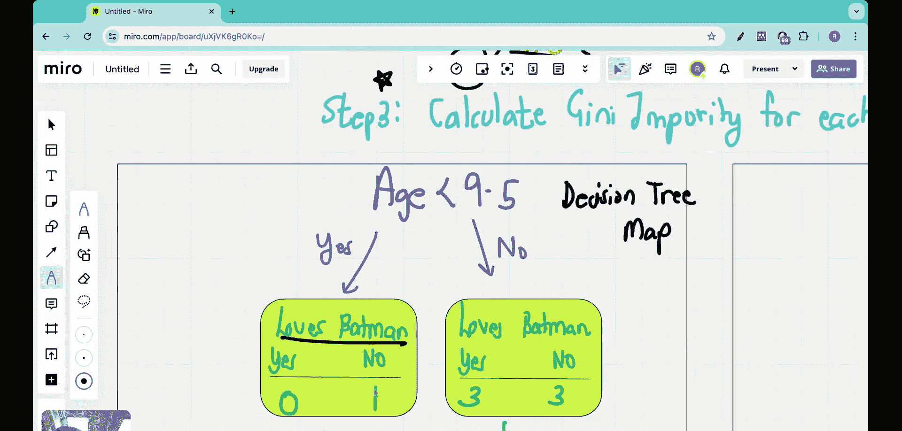

# Vizuara【中英⚡从零开始构建决策树｜Building Decision Trees from Scratch】 p04 P4 Gini Impurity for numerical data [BV1Zi4VzJEp9_p4]

Hello， everyone。Welcome to this video in the Dec tree from Sctch series。In the previous video。

 we looked at genie impurity。We looked at the mathematical definition of the gen impurity。

 and then we also looked at the graphical visualization of it。

We comparedd it with another metric which classifies the leaf impurity and that is called as the entropy。

So we ended the last lecture at this point where we calculated the gen impurity for two questions。

 loves movies and loves cartoons， and in this lecture we will calculate gen impurity for numeric data。

If you are tuning into this lecture for the first time。

 I will give a brief walk through through the problem which we are trying to solve。

 but I will still highly recommend to watch the initial lectures in this decision tree from scratchtch series。

So let's get started with today's lecture in which our main goal would be to calculate the gen impurity for numeric data。

So let me recap the problem which we are trying to solve this is the training data which we have we have interviewed seven different people and we have collected the responses which they give for three questions。

 loves movies， loves cartoons and their age。And then we have also collected the responses for whether they love Batamen。

So in the Loves movies， the responses of the people are either yes or no， in the love's cartoons。

 it's either they love cartoons or they do not love cartoons， and then we have noted down their age。

And then we have also asked these people that do you love Batman or not。

 and then we have noted down whether their answer is no or whether the answer is yes。

This is the training data which is available to us。

The goal or the problem which we are trying to solve is that based on this training data。

 we want to use it to predict if an entirely new person loves Baman or not。

 so for example if you meet a new person let's say based on this training data and ask them that do you love movies do you love watching cartoons and what is your age。

Just based on these three pieces of information about the new person。

 can you predict to the best of your abilities that whether that person is going to love Baman or not？

This is the main problem which we are trying to solve。

And in the earlier lectures we have looked at although this looks like a classification problem yes or no logistic regression is not the right approach for it。

 so we are going to look at a decision three approach。In fact。

 we are going to build an entire classification decision tree from scratch。

So we know the end goal which we want to reach the end goal is a classification tree which looks something like this you can call it the true answer or the true classification tree which we want to construct from scratch so let's look at this tree first you ask whether the person loves cartoons or not if they say yes you ask their age if it's less than 12。

5 you can confidently say they do not love Baman if the age is greater than 12。

5 you can confidently say that they do love Baman。On the other hand。

 if the answer to the first question， whether they love is cartoons or not that itself is no。

 you can immediately say that that person does not love Batman。

You can check these for all the training data which we have let's say we look at the first person let's say we asked them does the person love cartoon yes so it goes into this category is there age greater than 12。

5 is there age less than 12。5 yes indeed so then it goes into this category so we will predict they do not love Baman。

And indeed， we can see that this person does not love Batman。

So you can test this classification tree on all the seven training data which I have and you will see that it is correct。

The goal for us is to build a classification trail tree like this from scratch so for example there are a number of questions right the first question is what should really be in this root node。

Why did we choose this question of loves cartoons in the root node。

 why not choosing the question of whether they loves movies or what is their age those also could be in the root note。

 right？So in the previous lectures， our main goal is to try to find out what should be at the root node。

So the main goal which we have been at in the previous lecture and the lecture before that is how can we decide the root node and we have made significant progress in fact。

 when we concluded last lecture we have reached this stage where we constructed a decision3 map so this is what is called as a decision3 mapap。

We constructed this map for two questions， loves movies， and loves cartoons。

And then based on the decision3 map， we calculated something which is called as genie impurity for these two questions。

So the gen impurity is defined by a mathematical formula。

 gen impurity for a leaf is1 minus the probability of yes whole square minus the probability of no whole square。

So if you do not know what this means， kindly look at the previous lecture in this series。

So we computed this genie impurity for the Love's movies question and it turned out to be 0。

405 and we calculated the genie impurity for the Love's cartoons question and it turns out to be 0。

214。So mathematically the genie impurity for the Love's cartoons question is lesser than the Love's movies question and thats why when we decide the root note the love's cartoons should definitely be given more priority over the loves movies question。

Why， because if we have more impurity， which means that we are not doing a good job of classifying。

Whether the person loves Bataman or no， and in loves movies， the impurities 0。405。

 which is almost two times that of the loves cartoontos question。So in the last class。

 we reached the conclusion that great， so we should definitely prioritize Love's cartoons as the root node more than the love's movies。

But that still does not answer the question what about age right so now you have decided that at the root node loves cartoons should come over loves movies but what about if I ask the age of the person first and then I do the branchching from that。

So why cannot we use age as the root node？And today is all about that today we will compute the gen impurity for age。

In fact， if you see age is a bit different than the other questions right because loves movies and loves cartoons。

 the answer is either yes or no， but age is a numerical feature， it takes numerical values 7， 12， 18。

 35， 38， 50， 83 etc。So the procedure for finding the gen impurity for numerical features like this is a bit different。

 so let me walk you through the procedure right now。So let us just focus at the age right now。

 so if you look at the age column its 7， 12， 18 35， 38。

 50 and 83 and we have also documented whether the person loves Batman or no so it's two nos。

3 SS and two noses。佢啲。So the first task which you have to do when you are given a numerical features like these is that you have to sort that numerical feature from the lowest to the highest。

So lets see if that is done for the age， we have to sort this from the lowest to the highest and we can see that it is already sorted from low to high if you are working with a new classification tree and if you have a numerical feature which is not sorted the first step is to always sort that feature from the lowest value to the highest value。

Great so this step is done right now now we move to the next step。

 the next step is to calculate the average age of for adjacent rows。

Which means that here I have six rows right actually7 rows 7， 12，18， 35。

385 83 so I will look at adjacent rows so first I will look at 7 and 12 then I will look at 18 and then I will look at 12 and 18。

Then I will look at 18 and 35， which are these two， then I will look at 35 and 38。

 which are these two， then 38 and 50 these two and then 44 and then 50 and 83， which is these two。

So I'll find the average of each of these pairs， so first I look at 7 and 12 whose average is 9。5。

 then I look at 12 and 18， whose average is 15， then I look at 18 and 35 whose average is 26。5。

Then I look at 35 and 38 whose average is 36。5， then I look at 38 and 50 whose average is 44 and then I look at 50 and 83 whose average is 66。

5。So here I've written the average age for the adjacent rows right here。That is the second step。

And so the second step is calicculating average age for adjacent row and we have completed this step right now so I have marked it with a thick symbol。

 The third step is to calculate the gen impurity for each age。

 So now if you look at the average ages there is one。There is2， there is  three， there is4。

 there is5 and there is 6， there are six different ages which I have right。

 so I will find the gen impurity for every age。So let's see how that is done first， let's look at 9。

5。So I will ask the question age is less than 9。5 and then I will construct a decision tree map for this。

Decision pre mapap。So if age is less than 9。5 it splits into two categories yes and no and I want to compute gen impurity。

 so first I will look at the final goal loves Baman and then I will look at how many ss and how many nos are there so first let me look at the yes category。

