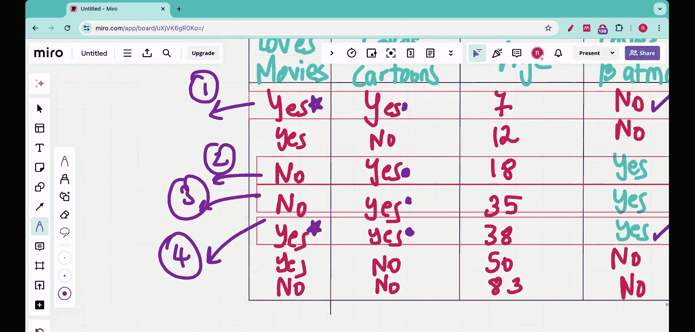

# Vizuara【中英⚡从零开始构建决策树｜Building Decision Trees from Scratch】 p05 P5 Finish building the decision tree [BV1Zi4VzJEp9_p5]

Hello everyone， welcome to this lecture in their Dec Pri from Sctch series。Today。

 we will finish building the classification decision tree。

 an endeavor or a process which we started two to three lectures back。

If you are watching this as the first lecture of this series， no problem。

 I have designed the lecture so that it's self content。

 but I highly encourage you to watch the previous lectures if you are not familiar with concepts such as genie impurity。

 etc， because that's the concept which I'm assuming you know in this lecture。

So let's get started first let me introduce the problem to you to all those who are tuning in for the first time and just as a recap for everyone who is following。

This is the training data which we have we have essentially collected data for seven people。

And we have asked them questions such as do you love movies， that's the first question we asked them。

 then do you love cartoons， the third question is what's your age？And essentially。

 the fourth question is， do you love Baman or not？So we have collected all these data from these people。

 you will see that the loves movies loves cartoons and loves Bamen。

 these answers are either yes or no， but the age if you see is an imp numerical value。

The goal is that we have to use this training data to predict if any new person loves Batman or not。

So let's say you have this training data and if you meet a new person， you ask them， hey。

 do you like watching movies， do you like watching cartoons， and what's your age？

Based on these three answers， you should be able to predict whether the person likes Batman or whether they do not like Batman。

That is the main problem which we are trying to solve and the way we are solving this problem is by building a classification tree completely from scratch so we started these two lectures back where first we spent a lot of time understanding terminology then we understood a concept called as genie impurity which essentially quantifies the。

Imurity score for a leaf， the lower the gen impurity。

 the better it is and using this quantitative metric we can determine which questions should come first in the decision tree。

So at the end of the previous lecture we have already decided what should commit the root node。

 the root node is essentially the first statement or the first question which needs to be asked in the decision tree and there were three options for us the first option was loves movies。

嗯。The first option was loves movies， the second option was loves cartoons。

And the third option was age， because if you see all of these are other three questions which haveve been asked。

 now we designed a mathematical procedure to help us understand which of these questions should be asked at the top of the decision tree。

And for that， we calculated the genie impurity for all these three and for the loves cartoons。

 the gen impurity turned out to be the lowest and its value was 0。214。

I've demonstrated it over here so for all of these what we did is we designed a Dec three map like this so if the question is loves cartoons we can go in yes and no if you go in the yes compartment you will see that so let's say loves cartoons and yes so there are one to three and four people and if you see their responses you will see that one person says no and three people say yes so it's been written as one no and three yes similarly if you go in the no compartment here you will see that three people do not love Batman and zero people love Batman essentially all people who don't love cartoons are not loving Baman。

So this is a decision tree map and based on these values， we compute a score called as gen impurity。

So if there are mixed classes， so for example， in this leaf here， there is answer yes as well as no。

 which means it is imp pureure leaf。Here， if you look at this leaf， the answer is only no。

 there is no yes， so it's not a mixture of classes， which means it's a pure leaf。

Having a pure life is good and it really reduces genuineurity。So I think for love's movies。

 the gen impurity was somewhere around 0。4 and for the age。

 so let's see actually these values yeah for love's movies the gen impurity was 0。

405 and for age the gen impurity was 0。343。So it was really the lowest for the Loves cartoons question and that's why we use it as the root node。

 great。In today's lecture what we are going to look at is that after deciding the root node how do you finalize the nodes after that which are also called as the internal nodes or branches and then finally how do you finalize the leaf node in short we will complete building the decision three process in today's lecture so it's a very exciting lecture let's get started。

First let's recap where we are， we have decided the first question which we are going to ask that sls cartoons and that segregates people into two types。

 four people go in the S compartment over here and three people go in the no compartment。

Wwhich can be seen from this diagram there are in the yes compartment there are3 plus one equal to four people and in the no compartment there is0 plus 3 equal to three people。

right and in the decision tree map as I showed you before it looks like this now if you look at the left leaf over here so I am calling this as a left leaf this is an impure leaf right so some further analysis needs to be done on that because it still has a mixture of classes。

But if you look on the right cliff。If the person says they don't love cartoons， we can。

 for all the people， we can say that they don't love Batamen。And there are three people here。

So this leaf is actually fully pure。Which means that it does not have a mixture of classes and so we don't need to split the decision tree any further on this branch。

Because it's already pure， we already know that all the people are coming in the no。

They don't love cartoons， they would not like Batman since they are in the no category here。

 so we don't need to split the decision tree further after this point。

But if you look at the left cliff。In the left leaf， if you see。

 three people say yes that they do love Batman and one person says no。

 so it's a mixture of classes and it's an impure leaf。

So that's why we need to split thisly further and we need to decide what question to ask。

Now the next question to ask comes from what what we have in the training data。

 so loves cartoons is actually fixed so that question has already been asked so I cannot ask this up first let me actually erase some things here。

Yeah， okay， so Love's cartoon's question has been already asked so I can either ask the Loves movies question or the age。

So when I look at this left cliff category here， there are four people here in this category we can ask these four people or we can split these four people based on either the loves movie question or the age question。

So the first question which I asked is loves cartoons。Loves cartoons， and that gave me yes。No？

In the no category we have already stopped splitting the decision tree because that leaf is pure in the yes category we can either ask the whether they love movies。

Or we can look at the age。So we have to decide what should come at this particular node over here。

 So this is an internal it's also called。It is also called as an internal node or a branch。

 we need to decide what question to be asked here。And like always how to decide this we will use the mathematical major which is called as gen impurity as I told at the start of this lecture if you are not aware of this terminology there is a separate lecture in this series which is entirely devoted to understanding gen impurity so I will highly encourage you all to go through that。

So what we will be doing is that we will be looking at these four people and well be computing the genie impurity for the Love's movies question and for the age。

So， lets see how to do that first let us look at the training data again and let us look at the four people who answer yes to the question of love cartoons。

So let's look at these people。 This is the first person over here。

 I'm marking as one because they have answered yes， then this person has answered yes， this and this。

 So these are the four people。 So I'm marking them as2。3 and 4。

So these are the four people which we are going to be looking at so we will construct decision three maps for both loves movies as well as age and based on the decision three maps for these four people well be computing the genie impurity so let's start with the decision three map for the loves movie question so it will be yes and no first let's go to the yes category so let's look at these four people and let's see out of these four how many have answered yes to loves movies so it seems there is one and one so there are two people who have answered yes so let's look at whether they love Baman the first person does not love and the second person loves Baman so it is one yes and one no So in the yes loves movies category we have one person who loves Batman and one person who does not love Batman great。

Now let me go to the Loves Mo no category。