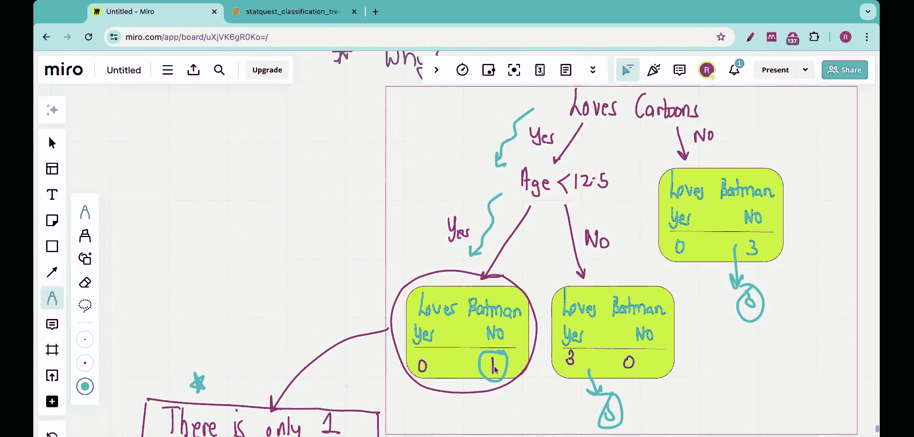

# Vizuara【中英⚡从零开始构建决策树｜Building Decision Trees from Scratch】 p06 P6 Pruning classification trees： An overview [BV1Zi4VzJEp9_p6]

Hello everyone， welcome to this lecture in the Decion trees from Sctch series。

Today we have a very important topic to cover， which is usually not covered in too many decision three lectures。

Today we are going to talk about preing。And we are going to talk about preventing indecision trees。

Especially we are going to look at classification trees。And understanding。

 understand pruning from scratch。If you have been following this series in the previous lectures。

 we have built an entire classification tree from scratch。However。

 if you have not seen the previous lecture， it's totally fine。

 I've designed this lecture in such a way that even people who are coming you will completely understand this lecture and get a flavor of how we usually do things in this series。

 which is completely in a handson manner and I write and show everything to you on this whiteboard。

So let's get started the problem which we have which we have been considering for the past many lectures now is that this is the training data set which we have so I'm going to call it。

Training。This is the training data set which we have we have essentially collected information from seven different people。

And we have first asked them do they love movies or not， that is the first question。

 then we have asked them do they love cartoons or not。Then we have also collected their age。

 and then finally we have asked them do they love Ba manner。

So the goal is that based on this training data， when any new person comes and well let's say whenever any new person gives us information about whether they love his movies。

 whether they love cartoons and what's their age， can we predict whether that person will love Baman or not this is the problem which we are trying to solve based on these three answers。

 whether they love movies， whether they love cartoons and what's their age。

 can we accurately predict whether that new person will love Baman or they won't love Baman。

In the previous lectures， we built this classification tree from scratch。

 so this turns out to be the optimal classification tree for training。

Where the first question we ask is。To any person is， hey， do you love watching cartoons？If no。

 then we can confidently say that they don't love Bamen。So that's the no side。If they say yes。

 they do love watching cartoons， then we ask their age if the age is less than 12。

5 we can confidently say that they do not love Baman， if their age is greater than 12。

5 which means if they are in this branch， we can confidently say that they do love Baman。

You can check this decision tree and whether it makes sense for the training data。

 let me take the first data set。So first we ask whether they love cartoons so this person says yes。

 great， so we go into this branch， then we look at their age age is 70 which is greater than 12。

5 so we look at this branch so we will predict that the person loves Baman。And， indeed。Oh， sorry。

 the age of seven over years， so let me。Easese this so the age of7 over here not 70 so let's see again so this first person they loves cartoons yes so we are in this branch then their age is  seven which is less than 12。

5 and then we can say that they don't love Batman that's our decisionary prediction and if you look at the true data we will see that indeed this person does not love Baman。

And if you validate this pre， you will see that for all the seven people in the training data。

 it actually gives 100% accuracy。So if you take this decision three。

And if you actually look at the training accuracy of these three。

You'll see that the training accuracy of this decision tree is 100%。

But today's lecture is not about training accuracy， it's more about testing and generalization。

Let me explain that further so this decision tree as I mentioned has 100% accuracy on the training data。

 but now let's look at some testing data examples so let's say we have three people in the testing data and let me mark them with a rectangle this is my testing data over here。

I have person one， I have person two and I have person three so let's say you have built this decision three right so someone comes over to you and says that hey can I test your decision three on three new people then you say that yeah I have built this decision tree and I think it will work so let's see。

So let's see for person one。They do love movies， they do love cartoons and their age is6。

 so let's see what our tree will predict。So first we check whether they love cartoons so that's yes。

 so we go in this branch over here。Then we see their age and their age is 12。 less than 12。5。

So we go in this branch， so well predict that the person actually does not love watching Baman。

So our prediction。Is that no， they do not love watching Batman for the first person。

Let's look at it for the second person。 Let's look at the loves cartoons。 The answer is yes。

 so we again move in。This branch。Let's look at the age， the age is again seven。

 so we again move in this branch。And so our prediction of the decision tree will be that no。

 they will not love Baman。So even for the second person the prediction is no they will not love Batman Now let's look at the third person the third person does not love cartoons so we are directly in this branch so our prediction will be that no they don't love Baman。

So for all of these three people， what our decision three will do is that the decision three will predict that neither of these three people actually loves Ramen。

And we gave our answers to the person who asked us to test the DL tree。

And now let us check our decisionary predictions。So for the first person。

 they actually did love Batman and our person and our prediction is no， so it was wrong。

It's the wrong prediction。For the second person， they also loved Batman， but her prediction was no。

Another wrong prediction。And if you look at it for the third person。

 the person did not love Batman and our prediction was no， so this was a correct prediction。

So if you see out of the three predictions which we made。

We got two predictions wrong and we got only one prediction correct。So2 third of our predictions。

 which means that 66% of our predictions were actually completely wrong。So why is this the case。

 in fact our training accuracy as we saw over year was 100%？So why is our testing accuracy， only 33%。

 66% of our predictions are wrong， which means only 33% of the predictions are correct。

What causes this much decrease in the testing accuracy？So let us try to think about this。

If you analyze our optimized decision tree， you will see that if the most of the errors lie in this branch right so for the first two people these two people person one and person2。

 they loved cartoons and their age was less than 12。5。So we were in this branch。They loved cartoons。

But the age age is less than 12。5 we are in this branch， so something is not right in this branch。

And let's try to figure out what that is。Okay， so if you go to this branch again in this decision tree。

 you will see that。We can say that the if you are in this branch， the person does not love Batman。

 but we have only one of the training data here， there is only one person here。

So based on only one person in our training data， we have made this entire branch。

There are three people here。And there are three people here。

 so at least we have more number of people in these school leaves to make the prediction right。

 but in this leaf in this leaf right over here which is lowest cartoons yes and age less than 12。

5 years， there is only one person over here。This is a big problem because based on just one person in the training data。

 we cannot make a decision tree。And in fact， we have seen that it's that place where we get most of the errors these two people。

 person one and person two belong to this this branch area and they came to this leaf。

 but the answer was wrong for those people because we have designedsigned this leaf and the answer of this leaf。

Based on just one person's data。And this is the problem of overfitting。

So basically that person's data just might be noise right。

 just based on one data we cannot construct a whole new branch here。

We might be doing well on the training data， but due to overfitting。

 we are not doing very well on the testing data at all。

And the main purpose of any machine learning model， as we have seen before multiple times。

 is not just to do well on the training data， but also to generalize well and those do well on the testing data as well。

So the problem is that we need to avoid this overfitting right just because one person says that they love cartoon and their age is less than 12。

5 and they don't love Baman， we cannot say that for all people who love cartoon and whose age is less than 2。

