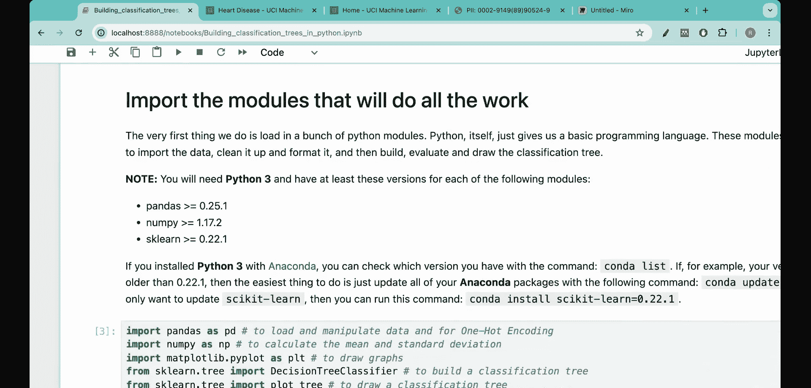

# Vizuara【中英⚡从零开始构建决策树｜Building Decision Trees from Scratch】 p07 P7 Code entire classification tree in Python [BV1Zi4VzJEp9_p7]

Hello， everyone。Welcome to this video in the Dec trees from Sctch series。

Today I am very excited to make this video because this will be a hands on tutorial on building an entire classification tree in Python from start right till the end。

We will learn everything along the way and Ill also write down many things on the whiteboard。

Towards then end， we will be building the classification tree for a real world and highly impactful problem。

Before we start， I just want to give the credits to this notebook which you are seeing right now and this video to Joshua Stmer from the Stats Quet channel。

If you have not been to that channel it's one of the best channels for many things related to decision trees。

 etc ceter， and I have borrowed this notebook from there so just giving credits at the start let's get started now。

Essentially our main aim in this lecture is to。Use decision trees。

To predict whether a patient will have heart disease or not。Previously。

 if youre following this series， we have conducted five to six lectures on understanding basics of classification trees and regression trees such as gene and purity。

 entropy， pruning。Et cetera。 Now， all of these things will come together， and I will show you how。

A machine learning engineer thinks about solving a real life problem using decision trees。

So first it is very important for us to understand the problem itself before even coming to solving it。

 so let me tell you where the data is collected from so it's a heart disease data and it is collected from this UC Irvine machine learning repository。

They have a huge number of popular data sets。So the hard disease data set。

 the way the data set is structured is there。The data was collected from Cleveland and I think。

 in the USA。And there were a number of patients who came in for diagnosis and for understanding whether they do have this disease or not。

And while the course of this research proceeded。A large data set was created for all of these patients。

This data set is actually documented in a 1989 paper。

which is titledIn Ap of a new Pro algorithm for the diagnosis of coronary artery Vs for the publication of this paper。

 this data was collected and now we are using this data for machine learning tasks。

So let's understand the data set itself。🎼But before that I just want to explain you the visual representation of the problem which we are trying to solve imagine a person that person has many attributes such as age。

 what's their age， what's their sex are they male are they female then a number of other attributes which will be coming to in a moment。

 but overall if you count these number of attributes there are 13。So let me count it 1，2，3，4，56，7。

8910111213 there are 13 different attributes for every single patient which we are going to be looking at。

Based on these attributes。We have to feed these attributes and the data associated with these attributes to the decision three model。

And then the final goal which we have is to predict whether any new patient。

 not just the people who have whom we have used for training。

 but lets say if any new person comes and we collect these attributes for the new person。

Can we predict whether that new patient has a heart disease or they do not have a heart disease？

That is the main problem which we are trying to solve so even before moving further with any machine learning project。

 it's actually very important for everyone to know the problem itself and the objective which we are trying to achieve。

I hope everyone is on the same page with me until this point now let's move to the next step。

The step number one of this project is going to be understanding the data set itself。

So let's look at the data set again in more detail and I have。Actually， ask Cha G to。

Give me descriptions of each of these different variables。

So here is what chat GPT answers I think it is very important to understand the variable meaning many people just proceed with an ML problem without knowing what these variables represent。

 but I think it really helps to debug issues such as categorical variables noncateical variables it makes it much easier。

And it's always good if you have the intuition， it makes you interested more in the problem。

The first variable is the age of the patient in years。

 it is very simple to understand the second variable is the sex which is the gender of the patient。

 so we have one for male and we have zero for female。

The third variable is called CP this is for quantifying the type of chest pain the patient experiences so this is actually on a scale of one to4 in the data which we have higher indicates more typical angina so you don't need to know what angina means but just know that CP is a type of chest pain which the patient experiences and it's on a scale of one to44 means that the chest pain is the highest one means that the chest pain is the lowest。

Rest BPp is the patient's resting blood pressure。Which is measureded in millimeters of mercury。

The variable CHOL， which is called is the patient's serum cholesterol level。

 which is also majored in milligrams per decciiliter。

Then FBS is the patient's fl fasting blood sugar level。But it is not just that level。

 the FBS is actually a categorical variable which indicates if the patient's fasting blood sugar is above 120 mg per deal。

If its above it is not very good as we know it can lead to more symptoms of diseases so this variable takes values of either1 or0 if it's one it means the patient's fasting blood sugar is more than 120 if its 0 is less than 120。

Rest ECG are the results of the patient resting electrocardiogram。

 so it's on a scale of0 to the variable thalatch。Is the highest heart rate the patient achieves during exercise if this is very。

 very high， the heart is beating very， very fast during exercise。It's probably not that good of a。

Then the variable is ex this indicates if the patient experiences chest pain induced by exercise again this is a categorical variable it either takes values1 or0 one means that the person does experience chest pain induced by exercise zero means that they do not。

The next variable is old peak， so old peak and slope are actually the results or variables which are related to the cardiogram of a person which might look something like this。

So。This the amount of ST segment means that there is actually a segment between the fall of a cycle and the beginning of the next cycle。

 so you dont need to know this in detail but it is just related to this electrocardiogram over here so old peak is the amount of the depression induced by exercise relative to rest in this graph。

Slope is the slope of the segment during peak exercise， it has a scale of 0 to2。

Then we come to the next variable， which is CA。So CA are the number of blood vessels which light up under fluoroscopy。

 so when the fluoroscopy is conducted we check how many number of major blood vessels light up and it has the scale of 0 to3。

Last two variables arethal， which are the results from the thelium heart scan， if 3 it normal。

 if6 it means fixed defect， if7 means it is the reversible defect。And HD is the final variable。

 it is the diagnosis of the heart disease， so zero means no heart disease is present and one means heart disease is present。

So this is the final target variable which we have so there are 13 variables which we have collected for every single patient。

 these 13 variables and the final goal is to predict whether that person will have a heart disease or not。

 this is the data set。Just to give you a visual of how our decision tree might look like。

 this is something what our decision tree might look like towards the end， it might be huge。

 it might be smaller we don't know right now， but our goal is to construct a decision tree like this。

So I hope you have understood the or rather you are following with me until the first step which is understanding the data set。

Now let's go to Python and let's code out the first step。Before we move further。

 there are a number of things which have been written here such as importing data， missing data。

 formatting the data， building a preliminary tree， optimizing the tree will be following all these steps in a sequential manner。

So let's first start our with importing the packages before we。

Even start running or seeing the data set in Python， we definitely need to import。

