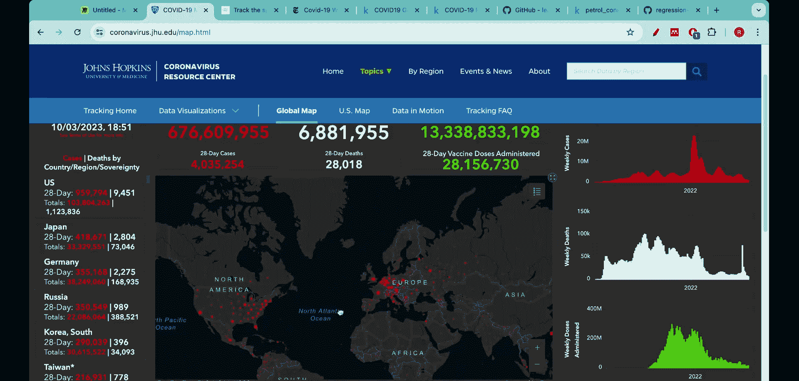
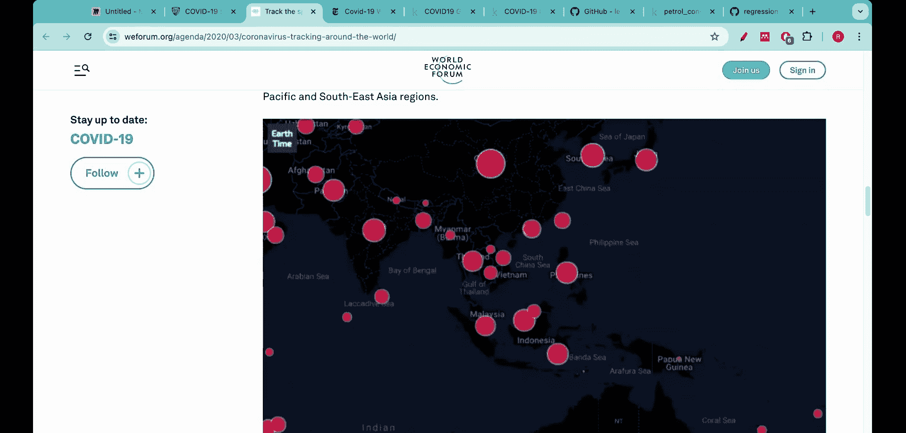
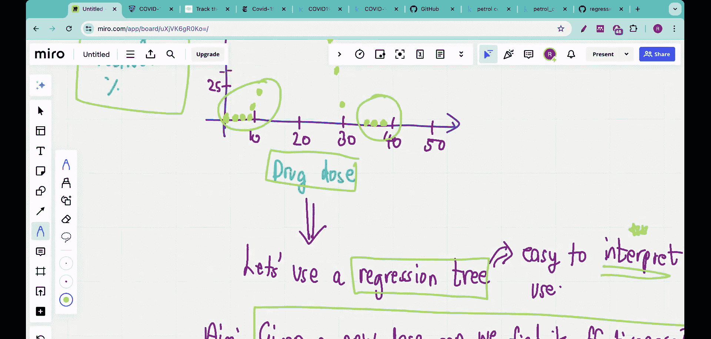

# Vizuara【中英⚡从零开始构建决策树｜Building Decision Trees from Scratch】 p08 P8 What are regression trees？ [BV1Zi4VzJEp9_p8]

Hello everyone， welcome to this lecture in the Decion trees from Scratch series。

In the past five to six lectures， we have looked at classification trees。

And we have looked at building an entire classification tree from scratch and also coding it out in Python。

Today we are going to start a new topic which is regression trees。

So for the longest time I thought that classification is the only purpose of decision trees。

 I did not know that decision trees can be used for regression tasks as well。In fact。

 what I learned about this is that they they are very useful and very impactful in a lot of real low world regression problems let's look at some of these problems。

So this is the very famous John Hopkins dashboard for CoVID 19 cases if you look at the red spots you'll see the concentration of where the infected cases were。

In fact， many famous forums such as the World Economic Forum converted this into a live animation to show how the infection was spreading so if you look at this animation here you will see how the red dots evolved。

 they started from China and then different places around the world started developing these big red spots which means the infection size was progressing slowly in all the regions of the world。

New York Times maintained a very nice data set about this here you can see how the infections varied in different continents of the world。

 there are multiple peaks and here you can see the hot spots where the cases were maximum you can even plot cases per capita deaths per capita you'll see areas which are very dark in color which means COI 19 really had a huge impact in that particular area。

Now when COVID19 was progressing， there was a big need for governmental agencies and policymakers to really predict how many infected case counts will be there in this week next week and the week after that because that decision would also influence the policies which they would implement such as the mask mandate the lockdown policy how long should the lockdown be implemented for whether masks should be compulsory in which areas should be compulsory for these reasons forecasting became very essential and KagL played a very important role so Kaggel started having these challenges during the COVID time。

 so here you can see COVID-19 global forecasting challenge and so many people submitted their solutions so if you look at the challenge itself the forecasting task so this was a forecasting task essentially the challenge was to predict the infected cases as a function of time so if you look at the data over year you will see that。

In this challenge， you will be predicting the cumulative number of confirmed coded 19 cases in various locations across the world。

So they have the training data， they have the submit testing data。

 and you have to submit your solution。Number of solutions were proposed。

 But what is very interesting to see is that regression trees。

Regression trees were also used to make these solutions Earl I would have thought that people would have proposed solutions using least square methods gradient boosting some complex ML algorithms like neural networks。

 etc， but even regression trees was used to propose the solution and you can see here this solution as a s star here which means that it was light and quoted by many people。

And I'll share this notebook in the information section of this video as well。

 but I just want to illustrate here that regression trees can be used to solve even impactful and real life problems like the COviID 19 pandemic so what you're learning in this lecture will be extremely beneficial for you。

Not just this problem you will see that on GithHub and on Kaggle also there are a number of projects which have been done with regression trees。

 for example there is a famous petrol consumption data set。

Whi is basically about different things such as petrol tax， highways， population。

 and then ultimately the goal is to predict the amount of petrol consumption， right？

And it turns out progression trace is very popularly used to solve this problem。

 it's also available on kggle as I'm showing here right now， people have written many codes for this。

If you search regression tree on GitHub right now， even after this lecture or during this lecture。

 you'll get so many projects which have been done using regression trees itself。

So the purpose of this lecture is to first give you a fundamental understanding of what really are regression trees and then similar to the way we approached for classification trees。

 we'll be building out an entire regression tree from scratch and then we'll also code out a regression tree in Python。

So let's get started with today's lecture first I want to tell you a bit about why regression trees are beneficial when you have so many other methods for regression such as the least square。

 the ordinary least square， etc。One major reason which I found out is that regression trees can handle nonlinear data in a much。

 much better manner than other regression methods。So let me explain to you what I mean look at this dataset right this dataset looks pretty much linear there is some amount of noise but we can clearly see that there is a straight line like this which fits through the data for such data sets traditional regression methods are very good and you can proceed with those but what about non nonlinearar data what if the data is like this where there is a cluster of points here then there is a cluster of points here then here and then here try fitting a straight line here no matter which straight line you use it will not fit this nonlinearar data very well it is in this type of data where a regression trees are actually extremely beneficial and extremely useful。

In today's lecture， let us understand what regression trees are and what。

Type of problems can they solve and from the next lecture we will start building out regression trees。

So again， as a reference， I am following the lecture material on the Stats Que channel。

 I've disilled this material down into building blocks， but I'm a big fan of this channel。

 so just giving credits here。So the problem which we are going to solve is this we have a training data which consists of drug effectiveness on the Y axis and the dosage of the drug on the X axis so imagine a data where you have the drug dosage such as in terms of percentage so 102030 40 etc and on the Y axis you have drug effectiveness percentage so the goal is to kind of quantify the relationship between the dosage level and the drug effectiveness right so that whenever you meet a new person let's say whenever a new person is administered a drug can you predict based on the drug dosage which they have taken what would be the drug effectiveness that's the main problem which we are trying to solve。

And let's say the data set looks something like this if you concentrate on the yellow points right now。

 don't focus on the orange line or the orange text， just look at the yellow points right now。

This is our data set right now here you can see on the x axis we have the drug dose and on the y axis we have drug effectiveness percentage。

And if you focus on the yellow data points， the first thing which you can see is that it's kind of in clusters right it does not look like a linear data at all in fact。

 if you try to fit a straight line through this data it's a very bad idea so you cannot use traditional regression methods also。

So let me erase this straight line here so that I can also tell a bit more features about this。

Data set， So I' have erase this right now so that we can clearly。呃。

We can clearly visualize the data set so traditional standard linear regression is going to be a bad idea right and one more way to think about this is that。

Wherever there are points of high magnitude， such as these points。

 it's always surrounded with points of low magnitude such as on the left and on the right。

This is a perfect indication or a perfect representation of a data set which is not ideal for linear regression。

 such kind of clusters， which which you can see in a nonlinear manner。And to solve this problem。

 we are going to use a regression tree， it turns out regression trees are much better than traditional least squares to solve problems like these。

The other advantage of regression trees is that regression trees are also very easy to interpret and use。

So the first advantage， which I told you about regression trees is that they can handle long nonlinear data in a much better manner。

 right compared to other regression methods， but there is another advantage and that is that。

Like with all decision trees， they are very much interpretable in nature。

 One thing which I really respect and I really like about decision trees is that unlike other neural network methods。

 regression trees are highly interpretable you can look at a regression tree and can ask questions that why is the answer like this or why is the solution behaving like this It's like shining a torch on the black box which is usually machine learning。

😊，Great， so let's use regression tree and our aim is that given a new dose。

Can we actually find the effectiveness of the dose so we have this training data right if we are given a new data which is not in the trade。

