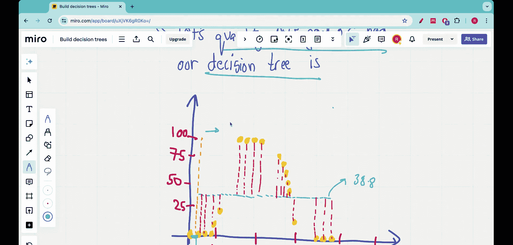

# Vizuara【中英⚡从零开始构建决策树｜Building Decision Trees from Scratch】 p09 P9 Let's start building a regression tree： Deciding the root node [BV1Zi4VzJEp9_p9]

Hello everyone， welcome to this lecture in the Dec trees from Sctch series。Today。

 we are going to start building an entire regression tree from scratch。In the previous lecture。

 we looked at the applications of regression trees and we saw that they are much better than let's say orin squares or other regression methods。

 especially at handling nonlinear data。I also mentioned about the reference to the Stats Que channel from which I've constructed this series of lectures。

So let's get started with today's lecture in which we will learn step by step how to start building a regression tree。

I predict that we will cover three to four lectures on this topic today is the first lecture。

 so please follow along and I hope that you liked the lecture。

So the problem which you are trying to solve looks like this。

We have drug dose on the x axis and we have drug effectiveness percentage on the Y axis。

We have collected data for around 10 to 15 patients and the data which we have collected is basically depending on the drug dose。

 what is the drug effectiveness percentage for that particular patient。

And you can see this data has been plotted on the X Y axis， as has been shown in the figure。The国。

Or the objective。Which we have is that given this training data。

We want to build a regression tree that uses a drug dose to predict drug effectiveness basically let's say you have been given a new patient which is not in the training data and you know the drug dose of that patient。

 let's say it's a which is not in the training data。

Can you predict what the drug effectiveness percentage will be for that patient？

A classic regression problem and we are going to solve this using regression trees。

 so that's the motivation。To give you a visual understanding of how the。

End goal looks like this is how the final optimize decision tree looks like。

And now we are going to start from scratch to build this tree step by step。

There are many things right in this tree there is a root node then there are terminal nodes。

 there are branches， there are leaves and we need to make a decision on what should be there in every such node as we did with classification tree first we are going to start with root node and what should be the correct value of the do here in the root node Why is it 14。

5 why not any other value right so that's what we are going to look at today。

So as I mentioned we need to decide the root node first for what is going to come at the top of the regression tree so I will return this as step number two step number one was just being familiar about the problem the end goal which we want to achieve so in today's lecture we are going to look at the specific objective of deciding the root node of the regression tree。

So let's see how do we do that？So step number three is basically we need to calculate the average of the first two doses。

And you will see later why we do this， but the this step is that the initial thing which you need to do to find the root node is start from your data and look at the first two values of the data so I have marked these values in this orange of op right and then what you have to do is you have to take the average of the first two。

Doses so let's say the x x is or the drug dose for this first point is x1 and for the second point is x2 so you have to take the average of these two so I am going to be doing x1 plus x2 divided by 2 which is equal to3。

And then what we are going to do is we are going to test with this as the root node。

So this is how we are going to do this so the average is equal to three right so we will draw a line here a dotted a dotted line everything on the left side of this dotted line is for dose less than three and everything on the right side of this dotted line is dose greater than three。

So what we are going to say is that if for the patient， the dose is less than three。

 which means we are on this side。All we have to do is look at the number of points here on the left side。

 so there is only one point whose value is0， so we are going to say that if dose is less than3 the drug effectiveness is equal to0。

On the right hand side there are so many points right which which you can see in this blue dashed line。

 so we are going to say that if dose is greater than three。

 which means if we are on the right hand side like this。

 we will take the average of all of these points。And that is going to be their drug effectiveness。

So if you look at all these points and if you take the average。

 you will see that the average is equal to 38。8。So we are going to say that if the dosage is greater than three。

 which means if we are lying on the right hand side。

The drug effectiveness percent is the average of all of this all of these y valuess。

 which is equal to 38。8。So the way this decision tree looks like is as follows if dose is less than three。

 if it's yes， we are going to say that the drug effectiveness is average of all the points on the left hand side。

And since there is only one point on the left hand side whose value is zero。

 we are going to say that the drug effectiveness on the left hand side for dose less than three is0。

On the other hand， if we are in the no bucket， which means if dose is greater than three。

 then we are going to take the average of all of the patients here。On the right hand side here。

Which have been marked with this blue shaded region right now。

 we are going to take the average of all of them which turns out to be 38。

8 So if those less than three was a root node， the way this will proceed is that if it's less than three we are going to say that the drug effectiveness is 0 if it's greater than 3 we are going to say that the drug effectiveness is 38。

8。Now this is just a trial right， this is of course not the correct root node。

 so we need to know whether we are moving in the right direction or not。

So there is this thing which is for major what matters？Basically。

Currently what matters to us is the root node right。

 so we need to measure whether this choice of root node or whether this precision tree is good or bad。

And let's see how to do that。So this is a visual representation of what we are essentially doing。

 so we are saying that this orange line here is dose equal to three。

So we are saying that if dose is less than three， then the decision tree predict  zero for this point and we are going to say that if dose is greater than three。

 then the decision to predict this。Wwhich is 38。8 for all of these points the decision tree will predict 38。

8 now take a look at the right hand side so I am going to call this RHs everything to the right of this orange light take a look at all these points。

Now， what I'm saying here is that for all of these points。

 I am going to say that the true answer is this blue dotted line， which is 38。8。

And visually you can see that it leads to so much error rate because all of these points are divevering from 38 point0 maybe only this point has the correct value。

 but all of these points over here have a larger value than 38。

8 all of these points here have a lower value than 38。0。So for all the points on the right hand side。

 this is definitely not the correct。Value。So I have put a cross symbol over here on the left hand side。

 we are actually doing quite a good because there is only one point whose screw value is0 and we are going to predict the value to be0。

But it does not matter because there is only one point on the left hand side and you can see that there are like 10 to 15 points on the right hand side right。

 which means for most of the points we are getting a lot of error so qualitatively visually we can see that this decision tree。

Is not doing a good job and this is not the optimal decision decision tree。

We move now to step number five which is quantification of this so until now only qualitatively we have seen that this decisionary is not good right so lets try to quantify this。

If you have seen the classification tree tutorialial you must have seen that in classification tree we use a metric called impurity or gen impurity and that depends on probabilities in the case of regression this metric is actually something which is quite simple and easy to understand and it's called as some of the squared residuals SSR。

So some of the square residuals is the metric which will help us put this qualitative understanding into practice。

So this metric will give us the power to assign a mathematical number to quantify how good or how bad our decision is So let's see how this metric does that here Ive plotted the same thing again all the points on the right hand side of this orange line will get a value of 3384 Now what we will do is that。

For each data point， we will see its true value， let's say for this the true value is0 right and we will see how far that is from its prediction。

