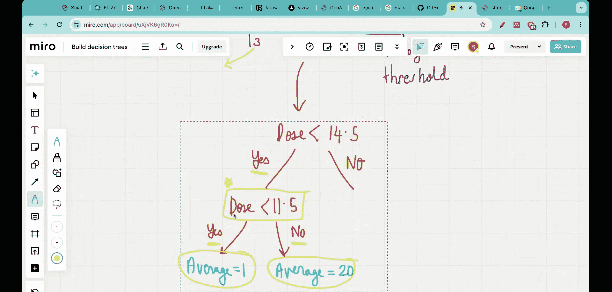

# Vizuara【中英⚡从零开始构建决策树｜Building Decision Trees from Scratch】 p10 P10 Finish building the regression tree [BV1Zi4VzJEp9_p10]

Hello everyone， welcome to this lecture in the decision please from Sctch series。

So in the previous lecture， we started the process of building a regression tree entirely from scratch。

So let me first revise the problem which we have so we are looking at this particular problem where we have collected data from patients。

In particular we have collected this data from patients。

 we have the drug dose on the x axis and based on the drug dose。

 we have to predict the drug effectiveness percentage。

That's the problem which we are trying to solve。The data which we have collected is around 20 to 25 patients。

 which have been shown on these yellow points over here。

And it is very hard to solve this problem with a traditional regression model such as ordinarily squares because the data points themselves are pretty nonlinear as you can see from this figure so it turns out that to capture the relationships between such a nonlinear data regression tree is one of the best algorithms which we can use。

So in the previous lecture we started building a tree and at the end we need to achieve this goal。

 this is the optimized tree， this is the way it looks like you first make the classification with dose less than 14。

5 than yes no then you make the classification dose greater than or equal to 25 years no and then the final classification is dose greater than or equal to 23。

5 yes no。The real question is how do we get to such a tree you will see that this tree satisfies all the data points which have been in in this plot。

 but we are trying to answer the question can we bridge this tree from scratch？So。

 the goal is that given this training data， we have to build a regression tree that uses a drug dose to predict drug effectiveness and we started doing this in the previous lecture by looking at the root node。

So in the previous lecture we actually looked at what should be the dose threshold in this first root node。

 so is it dose less than 11。5 dose less than 26 dose less than3 dose less than5 what should we set alone？

So we ultimately settled on those less than 14。5， which would be the root node。

And the way we made this decision is we looked at a metric called some of squared residuals and we plotted that metric for all the different dosage values and we saw that among all the different dosage value a dosage value of 14。

5。Gave the lowest sum of square residual。And so which essentially means it gave the lowest error and that's why we used dose less than 14。

5 in the root node。So in the yesterdays or in the last。

Lecture we have reached this stage where we have determined the root node which is gross less than 14。

5 if you have not seen that lecture and if you don't know what some of squared residuals is I highly encourage you to go through the previous lecture but if you are to follow along please do because I will explain everything from scratch。

So our root node is finalized， which is going to be those less than 14。5， correct？

Up till now the decision tree looks like this， we don't know anything further。

 we only know that the root node is going to be dose less than 14。

5 and we are going to split the tree into the yes branch and the no branch we do not know what comes after this until now in today's lecture we will build the entire decision tree。

In particular we will look at what comes after this yes and no category in today's lecture I'm going to assume that you know the concept of sum of squared residuals which we calculated in the previous lecture basically what we do is we just take the difference between the actual value of the point and the predicted value and then do the square and then add all of these that's why its called as the sum of squared residuals if you don't know what it means for now just intuitively think of it as some kind of an error which we are estimating。

Okay， so when you classify or when you first split the tree based on the root node which is dose less than 14。

5 the data point gets split into two halves， there is a half on the left which I am calling L right now and there is a half on the right which I am calling R。

And now we need to understand what do I need to do further。

 so lets look at that half on the left initially。So if you focus your attention on the half on the left you will see that there are six points for which the dosage which is the x axis is so remember the x axis is dosage。

 there are six points those dos less than 14。5 and those six points have been marked in this bounding box over here so let's look at what to do with these six points。

So those less than 14。5 in the as bucket， if it is。

 the six measurements should come here and these six measurements are the ones which I've shown here let me mark them again with an arrow。

 1，2， three，4，5 and 6。These are the six measurements over here。

Now ideally what we should be doing is that we need to further divide this into another threshold right like maybe this is we need to make one more threshold of those less than three or those less than five or those less than seven in this category。

And to understand what that threshold should be， we need to repeat the sum of squared residual steps。

 which we did for the earlier。For the root node calculation。

 basically what we will do is that we'll take these six points so when。2，3。4，5 and 6。

We'll take these six points and we will start with the set of two points so we'll first start with these two we take their average。

So we will assume first that this is the threshold dosage and we will find the sum of squared residuals for this。

 then we will take the average of these， then we will take the average of these。

 then we will take the average of these for all these thresholds we will find the sum of squared residuals。

And when you find the sum of squared residuals for all these points。

 you can plot the sum of squared residuals for different dosage threshold。

So here I have plotted the sum of square residuals for dosage threshold of three， then five。

 then seven， etctera， do dot dot up to 11。5。So again as I said if you are not familiar with the some of squared residual concepts we covered it in a lot of detail in the previous lecture。

 just go through that or for now just think of it as an error metric so this error metric which is the SSR is decreasing as you can see with the dosage threshold right so if the threshold is dose less than three the SSR will be the highest if the dosage threshold is dose less than 11。

5 then we can see that the dosage threshold will be the lowest or the SSR will be the lowest rather the error will be the lowest。

So for the dosage threshold of dose less than 11。5。We give the lowest error。

 so this should be not threshold those less than the 11。5 actually gives the lowest SSR。Great。

 so this suggests that when you want to make the further classification in this CS。In the yes back。

 in the yes bracket or the yes bucket， the next classification should be at a dosage level of dosage less than 11。

5。So why did we plot this SSR versus dosage threshold because we wanted to understand what value should come here。

 is it dose less than three， dose less than five， those less than seven？

So that's why we plotted the SSR values and we found that for those less than 11。5 it is the lowest。

 so we are choosing this as the question to be asked in the decision tree。So。

 what you will do is that now the dose less than 11。

5 right you will again break it into two categories。

 you will break it into yes category and you will break it into the no category。

So when you further do a split along the 11。5。So 11。

5 will be somewhere over here right so if you will further split it along 11。

5 and there will be again the left side of this which is dose less than 11。

5 and dose greater than 11。5 on the right side of this。Okay， so one thing to remember here is that。

Let me showcase this to you further。If dose less than 11。5 is yes。

 then the average of all the values which lie on that side is equal to 1 and if the dose less than 11。

5 it's no， then the average of all the values which lie on the right hand side is 20。Okay。

 this we don't need this average U use， but I've just app plotted them here。

Now we think that we have got this perfect threshold right， but there is a problem。

And I'm going to explain that problem to you right now。

So I want you to look at how many people are there whose those who are in this bucket over here。

So look at this bucket carefully what this bucket is that dose less than 11。

5 which says no which means dose is greater than 11。5 but for those less than 14。

5 it' is in the yes category so this bucket is the range dose between 11。5 to 14。

5 right and let's look at a graph further。If you look at the。Data between the dose of 11。5 or 14。5。

 you will see that there is actually only one data point here。Actually。

 let me erase some of the things over here so that it will be much easier for you to。Actually see。

