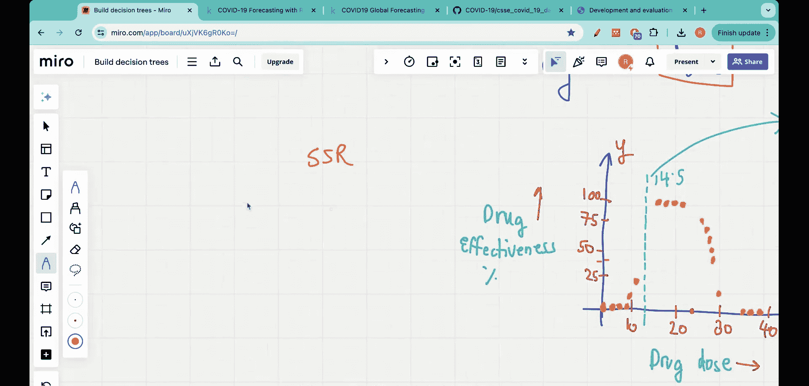

# Vizuara【中英⚡从零开始构建决策树｜Building Decision Trees from Scratch】 p11 P11 Regression trees with multiple features [BV1Zi4VzJEp9_p11]

Hello everyone， welcome to this lecture in the Decion T from Sctch series。

Today we are going to be looking at a very interesting topic。

 we are going to see how to build a regression tree with multiple features。

The credit for this lecture goes to Stat Quest who has brilliant videos on his channel。

 so please refer to that channel its one of my favorite channels。

So if you have seen the previous lectures in this series it's awesome because you'll understand this lecture much better if not it's fine I've designed this lecture so that there are no prerequis needed but still I would encourage you to go to the previous lectures in this series to improve your understanding so let's get started let's see what all we have looked at until now。

So we took this problem， which was basically we had a data of patients and on the x axis you can see that we have the drug dose and on the Y axis there is drug effectiveness。

Basically， the problem is that we are trying to predict the drug effectiveness percentage based on the drug dose。

And here's the data of around 1920 patients which we have and the problem we are trying to solve is if there is any new patient and if we know the drug dose for that patient。

 can we evaluate the drug effectiveness percentage for that new patient？

That's the problem which we are trying to solve over here and to solve this problem。

 we saw that logistic regression fails because。If you look at this data set for example。

 there is a cluster of low data points on the left side as well as on the right side。

 so having the S curve of logistic regression rail like this does not fit the yellow data points very well at all。

In fact， it turns out that regression increase。A。One of the best ways really to model this data and that's why we are going to be looking at these trees right now。

 in particular regression trees capture non nonlinearities in the underlying data really well。

 So this underlying data is fully nonlinearar right and regression trees are one of the perfect methods to capture such a nonlinear relationship between the underlying data。

 we also build this entire regression tree from scratch in the previous3 to4 lectures where we saw that to develop such a model between drug dose and drug effectiveness heres the optimum regression tree which actually works the best you first see if the dose is less than 14。

5 if yes， it's 4。2% effective If no， you check whether the dose is greater than or equal to 29 if yes。

 it is 2。5% effective if no you check whether the dose is greater than or equal to 23。5 Yes， it's 52。

8% effective and no it's under。% effective。We saw in a lot of detail regarding how to finalize this root node。

 how to finalize the intermediate nodes or branches and how to stop splitting that tree further。

We also saw how to prevent overfitting。Now， so far。

 we have built a regression tree with a single predictor。

Basically we are using the drug dose to predict the drug effectiveness right so there is a single input feature which is the drug dose and based on that single feature we are predicting the drug effectiveness percentage。

In today's lecture， we are going to discuss about how to build a regression tree to predict drug effectiveness using multiple features。

In particular， what if you don't have just a single feature。

 but let's say when a patient comes right， you take lots of data with respect to the patient you ask them their age。

 you ask them their sex or their gender whether it's male female along with the dose level which is given to the patient So what if not the dose but what if there are other variables also which play a huge role in predicting the drug effectiveness so what if male versus female males have a lower success rate on the drug on females have a higher success rate so then suddenly the gender becomes so important right So that's why in many real life cases。

 whenever you apply regressionaries to real life you will encounter multiple features it is very hard to find a single features such as this drug dose real life data does not work like that typically you have multiple features like this。

So today we are going to discuss everything about how to build a regression tree to predict drug effectiveness using three features the first feature is the dose。

The second feature is the age of the person and the third feature is the sex of the person。

 whether it's male or whether it's female。So let's see the tabular data which we have I'm not going to show all of the data which is there but I'm just going to show a sample of the data and how it looks like so the training data set which we have looks like this this is the training data for the first patient we have the dose we have the age of the person and we have the sex whether male or female and then finally we predict the drug effectiveness percentage or this is given in the training data itself so for a new patient based on the dose age and sex we need to predict the drug effectiveness percentage so this is the data for the first patient here' the data for the second patient heres the data for the third patient and finally the fourth row corresponds to the data for the fourth patient。

Okay， so now let's go about building the regression tree for such a data set which has multiple features。

 but up till now I hope you have all understood what the problem is。

 the problem is that let's say whenever a new patient comes to the clinic and we take information about the dose their age and sex we need to predict the drug effectiveness percentage for this new patient based on the training data which we have。

So let's see the steps involved first there are three features right so first what we will be doing is that we will just be considering one feature which is dose。

So first we are going to completely ignore the age and the sex feature and we are only going to look at the dose feature。

So let's see the plot for the dose feature， if you just plot the drug dose on the x axis and the drug effectiveness percentage on the Y axis。

 the plot looks like this where the yellow dots are the drug effectiveness percentage。

Now we have to decide the root node what goes at the top of the tree and for that we are going to use a metric which is called as the sum of the square residuals。

Which is also called SSR and I've written the full form over here。

 it's called the sum of the squared residuals。If you have if you don't know what this is。

 we have covered it in the previous lectures， but just so that you have an intuition as you follow along what the some of the squared residuals is it's basically it's。

It's an error it's a major of error between the prediction and the actual data。

 so let's say the first node which we have is that this or the first root。Threhold is at this point。

 which means that at the。At the root of the tree ambulance to say let's say dose is less than five。

So the the way to calculate the SSR for this threshold5 is that first you draw this line which corresponds to drug dose if equal to 5。

 then you look at the points on the left hand side and you look at the points on the right hand side and then you find the average so the prediction on the left hand side is maybe this which is the average and the prediction on the right hand side maybe this which is the average。

Then what you do is that you find the some of the square errors of all the points with respect to this decisionary predictiondi。

You do this sum of the squared error on the right hand side and you do this sum of the squared error on the left hand side also when you add all of these errors between the predicted value which are these average values shown by straight line and the actual values that is called as the sum of the squared residue。

So the way the threshold is defined is that you first find some of the squared residuals for let's say。

 you start from the leftmost side so you first take the average between。

 let me actually interrupt this line to avoid any confusion。Okay， so the way you decide the optimal。

Feature value is first， you take these initial two points。 You take their average。

 Let's say that's 5。 So the first threshold is dose less than 5。 Then you take the next two points。

 Then you take the next two points。 So those less than five can be the first threshold。

 dose less than 7 can be the second threshold。 Then dose less than。14。5。Those less than 14。

Poin5 can be the third threshold。 Then those less than。

Those less than 25 can be the fourth threshold etc ceter。

 so basically you keep on taking the average of the subsequent points and then you find the SSR values for all of these thresholds。

You find the SSR value for this。 You find the SSR for this。

For this and then you also find the SSR for basically all these thresholds and then you have to choose that threshold which gives you the lowest error。

 which gives you the lowest sum of the squared residues。

And it turns out that in this particular case， the dosage less than 14。5。

 which I've written over here， which corresponds to this blue line over here。

 that dosage level leads to the lowest some of the squared residuals。So as I've mentioned here。

 we select that。