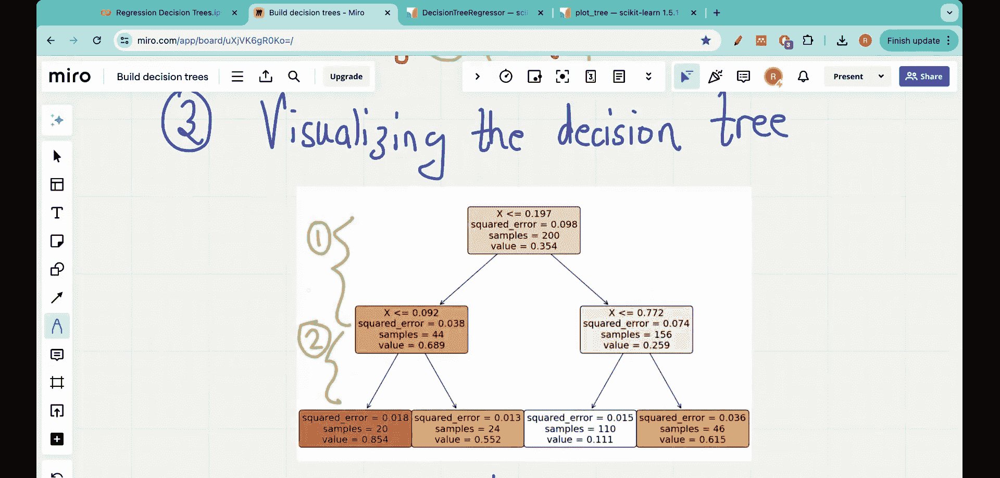

# Vizuara【中英⚡从零开始构建决策树｜Building Decision Trees from Scratch】 p12 P12 Build an entire regression decision tree in Python [BV1Zi4VzJEp9_p12]

Hello everyone， welcome to this lecture in the Decion trees from Sctch series。

Today is going to be a very hands on lecture。We are going to be coding an entire regression decision tree in Python。

So for the past four or five lectures we have looked at the basics of regression trees。

 we have understood concepts such as the sum of the squared residuals。

And we have seen how regression trees work for single features as well as for multiple features。

Now it's time to code an entire regression decision3 in Python。And as we do in this series。

 we'll do the coding right from the very basics。So let's get started with this lecture if you have not seen the previous lectures in this series on the regression tree it's fine。

 I'll try to make this lecture as selfcon as possible so that if someone is jumping to this lecture directly they will still understand all the concepts。

But I still recommend for your understanding to watch some of the previous videos in the regression decision tool。

So let's get started with today's lecture。This is the data which we will be looking at for the entirety of this lecture。

 so if you look at the data set the way it's been constructed it is that it looks like a quadratic function light right it looks like a parapola but some noise has been added to this data。

And our goal in this lecture is going to be to fit a regression decision tree to this data set。

Basically， we have to fit a regression model used made using a decision tree to this data set。Now。

 what I'll be doing is that I'll explain some parts on the whiteboard and then simultaneously or parallelly I'll be showing you the code for that particular part in Python so that your coding is improved as well as your theoretical understanding is improved。

So okay， first step before even thinking about running the code。

 defining the tree is to import the relevant packages。So I'm just zooming in a bit here。

 I'll share this notebook with all of you who are watching this video。

 but please remember that it the code works generally well for Python 3。

5 or later or the version of psychic learn which is greater than 00 0。20。

So let's see the packages which we are going to use。

 we are going to need a very minimal packages here， only psych it learn for defining the decision3。

 then N for mathematical computing and mat plot lip for the plots， that's it。

So I'm going to run this right now， this is a Google collab interface so you can see whenever a code cell is run the green pick appears over here。

Great， so this this part is done we have set up the required packages and now we are going to look at the data set as I showed you on the whiteboard。

 the data which we are going to be having it its base。Underlying nature is quadratic。

 but there is some noise associated with it， so you can see how we have generated the data set here。

Y equal to 4 into x minus 0。5 hole square， so that's a quadratic function。

 it's a parabola and then we are going to add some noise to this。

And then when I run this the function is defined and then we are just going to plot this plot this data set using the mat plot label so here you can see this is the quadratic training set with noise。

 this is the underlying data we have。Why did I add noisier？

The reason I add noise is because when you look at real data on practical problems and if you want to apply regression trees to model that。

The real data will be very messy， it will look much more complicated than this。

 so I wanted to simulate certain level of complexity and that is why I have added some amount of gausian noise。

That's it step one has been done。Now we come to step number two。In step number two。

 what we are going to do is that we are going to simply run the Python command for。呃。

Fitting the decision tree between the input data and the output data。

 so my input data is my x coordinate if you see in the plot and my output data is my y coordinate。

So there is actually just one simple line or rather two lines which you have to write to fit an entire decision tree Python has made things so easy。

And we are going to use this psychic learn function。

 which is called as the decision tree regressiongressor what this function does is that it fits a regression decision tree between the x data and the Y data。

So if you look at， Ive written down some piece of the code over here and we'll also go to Google Collab。

 but essentially what well be doing is that we'll define a regression tree variable。

Which will be equal to decision tree regressor， and we will specify a maximum depth。

It is fine if you don't specify the maximum depth also。

 Atyhen will do its own optimization and I'll show you how it works without defining the maximum depth as well。

But defining a maximum depth will constrain the tree to that much depth。

And then what you do is that after the decisionary variable is defined。

 which is3 underscore rig or rig， you will just do that three dot fit。And x and y。

 so basically this command fits a regression decision tree between the x variable and the y variable。

Most important thing to remember is this decision tree Regor function。

 which is provided by psychic learn。Now， if you look at this function in detail。

 there are so many arguments， right？There is the criteria， there is the maximum depth。

 there is the minimum samples in the leaf， then there is the maximum features。

 then there is CCP alpha。Maximum relief node。Maximum depth。

There are so many arguments which are there and we will explore some of these in this lecture。

 but for now the only argument which we have given is max depth。

If you don't give any other arguments， the psit learn package will automatically assume them by default。

 for example， if you have not specified anything in the criteria over here it will assume the squared error and Ill show you what this means also。

If you don't define minimum sample split minimum samples in the leaf。

 it will go on splitting so lets say if you define the minimum samples in the leaf to be 10。

And if you reach a leaf which has eight samples， we will not split further。

But if you don't define the minimum samples in the leaf， Python will assume it to be one。

 so unless we reach a leaf， which has one。Only one value it will keep on splitting the leaf further and further and further。

So a good intuition to have in mind is that if you don't specify any argument over here。

 if you don't specify the depth， if you don't specify the minimum samples in the leaf。

 you look at a huge tree。Okay， so Python is going to use the squared error function and it is going to use the max depth which we have defined。

And it is going to use minimum samples in the leaf to be equal to well。

That's all you need to know for now。And this is the simple command。

 the two lines through which you can implement a decision tree regressiongressor。

Now we will also run this in Python， so the first thing to do is from Scal learn do3 import decision3 reor。

 that is the common way to import any package and then we are going to type in the same thing what I showed you on the whiteboard。

3 underscore RG， which is the variable for my decision3 and call it three red。

Is equal to decision 3 regressor， max step equal to2。

And I am defining the random state over here just so that when I run the code and when you run the code。

We will get the same results if you don't define the random state。

 the initializations might be different and both of us might get slightly different reasons。

And then the second statement is3 red dot fit x and y this basically says just fit a regression decision tree between the x variable and the y variable。

So I will run this right now and you will see that a decision three regressor has been created。

Between the x and the y， so decision 3 has been fit。Now let's move to the next step。

 the next step is actually to visualize the decision tree。

And Im going to go to Python directly to show you how to do this。

 So we are going to use another psychit learn package which is called plot3。

 So let me take you to that what plot3 does basically is that you just need to provide it with a decision tree and then it plots that tree。

There are several other arguments here， but I am not going to go into detail here。

 the only thing to remember is that plot underscore3 in psychic learn helps you to plot the decision tree which you have just fit between the x and the y variable。

So let me run this right now and see how the tree looks like。So this is my decision3。

 the first thing to note is that the depth is equal to 2。

 so the depth equal to 1 corresponds to this and the depth equal to2 corresponds to the final leaf node。

Let me take you back to the whiteboard to explain this because I can write with a pen a so we give depth equal to2 right so the first thing to notice that so this is depth equal to1。

呃。And then below that。Is depth equal to2。So our3 has stopped splitting at this point because we gave the maximum depth。

Now， it is very important for every machine learning engineer to look at it。

