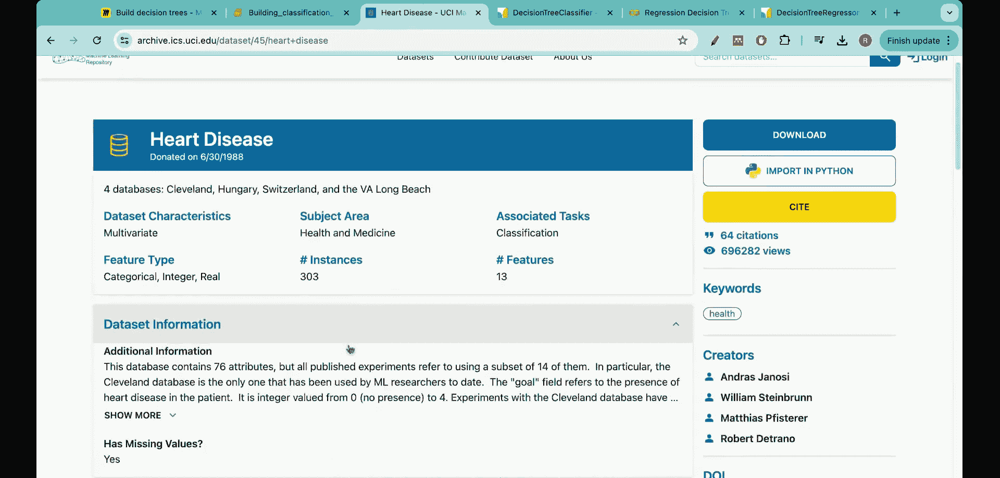

# Vizuara【中英⚡从零开始构建决策树｜Building Decision Trees from Scratch】 p13 P13 Interview Prep： Summary of regression and classification trees [BV1Zi4VzJEp9_p13]

Hello everyone， welcome to this lecture in the Decion trees from Sctch series。Today。

We are going to look at the review and recap of what all we have exactly learned in the previous lectures of this series。

So I'll be going through the key concepts which we covered and highlight the important things which you need to remember so if you want a quick review and recap before going for an interview let's say this lecture will be perfectly suited for you。

As I'm speaking， when you watch this video on YouTube， I'll put the relevant。

Video links for you to refer to。 So let's say when we talk about concepts like genie impurity and entropy。

 I won't be explaining those concepts in this video， but Ill link。

The thumbnail to the previous videos in this series where those concepts are explained。

This video is predominantly to get a brief overview of what we have learned so that it can serve as a quick summary。

So let's get started， the first thing if someone asks you about okay what exactly is a decision tree。

 you can think of a decision tree as divided into two parts。

 there is a statement and there is decision which needs to be made。

And then this definition recursively applies， so let's say if you have a statement and then decisions are made based on those decisions again further decisions are made and then the tree continues and continues and continues and it gets deeper and deeper and deeper as more and more decisions are made。

In fact， if you look at many decisions which you yourself might be making in your life。

 it can be constructed as a decision tree。Do I want to watch this movie， Yes， no， if yes。

 then what is the genre of this movie， then further you can go and classify in both the categories you can go and classify。

Okay， so that is the simplest definition of a decision tree Now if you look at the types of decision trees itself there are two major types of decision trees the first type is called as classification trees so let me increase the thickness of my pan over here yeah so the first type is called as classification trees。

And the second type is called as regression trees。Many students。

 when they learn about decision trees， they only think that classification is the only purpose of decision trees。

But that's a misconception， in fact， decision trees are a very powerful technique for regression tasks as well。

So let us see the difference between the classification approach and the regression approach for the decision trees。

If you look at the classification approach basically the main purpose of the classification decision tree is to classify into categories so for example a simplest questionnaire can be do you want to learn about decision trees and then it can split into two branches it can either split into the yes branch or a no branch if yes you can continue watching this video if no you can pause this video or not watch it。

That is the simplest example of a classification tree。And if you understand this example。

 you can think of so many real life examples right。

 let's say you have a patient or a bunch of patient data and if you want to classify whether the patient has a heart disease or not。

 that's a real life classification problem。In fact。

 there are so many classification tasks all around you， classifying whether it's a cat or a dog。

 whether brain tumor is present， whether brain tumor is absent。

 when a self- drivingriving car is making decisions such as is this a human in front of me or is this another car。

 all of those can be thought of to be classification problems。

And all of those can be solved using classification decision trees。

The second type of decision trees on the other hand， are regression decision trees。

In these type of trees what we do is that we predict numerical values so let's say do you want to learn decision trees yes。

 then your age is between 15 to 40 no then your age is less than 15 let's say if this is a decision tree see we are predicting numerical values youre right。

 15 to 40 less than 15 etc。This is an example of a regressionary。Again。

 if you understand this concept you can already think about the huge range of applications of regression trees right so think about if you want to quantify the drug effectiveness and on the x axis there is dosage level the age of the person the gender of the person etc so based on many features if you want to quantify the drug effectiveness level or the medicine effectiveness level thats like predicting a numerical value so this is an example of regression and the regression decision trees can be used。

Stock market is another example if you were to have time on the x axis and the stock price on the Y axis。

 that is a numerical value， the stock price。So regression decision trees can be used for that task as well。

So these are the two types of decision trees and in this playlist which we created we looked at both for the first six to seven lectures of this playlist we looked in a lot of detail about classification trees。

And for the remaining six to seven lectures of the series。

 we looked in a lot of detail about regression entries。So when we learned about classification trees？

There are some key concepts which covered the first thing which we spent a lot of time understanding is that how is the tree split。

And so for example， how do we decide the root node。

 how do we decide the intermediate nodes and how do we decide the leaf nodes of decision tree for that。

There are some key metrics which are used in by classification trees。

 one of those metrics is a gen impurity and I will link the lecture in the thumbnail above what is gen impurity you can watch the lecture but its a measure of the error in classification。

The second major is enpropy。Now both of these measures can be used for classification tasks and when I show you Python code in a while I'll show you that when Python makes these classification trees。

 you can choose which major you want to use and I've seen people use both of these but generally there is a higher preference towards using gen impurity there is a lot of similarities between these two for example the highest value for both of these occurs at a true probability of 0。

5 let's say。You'll understand all of this when you watch these lectures indeed。

 but the key goal here is to minimize the gene impurity as much as possible and minimize the entropy as much as possible while building the classification tree itself。

And that is the main purpose， or rather that is the main thing which is optimized when you build the classification tree。

In Python， building a classification tree is a very simple command。

 its this decision tree classifier。And you have to specify the x data。

 you have to specify the y data when you fit using this classification tree， but underneath the hood。

What Python is also using is that it's using this algorithm， which is called C。R and T。

 so which means classification and regression trees。

 so it is using this algorithm and what this algorithm does is that for classification trees it tries to minimize gene impurity or entropy and for regression trees it minimizes other and another metric which will come to in a bit。

So if you look at this decisionaryclassifier function in Python。

 there are different things which you can give see criteria。

 you can specify the criteria to be gen impurity or entropy。

 or there is also something called log loss， usually gen impurity is the most preferred one。

If you want to learn more about Gen purity， please watch the lecture which Ive linked about。

Because sometimes questions can be asked in interview about what is the difference between gen impurity and entropy。

 the answer to this question is that they are both great measuress for finding the error metric and there are a lot of similarities between them。

 but gen impurity is generally more preferred。Because it has the probability square and it does not have the log value。

 so sometimes that leads to better results although this is not the case for all the problems and you can generally experiment with both of these methods。

So these are two key methods which we looked at the start。

 but then as the lectures proceeded in classification degrees we looked at two other very important things the first is something which is called as cost complexity pruning or CCP。

Pruning of the tree so pruning as a grammatical term means reducing so cost complexity prununing means reducing the length of the tree or rather the depth of the tree and then finally we also talked about cross validation and testing so you might be thinking why is pruning really necessary。

For that， when this part of the series ended， we actually looked at a hands on problem in Python and we quoted out an entire classification tree in Python。

 Again， I'm linking the。The YouTube video link。About in the。In this video。

 so you can go through that in detail。But basically。

 what we did in this problem is that we took a real life example of patients and the data from 303 patients with 13 new variables。

