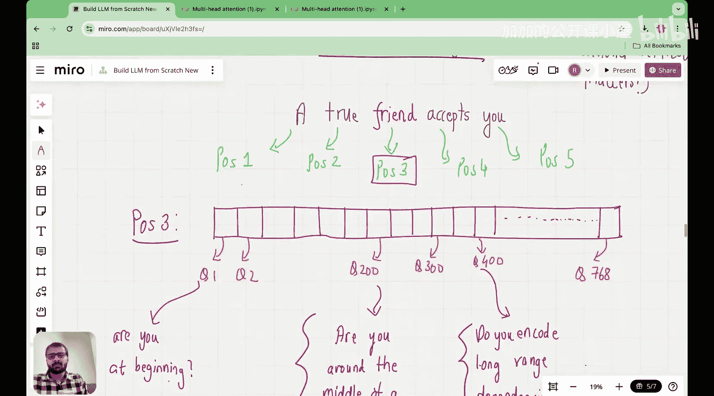

# Vizuara【中英⚡从零开始构建DeepSeek｜CS8803 Build DeepSeek from Scratch】 [BV1ryHpzTEKW_p5]

Hello everyone， My name is Doctor Raj Dunecker。 I graduated with a PhD in machine learning from MIT in 2022。

 and I am the creator of the Bill Deepsek from Scratch series。Before we get started。

 I want to introduce all of you who are sponsor and our partner for this series in V AI。

All of you know how much we value foundational content building AI models from the nuts and bolts inviideo AI follows a very similar principle and philosophy to that of us let me show you how。

So here's the website of Inviideo AI。With a small engineering team。

 they have built an incredible product in which you can create high quality AI videos from just text prompts。

😊，So as you can see here I've mentioned a text prompt。

 create a hyper realisticistic video commercial of a premium luxury watch and make it cinematic with that I click on generate video。

Within some time， I am presented with this incredible video， which is highly realistic。

What fascinates me about this video is its attention to detail look at this。

 the quality and the texture is just incredible and all of this has been created from a single text prompt。

That is the power of Invi's product the backbone behind the awesome video which you just saw is in video AI's video creation pipeline in which they are rethinking video generation and editing from the first principles。

To experiment and tinker with foundational models， they have one of the largest clusters of H100s and H200s in India and are also experimenting with B200s。

Individualviio AI is the fastest growing AI startup in India building for the world。

 and that's why I resonate with them so much。The good news is that they have multiple job openings at the moment you can join their amazing team I am posting more details in the description below。

🎼。

Hello everyone， and welcome to this lecture in theBuild Deep Seek from Sctch series。Today。

 we have a very important topic to cover and that is understanding self attention with trainnable weights。

So first， let's do a quick recap of what our plan is and what we have been doing so far。

So the main aim of this lecture series is to explain how deepse was built and the innovation switch power deep seek we have divided this innovation into four phases the phase one is with respect to the architecture。

 phase two is with respect to training methodology。

 phase three is with respect to the GPU optimization tricks which deepse has implemented and phase four is with respect to their model ecosystem itself。

We have been looking at phase one for the past two lectures and we have been building up towards understanding the multi head latent attention mechanism。

 so our plan for understanding the multi head latent attention is that we are going to do this sequentially we looked at the architecture of LLMs and in the previous lecture we looked at the need for why attention needed to be introduced。

And in today's lecture， our main goal is to see how the attention weights the attention scores are calculated。

So let me just take you quickly through the previous lecture in the previous lecture we saw that the main aim of the self attention mechanism is to take input embedding vectors and convert them into something known as context vectors。

Remember that context vectors are much richer than input embeddings input embedding vectors encode information about the meaning of a word and the position in the sequence。

 but it contains no information about how that word relates to other words in the sequence。

Context vector on the other hand contains that information context vector contains information of the meaning of the world。

 its position and also how it relates to the other tokens in the sequence。

So to get the context vector from the input embedding vector。

 we saw that intuitively the first thing we can do is take a dot product。

 but that does not work very well because the dot product is inherently limited。

And if there is a sentence such as the dog chased the ball， but it could not catch it。

And if this it is my query， I need my attention mechanism to differentiate that this it actually relates to the ball and not the dog。

So if we just use a simple dot product， it does not。It cannot capture this distinction。

 So what do we do， We introduce some trainable weight mattriosis。

 The role of this trainable weight mattriosis is that。Okay。

 we cannot encode the complex relationship in the attention mechanism。

 so why not we leave it to weight meosis which can be trained。

So this is exactly what is done instead of directly having the input embeddings。

 what we essentially do is that instead of taking the dot product between the input embeddings。

 we project the input embeddings into different spaces into different vector spaces。

 so for example if we are looking at a particular query we will multiply it by the query weight matrix。

And that will be the query vector。So， for example in this example which we just saw the dog chased the ball but it could not catch it if the second it is a query instead of directly taking the input embedding vector for this it we multiply it with the trainable query weight matrix so that it becomes a query vector。

And the other words with whom we want to see how this it relates to or how much attention we need to pay to other tokens。

 they are call less keys。And even these vectors we don't take directly as input embedding vectors。

 we multiply them with something which is called as the keys weight matrix。

right and then we get the key vectors for dog and the ball and then what we do is that instead of earlier what we did is we had the input embedding for it。

 we had the input embedding for dog and we had the input embedding for let's say ball。

But now what we do is we project this into the query vector so now we have a query vector for it which looks like this。

 we have a key vector for ball and we have a key vector for Do and now we take the dot product between the queries and the keys thats how we get how much attention needs to be paid to each key for a particular query。

So for this query it how much attention should we pay to ball we just take the dot product between the query vector and the key vector for ball if the query is it how much attention needs to be paid to the word dog we just take the dot product between it vector between the query vector for it and the key vector for dog right？

嗯。So in the previous lecture I just wanted to introduce to you that instead of just taking a simple dot product we have to work with trainable weight matrices and today we will learn more about these three trainable weight matrices which is the queries。

 key and values。If I introduce these queries keys and values to you directly。

 you would have been confused regarding why do we need these trainable weight mates in the first place。

 it seems a bit odd， but remember that as humans we have the limitation that we cannot come up with the attention mechanism formula there is no formula like physics so we offload。

The difficult thing to a neural network or to train weight mat rise。

And we realize that when you uploadload it to mat or we project the input embeddings to。

Higher or different dimensions through weight matortriosis。We are able to get good answers right。

 So we just call these mates as query key and value because they just make more sense to use in common literature。

But actually we are kind of doing a lazy trick here right since we cannot figure out the physics ourselves。

 we think that let me have some weight mates which I'll initialize randomly at the start and then I hope that after training is completed。

😊，I will learn something regarding the attention which needs to be paid to different tokens。

 and that's exactly what happens。So today we are actually going to see the step by step procedure of how we go from input embedding vector to the context vectors。

 so we are going to see a step by step procedure for let's say if you have certain input embedding vectors。

How exactly do we take these input embedding vectors and how do we convert these input embedding vectors into context vectors？

So let's begin our journey right now my main aim today is to show you some visuals and interspers it with bit of a code so that you can visualize the calculation process entirely yourself right so let's get started I am going to look at this sequence the next day is bright okay and remember now before going to the transformer architecture or before going to the attention mechanism these are just input embeddings which are token embeddings plus position embeddings so remember our previous lecture where we saw that essentially。

