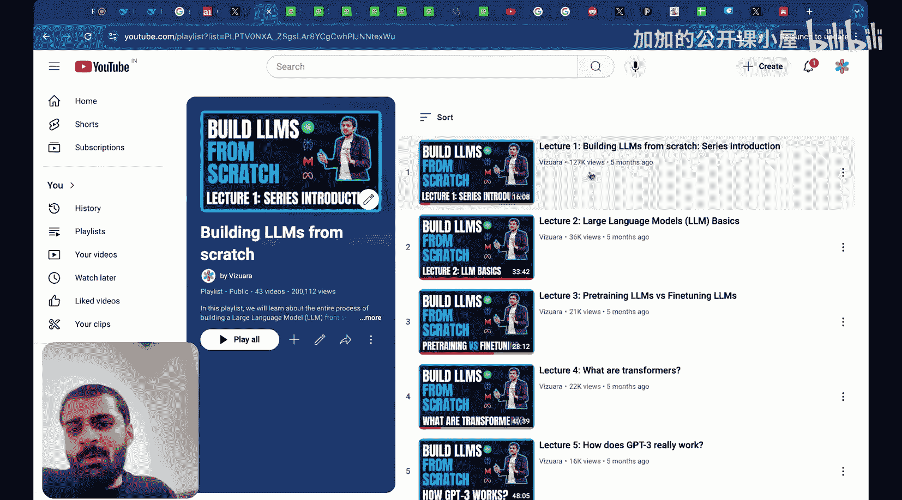
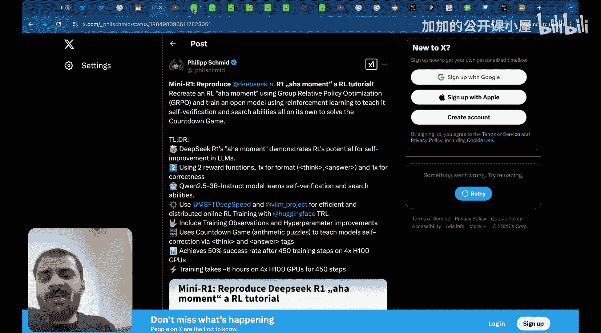
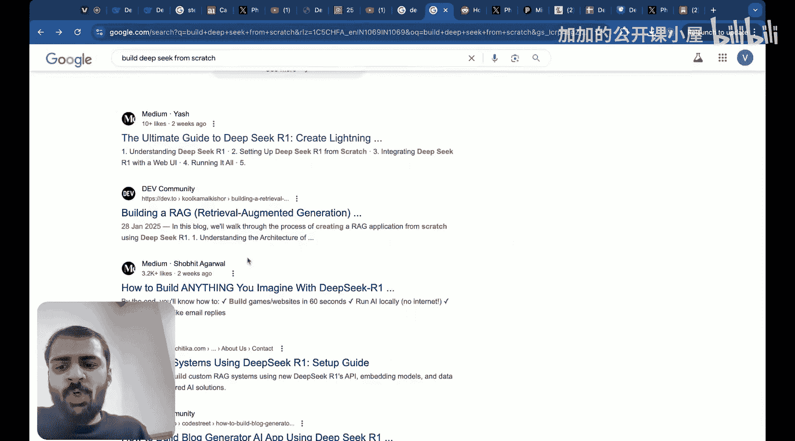

# Vizuara【中英⚡从零开始构建DeepSeek｜CS8803 Build DeepSeek from Scratch】 p01 P1 Build DeepSeek from Scratch： Series Introduction [BV1ryHpzTEKW_p1]

Hello everyone， and welcome to this playlist， which is titledBuild Deep S from scratch。My name is Dr。

 Raj Duneer， I graduated with the BT in mechanical engineering from IIT Mads in 2017 and then I completed my PhD from the Massachusetts Institute of Technology in machine learning and I graduated in 2022 After that I returned back to India and I'm one of the three cofounders of Vijura whose main mission is to make artificial intelligence accessible to all。

The main reason why I'm starting this playlist is of course。

 because deepse is what everyone is talking about right now。There are blog posts written about it。

 there are flashy news headlines about the topic， everyone seems to have an opinion about deepse。

Researchers， engineers， even companies are migrating from open AI API calls and deep seek API calls。

 people are just。goinging crazy over how China could have built an open source model which is at par or even better than G。

However， what I strongly strongly believe is that all engineers， students。

 researchers and working professionals are making a very， very big mistake in this deep seek wave。

 Of course， deep seek is a revolutionary moment。But instead of building flashy applications using deepse。

 what we should instead be focusing on is the foundations， the fundamentals。

 what we should really try to understand is how did they build deepse from scratch。

We should understand the nuts and bolts of how deepse is really built and we should try to build it ourselves。

 that is what we should be doing behind all the flashy headlines behind the competition between companies what we should be doing is understanding the basics of how deepS was built from scratch。

That is where the true focus should be and that's the main purpose of this playlist through this playlist I am planning to record a massive series of 2530 or even more videos in which I will teach you every single building block of the deeps architecture and by teach I don't mean just showing you blogs。

And showing high level things， but we will be coding and deriving the mathematical details of every single aspect。

By the end of these video lectures， you will be able to build every single deep seek module yourself。

You will be able to build the architecture and the modeling aspect also。

In this playlist or in this video either I plan to go over three major things the first thing is I'll take you through the journey of how I try to discover learning material with respect to deepse and I just couldn't find learning material out there either I could find flashy articles or blog posts which are not very very deep。

And then， I was just lost。And then I thought。To you about my process of understanding the entire journey of building deepse。

My second objective with this video is to show you how I have divided the different aspect of how I will make this playlist and in the final aspect I will show you what you can achieve after you go through this entire playlist Im pretty sure there are not too many engineers in the world right now who can build every single aspect of deepse themselves and understand the mathematics of what's going on beneath。

And by mathematics， I mean showing and deriving every single matrix multiplication。

So you will be that engineer once you complete this playlist。

 you will be very strong foundationally oriented engineer who can build a deep seek model or a deep seek architecture。

 why wouldn't anyone want to have such an engineer in their organization？

I will equi you with this knowledge through this place。On the Vijura channel。

 we already have a number of playlists on machine learning， deep learning。

 and building large language models from scratch。I hope you thoroughly enjoyed this series as well。

So let's dive into this video where I'll cover the three aspects which I mentioned。

So the first thing I want to get started with is my journey into how I reached this point of wanting to build every single aspect of deepse from scratch。

It all started with this deep sick arant release。And at that time I checked this out when this looked awesome。

 but very honestly at that time so many new models were coming out every single week that I thought this was one such a way which will die out pretty soon so I saw this release I checked out their website but I did not look it to it further after that。

But then things just started to get pretty crazy after that。

 so here was a LinkedIn post which was released which said that deepsek had erased $2 trillion worth of market cap in US talks。

Companies in the US lost a huge amount of money。And the reason was because。

China's deepse built a reasoning AI model that rivals openI's best model。

 and that too it did it for 100th of the cost and more than that it was open source。

Deep seek was not just cheaper to build。 It was also cheaper to run。

So this was more than technical it was also a political thing right so had Silicon Valley lost its AI advantage deepse raised all of these questions。

 it was around 27 times cheaper than open AI it was open source and permissively licensed it was just amazing。

It led many countries to act also after that， so for example。

 India released a proposal which was a call for building the nation's first foundational model。

So people were suddenly like if China as a country can do it with few resources compared to the US。

 why not other countries also， so this started this debate also。

And then I got really curious about this。 And I started searching a lot about deepse。

 I always like to build things from scratch。 There is this build LLM from scratch playlist。

 which I released， which has。And now around 40， 45 videos and it has received a huge amount of interest for people。

And I saw this one post where someone had tried to replicate。Deep seek car。

 it was just a small tutorial， but this ignited the idea in my mind that why don't I try to build deepse from scratch or why don't I at least understand how every single module of deeps was built from scratch？

And then I started doing a bit of research right and I realized that deeps R1 was not the first thing which came out of this company in January 2024 they had this deeps LLM paper then in Jan 2024 again they had deeps code。

Then in March of 2024， they had a regional language model。In April of 2024， they had deepse math。

 which was related to mathematical reasoning in open language models。

 then kept deepse version 2 in June 2024。Then deep C codeder version 2 in June 2024。

Then finally came along deepse version  three。And this really blew everyone's mind because this was the foundational model which ultimately led to this paper called Deepepse Ar1。

 which only came out in January of 2025， so there was one year of research or maybe more than that who reached to this stage where it finally came into the public limelight。

And all of these innovations which happened in these papers， right all of these papers。

 I really wanted to dig deeper and I wanted to understand。

I knew exactly how LLMs were built from scratch， but deep sequences a revolution on top of the foundational LLM models and the architecture which we have traditionally seen。

 so I wanted to learn everything about it。And naturally I started searching on YouTube first related to deepse from scratch。

 then I could see here's a 20 minute video which is around 1。5 million views。

Here is a video which is again， 21 minutes。And it has huge number of views。

 but you can see that all of these videos are either 10 minutes or 15 minutes。

 This is another video which is just8 minutes。 This is not what I was looking for at all。

 I wanted to know the nuts and bolts of every single piece of how deepse was built and assembled from scratch It's as if I want to build a sports card all by myself and I am just being shown a five minute origin of how a sportscard looks like that's not what I was looking for I wanted a video which explains the mathematical details which explains the code from scratch and which takes me through the building blocks right similar to the way I did for build LLM from scratch but I just could not find anything on YouTube Then I started searching on Google I could see that several people are building apps using deepse that is fine building apps with something already existing is school but I really don't want to do that I want to be able to build。

Deep sleep？On my own， that's where the real power lies， in my opinion。

 not in building applications on top of something which already exists。

Then I searched on internet again build deepepse from scratch and I could see several forums。

 several articles like the ultimate guide to deepepse R。

 but here again it already uses deepepse R and builds apps。

