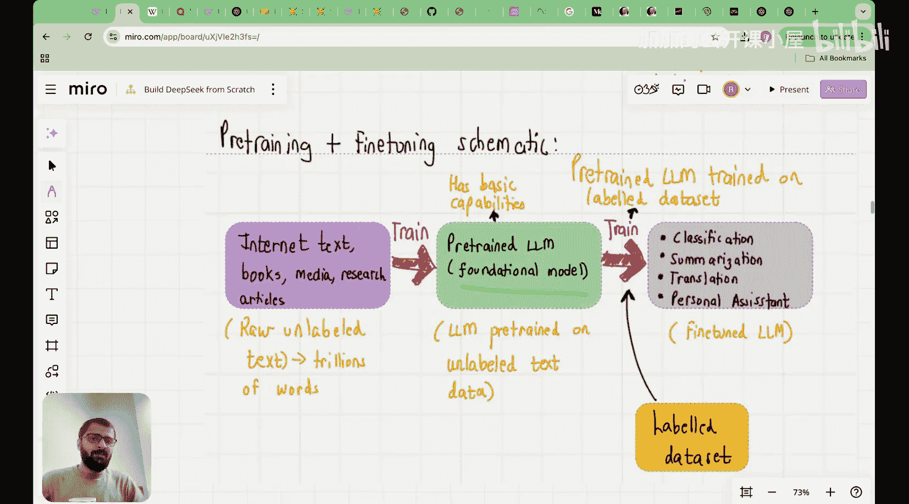

# Vizuara【中英⚡从零开始构建DeepSeek｜CS8803 Build DeepSeek from Scratch】 p02 P2 DeepSeek Basics [BV1ryHpzTEKW_p2]

🎼Yeah。Hello everyone and welcome to this next lecture in theBuild Deep Seek fromron Sctch series。

Today， my main agenda is to cover three things。First， we are going to look at what exactly is deepse。

Second， we are going to look at what makes deep seek so special and why is everyone talking about it。

 What are the technical details which make deep seek so special。

And the third thing which we are going to look at is what is the plan in this lecture series。

What we are going to learn and what is the sequence in which we are going to learn about different topics。

So let's get started。First， what is deepse， essentially deepse is a Chinese company which builds large language models。

And before we dive any deeper， first， let me give you a quick overview of what large language models essentially are。

All of you would have interacted with Cha GPT right I can go to Ch GPD right now and let's say I can ask that。

Make。Yeah。Make a travel plan for me to visit Italy。

And then child GP will come up with this travel plan。 This is a large language model。

But one thing to keep in mind is that at the heart of it， what a large language model is。

 is that it's an engine which takes in a sequence of words。

 and then it gives a probability of what's the most likely next token。

And when such tokens are aggregated together， it forms sentences such as what we see here right now。

So essentially large language models are probaistic engines for predicting the next token This is the first thing to keep in mind Here' is a simple code which I wrote to demonstrate that。

The models and their prediction are probabilistic in nature， so for example。

 if the sentence is after years of hard work， your effort will take you and we have to complete this sentence。

I use the open AI API key and I ran this code， which predicts the top 10 tokens and their probabilities。

 so although the output will be2。Whi is essentially or which essentially implies that the next token is two after years of hard work your effort will take you too。

But you will see that there is also some amount of probability which is assigned to tokens like far places where etc。

So although you see these answers over here and they look deterministic。

 it seems that Cha GPT is very confident in giving these answers。

 just keep in mind that underneath for every single token there is a probability and we choose the next token with the highest probability usually the distribution of the next token probabilities looks something like this on a log a log scale。

 it looks something like this the first token generally has a very high probability in the case of confident predictions。

And then the p， and then the probability just keeps falling down。Alright。

 so that's the key idea behind what large language models are and then what exactly is this large behind large language models？

To put it simply， no one really has an exact definition of what large is。But essentially。

 there is a scaling law its size。The first paper which kind of figured this out was the GT3 paper。

Let me quickly show that paper to you so here's the GPT3 paper which was titled language models are few short learners。

Where the authors essentially proved that if you increase the model size to something as high as 175 billion parameters。

For both one shot and few short learning， the model performance essentially dramatically improves。

 I believe that this was when we truly crossed the size barrier from 1。

3 billion parameters to 13 billion parameters to ultimately 175 billion parameters。

And once this size barrier is crossed， we start seeing wonderful properties of la language models。

So this was GPT2， the largest model had around 1。5 billion parameters， GT3。

 the largest model had around 175 billion parameters。And in general， here is a。Paper。

 which was published in nature， right about neural networks and size。So from the 1950s to 2020。

 you can see that there is an exponential increase in the number of parameters which we are using and recently you see the orange dots are more。

 This is because language models have very dominated the。Size space。

 so essentially language models and their size has been drastically increasing。

 and we have reached about 1 trillion right now。 So look at this straight line here。

 which I've shown by this red arrow。 So the y axis is in log scale。

 So this is an exponential scaling log， which means that the size of the language models is increasing exponential。

Why do we really care about size so much and why do we increase the size well because people have seen that as you keep on increasing the size of language models。

 you observe something called emergent behavior or emergent properties？

These are essentially properties。Which are not present in smaller models。

But they are present in larger models。 So， for example， if you see all of these tasks here。

 such as performing arithmetic。Word and scrambling tasks， etc， all of these tasks。

 you see there is a pickup point in all of these and on the X axis you can think of this as computational power or roughly equivalent to the model size。

So if the model size increases beyond a certain point， we have this pickup point。

So the model suddenly starts learning about new things， the model starts developing these magical。

 awesome properties。Although the model is traineded simply on the next token prediction task as the size of the LLM goes on increasing after a specific size。

 the model can do these wonderful properties。Or rather the model shows these wonderful properties like could be translation。

 summarization， grammar checking， etc ce。 And that's why we are in a race to win larger and larger and larger models。

 Comp like Open air Anthropic have even publicly said that they are just chasing size at this moment because there is still some hope that maybe after 10 trillion or after 100 trillion number of parameters。

 the LLM shows some properties which we are not aware of at all right now。

So these are the emergent properties of large language models。

One thing to note is that LLLs differ from earlier NLP models because earlier NLP models were essentially designed for specific tasks such as language translation。

Whereas due to such emergent properties， which we just saw large language models can do a wide range of tasks。

Such as translation， summarization， fact checking， grammar checking， etc。

 as all of you might have explored with J GT right？Just a key point to note。

 earlier language models could not even write an email from custom instructions。

 a task which is prevail to modern large language models。So until now。

 we have seen that large language models really become better and better with size。

 they develop emergent properties。And one more thing to note is that at the heart of this language revolution rather is this architecture which is known as transformers。

If you don't know what transformer architecture is， don't worry we'll cover that in this series。

 but essentially there was this paper called Attion is all you need。

 which introduced a transformer architecture， it looks a bit complicated as shown in this diagram to truly unpack the transformer architecture it takes。

A couple of lectures， but essentially this is the secret sauce which powers language models and we are going to learn about this so don't worry。

Finally， one thing which I want to mention is that when we say creating a large language model。

 it involves two stages。The first is a pretraining stage where we don't have a label data set。

 but essentially the model on its own creates training data and the labels this is called as an autoregressive stage So models which are pretrained they are also call less foundational models So to do this pretraining we typically assemble huge amounts of data from internet textbooks。

 media research articles， etc。 For example， GT2 was trained on data from Reddit books。

 Wikipedia articles， Open web corpus， etc。 and then this whole this giant large language model is trained on this huge amount of data this training costs upward of million dollars might even cost tens of hundreds of millions of dollars as the size of the LLM increases。

Keep in mind that after pretraining， the model develops basic capabilities and after that we typically need to fine tune the model。

