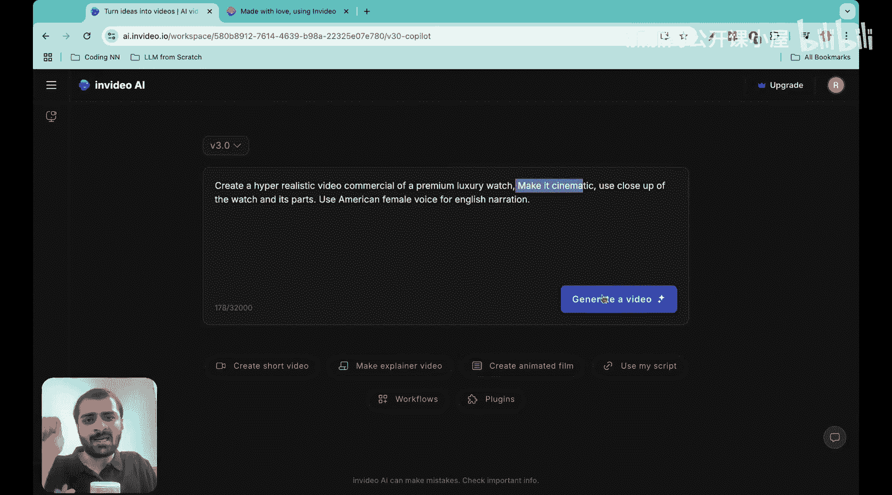
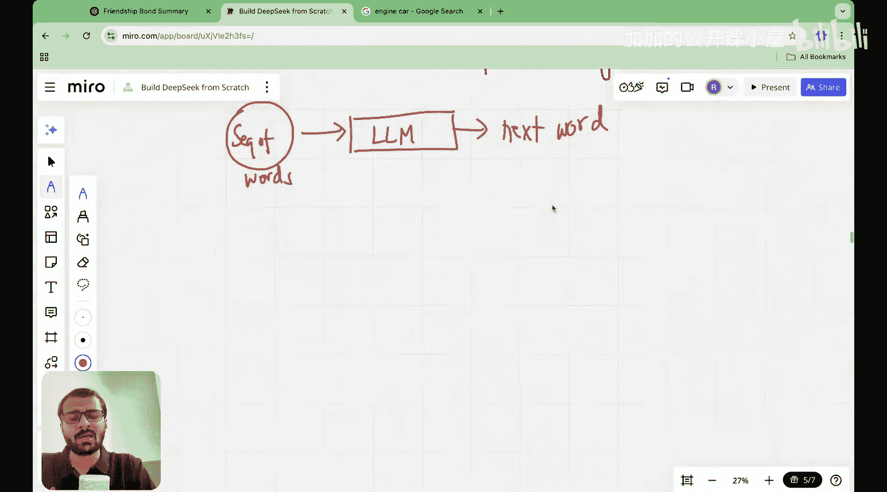

# Vizuara【中英⚡从零开始构建DeepSeek｜CS8803 Build DeepSeek from Scratch】 p03 P3 LLM Architecture in 1 hour ｜ Journey of token through the LLM Architecture [BV1ryHpzTEKW_p3]

Hello everyone， My name is Dr Raj Duneer， I graduated with a PhD in machine learning from MIT in 2022。

 and I am the creator of the Bill Deepepsek from Scratch series。Before we get started。

 I want to introduce all of you who are sponsor and our partner for this series in V AI。

All of you know how much we value foundational content。

 building AI models from the nuts and bolts inviide AI follows a very similar principle and philosophy to that of us let me show you how。

So here's the website of Inviideo AI。With a small engineering team。

 they have built an incredible product in which you can create high quality AI videos from just text prompts。

😊，So as you can see here I've mentioned a text prompt。

 create a hyper realisticistic video commercial of a premium luxury watch and make it cinematic with that I click on generate video。

Within some time， I am presented with this incredible video， which is highly realistic。

What fascinates me about this video is its attention to detail look at this。

 the quality and the texture is just incredible and all of this has been created from a single text prompt。

That is the power of Invi's product the backbone behind the awesome video which you just saw is in video AI's video creation pipeline in which they are rethinking video generation and editing from the first principles。

To experiment and tinker with foundational models， they have one of the largest clusters of H100 s and H200s in India and are also experimenting with B200s。

Individualio AI is the fastest growing AI startup in India building for the world。

 and that's why I resonate with them so much。The good news is that they have multiple job openings at the moment you can join their amazing team I am posting more details in the description below。

🎼Yeah。

Hello everyone， and welcome to this lecture in theBuild Deep Seek from Sctch series。

In the previous lecture， we learned about。The four phases in which we are going to divide the lecture series。

The first phase is going to be the innovative architecture behind deepse。

So that's phase number one right over here， Ph number two is the training methodology itself。

 the rise of reinforcement learning and how they relied on RL to teach complex reasoning to the model using rule based reward systems。

That's phase number two。Phase number three is GPU optimization tricks。

 so how they used NVDs parallel thread execution PTX or QR， let's say。

And phase number four is their model ecosystem itself。

So they did not stop at just building a huge 671 billion parameter model。

 but that large model was essentially distilled。Down into a much smaller model whose size was around 1。

5 billion parameters。So that's essentially phase number four。

We are going to go through phase number one to phase number two。

 Ph number three and phase number four。And in this lecture。

 today we are going to start with phase number one。

 which is essentially the innovative architecture behind deepse。And what makes it so efficient？

The two major aspects of their architecture， which contribute to the deepse efficiency is essentially something called multi head latent attention MLA。

 which makes the attention mechanism itself more efficient。And second is the mixture of experts。

 which means that although the number of parameters is 671 billion。

 all of those parameters are not active at the same time。

 only about 37 billion parameters are so essentially parts of the parameters are turned off and parts are turned on like light bulbs going on and off。

And that。Makes the model extremely efficient in its computations， parameters which are not needed。

 are turned off。When they are needed they are suddenly turned on and then they start working right then we have multi token prediction quantization and rotary positional encoings as well which we are going to learn about。

So the first thing which I want to teach you is multi head latent attention。

And then I was thinking about how to exactly teach this concept， right。

 because the concept itself is pretty advanced。 So if you search about。Multi head。

If you search about multi head latent attention， you will at certain block posts which talk about this so they do talk about essentially what multi head attention is。

And if you scroll down here below， you will see that it's just one page of this blog article and they start out with multi query attention group query attention and they go to rotary positional encoding and then there is a very small section on multi head latent attention which is impossible for a person to understand if if they are just。

Starting out to explore what deep seek is and so I don't want to follow that approach of just going through a simple lecture and explaining MLA by assuming that you know the prerequisite knowledge。

Instead， as I mentioned to you at the start of the series itself。

 I want to make this lecture series very deep。So the way I'm going to explain multi head latent attention is through a four par process。

First， we are going to understand the architecture of LLM itself and that is going to be the main purpose of today's lecture。

I believe that without having an intuition of the LLA architecture。

 it's impossible to understand latent attention。Then we are going to understand why there was a need for self attention and what is the self attention mechanism itself。

Once we understand self attention， we are going to understand。

How self attention was transformed into multi head attention and what does it mean to have multiple attention heads？

That is the third aspect over here， and then the fourth aspect is essentially key value cash。

So then we are going to understand okay multi head attention works and it really works very well。

 but then what can we start doing to improve the efficiency of multi head attention to make it computationally faster to make sure that the number of parameters which we are sting in the memory is reduced。

And that's when key value cash comes into the picture。Only when you truly understand key value cash。

 then you will slowly start to understand multi head latent attention so after keyV cash then we are going to understand MLA。

But Im going to devote a lot of time to develop your foundations in these first four concepts before we go ahead to MLla itself。

Many of these blog posts， which I mentioned right now。

 they assume that you are already familiar with this。

So in theBuild deepse from scratch series we have 43 lectures explaining you everything about these different aspects in this lecture series Im not going to go as deep so for example today I'm going to have just one lecture on the LLM architecture but in the build LLM from scratch there were three to four lectures right。

So my aim is that I want to explain this knowledge to you。

 but also I want to make sure that beginners who have started watching this series。

They also feel connected with the series。So the challenge for me was to come up with a new set of lecture notes specifically for this series because。

I'm trying to explain a concept in one hour， but also I want to make sure that I don't lose out beginners in the process。

So I've made a whole series of new notes for explaining these different concepts。All right。

 so I hope everyone has understood the flow of how we are going to understand multih latent attention。

Today， our main aim is to understand the architecture of LLMs。So after today's lecture。

 all of you should have a mental map or a visual roadmap of what happens with a world or a token when it goes into NLLM。

First of all， let me explain what does it mean architecture of an LMerate。

 so if you pass in some certain a sentence or a sequence of words。

We have seen that when a sequence of words is passed into an LLM。

 what the LLM essentially does is that it predicts the next word or it predicts the next token rather。

So an LLM or a large language model can be thought of as a next token prediction engine， right？

So it can be thought of as the next。都跟。Prediction engine。And just like an engine。

 so let's say if I go on such engine car and。If I copy this right now， copy image。

 or let me copy a good image right now， if I copy this image right now。

