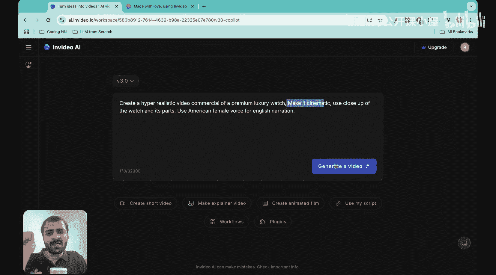
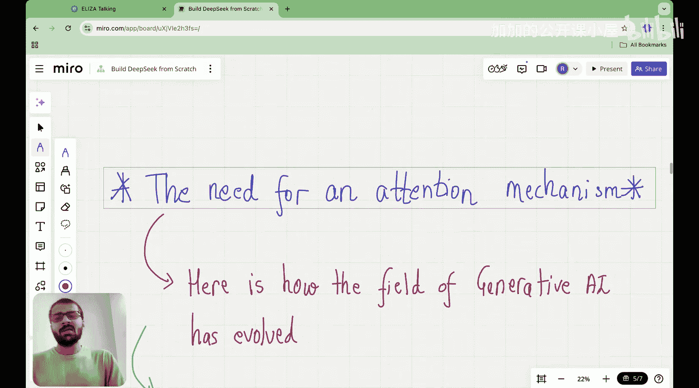
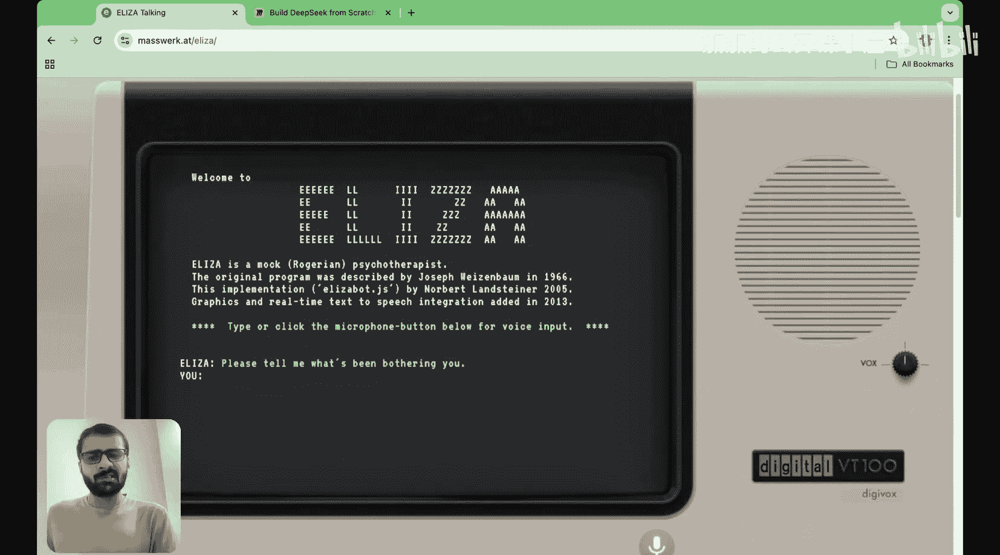
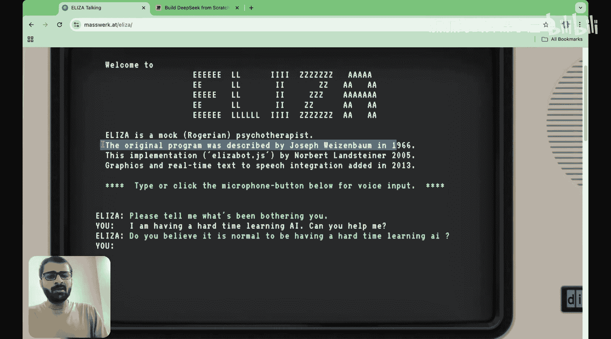
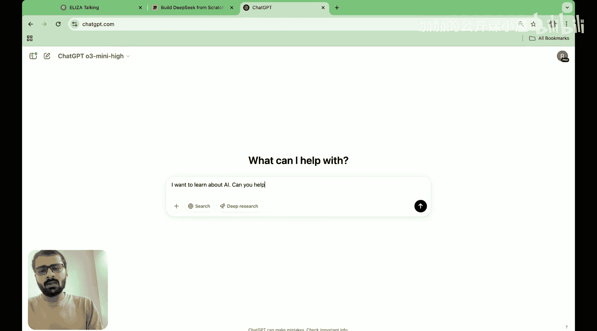

# Vizuara【中英⚡从零开始构建DeepSeek｜CS8803 Build DeepSeek from Scratch】 p04 P4 The Attention Mechanism 1 hour explanation [BV1ryHpzTEKW_p4]

Hello everyone， My name is Dr Raj Duneer， I graduated with a PhD in machine learning from MIT in 2022。

 and I am the creator of the Bill Deepepsek from Scratch series。Before we get started。

 I want to introduce all of you who are a sponsor and our partner for this series in V AI。

All of you know how much we value foundational content building AI models from the nuts and bolts inviideo AI follows a very similar principle and philosophy to that of us let me show you how。

So here's the website of Inviideo AI。With a small engineering team。

 they have built an incredible product in which you can create high quality AI videos from just text prompts。

So as you can see here I've mentioned a text prompt。

 create a hyper realisticistic video commercial of a premium luxury watch and make it cinematic with that I click on generate video。

Within some time， I am presented with this incredible video， which is highly realistic。

What fascinates me about this video is its attention to detail look at this。

 the quality and the texture is just incredible and all of this has been created from a single text prompt。

Thats the power of Invi's product the backbone behind the awesome video which you just saw is in video AI's video creation pipeline in which they are rethinking video generation and editing from the first principles。

To experiment and tinker with foundational models， they have one of the largest clusters of H100 s and H200s in India and are also experimenting with B200s。

Individualviio AI is the fastest growing AI startup in India building for the world and that's why I resonate with them so much。

The good news is that they have multiple job openings at the moment you can join their amazing team I am posting more details in the description below。

🎼Yeah。

Hello everyone and welcome to the next lecture in theBuild Deep Sek from Sctch series。Today。

 we are going to learn about a very important concept。And that is the need。

For an attention mechanism。First， let me quickly summarize what all we have covered so far in this lecture series and then let's come to the topic of discussion today。

So two lectures back in the lecture called deepse basics， we looked at the four phases。

Of the deepsek architecture or rather the four phases through which we are going to cover this lecture series。

 the first phase is the innovations in the deepse architecture。

 the second phase is the training methodology， the third phase is the GPU optimization tricks and the fourth phase is the model ecosystem。

In the previous lecture which was titled LLM architecture。

 we started looking at phase1 in particular our main goal is that in the next two lectures or two to three lectures we have to start understanding about the multihead latent attention which is the first major innovation in the deeps architecture。

 however to understand MLA or multihead latent attention。

 we cannot directly start looking at that concept， we need to slowly work our way towards it。

So first we looked at the architecture of the NLM itself。

 we saw that the architecture of the LLMs looked something like this。

 we had three sections first we had the input section。Then， we had the。Processor。

 and then we had the output section。Each section essentially had different building blocks。

So we saw that to really understand how the， if you think of the LLM as the engine， right？

And to truly understand how the engine works， we really need to open the engine and try to see what lies underneath。

And how does essentially LLms learn to predict the next token or the next world。

 If you think of this analogy as similar to the motion of a car。

 we see that if you put fuel in the car。The car essentially moves right。

 so something happens in the engine and the car moves similarly for LLM。

 the fuel is the sequence of words which you feed in as an input to the engine which is the LLM and the output is the next word prediction。

Or the next token prediction， and that's why we also called LLMs as next token prediction engine。

Now this engine has a huge number of parameters， GPT3 has 175 billion。

 GPT4 probably has around 1 trillion and GPT 4。5， which was released recently probably has around 5 to 10 trillion。

So to truly understand how this engine works， we opened the black box and we looked at these three aspects。

But I did not directly explain these three aspects to you。

 I told you that what if you put yourself in the shoes of a token or a world and you imagine yourself going through the different phases so if you' are a token first you get assigned a token ID that's your badge then you get assigned a token embedding vector then you get assigned a position embedding vector the token and the position embedding are added together and that's the input embedding which is your uniform。

Now， similarly， whoever are your neighbors， they also have their uniform or the input embedding and all of you together onboard the train to the transformer。

Each transformer block has multiple components such as the normalization， multi head attention。

 dropout skip connection， again， a normalization layer。

 a feed for a neural network and a dropout layer followed by another skip connection。

 This is just one transformer block。 There are multiple transformer blocks like this。

 it can be 12 2496 etc。 So as a token with your uniform， which is your input embedding。

 you have to go through all of these transformer blocks。

 And then when you come out you have a layer of normalization and finally you have an output layer in which if you are a 768 dimensional vector。

 you are mapped or up projected into a 50000 dimensional vector。Why 50。

000 because that is the vocabulary size and that essentially helps us to choose the next token。

That is the whole life cycle of a token as it goes through the LLM architecture right in today's lecture we are going to focus on one single aspect of this entire architecture and thats this multiier attention I want you to appreciate where this multiier attention comes into the picture so out of all of these steps which the token goes through the multiier attention comes in the transformer block and within the transformer block also it comes after the normalization layer。

In this particular case。So today we are going to understand multiard attention。

 but to do that first we will understand what is attention itself。

And what is the need for the attention mechanism， why why do we start talking about this term attention。

 why has it got so much popularity in recent times？

So our today's goal is to motivate the concept of self attention we are not going to see the mathematics of self attention mechanism today today the whole goal is to try to understand why we need attention in the first place and why it has been such a game changer for large language models。

Just think about this right out of all of these steps which a token goes through。

The most important step lies within the transformer block lies within one step of the transformer block and that's the attention。

That's why I marked it with a different color here。This block of the train essentially gives。

All the properties which have made LLM so good at understanding a language。

So to truly understand how attention works， Ive created this separate lecture for you in which we try to motivate the need for an attention mechanism。

Before understanding why we needed attention and how it has changed the field。

 first let us deep dive a bit into the field of generative AI itself。

 so lets rewind and go back to history of it， I believe it is essential to appreciate the attention mechanism。

In 1960s， there was this Eliza chatbot， you can think of this as。

I would not call it a large language model， I would call it a chatbot。It was the first。

Natural language processing chatbot， which was meant to be a therapist。 So if you ask。

 please tell me what's been bothering you， I can say that I am。

Having a hard time。Learning a。Can you help me。You believe it is normal to be having a hard time and yeah。

So see it's like not very helpful but remember that it's 1960s so at that time this was considered to be a revolution so here you can see the original program was described by Joseph Wejnbaum in 1966。

Compare this to chat GT right now， where we say that。I want to learn about AI。Can you。

