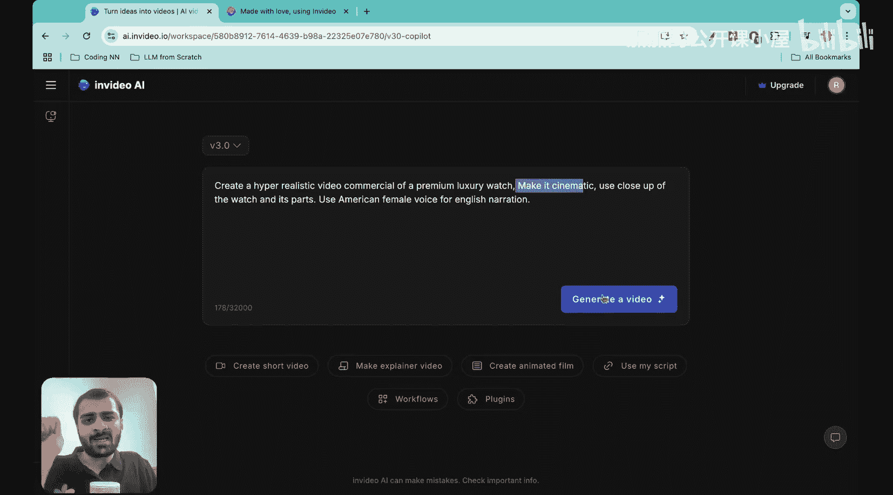
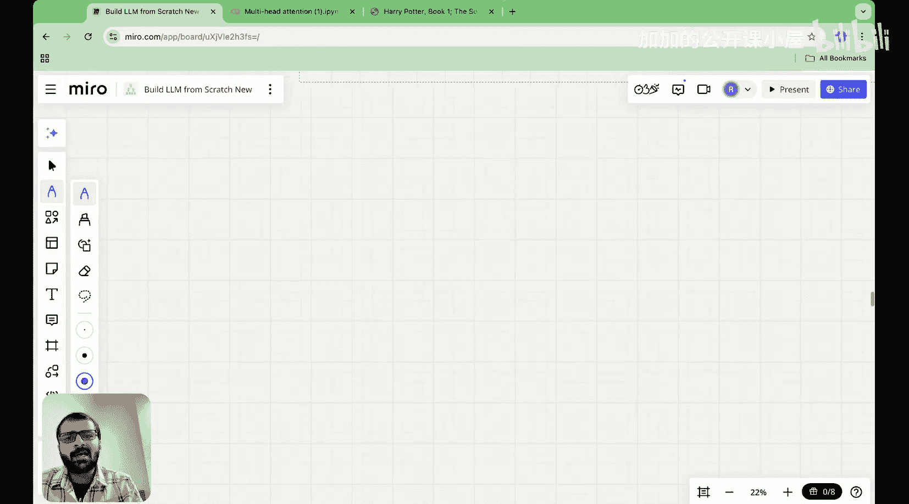
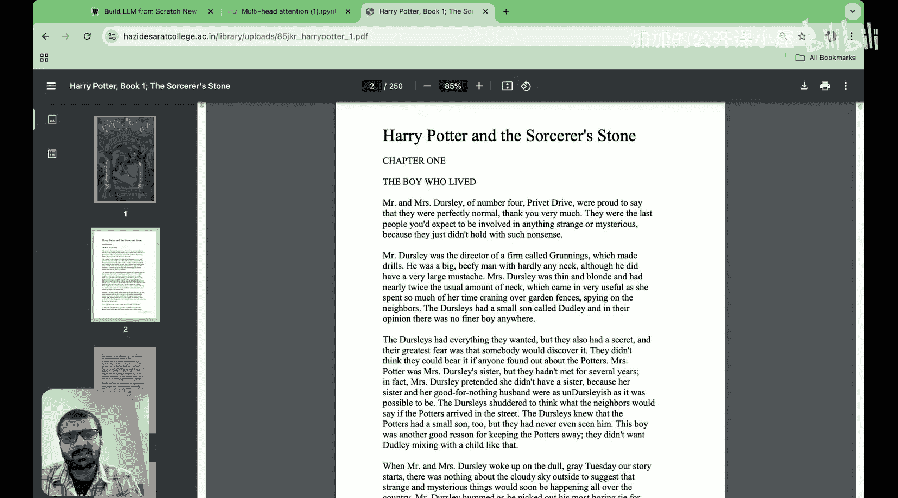
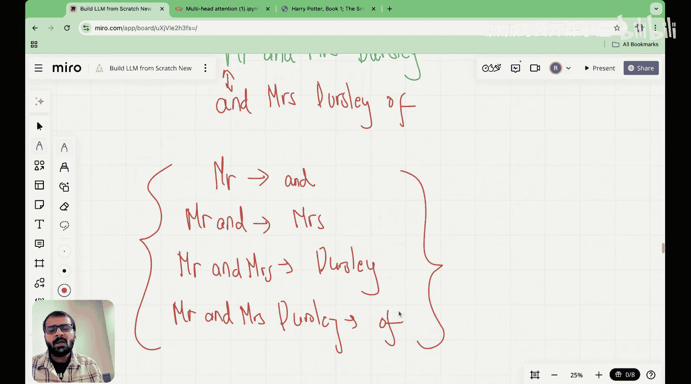

# Vizuara【中英⚡从零开始构建DeepSeek｜CS8803 Build DeepSeek from Scratch】 p06 P6 Causal Attention Explained： Don't Peek into the Future! [BV1ryHpzTEKW_p6]

Hello everyone， My name is Doctor Raj Dunecker。 I graduated with a PhD in machine learning from MIT in 2022。

 and I am the creator of the Bill Deepsek from Scratch series。Before we get started。

 I want to introduce all of you who are sponsor and our partner for this series in V AI。

All of you know how much we value foundational content building AI models from the nuts and bolts inviideo AI follows a very similar principle and philosophy to that of us let me show you how。

So here's the website of Inviideo AI。With a small engineering team。

 they have built an incredible product in which you can create high quality AI videos from just text prompts。

😊，So as you can see here I've mentioned a text prompt。

 create a hyper realisticistic video commercial of a premium luxury watch and make it cinematic with that I click on generate video。

Within some time， I am presented with this incredible video， which is highly realistic。

What fascinates me about this video is its attention to detail look at this。

 the quality and the texture is just incredible and all of this has been created from a single text prompt。

That is the power of Invi's product the backbone behind the awesome video which you just saw is in video AI's video creation pipeline in which they are rethinking video generation and editing from the first principles。

To experiment and tinker with foundational models， they have one of the largest clusters of H100s and H200s in India and are also experimenting with B200s。

Individualviio AI is the fastest growing AI startup in India building for the world。

 and that's why I resonate with them so much。The good news is that they have multiple job openings at the moment you can join their amazing team I am posting more details in the description below。

🎼。

Hello everyone and welcome to this lecture in theBuild Deep Seek from Sctch series。Today。

 we are going to proceed ahead in our journey of understanding the attention mechanism and briefly speaking。

 here's our plan。 Eventually， we know that we want to understand multi head latent attention。

 which is one of the key components of。The deep sea architecture。 But to do that。

 we need to proceed in a step by step manner。So initially we started out with understanding self attention we finished this in the previous lecture。

 so if you remember in the previous lecture we saw exactly the step by step procedure of how the self attention mechanism operated we started with the query key and value trainable weight mates we multiplied the input embedding matrix with these and got the query key and the value vectors。

Then we multipied the query matrix with the key transpose to get the attention scores。

We then scaled the attention scoress with the square root of keys dimension， applied soft Max。

 and we got the attention weights， and finally we multiplied the attention weights with the values matrix and we got the context vector matrix。

The way to interpret the context vector matrix is that essentially every row of the context vector matrix。

Cresponds to the context vector for that particular token so if you see the input embedding matrix every row corresponds to the input embedding vector for the next date is bright in this example。

Similarly， in the context vector matrix， the first row corresponds to the context vector for the。

 the second row corresponds to the context vector for next， et cetera。

 So the whole aim of self attention is to take the input embedding vector and convert it into a context vector And why does it do that。

 Because the context vector is much more richer than the input embedding vector。

 The input embedding vector just contains information about the semantics of the word。

But it does not contain any information about how that word is related to all the other world around it on the other hand the context vector contains information of not just the semantics but it contains information of how much importance needs to be paid to all the other words or token surrounding it。

And that's what makes the context vector much more richer in the representation than the input embedding vector。

So today what we are going to do is we are going to look at something which is called causal attention we have already looked at selfat and the next step along our journey to ultimately understand multih latent attention is causal attention as the name suggests causal implies that So one thing causes another right so we only need to look at those things which are responsible for producing the next token and I'll clarify what this means but causal attention is a central building block of understanding multiha attention and then eventually understanding key value cache and then ultimately understanding multih latent attention so let's begin our journey of understanding causal attention before we get started with the lecture I want to just take a quick。

呃。I want to explain a quick summary of how exactly the next token prediction is done so that I can explain or set the context for causal attention in a much better manner。

 so let's say we have the Harry Potter's first book right and that's a part of the data set which we are using to pretrain the large language model。

And so for the sake of simplicity， let me just take a screenshot of the first page over here and let me bring the screenshot onto my mirror board。

So I have brought the screenshot of this first page over here and now let me show you how the input and the target pairs are actually constructed。

To be fed to the transformer architecture。 So heres how that is done。 First。

 we determine something called as the context size。 So if the context size is equal to 4， we create。

A sequence of four tokens， so this is my first input。

And then I also determine something called as a stride which means how much I have to skip before I create the next input so this is my first input this is my second input this is my third input so similarly what Ill do is that I will divide the entire data set into chunks of four words or four tokens right and then based on my batch size I will have a matrix which is created so thats let's see the input batch1。

So if the batch size is equal to6 or if the batch size is equal to8， then the first batch will have。

Lets say the tokenide is corresponding to Mr。 and Missus Bradley That's the first row。

 So let's say this is 1151822。 The second row will be the tokenidees corresponding to these four tokens。

 so that will be something like 3，4，5，6。 Similarlyly。

 I will have eight rows like this because the batch size is equal to 8。

RightAnd why do I have four columns， the reason I have four columns is because the context size is equal to4。

So that is how the input batchge is created so this is my first input batch the way the output is created is that every input is essentially shifted to the right hand side by1 so this is my first output this is my second output this is my third output etc。

So once you get the input batch getting the output batch is very easy you just shift the input to the right hand side by one so this will be something like 15。

 18 223 etc， so thats my output batch1。谢是。Now if you look at the first。

If you look at the first rower and the first row here， that's my first input output prediction pair。

 So for example， let's see its so the input will be missed。And。Mrs。Don sleep。That is the input。

 So this corresponds to 1，15，18 and 22， and then the output is the input shifted to the right by one。

 So then this will be and。Mrs。They sleep。off。Thats the output Now if you see within this one pair of inputs and outputs there are actually four prediction tasks the first prediction tasks is when Mrer is the input。

And is the output。The second prediction task is when Mr and end is the input。Missses is the output。

 The third prediction task is when Mr and missus is the input。

Then Drsly is the output and the fourth prediction task is when Mr and Mrs Drsley is the input。

Then off is the output so if you see every rower although it looks like we have four tokens right so there might be just one prediction task which is predicting the next token but that is not the case if the input ises mist and misses Dursley and the output is and misses Dursley off。

If the context size is four， there are four input and target prediction tasks or input output prediction tasks which I've written over here right now。

 the thing which I want you to focus is that whenever you you' are predicting certain output so for example。

 when misses is the output which is to be predicted。

