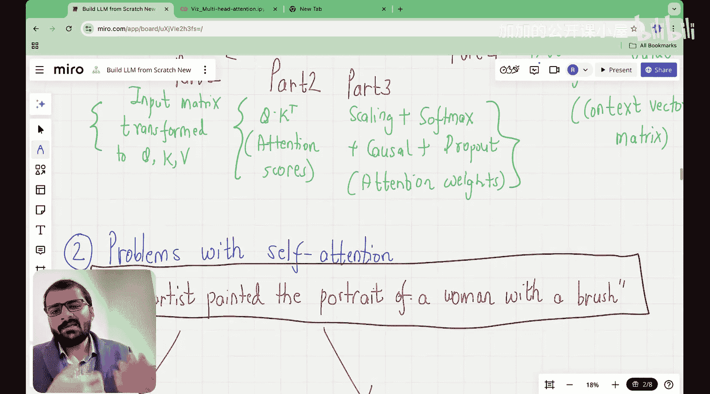

# Vizuara【中英⚡从零开始构建DeepSeek｜CS8803 Build DeepSeek from Scratch】 p07 P7 Multi-Head Attention Visually Explained [BV1ryHpzTEKW_p7]

Hello everyone， My name is Doctor Raj Dunecker。 I graduated with a PhD in machine learning from MIT in 2022。

 and I am the creator of the Bill Deepsek from Scratch series。Before we get started。

 I want to introduce all of you who are sponsor and our partner for this series in V AI。

All of you know how much we value foundational content building AI models from the nuts and bolts inviideo AI follows a very similar principle and philosophy to that of us let me show you how。

So here's the website of Inviideo AI。With a small engineering team。

 they have built an incredible product in which you can create high quality AI videos from just text prompts。

😊，So as you can see here I've mentioned a text prompt。

 create a hyper realisticistic video commercial of a premium luxury watch and make it cinematic with that I click on generate video。

Within some time， I am presented with this incredible video， which is highly realistic。

What fascinates me about this video is its attention to detail look at this。

 the quality and the texture is just incredible and all of this has been created from a single text prompt。

That is the power of Invi's product the backbone behind the awesome video which you just saw is in video AI's video creation pipeline in which they are rethinking video generation and editing from the first principles。

To experiment and tinker with foundational models， they have one of the largest clusters of H100s and H200s in India and are also experimenting with B200s。

Individualviio AI is the fastest growing AI startup in India building for the world。

 and that's why I resonate with them so much。The good news is that they have multiple job openings at the moment you can join their amazing team I am posting more details in the description below。

🎼。

Hello everyone and welcome to this next lecture in theBuild Deep See from Sctch series。

For a quick recap here is what we have covered so far we are on our journey to understand multi head latent attention and up till now we have understood self attention。

 we covered this module from basics and also the coding part of this we understood causal attention in the previous lecture and today we are going to understand the fundamentals of multi head attention in the next lecture we are going to code multi head attention but today the main。

Thing which I want to convey to you is what is the real need for having this multi head attention and why can't we just stick with causal attention。

 let's say。The more I read in literature and the more resources Ive seen。

 very few people have explained what is the real need for having multiple heads in attention。

So without going into the code or without directly jumping into the code first。

 it's very important for us to develop a very strong intuition of why we have multiple heads。

So today's lecture is titledGoing from selflf attentiontion to multi head attention。

 and I am going to try to explain this to you in a very intuitive manner directly from the first principles。

So let's get started with today's lecture， as we have seen before。

 the main goal of the self attention mechanism is essentially to take input embeddings and to transform them into something which is called as context embeddings。

Remember that input embeddings on their own do not contain any information about neighbors。

 so for example if I look at a single token in a sentence。

 input embedding captures the semantic meaning of that token and its position。

 but it does not capture how that token relates to the other tokens in the sequence。

And that's the additional mechanism which self attention brings into the picture。The context vector。

Whi is the main outcome of the self attention mechanism contains information of how a given token attends to all its neighboring tokens。

And to go from the input embedding matrix to the context embedding matrix。

 we have essentially four parts。The first part is transformation to query key value mates。

 second part is calculation of the attention scores。

 third part is calculation of the attention weights and fourth part is the context vector matrix calculation。

 So lets quickly see these four parts in action right now。So let me take you to that。

Let me take you to that part of the notebook where we did those calculations here it is。

So here's the input embedding matrix which we have there are1，2，3， four。

5 tokens and each token is essentially an eight dimensional vector in the first step what we do is that we multiply this input embedding matrix with trainable query key and value weight matrix and then we get this query vector matrix。

 the key vector matrix and the value vector matrix。After this point。

 we forget about the input embedding matrix completely and only operate on these queries keys and the values。

 That step number one， step number two is we take。A product of queries multiplied by the keys transpose。

 and that essentially gives us the attention course。

So every row of this corresponds to the attention score of that particular token。 So for example。

 the second row of this matrix corresponds to the attention scores for next and how next actually relates to the。

Next。你。Is bright。So these five attention scores are mentioned in this or are calculated in this second row。

Similarly， all other rows。Have attention scores of that particular token。

The main drawback of attention scores is that the rows don't sum up to1 so we cannot make intuitive claims that when next is the query give 10% importance to the give 50% importance to next etc so to do that we have to normalize the attention scores and we have two steps in the normalization first what we do is that we take the attention scores and we divide them by the square root of the keys dimension this is then so that the variance of the queries multiplied by the keys transpose that stays equal to1 and the variance does not become too large and then we apply the softmax function the softmax essentially ensures that when you look at a particular row all the entries of that row will sum up to1。

So this is normal self attention where we look for a given token we look forward as well as backward in the causal attention mechanism。

 what we do is that all the elements essentially about this diagonal， all of these elements。

Are essentially put to 0 because for a given token。

 we should not have access to all the tokens which come after that particular token。

 So all of these elements， which have marked in the green color right now。

 they are effectively masked to0。 That's what happens in the causal attention mechanism。

And then we can apply dropout to the attention rate so that we randomly mask out some elements to v0 this is to improve the generalization performance and to prevent lower overfitting。

The last step which is done here is that we take the attention weight matrix and we multiply with the value matrix to give us the context vector matrix。

And here you can see that every row of the context vector corresponds to my token。

 so the first row is the context vector for the the second row is the context vector for next， etc。

And if you look at the visualization of the context vector。

 you will see that the context vector is much richer because it takes into account how much attention is paid to all the nearby or the neighboring tokens of N。

 for example， whereas the input embedding does not have that richness in information about the neighboring tokens。

So this was in a nutshell the self attention mechanism and the causal attention mechanism also remember that when we saw the causal attention mechanism what we essentially did was we put the all the elements of the attention weights about this diagonal to be equal to0 and then after that we can also add dropout。

So we can further randomly turn off certain attention weight to zero， that was causal attention。Okay。

 so with that let's get started with today's lecture in which we will motivate why do we need to go from self attention to materialier attention？

So first remember that self attention is awesome and self attention has a lot of advantages because we finally start including or encoding information about the context which is present in the given sentence without self attention mechanism。

 language models would not be as good as understanding the meaning of sentences as they are today。

But。For all the advantages of self attention， self attention mechanisms come with。

One very major problem， and。Multair retention solves that problem。

So let's see what this problem with the self attention mechanism is。

 And for that I want to start out with a simple illustration。

 So what I want to start out with is that I want to start out with。Sentence， right。

 And the sentence is the artist。The artist painted the portrait of a woman with a brush。

The community。

