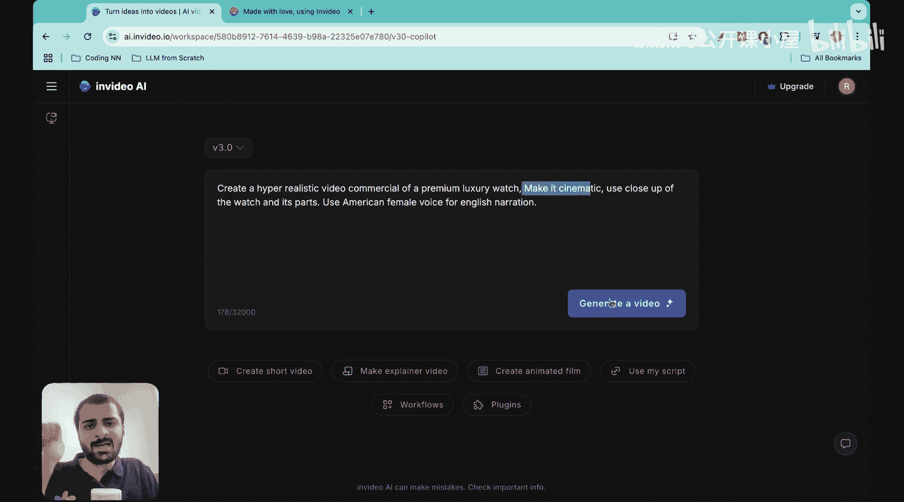
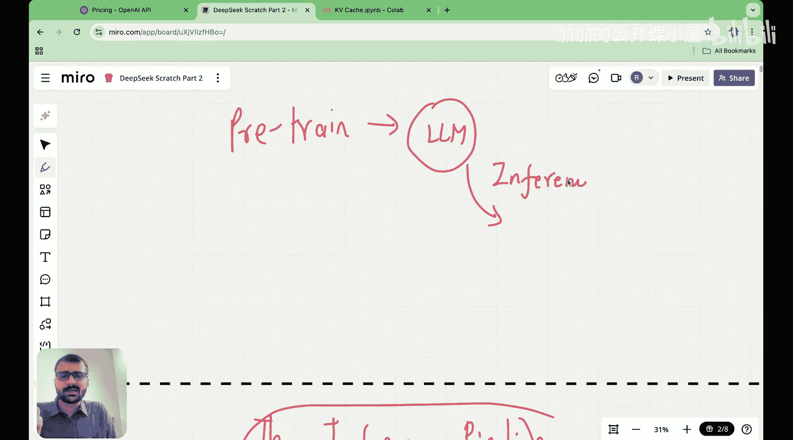
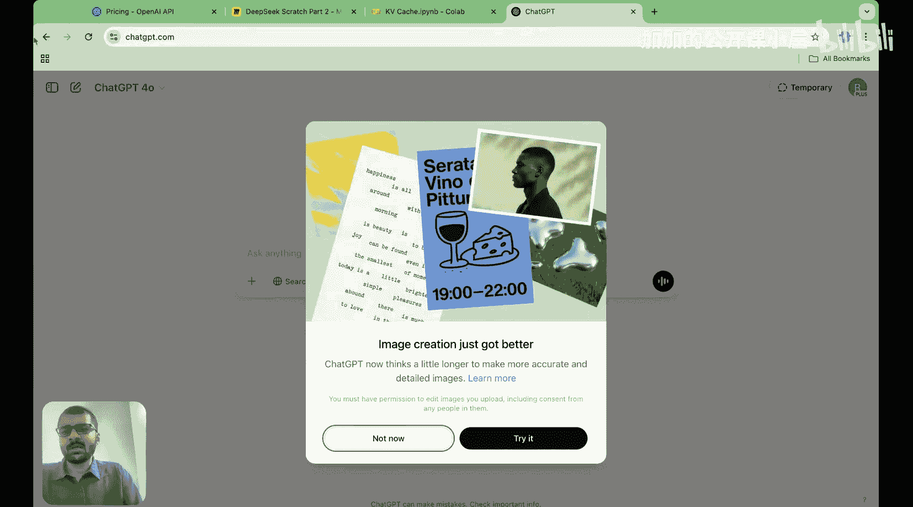
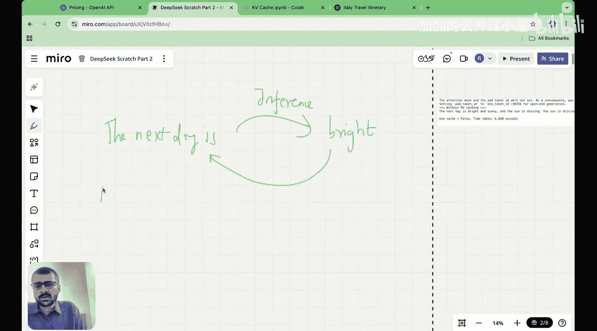

# Vizuara【中英⚡从零开始构建DeepSeek｜CS8803 Build DeepSeek from Scratch】 p09 P9 Key Value Cache from Scratch： The good side and the bad side [BV1ryHpzTEKW_p9]

Hello everyone， My name is Doctor Raj Dunecker。 I graduated with a PhD in machine learning from MIT in 2022。

 and I am the creator of the Bill Deepsek from Scratch series。Before we get started。

 I want to introduce all of you who are sponsor and our partner for this series in V AI。

All of you know how much we value foundational content building AI models from the nuts and bolts inviideo AI follows a very similar principle and philosophy to that of us let me show you how。

So here's the website of Inviideo AI。With a small engineering team。

 they have built an incredible product in which you can create high quality AI videos from just text prompts。

😊，So as you can see here I've mentioned a text prompt。

 create a hyper realisticistic video commercial of a premium luxury watch and make it cinematic with that I click on generate video。

Within some time， I am presented with this incredible video， which is highly realistic。

What fascinates me about this video is its attention to detail look at this。

 the quality and the texture is just incredible and all of this has been created from a single text prompt。

That is the power of Invi's product the backbone behind the awesome video which you just saw is in video AI's video creation pipeline in which they are rethinking video generation and editing from the first principles。

To experiment and tinker with foundational models， they have one of the largest clusters of H100s and H200s in India and are also experimenting with B200s。

Individualviio AI is the fastest growing AI startup in India building for the world。

 and that's why I resonate with them so much。The good news is that they have multiple job openings at the moment you can join their amazing team I am posting more details in the description below。

🎼。

Hello everyone， and welcome to this lecture in theBuild Deep Seek from Sctch series。Today。

 we make progress towards understanding one of the key innovations in the deep Sih architecture。

 and that key innovation is multiha latent attention。Deep seat。When they wrote their。

The architecture of the model， which was eventually going to transform the whole LLM landscape。

 one of the key innovations was this concept of multihead latent attention。

And through this innovation， they unlocked。Speed improvements。

 performance improvements in the transformer architecture itself。Now。

 to understand multiha latent attention， we cannot go to understand this concept directly。

We have to first understand the key value cash。And the main purpose of today's lecture is to understand the key value cash。

So I'm going to divide today's lecture in three parts。

First I am going to explain to you what exactly happens during the inference time of a language model Second。

 we are going to understand what is this key value cache and why do we really need it and third thing which we will understand is that once we understand why we need the key value cache how to implement the key value cache。

This lecture serves as the foundational building block towards finally understanding multihi latent attention because latent attention would not have been developed if it were not for the key value cache at the end of today's lecture we'll see that key value cash has some disadvantages of course it leads to a huge number of improvements but it comes with a dark side。

And to deal with this dark side of key value cash， latent attention was ultimately in。

But to understand the dark side of the key value cache we need to first understand the concept in a lot of detail。

 I took a long time to prepare this lecture because I want all of us to understand every single thing from the very basics。

So most of the lecture is going to be on the way board where as always I'll explain everything from scratch and then towards the end of the lecture we also have a coding component。

So if you recall what all we have covered in this series so far。

 first we started with the concept of self attention then we learned about causal attention and in the previous lecture we learned about multiha attention if you have followed until this part then you are aware of the concept of attention and now you are fully ready and equipped to understand the key value cache。

So without any further delay， let's get started with this very important concept。

One more thing before we go ahead is that if you look at the open AI API and its pricing。

 let's look at the pricing for this GP4， which is mentioned over here。

 it's about $30 per million token。Now we have another GPT4 year with 32 k that's 60 per million tokens so why is there a price difference of two times one thing to note here is that this 32 k or 32000 is the context size。

For GPT for the context size is just 8000， but here the context size is 32000。

This clearly shows that if the context size actually increases。

The price also increases proportionately。And today we are going to learn that the key value of cash is one very major reason for this price increase。

Once we implement the key value cash， it comes with certain limitations。

And that's why those limitations depend on the context size。

And that's why as you increase the context size， open air charges you a lot more。

This also will be clear once we reach the end of today's lecture。Okay。

 so the first thing which we have to understand in this lecture is that。

Key value cash or KV cash only comes into picture during the inference stage of LllLs。

And that's the most important thing to notice。 So people who are watching this stop and think whether your concept about pre training and inference is clear Okay。

 so when an LLM。Is used， it is actually decomposed into two parts first we have to pretrain the language model。

First， we have to pretrain the language model and then you get a pretrained LLM。

On the pretrained LLM， then you perform inference， which means you ask questions and then the LLM response。

To give an example， let's say if I go to chat GPT right now right and then let me ask some questions such as。

Make a travel plan for Italy。If I ask this question right now I am not doing pretrain here。

 I am in the inference stage because the model which is printing this response is already pretrained。

But。Here the pretrain model is used for inference， which means for predicting one new token every single type。

And key value cache， the whole discussion which we are going to do in today's lecture only applies during the inference stage of the language model。

 this means that imagine your model is pretrained if the model has 175 billion parameters。

 all of those parameters are pretrained and they are fixed。

Now we are using that model to predict the next token so what actually happens during the inference stage is that it's a next token prediction task right so we are going to predict the next token during the inference stage。

And this is the main purpose of inference， the model is now trained all the parameters are fixed。

 we predict one token at a time。So the first concept to understand is that key value cache only is applicable during the inference stage。

 so first let us understand what actually happens during the inference pipeline of language models。

So let's say we ask or we give some sentence to the language model。

And here I have a simple demonstration for you where I've given some prompts such as the next day is bright and I'm using GPT2。

This is a pretrained GPT2 okay， Im going to pass this pro to GPT2 and then you will see that the model prints out one token each time see over here what is happening one new token is being printed each time during the inference stage。

So the next day is bright and then the next token is and the next token is sunny etc。

 so I'll run this code again just keep an eye out what is happening over here so if you look at what is happening over here you will see it proceeds very fast but one new token is being printed every single time。

And when you are interacting with Cha GPPT， the UI or the interface is such that you feel that everything is presented at once。

 but actually one new token is generated for you every single time。Okay。

 so this is the main thing which is happening in the LLM inference and the way it works at a more deeper level is that let's say if the input is the next day is it goes through the LLM architecture or the LLM pipeline well see that in a moment the new token is predicted let's say the new token is bright。

That new token is then added back to the input。So the way it happens is that the。Next。Day is okay。

 And let's say we are doing the inference。And the next token predicted is bright。

 This bright is then added back over here。

