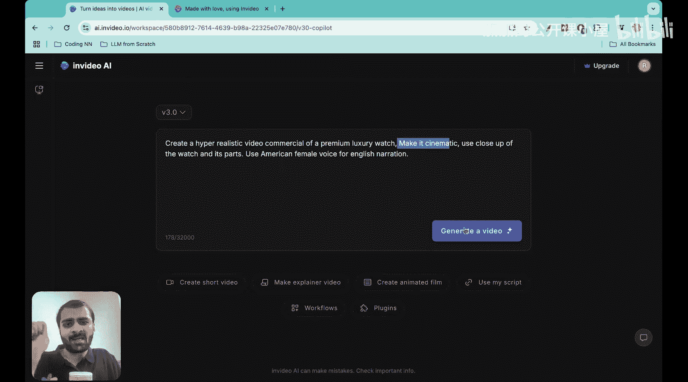
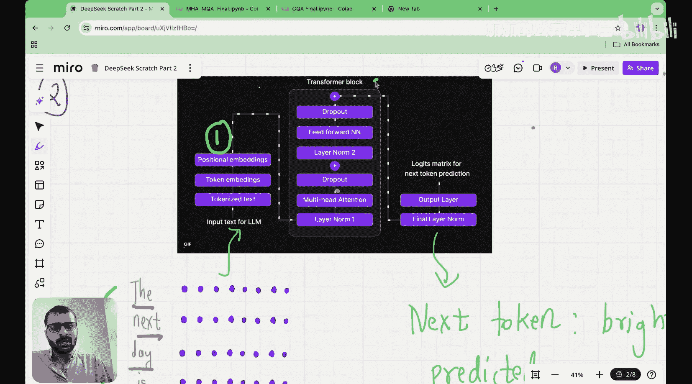
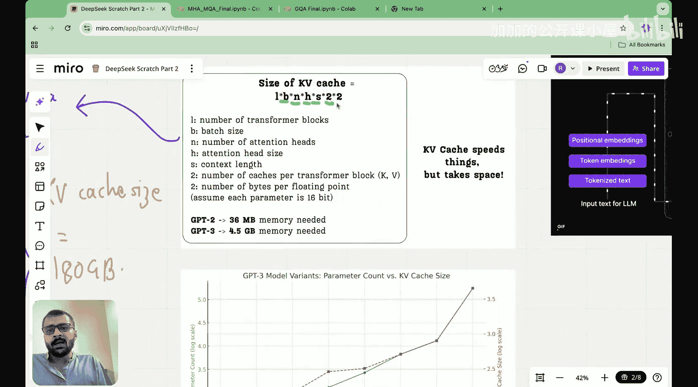
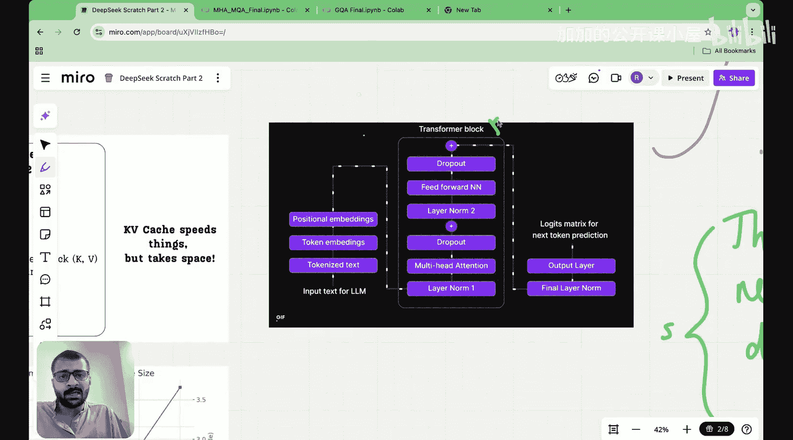
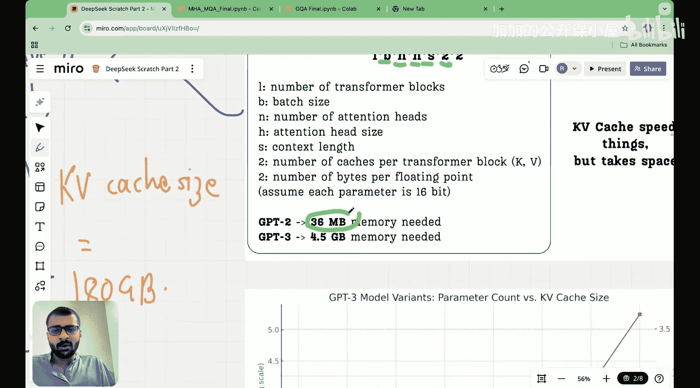

# Vizuara【中英⚡从零开始构建DeepSeek｜CS8803 Build DeepSeek from Scratch】 p10 P10 Multi-Query Attention Explained ｜ Dealing with KV Cache Memory Issues Part 1 [BV1ryHpzTEKW_p10]

Hello everyone， My name is Doctor Raj Dunecker。 I graduated with a PhD in machine learning from MIT in 2022。

 and I am the creator of the Bill Deepsek from Scratch series。Before we get started。

 I want to introduce all of you who are sponsor and our partner for this series in V AI。

All of you know how much we value foundational content building AI models from the nuts and bolts inviideo AI follows a very similar principle and philosophy to that of us let me show you how。

So here's the website of Inviideo AI。With a small engineering team。

 they have built an incredible product in which you can create high quality AI videos from just text prompts。

😊，So as you can see here I've mentioned a text prompt。

 create a hyper realisticistic video commercial of a premium luxury watch and make it cinematic with that I click on generate video。

Within some time， I am presented with this incredible video， which is highly realistic。

What fascinates me about this video is its attention to detail look at this。

 the quality and the texture is just incredible and all of this has been created from a single text prompt。

That is the power of Invi's product the backbone behind the awesome video which you just saw is in video AI's video creation pipeline in which they are rethinking video generation and editing from the first principles。

To experiment and tinker with foundational models， they have one of the largest clusters of H100s and H200s in India and are also experimenting with B200s。

Individualviio AI is the fastest growing AI startup in India building for the world。

 and that's why I resonate with them so much。The good news is that they have multiple job openings at the moment you can join their amazing team I am posting more details in the description below。

🎼。

Hello everyone and welcome to this lecture in the build Deep Se from Scratch Series。Today。

 we are going to start to understand how do we solve the KV cache memory problem？

We learned about the KV cache in the previous lecture。

 and we saw that it comes with a good side and it comes with a bad side。

First let me quickly recap what is the KV cache， why do we need it。

 what is its good side and what is its bad side。So it all starts by looking at the inference pipeline of language models and this is how language models do inference。

We first have an input sequence of tokens。Let's say we have four tokens the next day is and then we have to predict the next token that's the main task of language model inference。

 this input sequence goes through this entire architecture。

 it goes through this first block of data preprocessing， it goes through the transformer block。

 it goes through the output layer and then we get a logics matrix through which the next token is predicted。

One key thing to realize here is that。To predict the next token we only need the context vector of this last token so let me explain to you how once we are in the multi head attention layer we get the attention score between this last token and all the other tokens and thats how we can get the context vector for this last token this context vector then goes through all of these remaining layers。

It goes through these output layers and ultimately we get a logicits vector corresponding to is which is the last token in my input sequence。

This logic vector is a vector which has 50，000 tokens if or 50，000 parameters。

 if the vocabulary size is 50，000。And then I choose that index which has the highest value or the highest probability and then I find the token corresponding to this index and that's my next token prediction。

 which is bright。So the first key insight to remember during LLM inference is that to get the next token prediction I only need the context vector of my last token of the input sequence that's it I don't need these other context vectors at all that's the first insight the second insight is that lets say。

呃。The next day is was the input and bright is the output now this bright is appended to my input and that becomes my new input sequence so the new input sequence is the next day is bright which will again pass through this entire architecture and we predict the new token so let's look at what happens when this new input matrix passes through the transformer block especially let's look at what happens when this new input matrix passes through the multiier attention block。

So here we see that we'll get the queries matrix， we'll get the keys matrix。

 we'll get the values matrix， well get the attention scores。

 well get the attention weights and we'll get the context matrix。

 but if you pay close attention look at these black boxes。

Which I marked Ive marked a black box over here， Ive marked a black box over here。

 I've marked a black box over here。Your。Here and in the context matrix also。

So the second key realization is that all of these black boxes are already computed in my previous iteration in my previous iteration in the multiier attention。

 I've already computed all of these queries keys values except for this last throwover here that's corresponding to my new token so I have not computed that So the second realization is that I'm doing so many recalculations here can I store something that's where the idea of the cache comes into the picture。

So then we started backtracking to predict the next token so what I have to do is to predict the next token based on these inputs right what do I need to predict the next token I only need the context vector corresponding to the last token so to get that context vector what I only need is that I need the attention weights for my last token multiplied by the values matrix to get the attention weights I need the attention scores to get the attention scores I need the query vector multiplied by the keys。

Now all of these things which I've marked in the black boxes are cached。

 which means to get the keys matrix， I will cache my previous keys， I will cache my previous values。

 and I will only compute this new row， I will only compute this new row。

So whenever a new whenever a new token comes in all I have to do is that I have to find the query vector corresponding to the new token。

 I have to find the keys vector corresponding to the new token and append it to the cache keys so that gives me the total keys matrix and the third thing I have to do is I have to find the value vector for the new token and I have to append it for the cache values。

Then I multiply queries with keys transpose， I get the attention scores from that I get the attention weights。

 I multiply it with the values matrix and that's how I get the context vector only for the last token。

This context vector for the last token will traverse the rest of this journey。

 and then it will predict my next token。So you see what we have done here。

 we don't recompute the values and the keys again at all， we store them from the previous iteration。

 that' is the idea of caching， we cache the keys and values。

Now as we have seen in the previous lecture what happens with caching is that it reduces the number of computations which we need to do so if you see this line when we implement caching the amount of computations which we need to do increase only linearly with the number of input tokens however。

 if you don't do caching the amount of computations increase quadratically。

So that's one good side of implementing KL newC， the good side is that it reduces the number of computations which we need to do that ultimately reduces our cost that's a good thing for us。

Then what's the bad side， the bad side or the ugly side of the K value cash is that we the key value cash is that we are scoring something now we are cashing something and just like every piece of land。

To own every piece of land， we have to pay a price， right。

 similarly for every piece of data stored in the memory。

 for every single parameter stored in the memory， we have to pay a price。

The number of parameters you need to store when you look at a K value cache K value cash is given by this much。

Why is it this much， Well， Because let's look at one transformer block initially。

 If you look at one transformer block， let's say I have four tokens the。Next date is。

Let's say this is my four tokens， and each token has a dimension of four。

Now this dimension is the number of attention heads multiplied by the head dimension。

 so that's n into H。The number of rows over here is equal to my context size， so that's s。

And this is just one batch。 But if I'm processing in multiple batches。

 then this should be multiplied by B。 That's where the B into n into S H into S comes in。

 These are the number of parameters which need to be stored。 And remember if this is the keys。呃。

If this is the keys matrix there will be a values matrix along with it so then this will be multiplied with two and then I'm just showing this for one transformer block。

 there are usually multiple transformer block in language models so that will be multiplied by L which is the number of transformer blocks and this one more two additional is the number of bytes per floating point so Im assuming that each parameter stored is 16 bits which is 2 bys so the size of the TV caches given by L into B into L into H into s into 2 into 2 Now if you have GP2 that's 36 MB of memory If you have GP3 that's 4。

5 gB of memory but if you have。

