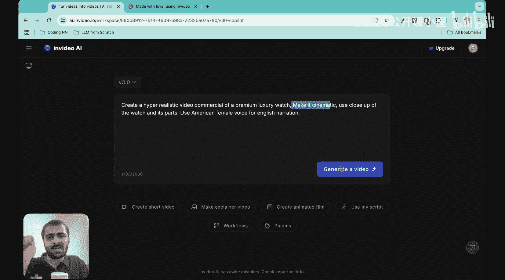
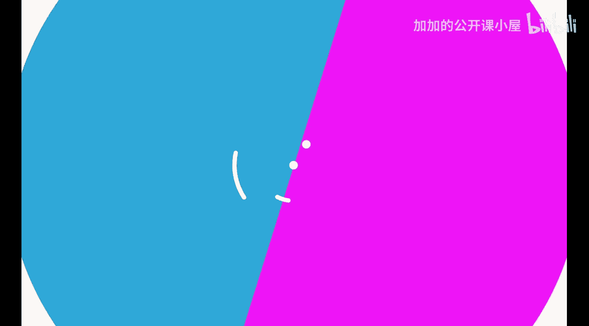
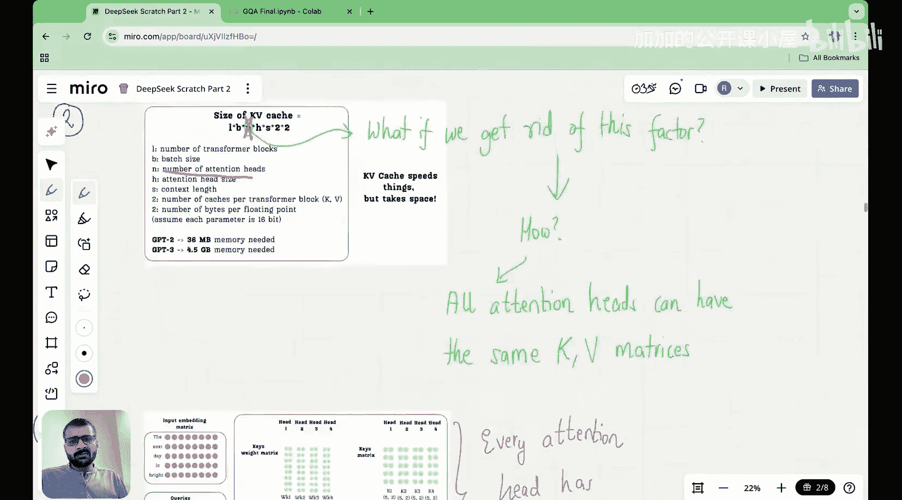

# Vizuara【中英⚡从零开始构建DeepSeek｜CS8803 Build DeepSeek from Scratch】 p11 P11 Understand Grouped Query Attention (GQA) ｜ The final frontier before latent [BV1ryHpzTEKW_p11]

Hello everyone， My name is Doctor Raj Dunecker。 I graduated with a PhD in machine learning from MIT in 2022。

 and I am the creator of the Bill Deepsek from Scratch series。Before we get started。

 I want to introduce all of you who are sponsor and our partner for this series in V AI。

All of you know how much we value foundational content building AI models from the nuts and bolts inviideo AI follows a very similar principle and philosophy to that of us let me show you how。

So here's the website of Inviideo AI。With a small engineering team。

 they have built an incredible product in which you can create high quality AI videos from just text prompts。

😊，So as you can see here I've mentioned a text prompt。

 create a hyper realisticistic video commercial of a premium luxury watch and make it cinematic with that I click on generate video。

Within some time， I am presented with this incredible video， which is highly realistic。

What fascinates me about this video is its attention to detail look at this。

 the quality and the texture is just incredible and all of this has been created from a single text prompt。

That is the power of Invi's product the backbone behind the awesome video which you just saw is in video AI's video creation pipeline in which they are rethinking video generation and editing from the first principles。

To experiment and tinker with foundational models， they have one of the largest clusters of H100s and H200s in India and are also experimenting with B200s。

Individualviio AI is the fastest growing AI startup in India building for the world。

 and that's why I resonate with them so much。The good news is that they have multiple job openings at the moment you can join their amazing team I am posting more details in the description below。

🎼。

Hello everyone， and welcome to this next lecture in theBuild Deep Seek from Sctch series。Today。

 we are going to learn about grouped query attention。In the previous lecture。

 we started learning about techniques which we can use。To solve the Kwi cache memory problem。

And the first technique which we learned about was the multi query attention。

 and today we are going to learn about the grouped query attention。First。

 let me do a quick revision of what we learned in the multi query attention。Essentially。

 it all started by looking at the K cash。 So during inference， we cash the。

We the keys we cache the keys matrix and we cache the values matrix during the inference time。

 and as a result we don't have to do repeated calculations again and again while predicting the next token。

That's the main idea of the keyL cash。Although the key value of cash offers a lot of benefits such as。

It offers a linear relationship between the input tokens and the compute time。

 whereas if you don't do caching， then the compute or compute requirements rather than the amount of computes。

 which we need to do increase quadraically if we don't do caching。

 If we do caching on the other hand， the amount of computations needed increase linearly with the input tokens。

 So we save on a huge amount of。Computational cost。

 and we don't have to do repeated computations again and again。

 That's one main benefit of the Kv cache。 However， it comes with this dark side。

 which we learn about in the previous lectures and that dark side is that。

It takes a lot of space in the memory。In fact， the memory requirements of the KV cache or the size of the KV cache grows with the number of transformer blocks。

 the bath size， the number of attention heads， the attention head size， and the context length。

As all of these parameters increase the size of the KV cache grows。

 so for example for GPT2 it's a relatively small model， the KV cache is just 36 M。

 but for GPT3 the KV cache grows to 4。5 gigys if you go to even bigger models like the deep C R01 orV3 for example。

This model uses 61 transformer blocks。Even if we assume a batch size of 1 during inferencefer。

 the number of attention heads is 128 and the attention head dimension is also 128。

 along with a context size of 100，000。With all of these parameters。

 the Kwi cache size for the deep seat model becomes as huge as 400 Gb。No。

If we take up this much space in memory it slows down our computations and we also have to pay more。

 so imagine a company has built a foundational model with just the normal variant of this Kv cache。

The company has to pay a lot because it has to store a lot of parameters during the inference time。

 and naturally this increases the cost which the company charges to the clients for inference。

But as we know， deep seek inference cost per API oil is very low， it's incredibly less。

So clearly it's not using this normal variant of the Kv cache， right？

So people have figured out ways to solve the KV cache memory problem and the ultimate way is the new innovation which Deepse implemented and that's the multihi latent attention。

But to get to that there were two other innovations。

 the first one was the multi query attention which we learned about in the previous lecture and today we are going to learn about group query attention。

The key concept of multi multiquary attention is very simple。

What we learned in the previous lecture was that if in normal multi head attention。

When we look at the crable keys matrix and when we look at the cranable value matrix every head essentially has different values right so if you look at head1 or attention head2 or attention head3 or attention head4 these values are different from each other that's why the color coding which Ive used the notes that every attention head has different values for WK and every attention head similarly has different values for Wv as well。

Now， naturally， since the input embedding is multiplied with Wk and Wv to give me the keys matrix and the query keys matrix and the value matrix。

When we look at the keys matrix K。The attention head1 values are very different from the attention head two values which are different from the attention head3 and which are different from the attention head4 and thats similar to the values also to the values matrix。

 the values or the elements for each attention net are different from each other。

Now since these values for the keys matrix and the value matrix are different from each other for different heads。

 we have to store all of them in the cache， so we are caching the keys and the values right so when we cache the first head we also have to cache the second head we also have to cache the third head and we also have to cache the fourth head similarly for the values we have to cache all the head separately and as a result if you look at the。

For mula for the KV cache size， you will see that it actually grows with the number of attention hits。

 the more the number of attention hits， the more the parameters we need to store。

So in multiquary attention， people did a simple trick。

 they said that what if in the Wk and in the WV matrix？

I'll first take a look at the parameters in my attention head1 and then I duplicate these same parameters for head number two。

 head number three and head number4， Similarlyly for the values I take my head head1 parameters and I duplicate it for head2 head3 and head4 Natural what this will also mean is that in my keys matrix K and my value matrix V my attention head1 values attention head2 attention head3 and attention head4 values will all be identical to each other there will be no difference in the values of the keys among different heads head1。

 head 2， head 3 and head4 will be the same。Now， if you look at the values matrix also。

 what we have for V1 will be the same for V2 for V3 and V4。So in multiticqu attention。

 keys and the value mats。Have attention heads and each attention head contains the same information in fact the exact same parameters so you can think of taking K1 and duplicating it to form K2 K3 and K4。

 you can think of taking V1 and duplicating it to have V1 v2 and V4 v1， V2 V3 and V4。Naturally。

 the consequence of this is that now since the values for all the heads are the same。

 we just need to cache or store one of these heads。

We don't have to store the mates for all the different heads because these values are literally the same right。

 so we can get rid of this factor n the number of attention heads in the size of the KV cache。

So when we use multi query attention， let's say deepse has 1208 attention heads when we use multi query attention we reduce the KV cache size by a factor of 128 from 400 gb to just 3 gb。

Howeverever。Although we save the amount of memory storage required by the KV cache。

 there are a number of disadvantages of the multi queryary attention and the major disadvantage is that it leads to significant performance degradation the main reason。

