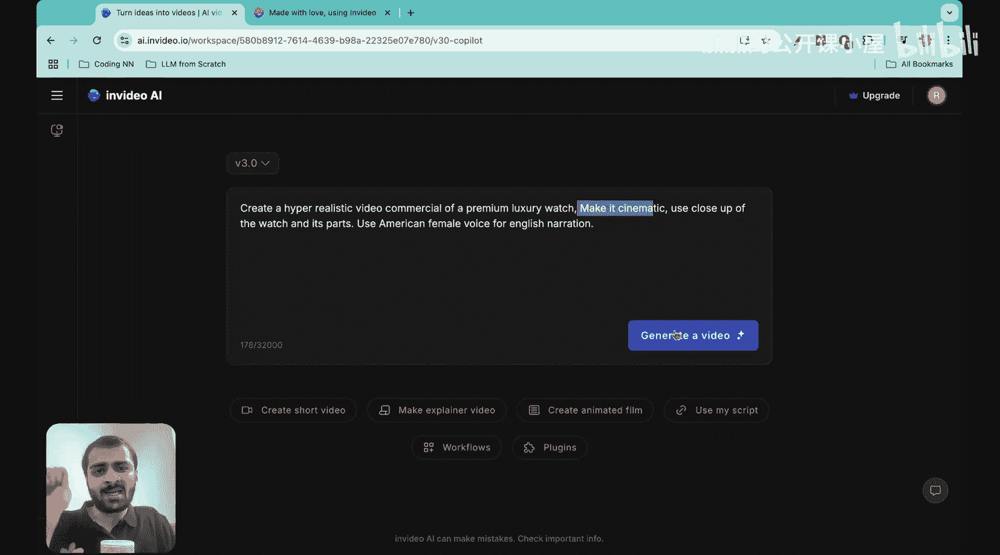
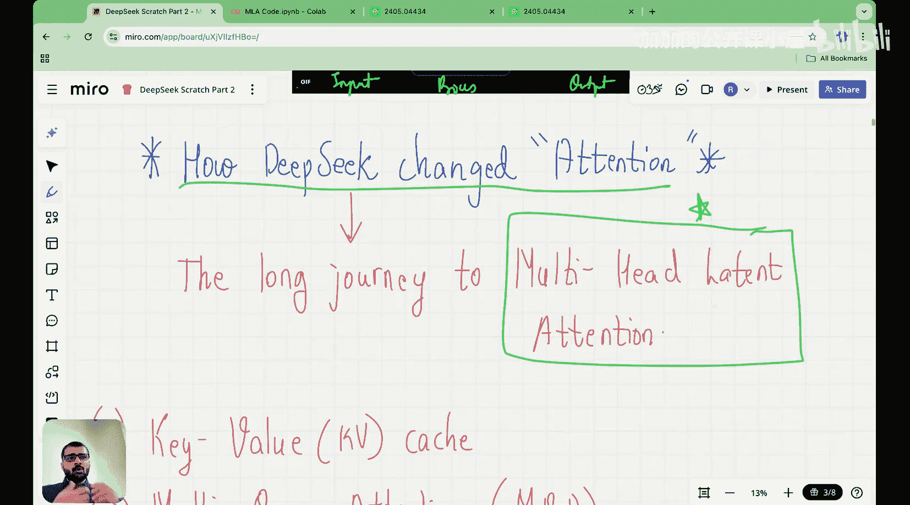
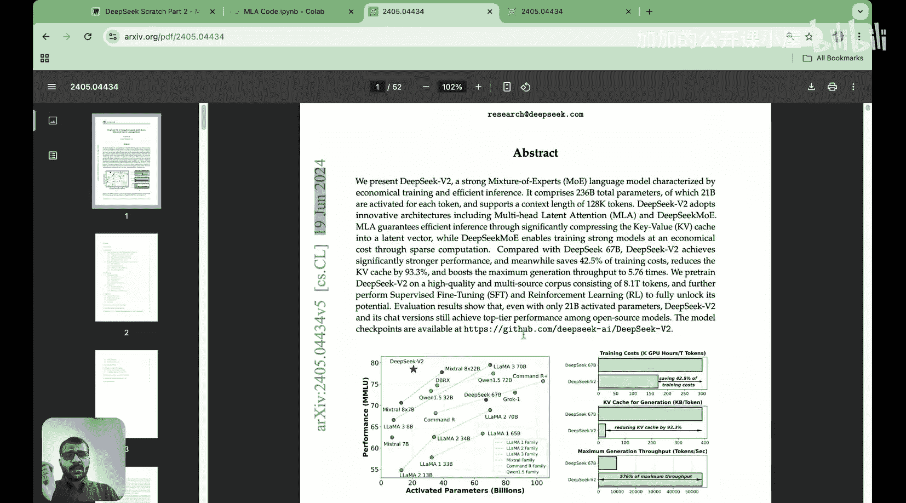
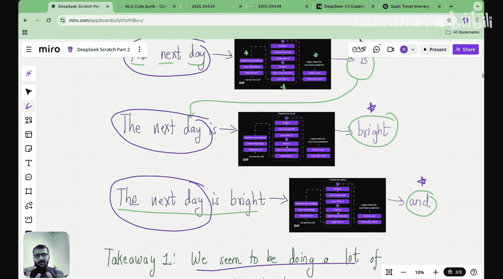
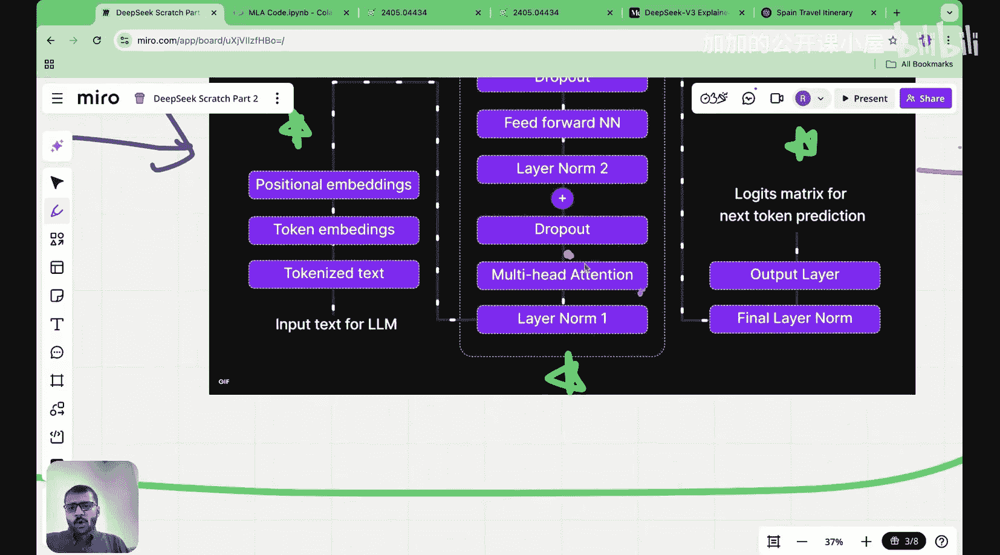
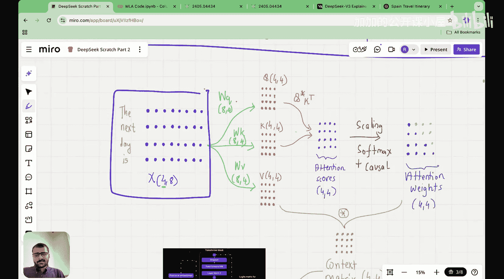

# Vizuara【中英⚡从零开始构建DeepSeek｜CS8803 Build DeepSeek from Scratch】 p12 P12 Multi-Head Latent Attention From Scratch ｜ One of the major DeepSeek innovat [BV1ryHpzTEKW_p12]

Hello everyone， My name is Doctor Raj Dunecker。 I graduated with a PhD in machine learning from MIT in 2022。

 and I am the creator of the Bill Deepsek from Scratch series。Before we get started。

 I want to introduce all of you who are sponsor and our partner for this series in V AI。

All of you know how much we value foundational content building AI models from the nuts and bolts inviideo AI follows a very similar principle and philosophy to that of us let me show you how。

So here's the website of Inviideo AI。With a small engineering team。

 they have built an incredible product in which you can create high quality AI videos from just text prompts。

😊，So as you can see here I've mentioned a text prompt。

 create a hyper realisticistic video commercial of a premium luxury watch and make it cinematic with that I click on generate video。

Within some time， I am presented with this incredible video， which is highly realistic。

What fascinates me about this video is its attention to detail look at this。

 the quality and the texture is just incredible and all of this has been created from a single text prompt。

That is the power of Invi's product the backbone behind the awesome video which you just saw is in video AI's video creation pipeline in which they are rethinking video generation and editing from the first principles。

To experiment and tinker with foundational models， they have one of the largest clusters of H100s and H200s in India and are also experimenting with B200s。

Individualviio AI is the fastest growing AI startup in India building for the world。

 and that's why I resonate with them so much。The good news is that they have multiple job openings at the moment you can join their amazing team I am posting more details in the description below。

🎼。

Hello everyone and welcome to this lecture in theBuild Deep Seek from Sctch Series。

Today is probably one of the most important lectures in this series because today we are going to see how deep sea completely changed the attention mechanism or how they rewrote the transformer architecture。

Through the invention of the multi head latent attention mechanism。

The reason Deepse achieved so much more efficiency in their transformer architecture。

 the reason they managed to reduce the size of the KV cache while still maintaining the performance of the transformer architecture。

Is。One of the main reasons why deepse became so popular and why they have so less inference costs。

And the main innovation behind。This reduction in inference cost SwgeDC has is multi held latent attention mechanism。

So this mechanism， which was innovated in the deep seat paper。

Actually changed this component of the transformer architecture So if you see this entire architecture of the LLM。

 there is the input block， there is the processor block， and then there is the output block。

The latent attention mechanism， which they introduced transformed this aspect of the transformer architecture。

 which is the multi hair attention mechanism。So today we are going to explore the long journey to multiha latent attention。

 we are going to understand how latent attention works and we are going to understand the intuition behind latent attention。

I'm going to show you every single thing in detail from scratch on this whiteboard so that you don't find latent attention confusing。

If you go to the deepse V2 paper， which was introduced in June 2024。

 Here is where they introduced the。

Multi hair latent attention architecture and here is the schematic for the latent attention architecture。

So if you scroll down below you will see that they have multiple variants of the latent attention mechanism today we are going to see the simplest variant which they call low rank key value joint compression in one of the later lectures in this series we are going to see what is meant by decoupled rotary position embedding we are not going to see that today today we are going to see the most simple version of the multi head latent attention。

When you scroll scroll through this paper， you will see that they have four figures。

 they have multi head attention， grouped query attention。

 multi query attention and finally multi head latent attention。

We are going to learn about these three quickly today。

 and then finally we are going to see multi health latent attention。

So the plan for this lecture is going to be as follows。

I have already covered key value cash multi query attention and group query attention in separate lectures previously。

 but I am aware that there might be some people who are listening to this lecture for the first time so for those people I am going to go through all of these concepts slightly quicker and then well come to multi head latent attention。

That way， this would be a self contained lecture on its own。

The main issue with the current available resources or multihlate attention is that if you search。

Multi head latent attention you will get blog posts like these If you walk through these blog posts。

 youll see that they only have paragraphs and these mats which are incredibly difficult to understand。

And nothing is explained from scratch it' is not meant for people who want to understand how latent attention works right from the matrix calculation matrix multiplication level。

 this lecture is intended for all those people who want to open the black box of machine learning and understand how the nu sand holds work。

It took a very long time for me to prepare this lecture， but I'm finally ready with it。

 so let's get started。So first we will have to understand what is the key value cache。

 then we will understand what is the dark side of the key value cache。

 then we will understand what people did to solve the key value cache problem。

Whi is the multi query attention and the group query attention。

 and then finally we'll come to how latent attention works。So too。

 our story begins at the inference stage of language models。

So let's say pre training is done and now we are at the inference stage。

 What happens in the inference stage when you go to chat GP， let's say and when you type something。

 let's say。Make a travel plan for。Spain， let's say you type something like this。

Cd GD what it does or any language model it predicts one token at a time that's the main purpose of inference During inference we predict one token at a time。

 so let's say the input tokens are the next day these three input tokens but during inference and then we have to predict the next token these three tokens go through this entire LLL architecture they go through the data preprocessing layer they go through the transformer layer and then they go through the output layer。

Finally， we get this logics matrix at the output layer through which we can predict the next token。

 In this case， let's say the next token is is。This next token is then appended back to the input sequence and the input sequence is then passed again through this pipeline remember when the input sequence is now passed through this pipeline everything is pretrained so the trainable mats trainable parameters are all fixed。

And then we get the next token the next token is then appended back to the input sequence。

 the entire input sequence is again passed through through this entire pipeline and we get the next token。

 This is how the next token prediction task works。Now。

 if you take a look very closely at this inference pipeline。

 you might intuitively realize that are we repeating calculations again and again because these three tokens were passed through this entire architecture to predict is。

Then these three tokens were again passed through this entire architecture to predict bright。

Then these three tokens were again passed through this entire architecture to predict and。

So the first takeaway of our story is that we seem to be doing a lot of repeated calculations in the inference stage that's number one please keep this point in mind。

Now this is at an intuitive level what we can do now is that let us visualize these repeated calculations and in particular I want to focus on the multiha attention block remember what happens in the multiha attention block is that the input sequence comes in and then we get the input embedding vectors and they are transformed into context vectors。

So let's see the calculations which are happening inside this multiha attention block and let's see if there are any repetitions in the calculations。

If there are reps in the calculations， then we'll see what to do with it。

 but intuitively we seem to be doing a lot of repeated calculations right。

 let's try to quantify this。So I have the next day is these are my four tokens。

 they form my input embedding matrix， okay， these four tokens are there。

 they will be multiplied with the trainable query matrix。

 they will be multiplied by the trainable weight key matrix and the trainable value matrix which is wk w wq Wk。

