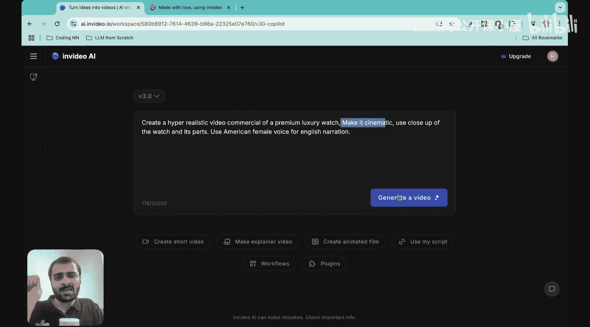
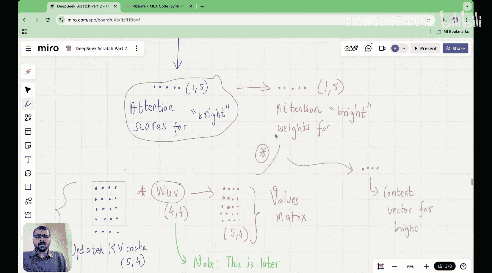

# Vizuara【中英⚡从零开始构建DeepSeek｜CS8803 Build DeepSeek from Scratch】 p13 P13 Multi-Head Latent Attention Coded from Scratch in Python [BV1ryHpzTEKW_p13]

Hello everyone， My name is Doctor Raj Dunecker。 I graduated with a PhD in machine learning from MIT in 2022。

 and I am the creator of the Bill Deepsek from Scratch series。Before we get started。

 I want to introduce all of you who are sponsor and our partner for this series in V AI。

All of you know how much we value foundational content building AI models from the nuts and bolts inviideo AI follows a very similar principle and philosophy to that of us let me show you how。

So here's the website of Inviideo AI。With a small engineering team。

 they have built an incredible product in which you can create high quality AI videos from just text prompts。

😊，So as you can see here I've mentioned a text prompt。

 create a hyper realisticistic video commercial of a premium luxury watch and make it cinematic with that I click on generate video。

Within some time， I am presented with this incredible video， which is highly realistic。

What fascinates me about this video is its attention to detail look at this。

 the quality and the texture is just incredible and all of this has been created from a single text prompt。

That is the power of Invi's product the backbone behind the awesome video which you just saw is in video AI's video creation pipeline in which they are rethinking video generation and editing from the first principles。

To experiment and tinker with foundational models， they have one of the largest clusters of H100s and H200s in India and are also experimenting with B200s。

Individualviio AI is the fastest growing AI startup in India building for the world。

 and that's why I resonate with them so much。The good news is that they have multiple job openings at the moment you can join their amazing team I am posting more details in the description below。

🎼。

Hello everyone and welcome to this lecture in theBuild Deep See from Scratch series。In this lecture。

 we are going to code the multi head latent attention mechanism from scratch。In the previous lecture。

 we started taking a look at the latent attention mechanism。

 which Deepsek introduced into their architecture。So let me quickly revise the most fundamental version of this mechanism。

 there are of course advanced versions of the multi latent attention which deepS also introduced and we are going to cover that later in the course。

But currently the main focus is to understand the most basic version of multihlate。

 and in the previous lecture we saw that this is what happens in that version we have an input matrix。

Which corresponds to the input sequence and remember during inference。

We are going to predict one new token at a time。So whenever we are having lectures with respect to latent attention。

 always think from the perspective of LLM inference。So we have four tokens， let's say。

 and these four tokens， each of them have an embedding dimension of eight。

So what happens in latent attention is that as the first step。

 we are going to project this input embedding matrix into a latent space。To do that projection。

 we are going to multiply the input embedding matrix with this DKV matrix。

 which is the down projection KV matrix。Whi takes my input embedding from an eight dimensional space and projects it to a lower dimensional space and in this case I'm assuming this lower dimensional space to be four dimensional。

The product gives me this matrix， which Im calling CKV over here。

 and it turns out that in latent attention， all you need to do is just cache this one matrix。

You don't have to cache the keys matrix separately。

 you don't have to cache the values matrix either you just cache this one matrix that's all and that reduces your Qwi cache memory size by a lot。

Once you get this latent matrix which is cache， you multiply it with WUK。

 which is the keys of projection matrix and WUV， which is the values of projection matrix。

 and then you get the keys and the values。Rest of the mechanism follows very similar to what happens in the multi head attention block。

 but there are two key things to truly understand the latent attention mechanism first is this latent。

Laightnt matrix CKV， and second is what we call as the absorption trick。

So you might be wondering what really did we achieve by adding this one more matrix over here？

To truly understand that there is a very beautiful mathematical trick in which this W Q and W UKK will be merged together。

So traditionally the queries vector is calculated by multiplying the input with WQ right。

 but as you will see we are going to merge WQ with WUK so that we can only cache so that we only need to cache CKV。

And this is how it happens， so  Q is equal to x times w Uq wq。

CKV is x times WDKV we saw this in this figure right now。

 and then the keys matrix is just the CKV multiplied by W UK。

And the values matrix is just CKv multiplied by WUB。

So wherever we have CKV we can put in x into W dKV so the keys matrix can be represented like this and the values matrix can be represented like this the absorption trick comes into picture when we calculate the attention scores。

So to calculate the attention scores， what we are going to do is that we are going to multiply。

We are going to multiply queries with the key transpose。

Wwhich is x into Wq multiplied by all of these values Now what you can do is that you can merge W UK transpose with Wq This was the merging I was talking about Wq with W UK。

 you merge these two。Into one matrix， so this will be WQ into W UK transpose and then what remains in the other bracket is x into WDKV and remember we are caching this because x into W DKV leads to CKV which is the only latent matrix I need to cache。

So my absorbed query now becomes x times Wq times W UK transpose instead of just multiplying x with Wq。

And remember WQ and W UK transpose are fixed at training time， we only need to compute them once。

 so this absorption trick is the second main understanding which you need to understand what actually happens in latent attention what happens is that we project the input into a lower dimensional space and the computations work such that we only need to compute this or we only need to cache this latent matrix。

All other things take care of themselves through this absorption trick。

So we get this absorb query and then we multiply it with this gaed matrix that uses the attention course then to get the attention weights。

 we just do the scaling soft max and then to get the context vector matrix。

 we multiply the attention weights with the values matrix。And remember。

 the values is also x times W D Kv times W U V。So the value matrix can be written as x times w。

 D Kv times W Uv。And。From the context vector matrix to get my logics matrix。

 which is the matrix through which will eventually get our next token prediction。

 we just multiply with the output projection matrix WO so here also x times W DKV is cached and WUV times WO is fixed at training time so we only need to compute once。

What I'm trying to show here is that。Even if we just cache this latent matrix。

 we can still get my logics matrix。And that can help me get my next token prediction。

 so I just need to cache one matrix and that's my latent matrix。

Even for my attention sports calculation， I just need one cash。

And for my values matrix and the eventual context vector matrix and the logics matrix computation。

 that same cache can be used。And that cache is called as the latent Kv cache。

 which is the input multiplied by WDK。So when a new token comes in。

 what we do is that we first compute the absorb query absorb query。

 which is x times Wq multiplied by WUK transpose when a new token comes in we first find this so if a new token is bright let's say it's a a dimensional vector we multiply it with WQ multipied it by WUK transpose and that gives us the absorb query vector for brightright。

And to get the attention scores， we simply need to multiply this absorb query vector with my cache。

So I first get the new cache vector， which is x bright， which is the new input。

Ebedding multipier to a W DKV， that's my new KV cache and then I append it to the earlier cache value so that's my updated KV cache and then I just multiply my absorptionary vector with the updated KV cache and then I get the attention scores for Brighter。

Once I have the attention scores for a Bri， simultaneously what I can do is that I can use my same updated KV cache。

 I can multiply it with WUV and I get my values matrix。

