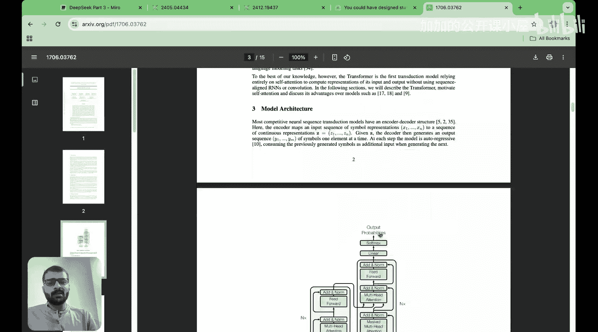
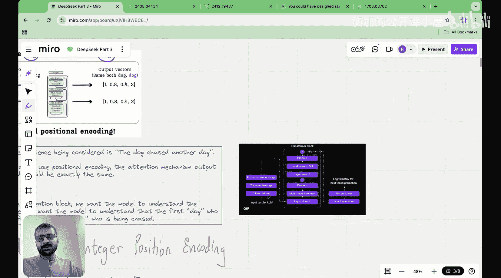
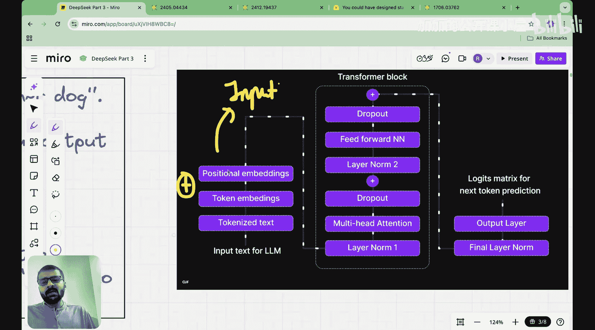
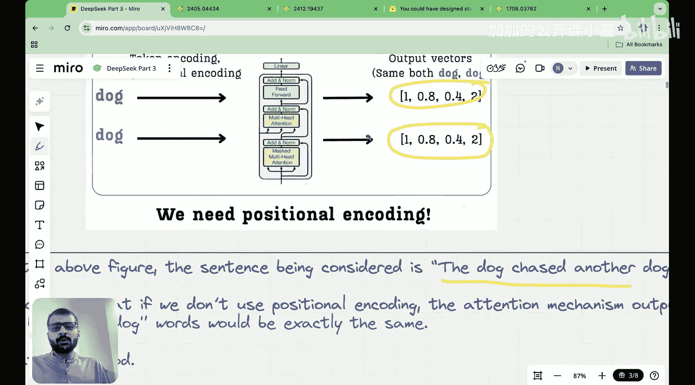
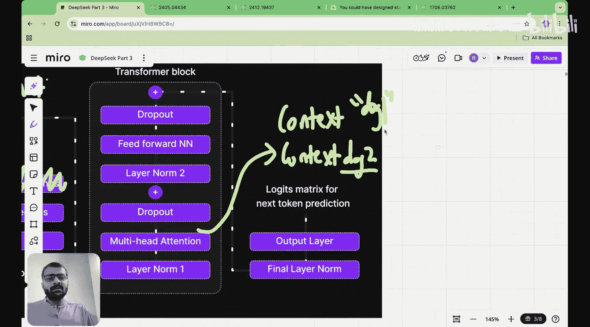
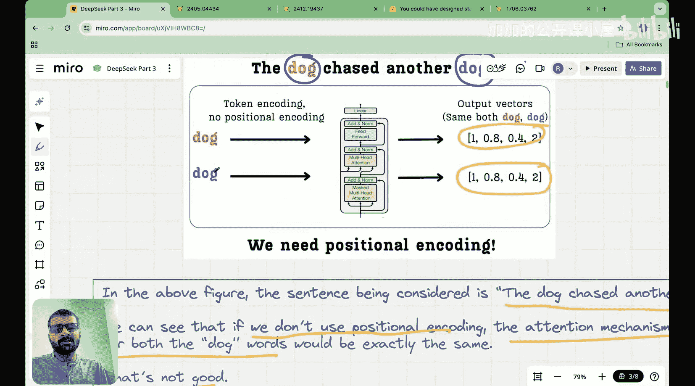

# Vizuara【中英⚡从零开始构建DeepSeek｜CS8803 Build DeepSeek from Scratch】 p14 P14 Integer and Binary Positional Encodings ｜ Journey towards Rotary Positional [BV1ryHpzTEKW_p14]

Hello everyone， My name is Doctor Raj Dunecker。 I graduated with a PhD in machine learning from MIT in 2022。

 and I am the creator of the Bill Deepsek from Scratch series。Before we get started。

 I want to introduce all of you who are sponsor and our partner for this series in V AI。

All of you know how much we value foundational content building AI models from the nuts and bolts inviideo AI follows a very similar principle and philosophy to that of us let me show you how。

So here's the website of Inviideo AI。With a small engineering team。

 they have built an incredible product in which you can create high quality AI videos from just text prompts。

😊，So as you can see here I've mentioned a text prompt。

 create a hyper realisticistic video commercial of a premium luxury watch and make it cinematic with that I click on generate video。

Within some time， I am presented with this incredible video， which is highly realistic。

What fascinates me about this video is its attention to detail look at this。

 the quality and the texture is just incredible and all of this has been created from a single text prompt。

That is the power of Invi's product the backbone behind the awesome video which you just saw is in video AI's video creation pipeline in which they are rethinking video generation and editing from the first principles。

To experiment and tinker with foundational models， they have one of the largest clusters of H100s and H200s in India and are also experimenting with B200s。

Individualviio AI is the fastest growing AI startup in India building for the world。

 and that's why I resonate with them so much。The good news is that they have multiple job openings at the moment you can join their amazing team I am posting more details in the description below。

🎼。

Hello everyone and welcome to this lecture in theBuild Deep Sek from Sctch Series。Today。

 we are going to start learning about positional emeds。First。

 let me clarify why are we learning about positional embeddings or positional encodings？In a course。

 about deep seek。So in the previous lecture we learned about multilatent attention and we have started this whole series with the purpose of understanding the deep Sik architecture in deep and ultimately with the purpose of building the different components of deepse from scratch。

So then suddenly， why are we starting to learn about positional encodings？

Let me give you a little bit of a background around that so here is the deep S version 2 or deep S V2 paper which came out in June 2024。

If you look at the multiha latent attention section over here。

 they first start out with the simplified multiha latent attention。

 which is what we have seen in the previous lecture。But after this point in section 2。1。3。

 they introduced something which is called as the decoupled rotary position embedding。

What they did in this decoupled rotary position embedding， let me go back to that section。Yeah。

 what they did in this decoupled rotary position embedding is that they combine multi head latent attention with something called the rotary position embedding。

And that leads to a much more powerful version of the multiha latent attention in the latent attention mechanism。

 which we saw we did not include the positional embedding， the rotary positional embedding。

So to understand this advanced multi latent attention mechanism。

We really need to understand what rotary positional embiiding means。

And if you see the deepsek version 3 paper which came out in 2025。

 and which ultimately led to this whole deepse revolution， it led to deepse RO1， etc。

You will see that here they directly start with this multi head latent attention。

 which by default uses rotary positional encoding or rotary positional Mdding。So in this lecture。

 I'm going to use embedding and encoding interchangeably， but it means the same thing。

So the reason we are having this two to three lectures now on positional embeddings or positional encodings is that we ultimately want to understand what rotary positional encodings are and then we will understand how the multi head latent attention is mixed with rotary positional embedding to create a much more advanced version of the latent attention mechanism。

So the way I'm going to divide this is that in today's lecture I'm going to。

Introduce you to what positional embeddings are。So today's lecture I'm going to introduce you to what positional embeddings are and then we are going to look at two types of positional embeddings today we are going to look at in teacher positional embedding and binary positional embeddings that's the purpose of today's lecture in the next lecture we are going to look at sinusoidial positional embeddings。

These sinus disorder positional embeddings were introduced in the attention。

Attention is all you need paper。

So we are going to look at these embeddings or these encoings next if you scroll down in the paper。

 youll see that these are the sinoidial positional embeddings and then in the lecture after that we are finally going to look at rotary positional embedding。

Which will help us understand how these rotary positional embeddings are mixed with latent attention。

The reason I want to go through this sequential procedure is again I want you to know every single thing from scratch so if we directly start with rotary positional embeddings some understanding some concepts will be lost I want to take you through how these advancements were actually discovered so I'll go from step number one in today's lecture to step number two and then to step number three。

Alright， so let's get started with today's lecture in which we will cover these three things introduction to positional embeddings。

 inte positional embeddings and binary positional embeddings。All right。

 so the first thing is what are positional embeddings and why do we need positional embedding or positional encoding in the first place？

The main reason is that the position at which a word comes in a sentence is very important to the context of the sentence。

Let me clarify this so if there is a sentence called the dog chase another dog， okay。

And there are two dogs here， right？Lets say I do not consider positional embedding or positional encoding at all what does it mean I do not consider positional embedding well it means that usually in the input block of the transformer architecture let me mark this with a different color。

In this input block of a transformer architecture when a given input text comes in it first token ice。

 it's converted into token embeddings， we add positional embeddings to the token embeddings and that leads to something called as the input embeddings which is then passed to the transformer block so let's say we don't have this positional embedding layer at all and we just have the token embeddings。

And let's say if I pass in now this sentence。The dog chased another dog。

 Ive passed in through the input block。What will happen is that both of these dogs will get converted into token embeddings right so the token embeddings are same for these two because they are the same words。

So the token embedding for the first dog is this， the token embedding vector for the second dog is this。

 both of these are completely identical vectors。And now both of these vectors will pass just like that to the transformer of law without adding any kind of a positional in。

 this means that for these two tokens。The input to the transformer block is exactly the same。

Which further means that when we come out of the attention block and when we get the context vector。

 so we get the context vector for the first dog。And we get the context vector for the second dog。

Dog number2 and this is dog number one these two context vectors will be exactly the same because now the input to the transformer block for these two dos is exactly the same。

 so they will go through the exact same operations in the transformer block and the context vector for these two dos will be exactly the same。

And this is not what I wanted at all because I wanted my transformer block to actually capture the fact that these two are different dos。

I don't want my transformer to think that these are the same dogs I want the context vector for this dog and this dog to be completely different。

That's why position is very important。If we don't use positional encoding。

 the attention mechanism output for both these dogs。Will be exactly the same。 That's not good。

After coming out of the attention block， we want the model to understand the context of the sentence。

We want the model to understand that the first dog who is chasing is different from the second dog who is being chased right so before we enter the transformer block we want to create some distinction between this dog and this dog and the way we do that is by adding another vector to the token embedding vector and thats this positional embedding vector。

Right over here。So there is a very nice tutorial and hugging face what they do is that day。

