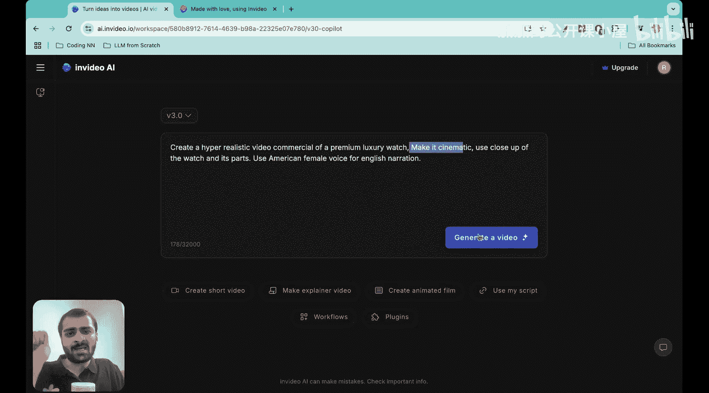
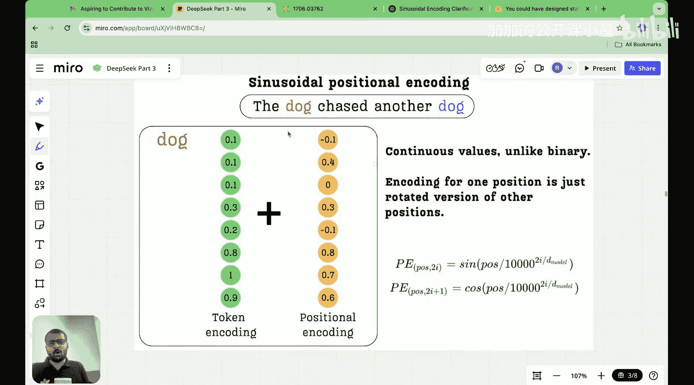

# Vizuara【中英⚡从零开始构建DeepSeek｜CS8803 Build DeepSeek from Scratch】 p15 P15 All about Sinusoidal Positional Encodings ｜ What’s with the weird sin-cos fo [BV1ryHpzTEKW_p15]

Hello everyone， My name is Doctor Raj Dunecker。 I graduated with a PhD in machine learning from MIT in 2022。

 and I am the creator of the Bill Deepsek from Scratch series。Before we get started。

 I want to introduce all of you who are sponsor and our partner for this series in V AI。

All of you know how much we value foundational content building AI models from the nuts and bolts inviideo AI follows a very similar principle and philosophy to that of us let me show you how。

So here's the website of Inviideo AI。With a small engineering team。

 they have built an incredible product in which you can create high quality AI videos from just text prompts。

😊，So as you can see here I've mentioned a text prompt。

 create a hyper realisticistic video commercial of a premium luxury watch and make it cinematic with that I click on generate video。

Within some time， I am presented with this incredible video， which is highly realistic。

What fascinates me about this video is its attention to detail look at this。

 the quality and the texture is just incredible and all of this has been created from a single text prompt。

That is the power of Invi's product the backbone behind the awesome video which you just saw is in video AI's video creation pipeline in which they are rethinking video generation and editing from the first principles。

To experiment and tinker with foundational models， they have one of the largest clusters of H100s and H200s in India and are also experimenting with B200s。

Individualviio AI is the fastest growing AI startup in India building for the world。

 and that's why I resonate with them so much。The good news is that they have multiple job openings at the moment you can join their amazing team I am posting more details in the description below。

🎼。

Hello everyone and welcome to this lecture in the Bill Deep Sek from Sctch Series。

We will continue our journey towards understanding the rotary positional and importance。

The reason why we have started to look at rotary position andcoings is because。

When deepse used multiair latent attention。They used a origin which coupled multi had latent attention with rotly positional ening。

So to understand this multi had later attention plus rotary position encoing。

 it's very important for us to first understand what is rotary position ening。

And we have divided this understanding into three parts in the previous lecture we understood。

The two types of positional encoings in teacherger and binary positional encodings in today's lecture we are going to look at sinusoidial positional encodings and finally that will set the stage for the next lecture which will be on the topic of rotary positional encoding。

So let's get started with today's lecture on susor positional encoding before that lets quickly revise what we looked at in the previous lecture。

 the first type of encoding we saw is integer position encoding where what we saw was why don't we just。

嗯。Look at the positions of tos and encode them within integers。

So if this is the token embedding for a given token， we add a positional embedding vector。

 which is of the same size as that of the token embedding vector。

And every value here will correspond to the particular position。

 so if this do comes at position number 200， the position encoding vector for that token will be 200。

 200， 200，200 repeated eight times based on the dimensions of the token encoding。

This is the simplest type of positional encoding but it leads to a lot of issues the major issue with this is that the token embedding values are clustered around zero these values are close to 0。

 but these values are very large or they can be very large based on the context size。

What that would mean is that that would completely dilute the semantic knowledge or the semantic information which we derive from token encoding remember token encodings capture information about the meaning of individual words individual tokens right and I don't want my positional encoding well used to be so large that they completely dilute that meaning。

That's one of the major reasons why we did not go ahead with。

Po or integer positional encoding because impteger positional encoding heavily pollutes the semantic information captured by the token end brains。

So ideally we need values which lie between zero1 et cetera， they are in that rate。

 they are not too high for positional equity。That naturally led to the second type of position encoding which is binary position encoing in binary position encoding what we do is that we look at the token。

 we look at its position and we convert it into a binary representation based on the length of the token embedding vector。

So since the token embedding vector is eight dimensional here。

 we convert it into a binary representation。We just8 weeks。So in this case。

 since docom set position 200， it will be represented by 11001000。

So these values now are constraint rate， they can either be0 or1 that solves the issue with respect to by anyposition that including。

We also did a very interesting exercise where we looked at if you had these different positions and you did binary and coding for all of these positions。

And if you take a very close look at what happens with every。

Bit here you'll see that the least significant bit oscillates the quickest among positions。

The most significant bit oscillates the least goodest or oscillates the slowest。So this last。

 this lowest bit actually oscillates the fastest。This bit oscillates a bit faster than that。

 so for example here you see changes after every two positions。

So the first bit changes after every well position。The second bit changes after every2 position。

 the third bit changes after every4 position， so you see for four positions sit's the same and then it changes。

So we conclude from here that the lower inices oscillate fast between positions and the higher indices oscillates low between positions。

And that can also be captured by this figure over here so if you look at this diagram very closely。

 you will see that for every position on the x axis I have this index which is plotted so if I have position number 60 there will be eight indexices right index number went to index number8 so the lowest index as we saw we ocillate the fastest。

Whereas as we increase in the index value， that index， the highest index will oscillate the slowest。

So the lowest index is called as the least significant bit and the highest index is called as the most significant bit。

So the key thing to remember is that the lower indexices change more frequently。

 the higher indexs change less frequently， this is the same understanding which we look at today sinusoidal positional reporting as well。

So it seems that binary positional encoding solve the range issue， right。

 the values are restricted between0 and1。So， what's the main issue。

 the main problem with binary positional or yeah binary position encoding is that。

If you look at these gs， they're discrete gs， right？

They go from zero or1 there is no values in between and that's not good during pre training during pre training it becomes very difficult for the LLM optimization routine to deal with these jumps or discontinu activitiesivities。

What if we could have a diagram which is similar to this， but instead of these discontinuities。

 what if this was made a bit smoother？What if these discontinuities were made of bit smoother？

Which essentially means what if we don't have values which are just zero or1。

 but what if we have values which are on the continuous spectrum between0 and one。

And that's where the idea of sinusoidial positional encod was born。

So let us start exploring this idea further。Sent is sort position ins。

Are designed with the purpose of solving this discontinuity problem and to make it continues。

So here are the main learnings from integer positional encodings。

 the higher in diis change more frequently， suggesting fine grain encoding。

 lower in dilysis change less frequently， meaning coarse encoding。Also， note that。

In teacherger positional encoding depended on two factors。

 the position of the token and the index number。So based on this graph right。

 because we had the position of the token and each each position had eight indices here and every index oscillated differently。

 So we need to keep in mind the position and we also need to keep in mind the index These are the same two factors the position and the index which we will be looking at during sinus sort positional input。

So s sort position encoding what it will do is that it will instead of taking values of either0 or1 will make sure that the values are on a continuous spectrum from minus1 to one so instead of being。

Binary representation， all the values which I have in my positional embedding vector are now on a continuous scale they can be。

