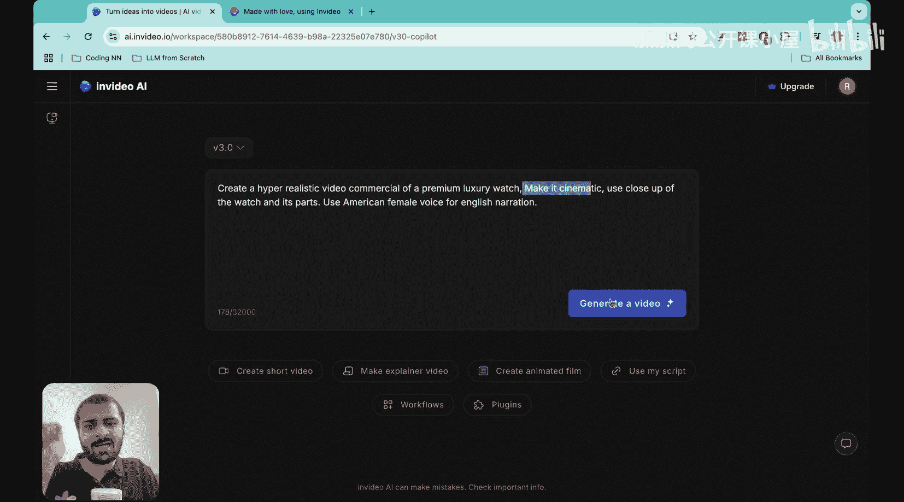
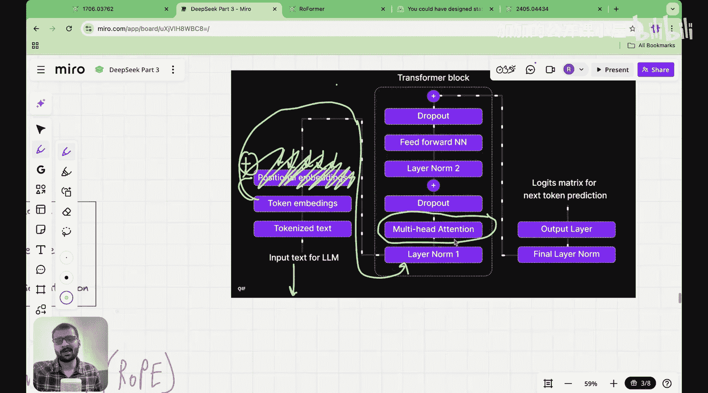
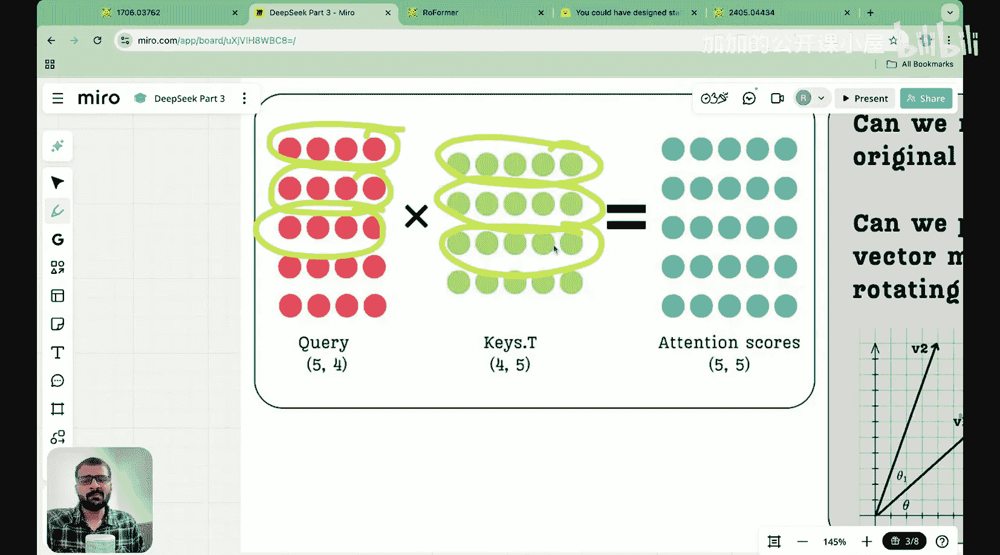
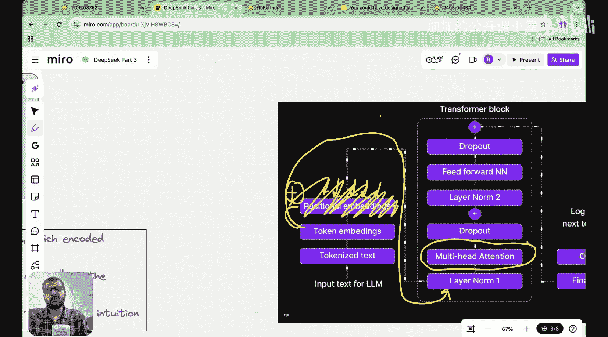
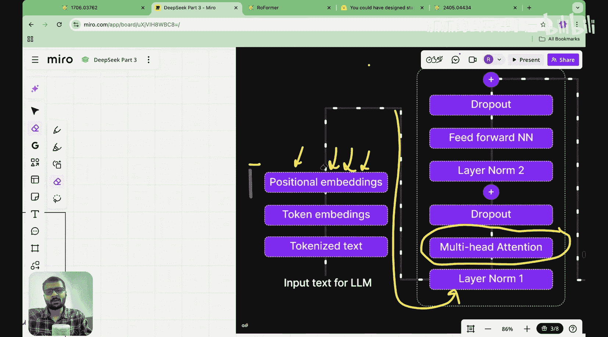
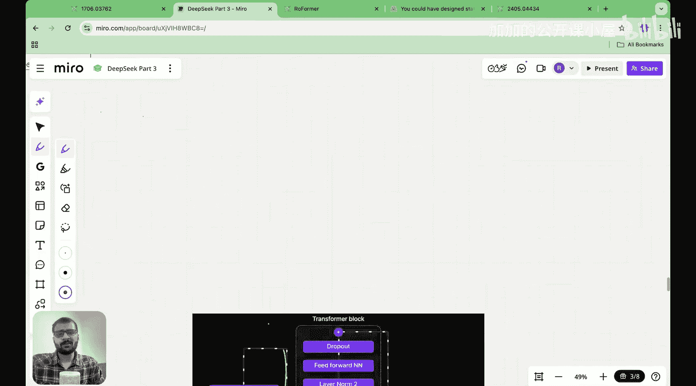
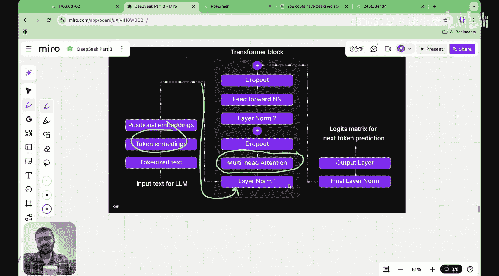
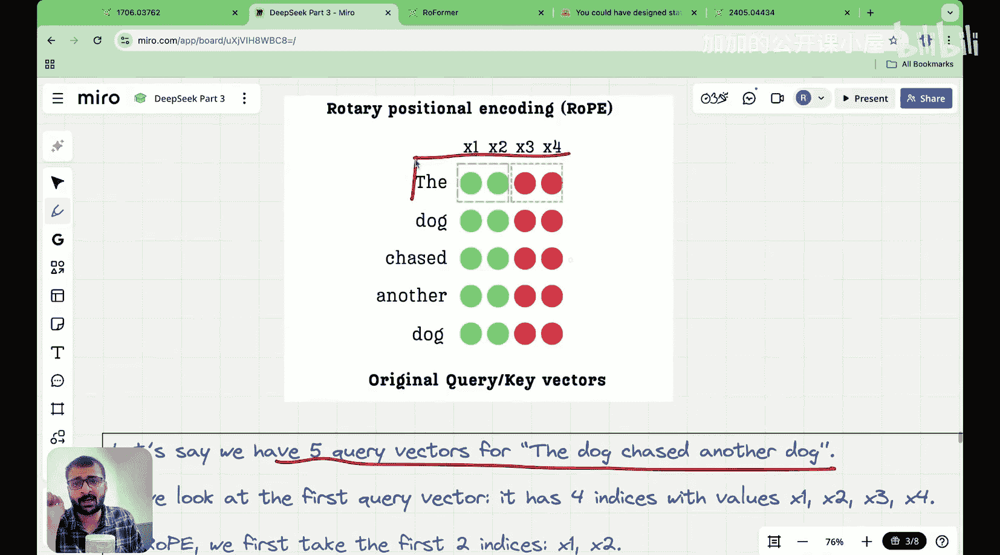

# Vizuara【中英⚡从零开始构建DeepSeek｜CS8803 Build DeepSeek from Scratch】 p16 P16 Rotary Positional Encodings ｜ Explained Visually [BV1ryHpzTEKW_p16]

Hello everyone， My name is Doctor Raj Dunecker。 I graduated with a PhD in machine learning from MIT in 2022。

 and I am the creator of the Bill Deepsek from Scratch series。Before we get started。

 I want to introduce all of you who are sponsor and our partner for this series in V AI。

All of you know how much we value foundational content building AI models from the nuts and bolts inviideo AI follows a very similar principle and philosophy to that of us let me show you how。

So here's the website of Inviideo AI。With a small engineering team。

 they have built an incredible product in which you can create high quality AI videos from just text prompts。

😊，So as you can see here I've mentioned a text prompt。

 create a hyper realisticistic video commercial of a premium luxury watch and make it cinematic with that I click on generate video。

Within some time， I am presented with this incredible video， which is highly realistic。

What fascinates me about this video is its attention to detail look at this。

 the quality and the texture is just incredible and all of this has been created from a single text prompt。

That is the power of Invi's product the backbone behind the awesome video which you just saw is in video AI's video creation pipeline in which they are rethinking video generation and editing from the first principles。

To experiment and tinker with foundational models， they have one of the largest clusters of H100s and H200s in India and are also experimenting with B200s。

Individualviio AI is the fastest growing AI startup in India building for the world。

 and that's why I resonate with them so much。The good news is that they have multiple job openings at the moment you can join their amazing team I am posting more details in the description below。

🎼。

Hello everyone and welcome to the lecture in theBuild Deep Sek from Scratch Series。Today。

 we are going to learn about a rotary positional encoding。

So if you remember in the previous lectures we have started looking at different types of positional encodings in particular in the last lecture we have taken a detailed look at sinor positional encoding and in the lecture before that we have taken a look at inteigger and binary position encoding so you might be thinking why are we spending this time on positional encoding in a deep seek from scratch series。

The main reason is that if you take a look at the deep seek paper。

 they have this multi head latent attention mechanism right we have already covered the most basic version of the MLA。

But deep S R1 and deep Sq V3， which were released in 2025。

They combine multiha latent attention with a special type of positional embedding。

 which is called as the rotary positional encoding， if you see over here。

The MLA is combined with rotary positional encoding。

So without understanding rotary positional encoding。

 it's impossible for us to understand how it's combined with multi head latent attention。

And that's why we have been spending the past few lectures on understanding different types of positional encoding now we have built up sufficient knowledge to finally tackle what exactly is rotary positional encoding。

So let's get started with today's lecture if you recall towards the end of the previous lecture we saw some limitations with sinusoidal embeddings。

One major limitation was in sinusoidal embeddings， we added the positional encoding values directly to the token embedding right or token emcoding。

And we know that the token encoding essentially captures the semantics。

So by adding an information about the position directly to the semantics。

 we are polluting the semantic information carried by the token embeics。Ideally。

 what I want is the follows， right， So let's take a look at the。Entire LLL architecture。

 and I'm going to copy this and paste it over here。

RightThis is the entire LA architecture Currently if you see what we are doing with sinusoidial position encoding is that we are adding we are adding token encodings to the positional encoding so here is where the positional embeddings or positional encodings come into the picture ideally I don't want this ideally I want my token embeddings to be passed unfiltered to the transformer block so that their semantic meaning is not diluted and then the question which we asked towards the end of previous lecture is that can we somehow inject information about the token position in the attention mechanism itself。

Instead of adding the positional embeddings to the token embeddings in this first data preprocessing step。

 why don't we include information about the positional embedding in the multiha attention mechanism and that's where rotary positional encoding idea is born。

So what we saw in the previous lecture was that。If you take a look at the multi hair attention mechanism。

 right？The multi attention mechanism consists of finding the attention scores。

 so we have the query matrix and we have the key matrix。

 the queries is multiplied with the keys transposedse to get my attention scores。

So it is this mechanism， it is the multi hair attention mechanism where we take into account the position of different tokens and find the attention scores。

So why don't we add the positional information or why don't we inject positional information into these vectors Why don't we inject positional information into the query vectors and the key vectors thats the first question the second question which we asked in the end of the previous lecture was that if you see the token embeddings are just added to the positional embedding side the token embeddings are added to the positional embeddings over here。

In this step， which has also been shown over here， the token embeddings are added to the positional embeddings。

 which changes the magnitude of the token embedding itself。

Which is not good ideally what I want is I don't want the magnitude of the original vector to change so lets say this is my original query vector instead of adding another vector to it so instead of adding another vector and forming a new vector why don't I rotate this vector。

If I want to capture information or if I want to inject information about the position。

 why don't I take a query vector or the key vector and simply rotate it by an angle theta to inject the information about position so if a token has a higher position I will rotate it by a different angle if it has a or if it if it has a position which is smaller or position index。

Or it's at a lower position I rotate it by a smaller angle essentially the angle will quantify some information about my position。

 but the magnitude of the vector will not change since Im just doing the rotation。

 the magnitude of the query vector or the key vector is not going to change that will make sure that my original vector magnitude remains the same So there are these two ideas with which we start the today's lecture first。

 instead of adding the positional embedding in the data preprocessing block over here。

 why don't I add it in the attention mechanism in particular。

 why don't I modify the query and the key vectors Second。

 instead of just adding my positional encoding vector to the query and the key vector。

 why don't I just rotate these vectors so that the magnitude of the original vector remains unchanged。

With these two ideas， we start our lecture today on understanding rotary positional andcoing。

Now if you understand rotary positional encoding you will never forget it because it is a very visual concept。

 but if you directly go into the mathematics it might sound hard or even intimidating or scary at first so I am going to try to make this lecture as visual as possible。

Okay， let's get started。So the main idea of rotary positional encoding is to take my query and the key vectors and to apply sinusoidal positional encoding to these vectors what that means is that in the previous lecture we saw that sinusoidal positional encoding has this formula right where essentially if if you scroll down here this is the formula where the even indices of any given position are given by a sine value and the odd indices of any given position are given by the cosine value so what if we use this same formula but now instead we apply to the query and the key vectors and instead of adding this to the vector we are going to do a rotation let's see how we will do this。

So now I'm going to demonstrate how rotary positional and recording。

Workors in practice through a visual example。So for the purposes of demonstration。

 let's say I have these query vectors right for five tokens you can also imagine this to be query or key vectors So the first query vector is for the it's a four dimensional vector The second query vector is for dog that's four dimensional vector the third is purchased another dog So every token in my input sequence is now a four dimensional query vector or you can also think of it as a key vector whatever I'm showing right now for the query vector the same thing applies to the key vector as well。

So let's say we have five query vectors for the dog chased another dog， okay？And for now。

 I'm just going to focus on the first query vector。

 the operation which we are going to perform on this first query vector is the same operation as we are going to perform on the later tokens as well。

 So I'm just going to show this operation on my first。

