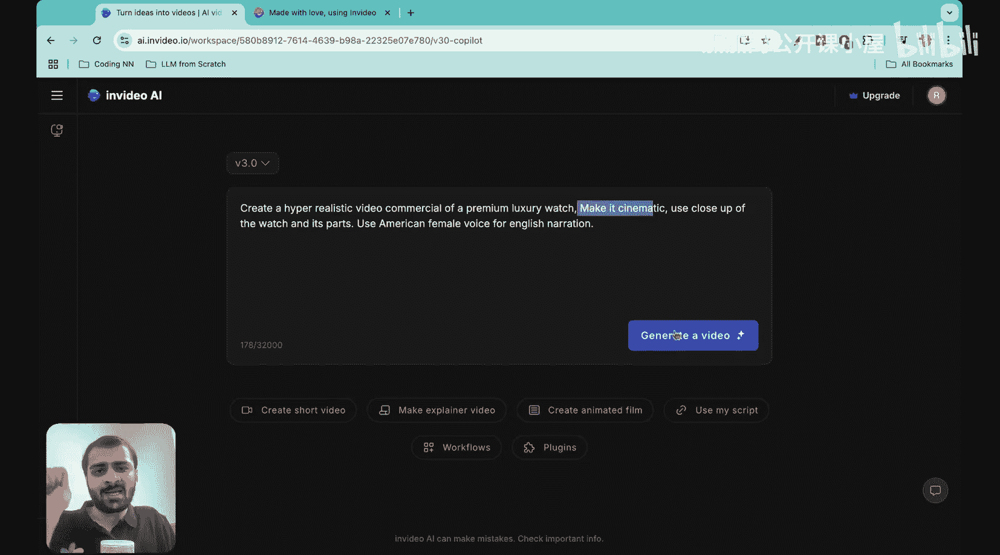
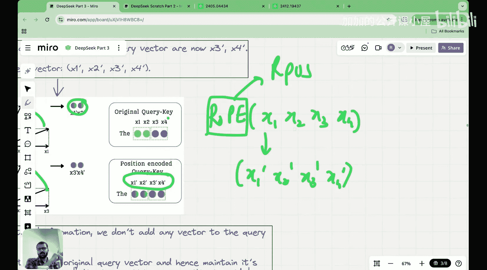

# Vizuara【中英⚡从零开始构建DeepSeek｜CS8803 Build DeepSeek from Scratch】 p17 P17 How DeepSeek exactly implemented Latent Attention ｜ MLA + RoPE [BV1ryHpzTEKW_p17]

Hello everyone， My name is Doctor Raj Dunecker。 I graduated with a PhD in machine learning from MIT in 2022。

 and I am the creator of the Bill Deepsek from Scratch series。Before we get started。

 I want to introduce all of you who are sponsor and our partner for this series in V AI。

All of you know how much we value foundational content building AI models from the nuts and bolts inviideo AI follows a very similar principle and philosophy to that of us let me show you how。

So here's the website of Inviideo AI。With a small engineering team。

 they have built an incredible product in which you can create high quality AI videos from just text prompts。

😊，So as you can see here I've mentioned a text prompt。

 create a hyper realisticistic video commercial of a premium luxury watch and make it cinematic with that I click on generate video。

Within some time， I am presented with this incredible video， which is highly realistic。

What fascinates me about this video is its attention to detail look at this。

 the quality and the texture is just incredible and all of this has been created from a single text prompt。

That is the power of Invi's product the backbone behind the awesome video which you just saw is in video AI's video creation pipeline in which they are rethinking video generation and editing from the first principles。

To experiment and tinker with foundational models， they have one of the largest clusters of H100s and H200s in India and are also experimenting with B200s。

Individualviio AI is the fastest growing AI startup in India building for the world。

 and that's why I resonate with them so much。The good news is that they have multiple job openings at the moment you can join their amazing team I am posting more details in the description below。

🎼。

Hello everyone and welcome to this lecture in theBuild Deep Seek from Sctch series。

Today we are going to learn how deepse V3 and Deepse R1 actually implemented an advanced version of multiha latent attention in which they integrated multiha latent attention or MLA with rotary positional encodings。

In the previous lectures we have studied about latent attention and we have also studied about rotary positional encodings。

 so in this lecture I am going to assume that you are aware of these two concepts if you have not seen the lectures corresponding to these two concepts please go back and revise these lectures because theyll be needed in today's lecture。

So let's get started if you take a look at deepse version 2 so deepse V2 paper and if you scroll down below they have a section on architecture in which they start explaining about latent attention in section 2。

1。2 they mention something which is called low rank key value joint compression。

And this is the basic version of multi hair latent attention。

 which we have seen in one of the previous lectures， this is the basic MLA schematic。

So let me just write it down over here。This is the basic。Eilyly。Okay。

Now this is not the actual latent attention mechanism which they use to train their version 3 and even the deeps R1 model which became so popular in 2025。

 so in the same deeps version 2 paper they have a section called 2。1。

3 which is called as decoupled Roary position embedding。

Here is where they actually explain how they adapted the latent retention mechanism to include rotary position em bodydding。

And they have shown a bunch of formulaes over here。

So this is in deepse origin 2 paper if you go to deepse origin 3。

they directly explain the multih latent attention with rotary positional encoding they don't explain the two types。

 they don't even explain the basic version， they directly start with the advanced version so if you start reading the deep seat V3 paper directly it's very difficult to understand these formulas right there is formula number one2345 there are so many symbols over here there are so many dimensions and its really impossible to figure out what exactly is going on。

So many blog posts and so many articles which I have seen directly start with these formula which are very difficult to understand there are many dimensions to unpack over here and so it is my aim in this lecture to explain you the nuts and boards of what exactly happens behind these formula so that when you go back and read the paper again it will be so much more easier for you to understand。

So let's get started with today's lecture。Okay， first， I want to come back to。

Why do we need to adapt the latent attention mechanism to include rotary positional encodings so let's start the lecture with that。

And to understand that we have to understand why latent attention actually works so if you see this schematic which we have seen earlier in latent attention the input embedding is multiplied by this W DKV matrix which projects my input vectors into a latent dimension。

And in latent attention， in multi latent attention， we only need to cache this latent matrix。

And the reason this caching works is because latent attention implements something which is called as an absorption prick。

So if you calculate the attention course， it will be queries multiplied by the keys transpose。

 so queries can be represented as x times wq， which is the trainable weight matrix and keys can be represented as。

If you see over here， the keys are CKV multiplied by WUK。So the keys can be represented。

 the keys transpose is W UK transpose multiplied by W DKV transpose multiplied by x transpose。

So the main thing which I want you to focus here is that in the latent attention mechanism these two mats are absorbed into one single matrix。

 so Wq into W UK transpose becomes one single matrix and then what remains is x times WbKV transpose and only this needs to be cached。

This is called as the absorption trick whenever a new query comes in it is multiplied with WQ and also W UK transpose both of these matrices are fixed at training time so we don't need to cache them or compute them again the only thing which needs to be cached is the latent matrix of the inputs。

So this is the main thing which you need to understand in latent attention and of how it really works。

If you have not gone through the multihi latent attention mechanism。

 please go through that because there we cover this absorption trick in a lot of detail。

So for the latent attention to work， we need this WQ and W UK transpose to be together so that they can be multiplied and absorbed into one matrix。

Keep that in mind。Now， imagine that we want to。Add rotary positional encodings to my queries and my keys。

 so let's say I want to do the exact same absorption trick in latent attention。

 but I want my queries but I want my queries to be added I want my queries to be injected with rotary positional encoding so I'm calling this Rpo which is rotary positional and this is my queries x times Wq and I also want my keys to be injected with rotary positional encodings so the keys matrix which is this I apply rotary positional encoding。

So let me just brush up your understanding of what exactly happens in a rotary positional encoding。

Let's say we are looking at one particular queries or the keys vector at a given position we divide that into groups of two and then each group of two is rotated to form another vector so for example here we have two groups x1 x2 and x3 x4 and this is the first position or this is the first query vector what happens is this x1 x2。

X1 x2， which was my original vector here， is rotated。To form X 1 dash X2 dash。Then x3 x4。

 which was my original vector is rotated to form x3 dash x4 dash and so if my original query values where or my original query vector was x1 x2 x3 x4 now when you apply rot3 positional encoding it becomes x1 dash x2 dash x3 dash x4 dash so if you apply rope to x1 x2 x3 and x4。

It becomes x1 dash， x2 dash， x3 dash， and x4 dash。So whenever I'm going to use this row operation or row operation in my。

Description later on over here。 So when I use rpo， this is same as the rope operation which I showed above。

 So when I use rpo or rope。This is what's going to happen， right， we take in the full vector。

 we divide it into bunch of we divide it into bunch of tools， and then we rotate。

