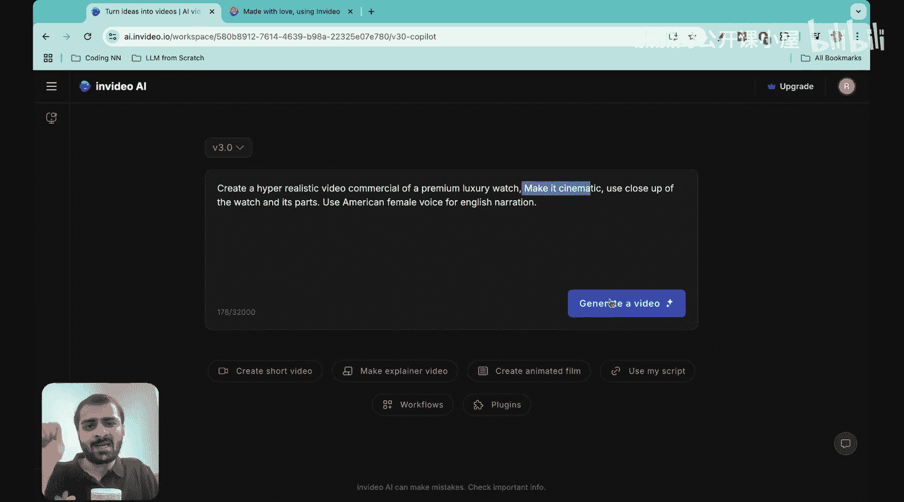
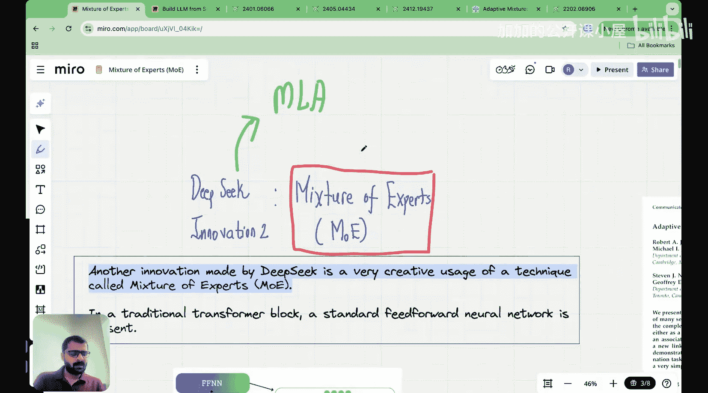
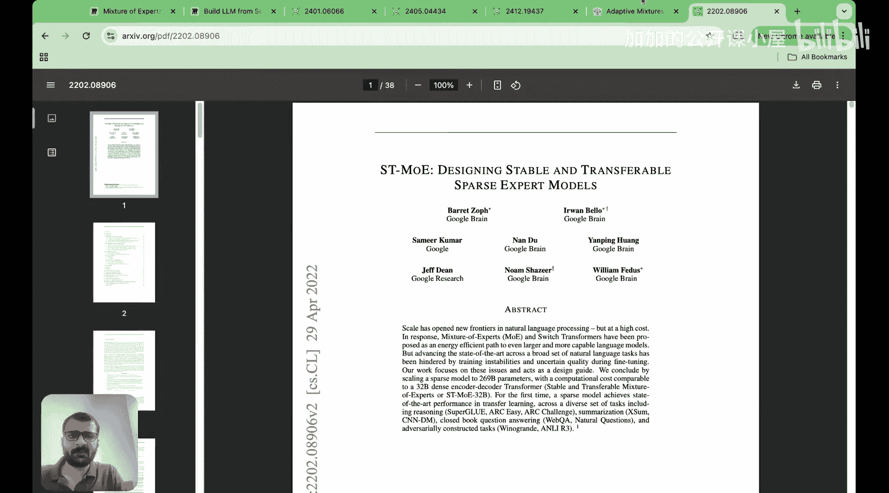
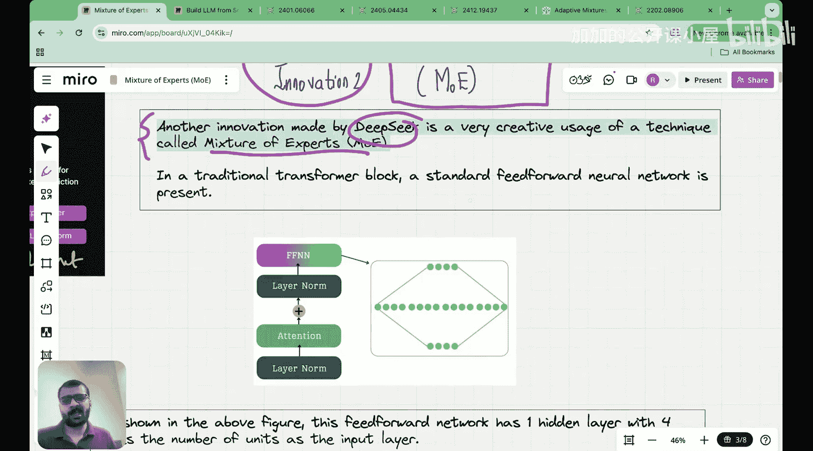
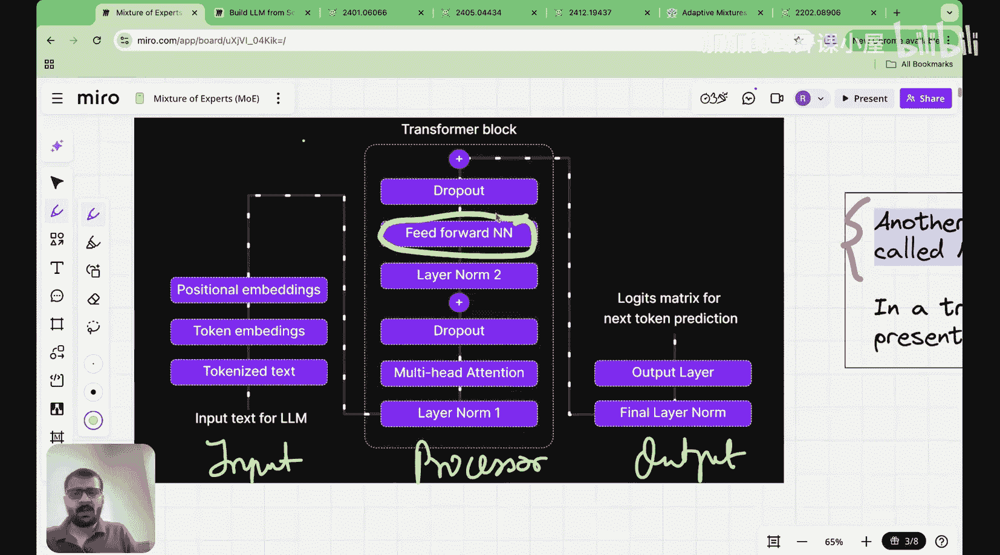
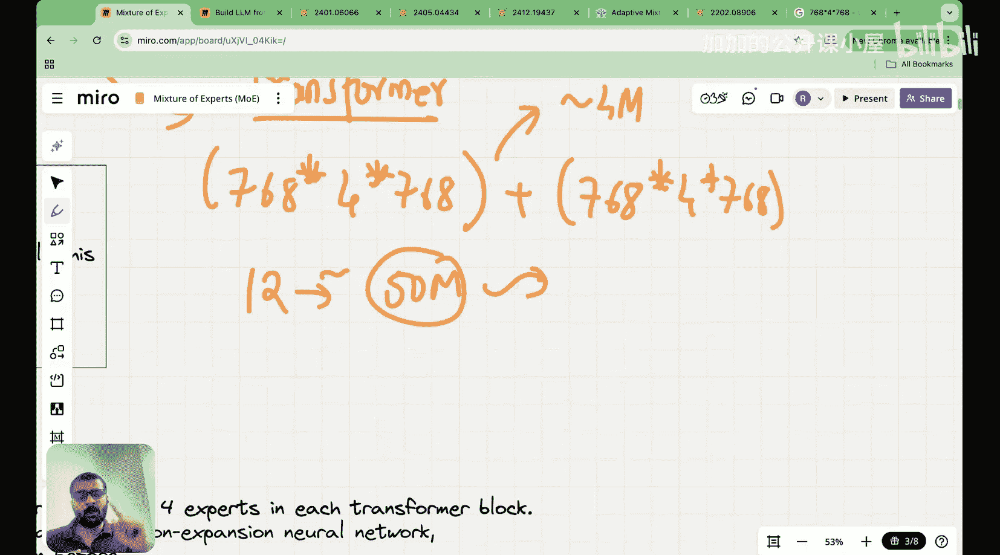

# Vizuara【中英⚡从零开始构建DeepSeek｜CS8803 Build DeepSeek from Scratch】 p18 P18 Mixture of Experts (MoE) Introduction [BV1ryHpzTEKW_p18]

Hello everyone， My name is Doctor Raj Dunecker。 I graduated with a PhD in machine learning from MIT in 2022。

 and I am the creator of the Bill Deepsek from Scratch series。Before we get started。

 I want to introduce all of you who are sponsor and our partner for this series in V AI。

All of you know how much we value foundational content building AI models from the nuts and bolts inviideo AI follows a very similar principle and philosophy to that of us let me show you how。

So here's the website of Inviideo AI。With a small engineering team。

 they have built an incredible product in which you can create high quality AI videos from just text prompts。

😊，So as you can see here I've mentioned a text prompt。

 create a hyper realisticistic video commercial of a premium luxury watch and make it cinematic with that I click on generate video。

Within some time， I am presented with this incredible video， which is highly realistic。

What fascinates me about this video is its attention to detail look at this。

 the quality and the texture is just incredible and all of this has been created from a single text prompt。

That is the power of Invi's product the backbone behind the awesome video which you just saw is in video AI's video creation pipeline in which they are rethinking video generation and editing from the first principles。

To experiment and tinker with foundational models， they have one of the largest clusters of H100s and H200s in India and are also experimenting with B200s。

Individualviio AI is the fastest growing AI startup in India building for the world。

 and that's why I resonate with them so much。The good news is that they have multiple job openings at the moment you can join their amazing team I am posting more details in the description below。

🎼。

Hello everyone and welcome to this lecture in theBuild Deepsek from Scratch Series。

In the previous lecture we have or in the previous series of lectures。

 we have covered extensively the major innovation of deepse and that is MLA or multihead latent attention。

When deepse introduced latent attention。They got the best of both worlds。

 they reduced the KV cache size and at the same time maintained language performance and that was just beautiful to see。

But along with latent attention， one of the other major innovations which Deepepsek made was something which is called as mixture of experts。

And we are going to look at the main idea of mixture of experts in today's lecture。

In the subsequent lectures we will get started with the mathematics of mixtures of experts。

 and then we will see exactly what's the new thing which DeepS did。

Now one thing to note is that mixture of experts as an idea has been around for a very long time and when I say very long time。

 I mean really very long time， the first paper which kind of introduced mixture of experts was actually in the 1990s so here you see this paper was published in neural computation in 1991 and the name of this paper was adaptive mixtures of local experts。

One of the authors was Jooffrey Hn， who is， of course。

 the pioneer in several machine learning domains， including back propag。

So the idea of mixture of experts is not very new。And even mixture of experts was implemented in other language model architectures before Deepse did it。

Deeps built upon that innovation and added some new tricks and techniques of their own。

 This is what I believe deeps did so nicely Instead of reinnovaventting the wheel。

 they just borrowed what everyone has done and built on top of that build something really cool and innovative。

So this paper which I showed you adaptive mixtures of local experts。

 this did not necessarily concern with language modeling right they did not introduce mixture of local experts for language modeling。

 they used it for a different task， they used it for supervised learning and they showed that using mixture of experts we could do some very new things with supervised learning algorithms。

And then it was slowly brought into the domain of language modeling through mystral and later through many other。

Many other players， ultimately deep seat， used all of that knowledge and build something powerful on top of that。

So here I just wanted to give you a context of mixture of experts。

 its history and why I'm calling it for deepse innovation。

 so although I'm calling it a deep seek innovation please note that they were not the first to come up with the name itself to come up with the idea of mixture of experts。

Alright， so in this lecture I'm going to give you just an introduction and a visual feel of what this whole idea of mixture expertise is。

So as I've written here， another innovation made up by deepse is a very creative usage of a technique or mixture of experts okay so first let's start understanding how mixture of experts sits used in language modeling。

In these series of lectures since they are very focused on LLMs。

 I'm not going to give you a historical context of mixture of experts because there is a whole literature on that I'm directly going to start with language model。

So if you look at the transformer block the transformer block looks something like this。

 we have an input， so let me play these geo for your understanding。

 we have an input input block where we have tokenization token embeddings positional embeddings we have the transformer block where all the magic theory happens here we have the layer normalization multi head attention drop out another layer normalization feed forward neural network dropout and then we have an output layer where the input embeddings are converted into the logics matrix and then we predict the next token。

Make sure of experts is an innovation which is especially concerned with one block among this entire architecture and that's this feed forward neural network。

So if you carefully look at this speed forward neural network， it kind of looks something like this。

Where if this is the input embedding dimension， it projects it。

 the feed forward neural network projects the input embedding dimension into a hidden layer whose dimension is four times the embedding dimension and then it projects it back into the original input dimension。

So I like to call this neural letter the expansion contraction neural letter。

Here there is an expansion when you go from the initial layer to the hidden layer and then finally there is a contraction from the hidden layer back to the original dimension。

So when we use a neural network like this it retains the original dimension but the input embedding goes into an expansion and a contraction The reason we use a feed forward neural network here is because it allows the language model to explore a much richer space it increases the dimensions the number of dimensions by a huge amount so it is one of the critical components of the transformer architecture and experiments have shown that if this component is removed the language models don't perform as well so the feed forward neural network is one of the key components of the language modeling architecture。

But one thing to note is the number of parameters which the feed forward neural network actually takes right so let us try to estimate this if you have a transformer block。

One transformer block le say and the input embedding dimension is 768 so how many parameters will be there in one such feed forward neuralval network so 768 in the let's see in the expansion layer we have 768 inputs at 4 into 768 hidden layer dimension so the number of weights will be 768 into4 multiplied by 76。

Those are the number of parameters in the expansion layer and the number of parameters in the contraction layer are similar。

 so the number of parameters in the contraction layer are again 768， multiplied by four times 768。

Correct， so if you do this calculation， let's do this so 768 multiplied by four times 768。

That is going to be equal to this and if I multiply this by 2 that's going to be equal to this so this is actually equal to 4 million right and if you multiply this by 12 so if the number of transformer blocks are 12 that is around 56 million parameters。

So this is for one transformer block and that's around 4 million parameters so if you have 12 such transformer blocks you get around 48 to 50 million parameters which are present in the feed forward Ne。

The reason I'm showing this to you is because the feed for neural network has a lot of parameters and what this does is that this affects the training time of the language model as a whole this increases the training time of the language model and it also increases the inference time of the language model。

Make sure of experts。Opttimizes this by reducing the pre training time。

 and it also actually reduces the inference line。

And now let's see how mixture of experts does this。So first。

 what I've written here is that we call this neural network。

 the compression expansion or the expansion contraction neural。

