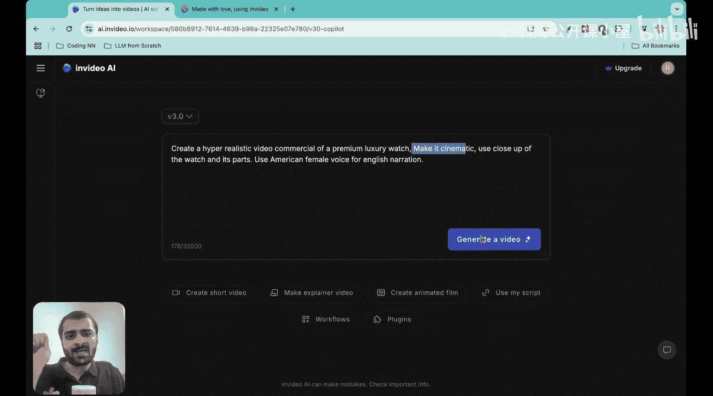
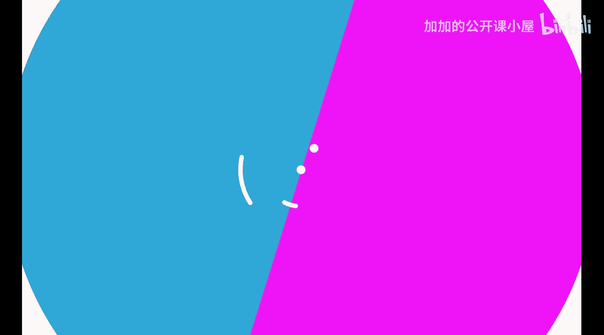
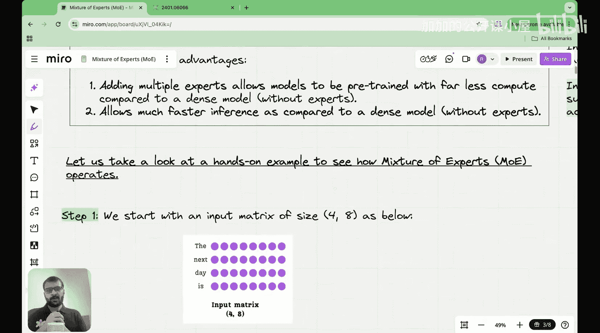
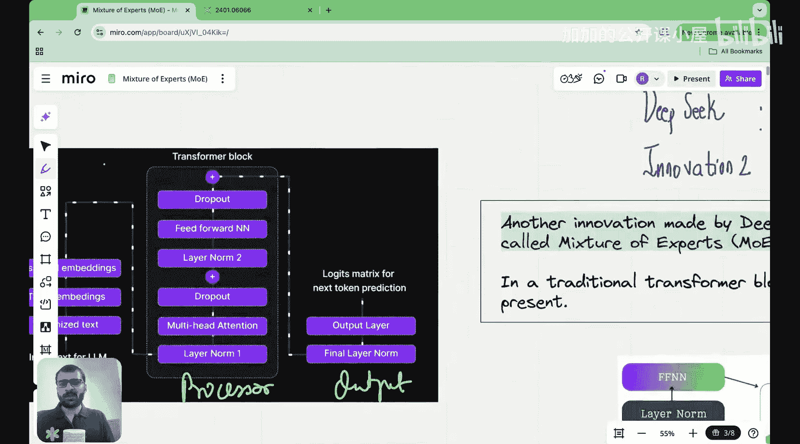
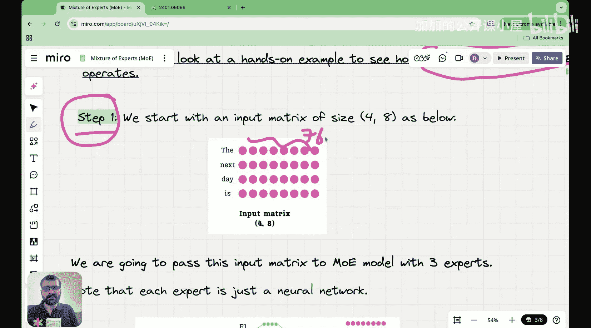
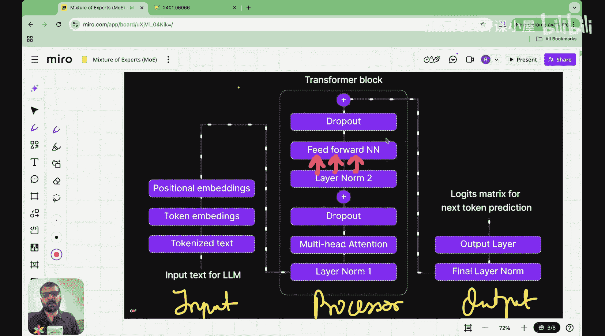
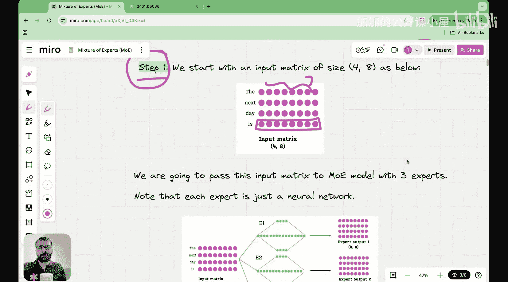
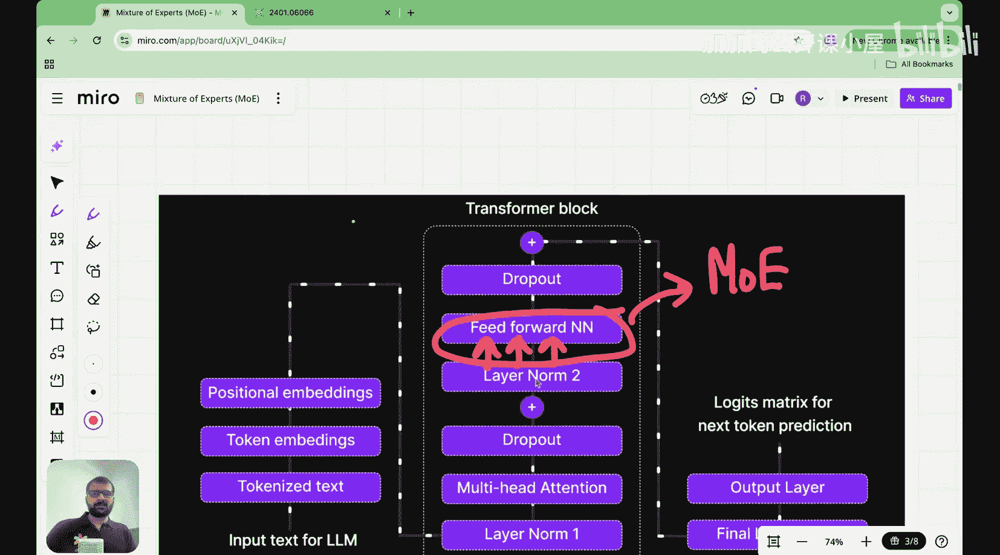
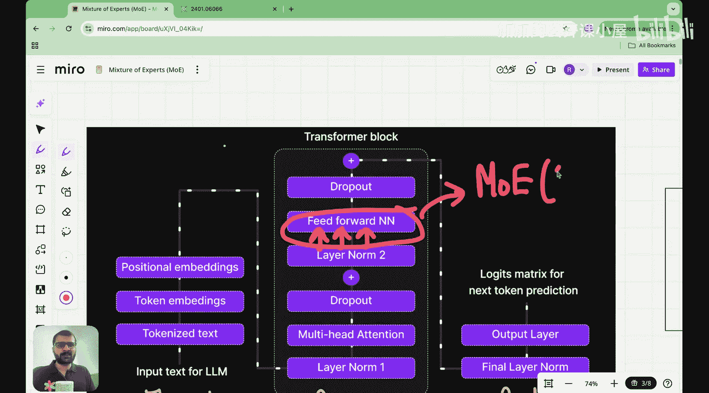
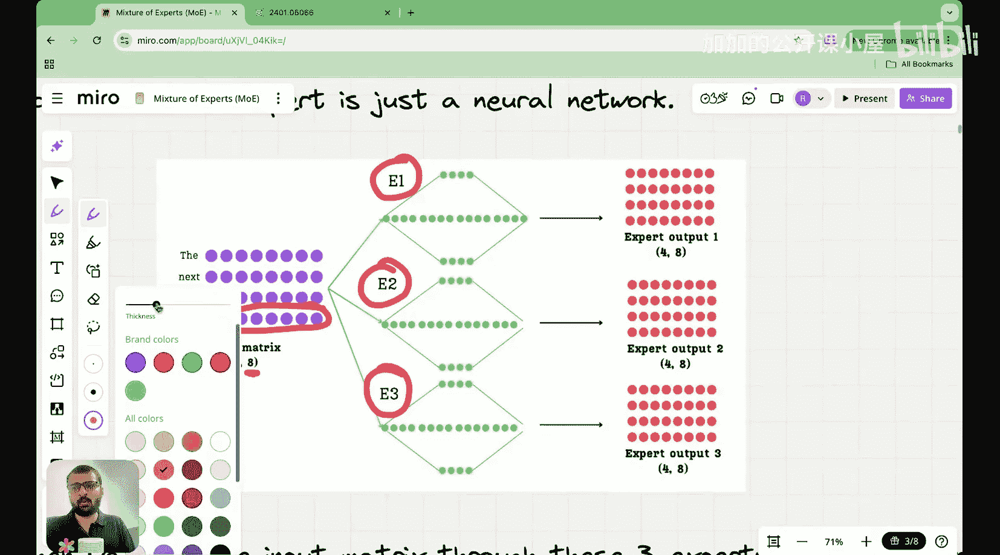

# Vizuara【中英⚡从零开始构建DeepSeek｜CS8803 Build DeepSeek from Scratch】 p19 P19 Mixture of Experts Hands on Demonstration ｜ Visual Explanation [BV1ryHpzTEKW_p19]

Hello everyone， My name is Doctor Raj Dunecker。 I graduated with a PhD in machine learning from MIT in 2022。

 and I am the creator of the Bill Deepsek from Scratch series。Before we get started。

 I want to introduce all of you who are sponsor and our partner for this series in V AI。

All of you know how much we value foundational content building AI models from the nuts and bolts inviideo AI follows a very similar principle and philosophy to that of us let me show you how。

So here's the website of Inviideo AI。With a small engineering team。

 they have built an incredible product in which you can create high quality AI videos from just text prompts。

😊，So as you can see here I've mentioned a text prompt。

 create a hyper realisticistic video commercial of a premium luxury watch and make it cinematic with that I click on generate video。

Within some time， I am presented with this incredible video， which is highly realistic。

What fascinates me about this video is its attention to detail look at this。

 the quality and the texture is just incredible and all of this has been created from a single text prompt。

That is the power of Invi's product the backbone behind the awesome video which you just saw is in video AI's video creation pipeline in which they are rethinking video generation and editing from the first principles。

To experiment and tinker with foundational models， they have one of the largest clusters of H100s and H200s in India and are also experimenting with B200s。

Individualviio AI is the fastest growing AI startup in India building for the world。

 and that's why I resonate with them so much。The good news is that they have multiple job openings at the moment you can join their amazing team I am posting more details in the description below。

🎼。

Hello everyone and welcome to this lecture in theBuild Deep Sk from Sctch series。

Today， we are going to continue our journey towards understanding the mixture of experts model。

To give you a recap of what we did in the previous lecture in the previous lecture。

 we saw that in the normal transformer architecture， there is one feed forward neural network。

And whenever an input token of a certain dimension goes into the field forward neural network。

 it is an expansion contraction neural network， so it has one hidden layer。

 which has four times the number of dimensions of the input token。

So this first is the expansion layer， and then we have a contraction layer which projects the expanded dimension back into the original dimension。

We saw that the main idea of mixture of experts is to take this simple architecture of the feed forward neural network and replace it with multiple neural networks so if we have four such neural networks then we say that there are four such experts。

So， you might be thinking。Okay， why are we doing this。

 why are we unnecessarily complicating the mechanism by adding four neural networks instead of one？

The main advantage of mixture of experts is that mixture of experts allows the pretrain to be done with far less computational capacity。

 which means that pretraining is done in a much more faster manner and inference is also done in a much more faster manner。

And the reason mixture of experts is able to achieve that is through a simple concept。

 which is called as sparsity。So the main idea of sparsity is that let's say if there are four experts right and whenever a group of tokens comes in as an input to these multiple experts not all of these experts will be activated so in this particular case you can see that expert to an expert to an expert3 are deactivated and only expert number four is activated this means that whenever a token comes in it is not routed to all of the experts it is routed selectively to only certain experts。

This further implies that during the pre training process and also during inference。

 all the experts don't need to be active at the same time。Depending on the type of token。

 certain set of specialized experts are activated。And this concept of not activating all the experts is called as parsity。

Sparrsity is one of the main ideas behind mixture of experts and in today's lecture we are going to see how sparsity is implemented mathematically so how mixture of experts works with a handson example thats what we are going to see today。

In the previous lecture we also looked a bit at interpretpretability。

 so it turns out that every expert essentially learns something new so for example there might be an expert in a given transformer layer。

Which。Is specialized in punctuation， which means that whenever the input consists of the punctuation token。

 either of these tokens， it'sed to these specialized experts。

Whenever the input consists of let's say verbs， it's routed to these tokens。

 wherever the input consists of let's say visual descriptions， it's routed to these experts。

So depending on the token。We select which experts the token should be routed to。

And that reduces my pre training time and that also accelerates my inference this is the main idea behind mixture of experts。

One more thing which we saw is that there are multiple transformer blocks right。

 and each of the transformer blocks has different experts。

So for a given token it does not necessarily mean that if expert number one is activated in the first transformer block the same expert is activated in the second transformer block no for a given token there might be different expert activated in different transformer blocks so let's say in the first transformer block this is the expert which learns about verbs in the second transformer block this is the expert which learns about whobs etc。

So this is the visual journey of a token which we saw in the previous lecture as it passes through multiple transformer blocks。

Today my main intention is to show you step by step how the mixture of experts is actually implemented which means that given any token let's say a token comes in with a dimension 768 right after it passes through all of my experts it should still retain its dimension of 768 so what happens in this process how do we utilize all of my experts to ultimately give my output which has the same dimension as that of my input。

While we do this we'll see a number of ideas we see the idea of scarrsity。

 which means that not all of my experts will be activated at the same time。

 so that's one main concept which we are going to see today。

And the second concept which you are going to see today is routing。

Routing means that its a routing mechanism which decides based on a given token which expert the token needs to be routed to so these are the two main concepts which we are going to see today and we are going to look at this concept in sequence of step so we have step number one step number two step number three。

 step number four。Step number five， step number six。

And step number seven so we are going to look at these seven steps today sequentially and I have this lecture planned out in a completely visual manner so that you will understand exactly how mixture of experts is implemented so lets get started with the sequence of steps。

Alright， so let's get started with step number one initially and this is the most simple step in this step we essentially start with my input embedding matrix so I have four tokens the next day and is and each of them have a dimension of 768。

So each of these token has gone through an entire journey before reaching this speed forward neural network stage right each neural each token is tokenized converted to token embeddings。

 we add positional embeddings then it goes to the transformer， we have a layer of normalization。

 we have multiair attention dropout。Another layer of normalization etc So after going through all of these sequences I have those input embeddings and now those are the inputs to my feed forward neural network here instead of one feed forward neural network we are going to see how the mixture of experts block is implemented with multiple neural networks。

Al right， so this is my input matrix with four tokens and each of the token has an embedding dimension equal to 8。

What I'm going to do next is that we are going to pass this input matrix to a mixture of experts model with three experts。

 so in this step which we saw instead of passing these tokens to a single neural network we are going to pass it through a mixture of experts model which has three experts or which has three different neural networks。

So lets see how this is implemented our main idea is that lets say you have this input embedding matrix and I have my expert number one expert number two and expert number three。

Each expert is a neural network， which is an expansion contraction neural network which retains the input dimension。

 so when the input embedding matrix is passed through the expert even。

The dimension of each token initially 768 and it's retain or lets say the dimension of each token is equal to 8 and thats retain to be equal to 8 right so whenever the input embedding matrix is passed through the field for our neural network even which is expert1 we get the expert output1 which is a4 by 8 matrix why is it 4 by 8 this will be relevant to you later so please try to understand the intuition behind。

