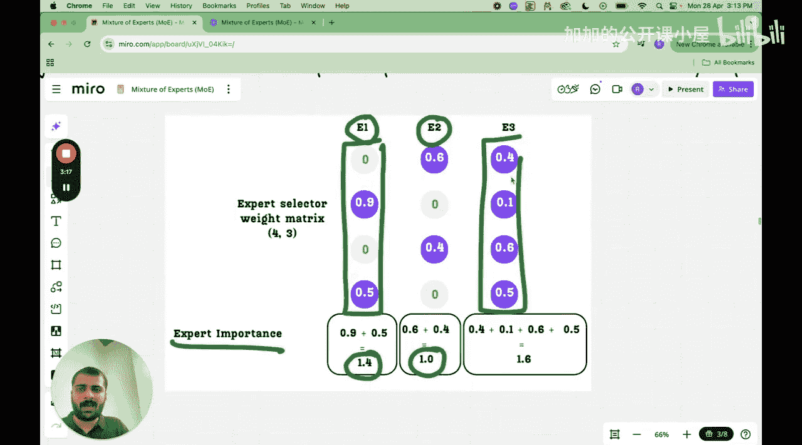

# Vizuara【中英⚡从零开始构建DeepSeek｜CS8803 Build DeepSeek from Scratch】 p20 P20 Mixture of Experts Balancing Techniques ｜ Auxiliary Loss ｜ Load Balancing ｜ [BV1ryHpzTEKW_p20]

Hello everyone， My name is Doctor Raj Dunecker。 I graduated with a PhD in machine learning from MIT in 2022。

 and I am the creator of the Bill Deepsek from Scratch series。Before we get started。

 I want to introduce all of you who are sponsor and our partner for this series in V AI。

All of you know how much we value foundational content building AI models from the nuts and bolts inviideo AI follows a very similar principle and philosophy to that of us let me show you how。

So here's the website of Inviideo AI。With a small engineering team。

 they have built an incredible product in which you can create high quality AI videos from just text prompts。

😊，So as you can see here I've mentioned a text prompt。

 create a hyper realisticistic video commercial of a premium luxury watch and make it cinematic with that I click on generate video。

Within some time， I am presented with this incredible video， which is highly realistic。

What fascinates me about this video is its attention to detail look at this。

 the quality and the texture is just incredible and all of this has been created from a single text prompt。

That is the power of Invi's product the backbone behind the awesome video which you just saw is in video AI's video creation pipeline in which they are rethinking video generation and editing from the first principles。

To experiment and tinker with foundational models， they have one of the largest clusters of H100s and H200s in India and are also experimenting with B200s。

Individualviio AI is the fastest growing AI startup in India building for the world。

 and that's why I resonate with them so much。The good news is that they have multiple job openings at the moment you can join their amazing team I am posting more details in the description below。

🎼。

Hello everyone and welcome to this lecture in theBuild Deep Sek from Scratch series。Today。

 we continue our journey in understanding mixture of experts。

Our main aim today is to learn about two things which are implemented in the mixture of experts modeling to make sure that every token is routed to experts in a balanced manner。

 and all the experts are essentially utilized。One such method is called as auxiliary loss。

And the second method is called as load balancing。Today we are going to learn about both of these methods which are very commonly implemented in mixtureture of experts。

First let me quickly recap what all we have seen so far in the first lecture on mixture of experts we understood the introduction regarding how mixture of experts is essentially used in this feed forward neural network of the transformer block。

And we also understood the intuition behind mixture of experts this whole idea of sparsity。

 so every token is not routed to all of the experts， but only a select set of experts。

And in the previous lecture， we saw a hands on demonstration of how mixture of experts is actually implemented from scratch。

We saw something which is called as top K load balancing。

 which means that every token is routed to only a select set of top K experts to implement sparsity。

And the second concept to choose of is that of the routing mechanism。

So the main idea of the routing mechanism is that the input matrix is essentially multiplied by the routing matrix and we get something which is called as the expert selector weight matrix。

And this expert selector matrix helps us to do two things。

 it helps us to understand which which among the three experts in this case to route to every token or to route for every token and the second thing it helps us understand is how much weighttage we need to give to each expert whenever a token is routed to it。

We learn about these steps in the previous lecture。 so if you are unsure about this。

 please go back and revise the previous two lectures on mixture of experts today。

 we are going to directly start from step number 8 over here， which is called as auxiliary loss。Now。

 what exactly is auxiliary loss and why do we need it。

 So let us start understanding regarding this in mixture of experts models。

 the routing mechanism essentially selects a subset of experts。

 As we have seen for every token we see， we select a subset of experts which the token is routed towards。

Until now， whatever we have seen so far， we have not implemented a mechanism which makes sure that this routing is balanced。

Which means that sometimes what can happen is if some experts get chosen or selected a lot of times while other experts are not utilized at all。

 it leads to inefficient learning， and our performance is not as optimal as expected。 Idely。

 we want all of our experts。To be helping， we want all of our experts to be contributing。

So if we look at the entire data set and if you look at all the experts。

 I want all of my experts to be active somewhere I don't want some experts to be overutil and I don't want some experts to be underutilized。

So to make sure that imbalanced expert selection is not there。

 we add a term which is called as the auxiliary lob term。So when the LLM is trained。

 all of us know that the main task of a large language model is the next token prediction and we have the training loss at that time。

Now to make sure that the selection of experts is balanced。

An auxiliary loss term is added to the main training loss term。

And this penalizes imbalanced expert selection and it pushes the routing function towards the more uniform distribution towards the more uniform distribution of what towards the more uniform distribution of where the tokens are routed to。

 so lets say at the end of all the routing you look at all the experts ideal you want to see every expert processing similar number of tokens。

Ideally， that's the balance distribution。So now let me illustrate step by step to all of you how the auxiliary loss is actually calculated so to start understanding how the auxiliary loss is actually calculated we start looking at the expert selector weight matrix and to give you a recap of what this expert selector weight matrix means every row illustrates the experts which are assigned to that particular token so if you look at row number one what it tells me is that token number one will be routed only towards experts number2 and experts number three and the weighttage of 0。

6 needs to be assigned to expert2 and the weightage of 0。4 needs to be assigned to expert 3。

Similarly， token number2 needs to be routed towards expert 1 and expert 3 and the weighttage of 09 will be assigned to expert 1 and the weighttage of 01 will be assigned to expert 3。

Token number 3 will be routeed towards expert 2 and3 with weighttages of 0。4 and 0。6 respectively。

 and token number 4 will be routeed towards expert 21 and expert 3 with weighttages of 0。5 and 。

5 respectively。So what I want to ask all of you here is that what does every column here in the expert selector weight matrix denote？

And you can pause this video for a to think about this。

 what does every column in the expert selector weight matrix denote？

So the answer to this question is that every condom essentially。Is for one particular expert。

 so the first column is for first expert， second column is for second expert。

 third column is for third expert， So if you look at the first column it contains the probabilities with which tokens are routed towards expert number one。

So 0 is the probability of token 1 being routed to even 09 is the probability of token 2 routed to even。

0 is the probability of token 3 routed to even and 0。5 is the probability of token 4 routed to even。

So now if I want to ask you the question that。What is the total probability or if you were to calculate a quantity which is called as expert importance？

Expert importance。What will be the total expert importance for expert number one intuitively？

So if you were to calculate the total expert importance for expert number one。

 you will actually look at all of these probabilities and you will add them together。

So if you add 0 plus 0。9 plus 0 plus 0。5， it will give you an answer of 1。4。

So a summation of all of these values indicates how much importance is given to that particular expert when you consider all of the tokens。

Similarly what we are going to do here is that I am going to add the values so Im going to add the values of column number one and that leads me to value of 1。

4 that is the expert importance of expert number one。

If I look at second column that is E2 and if I add all the entries of the second column that will be 0。

6 plus 0。4 that will be equal to 1， this will be the expert importance of E2。

And now if I look at the column number three。

