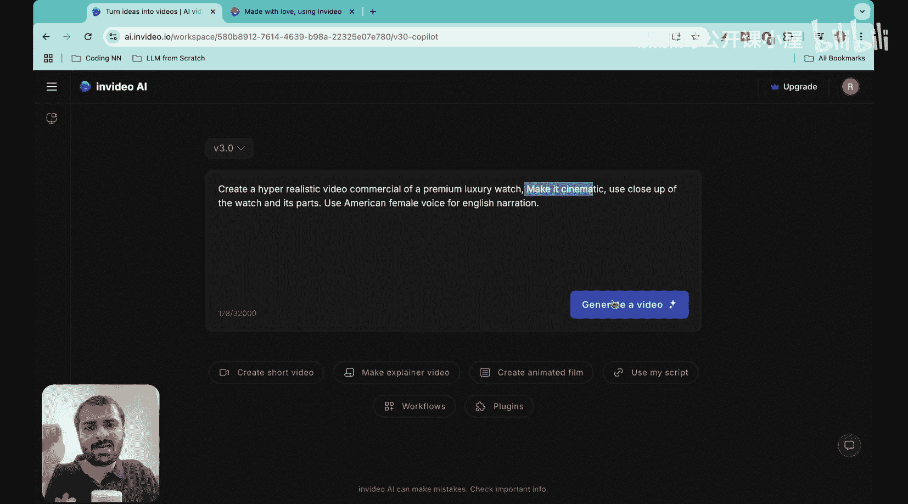
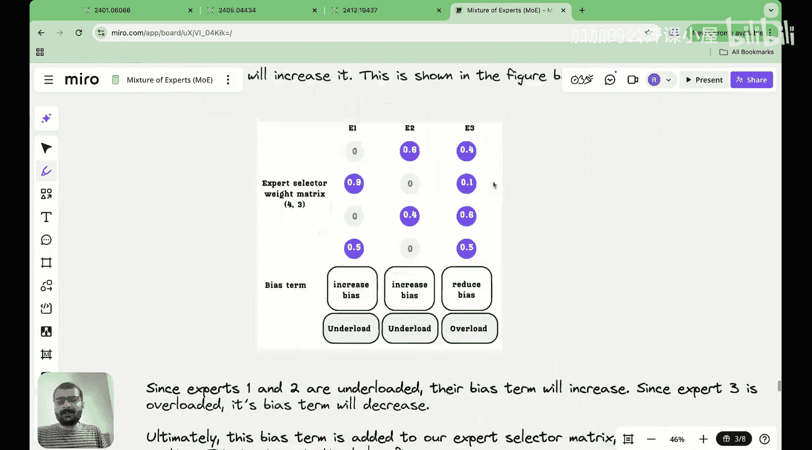

# Vizuara【中英⚡从零开始构建DeepSeek｜CS8803 Build DeepSeek from Scratch】 p21 P21 How DeepSeek rewrote Mixture of Experts (MoE)？ [BV1ryHpzTEKW_p21]

Hello everyone， My name is Doctor Raj Dunecker。 I graduated with a PhD in machine learning from MIT in 2022。

 and I am the creator of the Bill Deepsek from Scratch series。Before we get started。

 I want to introduce all of you who are sponsor and our partner for this series in V AI。

All of you know how much we value foundational content building AI models from the nuts and bolts inviideo AI follows a very similar principle and philosophy to that of us let me show you how。

So here's the website of Inviideo AI。With a small engineering team。

 they have built an incredible product in which you can create high quality AI videos from just text prompts。

😊，So as you can see here I've mentioned a text prompt。

 create a hyper realisticistic video commercial of a premium luxury watch and make it cinematic with that I click on generate video。

Within some time， I am presented with this incredible video， which is highly realistic。

What fascinates me about this video is its attention to detail look at this。

 the quality and the texture is just incredible and all of this has been created from a single text prompt。

That is the power of Invi's product the backbone behind the awesome video which you just saw is in video AI's video creation pipeline in which they are rethinking video generation and editing from the first principles。

To experiment and tinker with foundational models， they have one of the largest clusters of H100s and H200s in India and are also experimenting with B200s。

Individualviio AI is the fastest growing AI startup in India building for the world。

 and that's why I resonate with them so much。The good news is that they have multiple job openings at the moment you can join their amazing team I am posting more details in the description below。

🎼。

Hello everyone and welcome to this lecture in theBuild Deep Seek from Sctch series。Today。

 we are going to understand the main innovations which deep seek implemented in the mixture of experts architecture。

Until now， we have seen three lectures in mixture of experts in the first lecture we look at the mixture of experts。

Introduction and how we replace the feed forward neural network in the traditional transformer architecture with a bunch of neural networks。

 which were called as experts。That that was the first thing which we saw in the first lecture on mixture of experts。

 then we also looked at the intuition behind why mixture of experts really works mixture of experts drastically improves the pre cleaninging efficiency and also the inference efficiency。

And one main reason for this is the concept of sparssity。We saw that。

When we look at every individual token， it is not really routed to all the experts。

 but it is routed only to a fraction or a subset of the experts and thats 3 poly as a sparse model。

Where if you have four experts， maybe only one expert is activated for every token。

So sparsity is one of the main ideas behind which mixture of experts really operates。

Then in the second lecture we saw the step by step procedure through which mixture of experts is implemented。

 we first tap the input matrix and we multiply it with the routing matrix that gives us the expert selector matrix。

Then we decide how many experts need to be routed to each for each token and thats called as top k。

 so if top k is equal to 2 we select。Two experts for every token。

The way these experts are selected are based on the values of the expert selector matrix。

So if you look at every row here that corresponds to the experts to which every token is routed so the first token will be routed to these two tokens the second token will be routed sorry the first token will be routed to these two experts。

Second token will be routed to these two experts， etc cea。

So we take the expert matrix and then we apply softmax and that uses the expert selector weight matrix。

Where if you look at every row， it adds up to one， so the value each value corresponds to a probability with which that token is routed to that particular exporter。

So that is how what we ultimately do is that we use these probabilities as weight as a weights。

And then based on any given token， we first look at which experts is it routeed to and then we use these weighting factors。

 we use these weighting factors or these weight factors。To add the three output。

 so we have three experts so there are three expert outputs since there are three neural networks and then for every token based on the experts its routeed to and based on the weighting factor。

We use the weighted summ and get the final output vector for every token all these output vectors are then aggregated together and then we get the resultant output。

Fid the input。So if the input is 4 comma 8， the output is also 4 comma 8。

 but now it's a cumulative sum of three neural network output instead of just one neural network output。

That's the main idea of mixture of experts， which we saw until step number seven。

In the previous lecture we looked at balancing techniques， so we want to ensure that。Ultimately。

 when we look at all the experts， we want all experts to be operational。

 we don't want that one expert talk the limelight and one expert received all the tokens。

 that's not what we want。 We actually want all the experts to participate。

So if you look at every expert towards the end， every expert should on an average receive equal number of locals。

That's called as a balanced mixture of experts model。

And to do that we saw a couple of different things first we saw something which is called as the auxiliary loss。

Where we quantified the expert importance， so we found the importance of every expert based on the probability summation of tokens routeed to that expert。

And then based on the expert importance， we obtain the coefficient of variation。

 which is the standard deviation divided by the mean。

 and then we added this auxiliary loss factor to the overall loss。So higher the auxiliary loss。

 it means higher the coefficient of variation， which is not good because then one expert will be assigned more importance compared to other experts。

Then we saw that this termmo was not enough。To make sure that。

Tokens are routed uniformly to different experts， so then we introduce a term which is called as load balancing and the load balancing loss essentially was defined by this scaling factor multiplied by the number of experts and then for every experts we have two terms F and P。

This FI denotes the fraction of tokens sent to a particular expert I and a P denotes the fraction of probability。

 which is allocated to that expert eye。Now， minimizing this loss。

 it turns out that minimizing this loss gets us a balance in terms of。The fact that if a token。

 if a expert has more importance， more number of tokens will be outd to it。

 if an expert has less importance， less number of tokens will be outd to it。

 so there will be that proportionality。Between FI and BI， so minimizing this loss。

 what it does is that。It allows experts with higher importance to handle proportionionately more tos。

And it allows experts with lower importance to handle proportionately fewertos。

So by minimizing the second loss， which is called as the load balancing loss。

We mathematically enforce the model to distribute tokens proportionally to how much the expert is valued or trusted。

 and that leads to a more balanced use of the mixture of expert architecture。

We also saw something called as the capacity factor。

 which limits the number of tokens every expert can handle okay。So today。

 the key thing which we are going to remember is the second loss， which is called as the。

Lad balancing loss and there are these terminologist FIbiI if you don't remember this it's fine but just remember that the load balancing loss is added as a extra term to the total pretraining language loss which we already have when predicting the next token。

Today we are going to learn about the innovations which Deep seek implemented。

To deal with these losses。So deep seek， actually what it did was the whole mixture of experts literature was happening。

And like deep secret did with so many other。Innovations， which they have。

 they took this mixture of experts innovation and then they built or top of it。

 which means they took all these lost terms which we have been seeing。

 They modified these loss terms to make it more efficient。

 And today we are going to see three main innovations which deep seek implemented The first is something which is called as auxiliary loss free load of balancing。

 The second is called as。

Shared experts。And the third innovation is called as5 grain expert segmentation we are going to look at all of these。

