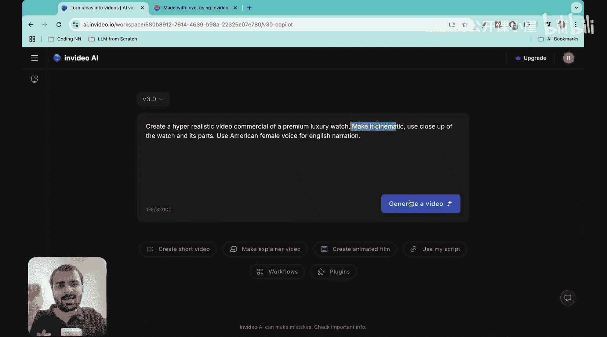
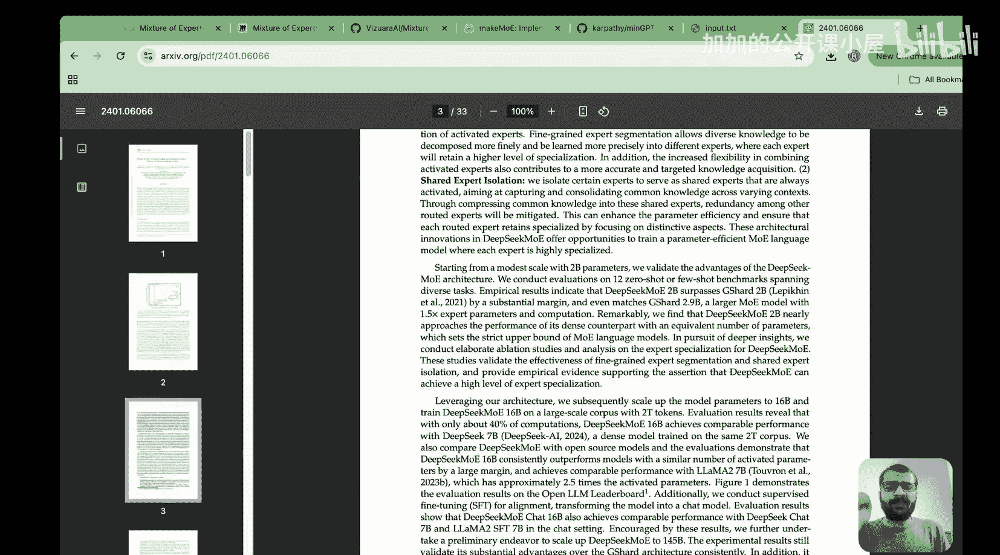
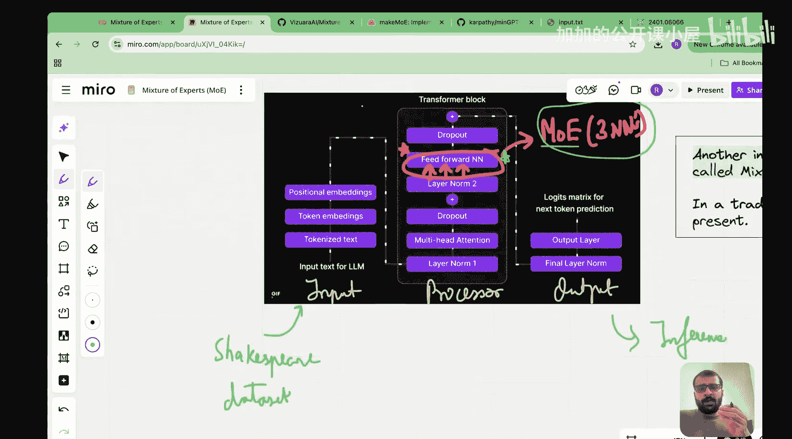
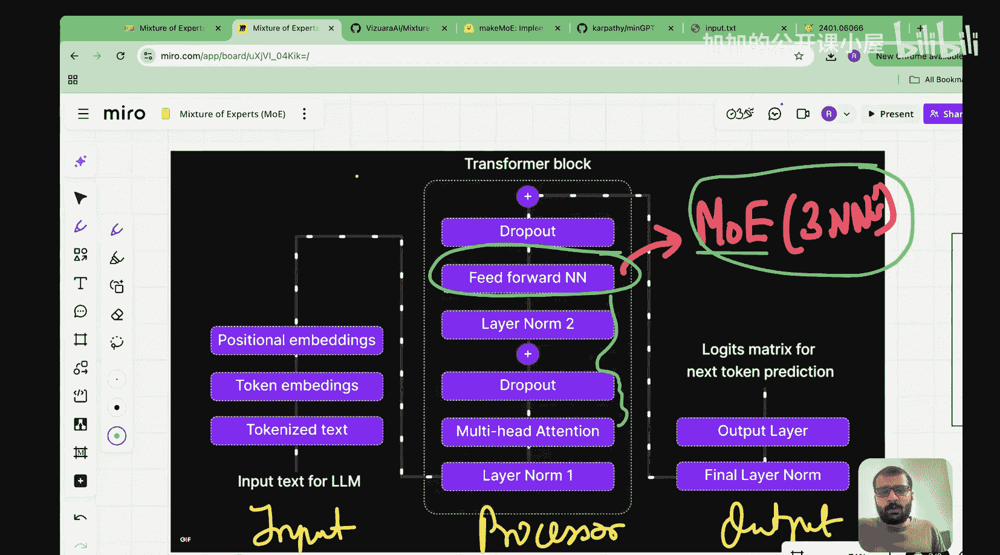
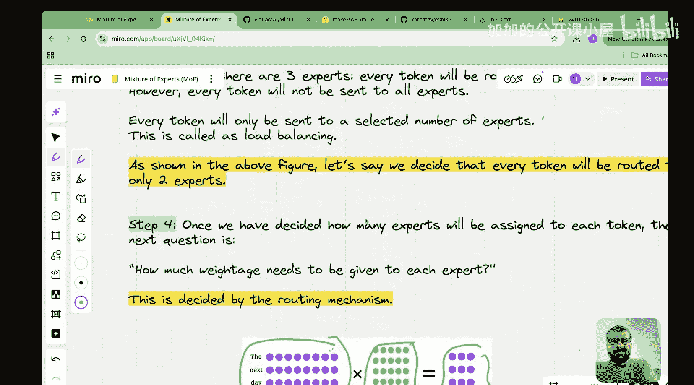

# Vizuara【中英⚡从零开始构建DeepSeek｜CS8803 Build DeepSeek from Scratch】 p22 P22 Code Mixture of Experts (MoE) from Scratch in Python [BV1ryHpzTEKW_p22]

Hello everyone， My name is Doctor Raj Duneer。 I graduated with a PhD in machine learning from MIT in 2022。

 and I am the creator of the Bill Deepepsek from Scratch series。Before we get started。

 I want to introduce all of you who are sponsor and our partner for this series in video AI。

All of you know how much we value foundational content。

 building AI models from the nuts and bulls in videoide AI follows a very similar principle and philosophy to that of us let me show you how。

So here's the website of Inviideo AI。With a small engineering team。

 they have built an incredible product in which you can create high quality AI videos from just text prompts。

😊，So as you can see here I've mentioned a text prompt。

 create a hyper realisticistic video commercial of a premium luxury watch and make it cinematic with that I click on generate video。

Within some time， I am presented with this incredible video， which is highly realistic。

What fascinates me about this video is its attention to detail Look at this。

 the quality and the texture is just incredible and all of this has been created from a single text prompt。

That is the power of In's product the backbone behind the awesome video which you just saw is in video AI's video creation pipeline in which they are rethinking video generation and editing from the first principles。

To experiment and tinker with foundational models， they have one of the largest clusters of H100 and H200s in India and are also experimenting with B200s。

Individualviio AI is the fastest growing AI startup in India building for the world。

 and that's why I resonate with them so much。The good news is that they have multiple job openings at the moment you can join their amazing team I am posting more details in the description below。

🎼。

Hello everyone and welcome to this lecture in theBuild Deepsek from Sctch series。Today。

 we are going to continue our journey towards understanding the mixture of experts。

In the previous four lectures， we have seen the mixture of experts introduction， intuition。

 how mixture of experts work in a mathematical manner， and in the previous lecture。

 we looked at the deep seek innovations in the mixture of expert architecture。 In particular。

 we looked at the deeps M E paper。

Which introduced several no innovations， which deep seek made in the mixture of experts architecture。

 some of these innovations being。

Findine grain expert segmentation and shared expert isolation。

 and one more innovation was auxiliary lost re load balancing。

 which they introduced in their V3 architecture。Today。

 we are going to conclude our mixture of experts module。

By coding an entire mixture of experts architecture from scratch。

So my goal here will be to take a simple data set。And then code the mixture of experts model。

 which we have learned on the whiteboard for the past four lectures fully from scratch。

 we are only going to use Pytorch， no other library。

And then we are also going to do pre training and inference in this lecture。

So let's get started before we start I want to mention a couple of references which I've utilized first is this make ME code which is implemented by Aveash Surri one of brilliant articles and I'll share this link in the description and the second is of course the。

NnoGPT or the mini GPT architecture， which is implemented by And Alpathy。

 we are going to take the data set from here and we are going to borrow。

Some code for the transformer architecture from here。

So visually what we are going to build today is that we are going to build this entire architecture。

So let me show you this entire architecture is what we are going to build today and this feed forward neural network。

 this layer here that is what we are going to replace with a mixture of experts layer that is the whole idea we are going to start with text which is based on Shakespeare。

Data set。And then we are going to do this entire three training pipeline。

 and after which we are going to do inference。Most of the time which Ill spend in this lecture is on the mixture of experts module and I will not be spending too much time on the rest of the code because we have already covered that in the other lecture so my whole goal will be to explain how this mixture of experts is written from scratch。

And of course， we'll build out the other other architecture also along with mixture of experts。

 but in terms of explanation， I spend most of my time explaining the mixture of experts module。

So let's get started。As you can see over here， I've divided this code into multiple steps。

 there are total 16 steps。And I'll be also sharing the code file with you so that you can run it fully on your own end。

A quick note about GPU so here you can see that I'm currently running on the T4 GPU which is free for everyone。

 but if you do have access to the a 100 GPU I will highly recommend you to switch to this because it just leads to faster prely it's not a necessity because you can run the same code on T4。

But it will just be much slower on the T4 GPp。Alright。

 so the first thing which we have to do is to load packages and here we are going to load only Ptorch as I mentioned we don't need too many other packages we are going to code everything from scratch the second is the data set。

So this is the data set which we have， this is a collection of a huge number of Shakespeare in place。

 Shakespeare in literature， etc， and here you can see that it's called input do TXD。

So that is the data set which I've loaded over here。

 you can even click on this arrow and you'll see that the data set is loaded。Now。

 what I'm going to do is that first I'm going to start defining this mixture of experts module directly since that's the main purpose of。

Today's lecture， I'm going to directly start codinging out the mixture of experts。

And let's take a look at the steps which we have seen on the whiteboard。

 The first thing which we have to do is that we have to define a module which just creates a neural network for。

That given export， right？Ultimately we get a weighted combination of these experts through the routing mechanism。

 but first we have to make sure that every expert is a feed forward neural network which has a hidden layer with four times the number of units as the first layer。

And the output layer with the same number of units as the first layer。

 so this is going to be our neural network and the activation function which I'm going to use after this hidden layer is ray loop。

Please note that in standard NLL architectures， the Jlu。Is used， you can even use this。

 but for the sake of simplicity， I'm going to be using rail over here。

So the first thing which we have to do as also shown in the schematic is we have to define each expert as a neural network。

 so I'm creating a class for as expert over here。And。

Whenever we create an instance of this class it initializes a neural network。

 so this is the expansion layer going from the embedding dimension to the four times the embedding dimension。

 then we have the rail activation， then we have the contraction layer and finally we have rockout。

So this is exactly what you saw on the whiteboard right this is the expansion layer。

 then we have the re activation after this， then we have the contraction layer and after that there is a dropout。

So whenever you want to create or whenever you create an expert。

We essentially create a neural network like this with an expansion contraction architecture。

So that's the first step in which we have defined every expert as a neural neural network。

The second thing which we have to do is implement the router and this is probably the most important step of the mixture of experts what the router will do is that the input matrix which we have and by input matrix I mean the。

Input which comes to the mixture of experts module。

 so if you take a closer look at this architecture。

 what is the input which comes to the mixture of experts module？

The input which comes to the mixture of experts module is essentially the output after the multihand attention block and after it goes to drop out layer normalization etc that is the input which comes to the mixture of experts right and that is the input matrix which Ive represented over here if there are four tos。

This four represents the number of tokens and this8 over here is the embedding dimension。

That's the input matrix and this input matrix will then be multiplied with the routing matrix。

And that gives me the expert selector matrix。Alright everything really starts after we get the expert selector matrix once you have the expert selector matrix after that we are going to implement the top K load balancing then we are going to apply Somax etc。

 well see all of this but the first step which we have to do is we have to implement the router。

