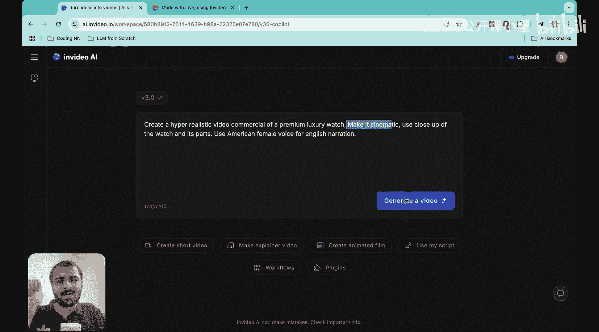
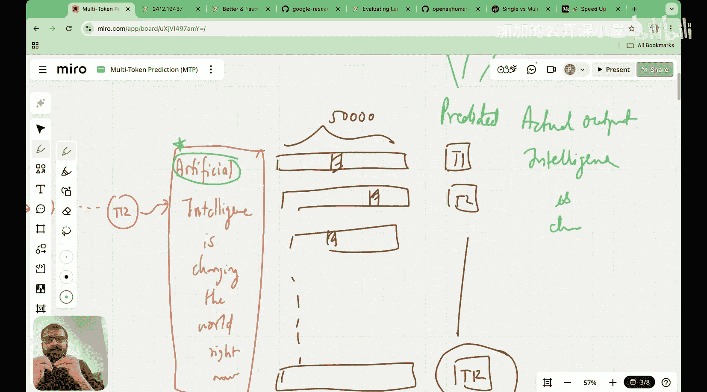

# Vizuara【中英⚡从零开始构建DeepSeek｜CS8803 Build DeepSeek from Scratch】 p23 P23 Multi-Token Prediction Introduction [BV1ryHpzTEKW_p23]

Hello everyone， My name is Doctor Raj Duneer。 I graduated with a PhD in machine learning from MIT in 2022。

 and I am the creator of the Bill Deepepsek from Scratch series。Before we get started。

 I want to introduce all of you who are sponsor and our partner for this series in video AI。

All of you know how much we value foundational content。

 building AI models from the nuts and bulls in videoide AI follows a very similar principle and philosophy to that of us let me show you how。

So here's the website of Inviideo AI。With a small engineering team。

 they have built an incredible product in which you can create high quality AI videos from just text prompts。

😊，So as you can see here I've mentioned a text prompt。

 create a hyper realisticistic video commercial of a premium luxury watch and make it cinematic with that I click on generate video。

Within some time， I am presented with this incredible video， which is highly realistic。

What fascinates me about this video is its attention to detail Look at this。

 the quality and the texture is just incredible and all of this has been created from a single text prompt。

That is the power of In's product the backbone behind the awesome video which you just saw is in video AI's video creation pipeline in which they are rethinking video generation and editing from the first principles。

To experiment and tinker with foundational models， they have one of the largest clusters of H100 and H200s in India and are also experimenting with B200s。

Individualviio AI is the fastest growing AI startup in India building for the world。

 and that's why I resonate with them so much。The good news is that they have multiple job openings at the moment you can join their amazing team I am posting more details in the description below。

🎼。

Hello everyone and welcome to this lecture in theBuild Deep Sek from Scraratch Series。Today。

 we are going to get started with a very important module and that is called as multi token prediction。

When you look at the deep sea architecture， they had three predominant revolutions in their architecture。

 the first one was multihead latent attention， the second was the innovations which they did on top of the mixture of experts module。

And the third one was a very smart implementation of something which is called as multitotken prediction。

Today we are going to learn about this third technique in the previous lectures we have covered everything which deep seek implemented related to multi latent attention and mixture of experts。

So if you go to the paper， which Deep seek released in January 2025。

 and which led to this whole deep seek revolution， that's deep seekq V3 technical report。

And if you scroll down below， you'll see that。First， they have this。In their architecture section。

 first they have the multi headlate attention schematic。

Then after this there is a whole section on the mixture of experts module which they have with innovations such as auxiliary loss free load balancing。

 shared experts， fine grain expert segmentation， etc。

 and finally the last thing which they have is this multitopken prediction。

And this is what we are going to see today， this is the schematic which deepse has with respect to the emergency token prediction module。

Now this looks simple that okay we usually do single token prediction in language models。

 what is this multi token prediction， maybe we are predicting multiple tokens。

But there are actually a lot of complexities which are involved in this process and that's why we are going to take about two to three lectures for me to explain this entire concept of multitoken prediction to you in a lot of detail as always we are going to show you everything on a whiteboard and then I'll also take you through the code of how can we code a multi token prediction module from scratch。

So that is the plan for the next two to three lectures so first let me take you through the history of this multitoken prediction actually multi token predictionion was not invented by deepsek deepsek just built on top of it like they have done with so many of their other architectural innovations。

Multti token prediction was first implemented in this paper called Better and faster La language models。

 via are multi token prediction。And this paper was。

A group of researchers contributed to this paper and one such group came from Meta。

Deepsk based upon this paper， so this paper was published in April of 2024 and Deep Siig immediately took this。

 they built on top of this and implemented that in their version  three architecture。Okay。

 so if you look at the abstract this these authors say that large language models are trained with next token prediction loss in this work we suggest that training language models to predict multiple future tokens at once results in higher sample efficiency。

So that's what multi token prediction essentially is we are going to predict multiple future tokens at one time。

So let us start understanding the difference between single token prediction and multi token prediction in this lecture I'm just going to motivate the concept of multitoken prediction I'm going to show you how it differs from single token prediction and then we are also going to discuss some advantages of multi token prediction so I'm going to build your intuition in this lecture in the next lecture we are going to see how deepse exactly implemented the multitoken prediction architecture and in the lecture after that we implement multitoken prediction in code。

So let's get started with today's lecture， if you take a look at single token prediction。

 the pipeline for single token prediction looks something like this let's say we have a bunch of input tokens which look something like this and let me actually let me take a batch of eight input tokens okay artificial。

Intelligence is。渐进都。World right now。Let's say I have this batch of eight input tokens the way single token prediction works is that this entire batch。

Passes through multiple sequences of the transformer blocks。

 So here I've shown three transformer blocks。 Ily， there could be 2 and24。

 even 36 transformer blocks。 And these are called as the shared transformer trunk。

 That's the terminology introduced in this first multi token prediction paper。

 So I'm going to utilize this same terminology what this essentially means is just a bunch of transformer blocks chain together。

 right And then finally， so let's say I have this bunch of transformer blocks D1 D2 etc cea of t3 right up2l which is chain together。

 And after that， I have my logics matrix which converts from which converts every token from the embedding dimension to a vocabulary size。

 So now if you have this。Let me copyface these eight tokens when they come out。

Of the transformer blocks， the final output is the logics to where are the logics。

Matrix where every token has now if the vocabulary size is 50，000， every token has now a 50。

000 dimensional vector corresponding to it。So all of these tokens have the 50。

000 dimensional vector corresponding to it， and then we look at that token index which has the highest probability associated with it and then we get the next token which is predicted。

Next token， which is predicted for all of my input tokens。And during inference time。

 the only next token which matters is the last token that's the new token， which is infer。

 but during training time， all of these tokens which are predicted。

 they will be used for getting my training loss。 So for example。

 for the first token which is predicted even。The actual prediction should be intelligence right。

 if artificial is the input， the actual output should be intelligence earlier。For the second input。

 which is artificial intelligence， the actual output should be。So this is actual output。

 the actual output should be is here the actual output should be changing etca。

 so we have the actual output and then we have the predicted output。And during training。

 the loss is computed between the actual output and the predicted output that's essentially the single token prediction task。

In multi token prediction task what changes is that for every token which Im looking at so let's say if I'm looking at artificial year in single token prediction only one token is predicted right in multi token prediction instead of one token there are three tokens which are predicted let's say let me call it S1 S2 and S3 these are the three tokens which are predicted during multi token prediction for every input token and for these three I have my actual。

I have my actual tokens which are S1 dash s2 dash and s3 dash and then I get the loss between my predictedd three tokens and the actual three tokens for every input token so if you look at artificial right now。

You first define the horizon into the future。

