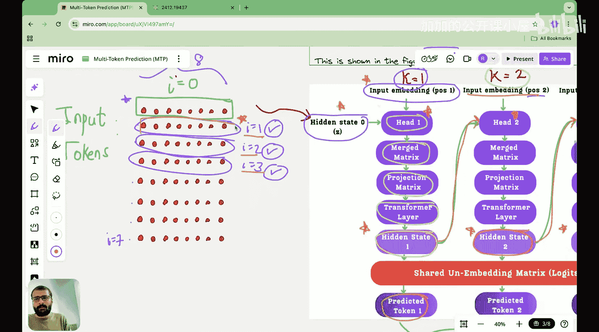

# Vizuara【中英⚡从零开始构建DeepSeek｜CS8803 Build DeepSeek from Scratch】 p24 P24 How DeepSeek rewrote Multi-Token Prediction (MTP)？ [BV1ryHpzTEKW_p24]

🎼Yeah。

Hello everyone and welcome to this lecture in theBuild Deep Sk from Sctch series。

Today we are going to understand exactly how deepsek implemented multi token prediction in the previous lecture we took a look at introduction to multi token prediction and how it differs from single token prediction。

We saw that in multi token prediction， when we focus on one input token。

 we generate multiple prediction tokens instead of just one prediction token。

And we also saw why is multi token prediction useful in particular we looked at four major reasons。

 the first is that multitoken prediction leads to densification of training signals。

 second it leads to improved data efficiency， it leads to better planning and finally it leads to a higher inference speed。

We also saw that deepsek used multitoken prediction gains only during the pretraining process and during inference。

 deepepsek just used single token prediction。Now， although multi token prediction looks simple like it just predicting multiple tokens instead of one token。

 there are a number of different intricacies which we need to understand， for example。

 if you take a look at the deepsq origin 3 paper you will see this schematic which they have。

This schematic formal multi ktoken prediction and there are a number of finer details hidden within this schematic such as this linear projection。

 this RMS nor concatenation， MTP module one MTP module 2， etc。

And when you read this paper they only have two paragraphs which are title MTTP modules over here and it's quickly explained in terms of mathematical formula it's actually very difficult to understand what's exactly going on here you feel that you have understood it but to truly understand it you need to write it down on a piece of paper so that's what I aim to do today today I'm going to show you exactly how deep C implemented multi token prediction what these equations mean equation 212223 and how to interpret this diagram which deep C has so let's get started with today's lecture we start out today's lecture with what happens in single token prediction right in single token prediction we have a bunch of input tokens which go through multiple transformer blocks and then we come out of the transformer block and the input tokens maintain their dimension so let's say we have three input tokens dimension is8 so this is three。

And when we come out of the transformer blocks， we have three by it again that's passed through an output head。

And let's say the vocabulary size is 50，000， this 3 by 8 is converted into a 3 by 50，000 matrix。

So it might look something like this。Well this is 50000 and then what we are doing is that for each of these token token1 token2 and token 3。

 we look at that index which has the maximum probability and that's how we predict the next token for each of the input tokens so the key thing to note here is that for each of these input tokens token number one token number two and token number three we are predicting one future token in the single token prediction task through this output head。

So one output head essentially helps every input token to predict one token so naturally if we want to predict multiple tokens for every input token we should have multiple output heads right so in today's。

Lecture I am going to assume that we are predicting three tokens into the future in mu token prediction and that terminology is called as depth。

So the depth which we are looking into the future is going to be equal to three。

 so we are going to need three heads， head of head number one， head number two and head number three。

For every input token， head one will predict the first future token。

 head two will predict the second future token and head 3 will predict the third future token。

Now I'm not just going to show you the text with respect to this I want to show you the mathematical intuition behind what I just said right so lets say these are my input tokens right I have eight input tokens which go from I equal to0 I equal to123。

4，56 and7 so the final input token is I equal to 7 and the dimension of every token is8 so the number of columns in every token is equal to 8。

What I'm going to illustrate right now is for one such input token。

 but this entire visual workflow will follow for all of the input tokens that's one key thing to understand for every single input token we are going to predict three tokens into the future。

So let's say we look at i equal to 0， so we look at first input token which is an eight dimensional vector。

 right？And we are predicting for a depth equal to three。

 so the depth is given by variable called K and that is the same variable which is used in deepse paper。

 so k prediction depth。So we are predicting for k equal to1。

 we are predicting for k equal to2 and we are predicting for k equal to3 for this input token Now remember for every prediction depth so for k equal to1 for k equal to2 as well as for k equal to3 we are going to need two inputs the first input is something which is called as the hidden state at that prediction depth and the second input is the input embedding at that depth so input embedding is much more easier to explain because it just the input embedding at that position right so if I'm looking at I equal to0 I'm making my predictions for three future positions right so I'm making my predictions for I equal to1 for I equal to2。

And for I equal to3。So the input embedding for k equal to1 format a prediction at depth1。

 the input embedding will be at position 1 will be which will be at I equal to 1 for k equal to 2。

 the input embedding will be at position 2 which will be at I equal to 2 and for k equal to3 the input embedding will be at position number three which will be at I equal to 3 so that's how you get the input embedding for every prediction depth but there is a second input to which you need。

Forgetting the prediction at every depth and that's something which is called as the hidden state。

For k equal to1， which is the first step， the hidden state is just going to be the。

Output of the transformer blocks right so these input tokens are passed through these multiple transformer blocks and then we get these hidden states right so we have these hidden states for all of these input tokens and the hidden state number0 is just the hidden state vector for that token so for my since I'm looking at I equal to0 my hidden state0 will be the input tokens when it passes through the transformer blocks what's the first row which comes out I equal to 0 so that's my hidden state vector。

So for the first prediction depth k equal to1， I have my input embedding at this second position I equal to1 and I have my hidden state。

 which is the output when this first row passes through all the transformer blocks so these are the two inputs the input embedding and the hidden state。

Now there are a bunch of operations which happen within every head so when I look at head number one right now。

 let me show this to you with a different color。 When I look at head number one right now there are multiple operations which happen first of all。

 these two vectors are merged the input embedding and the hidden state is merged together I show you the details of this calculation later but first we have this mergerging operation then we have a projection operation then we have a transformer layer and after this merge matrix goes through all of these we have the first hidden state right and for the prediction at depth equal to2。

 you remember I mentioned that we need two inputs so first input we already have the input embedding the second input is this hidden state which comes in the first depth calculation So this hidden state number one is the input for a depth2 and similarly when you do the calculations for a depth two here you'll get hidden state2 that will be the input for。

The third token prediction right so you see the different token predictions or the predictions at different depth are linked to each other in this way。

The hidden state 1 goes as the input for the prediction of the hidden state 2。

 the hidden state 2 serves as an input for the next step prediction。

And once you get this different hidden state one hidden state2 and hidden state number three。

 you pass it through the logics matrix， the logics matrix is the same one as here。

 which projects every hidden state into the vocabulary dimension and that is how we predict the next token I'm going to explain all these steps in a lot of details to you so do not worry here I just want to give you an overall overflow of what is exactly is multi token prediction so to summarize what I just mentioned we have to focus at one input token at a time so I'm looking at I equal to0 and the depth of my prediction is equal to3 so I have to make predictions that I equal to an I equal to2 an I equal to three。

So I need three heads， I have head number one， head number two and head number three。

In each head I need two inputs， I need the input embedding at that position and I need the hidden state at that position getting the input embedding is easy you just look at the future depth and you get the input embedding you get the vector of the input embedding at that position there。

