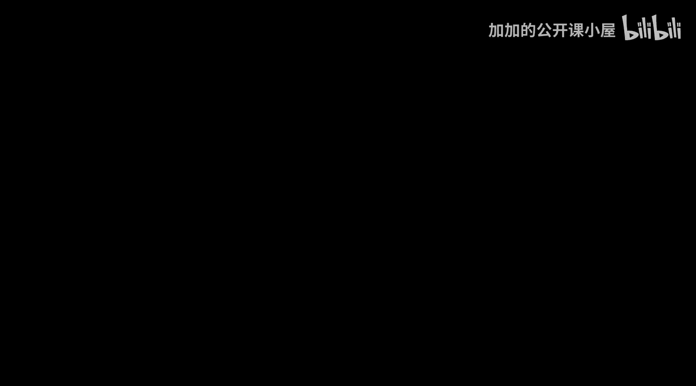
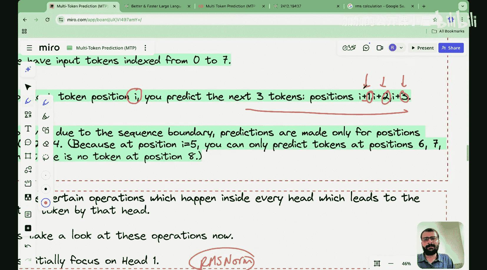

# Vizuara【中英⚡从零开始构建DeepSeek｜CS8803 Build DeepSeek from Scratch】 p25 P25 Multi Token Prediction (MTP) Coded from Scratch [BV1ryHpzTEKW_p25]

🎼Yeah。Hello everyone and welcome to this lecture in theBuild Deep Seek from Sctch series。

Today， we are going to code the multi token prediction mechanism from scratch。In Google collect。

So we have finished two lectures on multi token prediction so far in the first lecture on multi token prediction we looked at what exactly is multi token prediction how it differs from single token prediction and why is multi token prediction useful we looked at four major reasons for a why multi token prediction is useful first is that it leads to densification of training signals it just makes。

Pre training， a lot more efficient and a lot more smarter。

Second it leads to improved data efficiency， third it leads to better planning for the language module and fourth is that it leads to higher inference speed。

We also saw that deep sea used the multi token prediction gains only during pre training and during inference。

 deep sea just used single token prediction。And in the second lecture on multi token prediction。

 we saw the exact mechanism through which deepse implemented multi token prediction。

 so we saw that we looked at this sequence of input tokens。Where there were eight input tokens。

 each of a dimension of eight and then we saw that for every input token。

There were multiple tokens which were predicted。So there is a terminology called as the depth of token prediction。

 so if depth equal to 3 it means three tokens are predicted for every input token so for example。

 if you look at this input token in the first row we have head1 which predicts the first token we have head2 which predicts the second token and we have head number three which predicts the third token。

And within each head， there are multiple different computations which happen。

 so if you zoom into one head， you have a hidden state。

coming into that head and the input token embedding at that position， which are merged。

 which are then passed through a linear projection matrix。

 which is then passed through the transformer block and then finally that's passed through the logics matrix which uses the next token at that head。

So we have the merge matrix， projection matrix transformer layer。

 then we have the output of the transformer， which is the hidden state that's then passed through my unembedding matrix or the logics matrix and I get my prediction token for this header。

Now I mentioned two inputs coming into each head right first is the input embedding and second is the hidden state the input embedding is for that prediction for that depth at which we are predicting So for every given input we are looking into the future right So for the first head we look at the next position for the second head we look at the position after that for the third head we look at the position after that and we take the input embedding vector corresponding to each of those positions that is the first input to every head the second input is the hidden state to each head。

And for head number one， this hidden state is just the output of the first input open when it passes through the different transformer blocks in the LLA architecture。

 we get the output corresponding to that particular token and that is the hidden state for head number one。

But for the subsequent heads the hidden state is given from the previous calculation。

 so for example for head number two， the hidden state1 which is computed in head number one that's passed as an input to head number two for head number three。

 the hidden state which is computed in the previous computation is passed as the second input along with its input em。

So that's how information of the previous hidden state is carried forward。

 This is different than how multi token prediction is。

Was implemented traditionally where every token calculation was independent。

 but here it is not independent right， there is causality which means that we are taking information of the past and transferring it into the future。

And that's one main innovation made by B。So we saw this entire mechanism in the previous lecture and we saw the mathematical implementation。

 so finally after we have the predicted tokens for every input token we take the loss function between the predicted token and the actual token。

 we add all of these loss functions and that gives us our total loss。

If you want to revise this entire mechanism which I just revised。

 you can take a look at the previous lecture because now we are going to code this entire mechanism which I described right now in Google Colab。

So let us head to Google Colllab right now。So when we start to code this multi token mechanism or multi token prediction mechanism from scratch。

The code is not very long actually， and we just have four steps， step number one， step number two。

 step number three and step number four okay in step number0 actually we are just going to load the packages in step number one。

 we are going to define the RMSs Norm class in step number two which is the longest and the most important step we are going to just define a simple multi token prediction class。

In step number three， we are going to generate next tokens and in step number four。

 I'm just going to demonstrate the loss function calculation between the target token and the predicted token。

So let's get started first we have to load the packages and in this simple demonstration the only package which we are going to need is by touchrch。

So you'll just need to import Py and you only need to load it。

So this step will not take too much time， let me also run this along with you so let me run this live so that I can demonstrate to you that this entire code actually does not take too much time to run even if you are on a normal CPU or if you have T4 GPU that much is fine for you to run this code。

The second or the step number even rather is to define the RMS Nor class why do we need RMS norm if you remember for every head before we concatenate the hidden state and the input token embedding。

 we have to take the RMS norm of that vector and this is also mentioned in the deep sea paper before we concatenate the hidden state and the input embedding for a given head we have to take the RMS normalization of that vector。

Now how is RM is normalization calculated， it's pretty simple， let's say if you have a vector。

Let's say if you have a vector with a bunch of entries right， let's say if you have a vector with。6。

7，8 to values What you do is that you first take the square of each of them so you。

You take each of these entries and you square them。

 you take each of these entries and you square them， the next step。

 what you do is that you add all of these squared values。And then you take the mean。

 which means if there are eight entries， you sum all of these values and you take the mean。

And then what you are going to do is that you are going to divide every entry with the square root of this。

 so the root mean square is you calculate the root of this mean of the summation of the squares and then you are going to divide every entry of this vector by this quantity okay that is the root mean square calculation and if you are unsure about this you can just check RMS。

RMS calculation， so this is root means square so to get the RMSs value。

 you just sum the square you divide by n， you take the square root and then you normalize every entry in the vector by this quantity。

That's exactly what's done in this RMS norm class。 We first sum the。Entries， we take their mean。

 we take the square root and then we divide every entry in my vector with this Rms value。

 There is a small epsilon value which I've added here so that we prevent the division by0 Okay so that the RMS normalization class the step number two is where we define the multi token prediction task multi token prediction class and this is probably the most important part of this code So here you'll see that there is the in module where we have to initialize a number of different meices and then we have the forward method。

ok。So the best way to start understanding this code is right over here where we have these loops we have the first loop and the second loop so let me exactly explain to you what is going on here what we are basically doing is that for every input token so let me take you back here yeah for every input token let's say for I equal to0 we have available which is called S k and that's my prediction depth right so for I equal to0。

For I equal to0， I'm predicting that。I plus K。So I'm predicting at depth k depth equal to 1 depth equal to2 and depth equal to3。

 Similarlyly if I is equal to 1， Im going to predict at depth 2。

3 and4 if I'm predicting three future tokens if I equal to 2 I'm predicting at depth 3。

4 and 5 okay so the key thing to note here is that。

For every token position I we are predicting the next three tokens i plus 1 i plus 2 and i+ 3。

 so in the code you will see k right so this k is this value the depth and I is the position of the token right and how many such I you need to consider。

