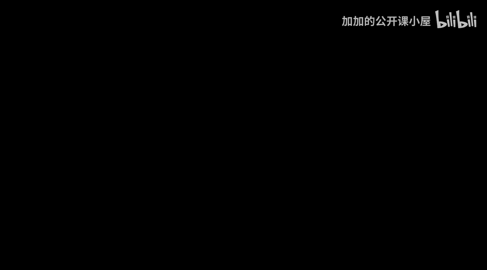
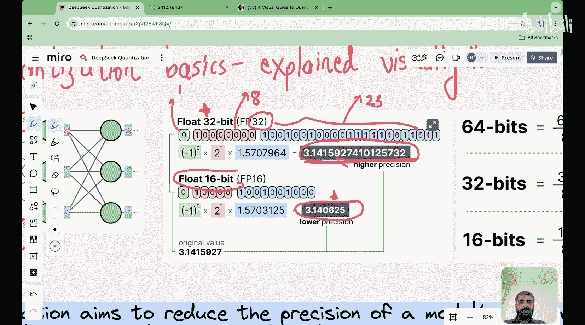

# Vizuara【中英⚡从零开始构建DeepSeek｜CS8803 Build DeepSeek from Scratch】 p26 P26 Introduction to LLM Quantization [BV1ryHpzTEKW_p26]

🎼Yeah。

Hello everyone and welcome to this lecture in the build Deepsek from Sctch series。Today。

 we are going to start an important topic and that is with respect to quantization。

So until now with respect to building the entire deep sea architecture。

 we have covered multi head latent attention， we have covered mixture of experts and in the previous set of lectures we also covered。

The third major architectural。APar of deepse and that's multi token prediction。

So after covering these three major pillars， we now move towards quantization and that's the final pillar with respect to the deep sea architecture。

So when I say quantization， if you take a look at the deep S version 3 technical report and if you scroll down below。

 you will see that we have covered until now the latent attention mixture of experts and multi token prediction。

So the architecture part of this paper is finished now if you come to the infrastructures portion。

 they have this FP8 training。And these major aspects of the FPA training are what we are going to cover in these sequence of lectures。

So if you scroll down below， you will see that。They have a section which is called as FP8 or floating 。

8 training section number 3。3 and that comes up on page number 14。

This section is about the quantization which deepC has implemented and like several other sections of this paper。

 if you directly start reading this， it will be a bit difficult to really understand what's going on。

So what I'm going to do is that in this series of two to three lectures。

 I am going to explain the five innovations which deep seek implemented in their quantization routine。

First is called as mixed precision framework， second is called as fine grain quantization。

 third is increasing accumulation precision， fourth is mentia or exponents and5 is online quantization。

Okay， so when deepse released their paper， they had figures on each of these sections。

 so for example， if you look at。Figure number six， that is the figure which illustrates the mixed precision framework。

Which we are going to。Wwhich we are going to see in detail this is the mixed precision framework then if you look at these figures such as figure number7 they have part a and part B so part a is with respect to finding grain quantization and part B is with respect to increasing accumulation precision if you directly look at these figures it may seem that there are so many building blocks over here and what do these different colors sexually represent I plan to break it down for you so that you will understand it。

The third or the fourth part is Menisa over exponents and the 50 is online quantization。

So if you see they have a part called Mentia or exponents and they have a part called or section。

 which is called as online quantization。So the way I'm going to break down these lectures is that before understanding any of these we first need to have a brief understanding of what exactly is meant by quantization。

So in this lecture， I'm going to very simply explain to you what quantization means。

And starting from next lectures I'll take you through all of these frameworks so the next lecture may be based on these three mixed precision framework fine grain quantization increasing accumulation and then I'll have another lecture on Menis hour exponents online quantization and then you will wrap up the quantization。

So let's get started with today's lecture first let me show you the main reference which I'm going to use today。

 so quantization I'm going to use a block。诶。Wwhich is written by Martin Rounddos。

 this is probably the best reference which I've come across to understand quantization and I'll be referring to this v in today's lecture where I explain to you quantization。

And what it exactly means， So let's get started with that。Okay， so deepse is a large language model。

 right？So why does quantitization come up in large language models and what exactly is quantization？

说。If you look at the basic building blocks of a large language models， we have inputs。

 we have weights。Inputs are multiplied by weights and pass through activations， right。

So these activations， which we are referring to， they are calculated after let's say you get the product of the inputs and the weights。

And these activations then serve as an input to the future blocks， etc。

 essentially what I'm trying to say is that there are a number of parameters in a large language model which multiply among each other and then we have several sums which need to be done。

So for example， if you consider this entire large language model。

 if you look at the multiha attention block， the multi attention block has several matrix multiplications right like queries will be multiplied with keys transpose so if you focus on each of these mates if you focus on the queries matrix if you focus on the keys matrix elements of these matrices will be multiplied with each other。

Similarly， if you have feed forward neural network。

 there are multiple parameters which will be multiplied with each other。

The reason I am telling you all of this is because parameters when you look at every individual parameter it occupies a certain memory。

 so there are parameters in token embeddings， positional embeddings。

 multi head attention feed forward neural network and if you consider the scale and shift there are parameters in layer normalization also we have the parameters in the output layer。

All of these parameters take up memory， so just like if you are building a house。

 the house will take up some area right， similarly。

 whenever you define a parameter that parameter takes a memory。

The amount of memory a parameter takes up is determined by how we represent that parameter。

Right so there are several representation techniques the most common by default parameters are represented as floating032 values or Fp32 for example if a parameter is 3。

14159 lets say the way it is represented in memory is by these 32 bit so if you pound these bits1 bit then we have12345678 there are 8 bits over here so and then finally we have 1234567891011121314151617181920212223 so 23 so if you add 1 plus 8 plus 23 that gives you 32 bits。

So in this case， which I'm showing you that every parameter is represented by 32 bits in memory。

What each of these bits mean is slightly different the first bit controls the sign so as is mentioned over here in this block if you see。

Yeah， the first bit over your control is the sign， the second bit or these set of bits is called as the exponent。

And this last set of bits is called as the significant or the mentia。

 so essentially there is a simple formula through which how the sign the exponent and the menisa all add up together to represent the entire number。

The number of bits which you have in the mentia in the last part controls the amount of precision with which you can represent every number by okay。

So at the top here I am showing you a floating point of floating 32 bit representation and if you take the closer look at the。

At this blog over here lets see so if you take a look at the floating point 32 representation and if you scroll up below you will see how these sign exponent and menes are so sign is actually pretty simple whatever the value here is you take my1 raised to that。

So if its 0 it means it is positive because minus on the raised20 will be1 if it is equal to 1 that's minus on the is to1 so it will be a negative number so the first bit determines the sign right the second bit which is the which is the exponent so its in this case it will be2 raised to1 and the last part which is the mantea which will be2 raised to0 plus 0。

57015703125 so that will give us 3。140625 thats float 16 bit for float 32 bit it will be much higher precision。

So if the same parameter right now is represented as a float 16 bit instead of a float 32 bit。

 it will just take 16 bits in memory。So it will take a less amount of memory but the downside of that is that we will have a lesser number of bits in the mentiappalright so that means we will have a lower precision so that same number will be represented with a very high precision over here and that same number will now be represented with a very low precision in a float 16 bit。

So essentially what I am trying to say is that every parameter takes up memory and the amount of memory a parameter takes is determined by how it is represented if it is represented by 32 bits it takes more memory and the parameter can be represented in a higher precision。

If it is represented by 16 bit， it takes up less memory and that parameter is represented in a lower precision。

Now you。Iし。