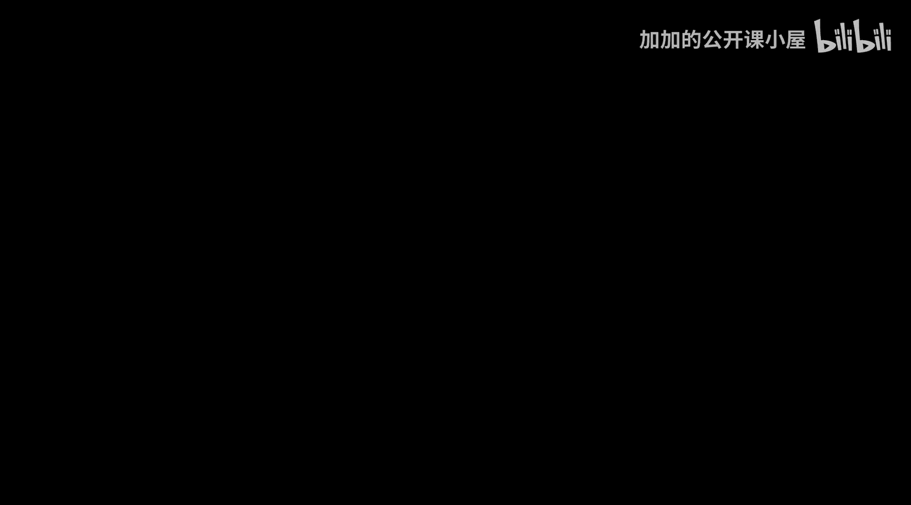
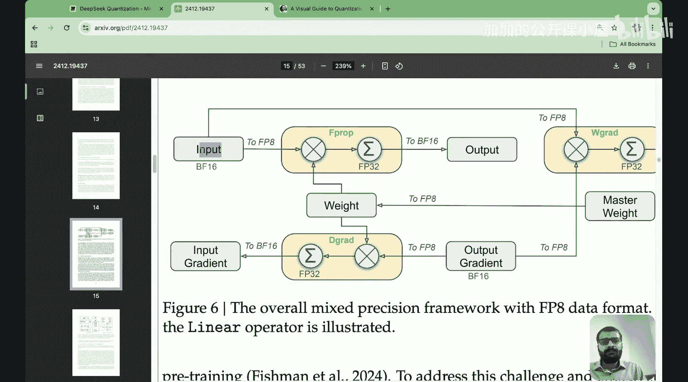

# Vizuara【中英⚡从零开始构建DeepSeek｜CS8803 Build DeepSeek from Scratch】 p27 P27 How DeepSeek Rewrote Quantization Part 1 ｜ Mixed Precision ｜ Fine-grained qu [BV1ryHpzTEKW_p27]

🎼Yeah。Hello everyone and welcome to this lecture in theBuild Deepep Sek from Scratch series。

Today we are going to start understanding the quantization methods which Deepse actually implemented in their version 3 report。

 so if you look at the deepse version 3 technical report PDF。

 they have a section called FPA training or floating point8 training and in this section they implemented several aspects with respect to quantization and I've divided those into five major aspects。

 mixed precision framework， fine grain quantization， increasing accumulation precision。

 men are over exponents and then online quantization。In today's lecture。

 we will cover mixed precision framework and fine grain quantization。

In the previous lecture we have had a introductory look at quantization and some of these concepts will be relevant to you in today's lecture as well essentially the main idea of quantization is that parameters。

Take up space， every parameter in a large language model takes up space。

So if the parameter is represented as a floating 032 bit number。

 it takes up more space then let's say if it's represented as floating 016， etc。

So the main aim of quantization is to reduce the precision of a model parameter from higher a bit。

Let's say from 32 B to a lower bit， let's say 8 bit or 16 bit。So through this。

 the main advantage which we get is that we reduce the total memory requirements。

 but at the same time we don't pay that much of a heavy price with respect to the accuracy of the model。

Of course， the accuracy slightly reduces because now every parameter will be represented in a low precision。

But that much reduction in accuracy of the large language model is typically fine for us because it does not degrade the performance that much。

In today's lecture you will come across floating point 32 which consists of 32 bits then youll come across floating point 16 which consists of 16 bits floating point 16 the range is much reduced compared to floating point32 youll also come across BF16 so the range of BF16 is same as floating point32 but its bits are the same as floating。

 16 so it still has 16 bits。Bf 16 is brain float 16。

 then there is also integer 8 whose range is very small minus 127 to 127 and it has8 bits。

One more concept which well see when we come to fine grain quantization is that when you want to actually quantize and go from a floating 032。

 let's say to a floating to an integer8， what you do is that if you have a sequence of numbers in floating 032。

 you divide all these numbers with the highest number in this case， 10。

8 and then what you will do is that you will multiply it with 127。

So keep this in mind that we divide by the highest number and then multiply it with 127 if you want to。

 let's say quantile is from a floating 0 32 to an integer8。All these concepts。

 which I'm showing you right now， we have covered it in previous lecture。

 but this quick summary will be enough for you as we get started with today's lecture。

So let's get started with the first major concept which deepse implemented and that's something called as the mixed precision framework so if you look at the deepse paper they have the mixed precision framework in section 3。

3。1 and they have a schematic which is corresponding to this which looks like year now based on the introduction which I gave you you already understand FP8 Bf 16 so this floating 。

8。A brain floats 16， floating 032。B F 16， etc cetera。

But now let me explain to you what this F prop means， what this B grad means， what W grad means， etc。

So when you look at a large language model there are a number of parameters which you get multiplied together the typical operation which happens in a simple neural network layer is as follows we have y equal to w times x where x is the input w are the weights and y is the output。

So a forwarded pass or a forward propagation， which is referred to as F prop overear are the operations in which weights are multiplied by inputs。

So y equald to w into x。And now I'm going to explain to you how deepse stored。

The weights store the inputs and the output in which quant format。Okay。

 so when the in so let's first take a look at the inputs， when the inputs were used in this formula。

 they were converted from a brain float 16 to a floating08。Okay。

 so floating point8 as you must have seen， it has a much lower range compared to brain float 16 and of course much lower number of bits so it takes less memory weights on the other hand are maintained in a high precision which means they are stored in brain float 16 or floating 。

32 but the weights are converted into a floating 。8 on the fly so when you take this multiplication you have a floating 。

8 weight multiplied by floating 。8 input which gives me the output。

And the output is computed initially in floating 032， but for numerical stability。

 it's converted back into brain flow 16。So whenever we have forward propagation modules anywhere in the large language model。

 what deepse did was that they did this multiplication of floating。8 and of floating。8。

 so it took a less memory。And the output they computed the output initially in floating point 32 remember that when a floating point8 is multiplied by 40 floating point8 we get a higher decimal representation so we can we can get the output in a higher format compared to the inputs。

So the output is computed initially in floating point 32 for numerical stability。

 but then it's converted back and stored in B F 16 to optimize the memory。 Remember。

 B F 16 has 16 bit， and it covers the entire range as floating point 32。

 which we already saw over here。 If you remember， this was the。

Bf16 which we saw it covers the same range as floating 。

32 but it has 16 widths so it takes up less memory compared to floating 0。

32 so now you'll be able to understand this Fpro block over here right if you see the F prop block has inputs which are floating 0。

8 weights which are floating 0。8 the inputs and the weights are multiplied and the output is immediately computed as floating 。

32 but its stored in memory as Bf16 or brain float 16。That's the way to interpret this F Pro block。

Along with forward propagation we also have backward propagation so if you look at a neural network like this and these are the inputs of a particular layer layer and these are the output。

Remember we are doing backward propagation right so when we reach a particular d we will have the partial derivative of the loss with respect to the output。

Of that layer， and then we need to find two things。

 we need to find partial derivative of loss with respect to weight。

Because we will need to update the weights of this layer and we will also need to find the partial derivative of loss with respect to the inputs of the layer why do we need to find the partial derivative of loss with respect to inputs Dl by dx because this Dl by Dx will serve as the Dl by D's head of the previous layer。

So when you look at the given layer， you will need to find the partial derivative of the loss with respect to the weights and the partial derivative of the loss with respect to the inputs。

The partial derivative of loss with respect to inputs is given by this formula DLDx。

 which is also called as Dgrad over here， so this B grad is the partial derivative of loss with respect to the inputs and it is given by the formula DL DZ multiplied by the weight transfer schools。

Now， to get the partial derivative of these inputs。

 the weights are again converted on the fly to floating point8 for this calculation and DL by dies is stored as Braille float 60 but it is converted to floating point8 for computation。

And DL by Dx is computed initially as floating point32 then converted to brain float 160 So if you take a look at this entire computation。

 theL by DZ is on the flag converted to floating point8 weights are on the flag converted to floating point8 and the multiplication it's computed as floating point32 and stored as Bf 16 or Bra of float 16 so this is exactly what you see over here right weights are floating point8 weights are multiplied with the output gradient which is floating point8 the multiplication is initially computed as floating point32 but it's stored as brain float 16 that's my input gradient but I also need the gradient with respect to the weights right that's the Wogram。

And the blue gra is given by this formula partial or the gradient with respect to the weights is equal to x transpose multiplied by DNV。

And x is stored as floating point8 DL diesard again is converted from brain float 16 to floating point8 and keep in mind that DL by the partial derivative with respect to the weights is stored as floating point 32 to ensure numerical stability for weight updates so this is not converted into floating point8 because this will ultimately lead to my weight updates right so if you look at DL by Dw you'll see that the weight gradient right which is computed after multiplication of the inputs。

