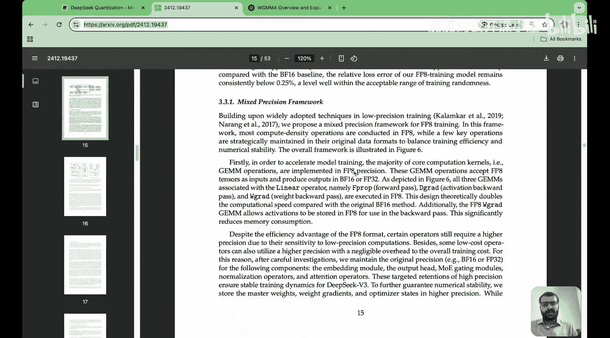
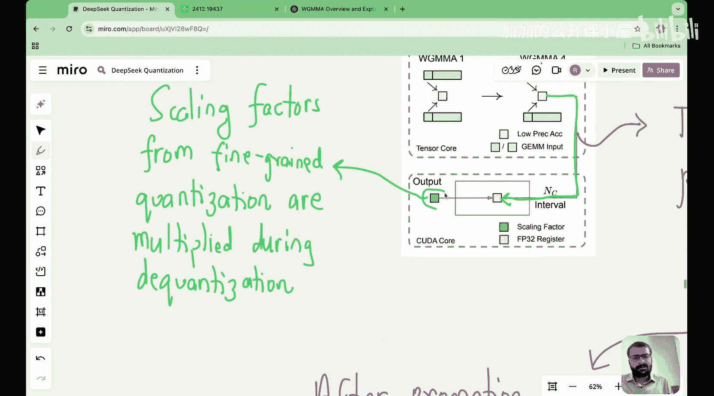

# Vizuara【中英⚡从零开始构建DeepSeek｜CS8803 Build DeepSeek from Scratch】 p28 P28 How DeepSeek Rewrote Quantization Part 2 ｜ Accumulation Precision ｜ Online Q [BV1ryHpzTEKW_p28]

🎼Yeah。Hello everyone and welcome to this lecture in theBuild Deep Sek from Sctch series。

Today is the second lecture of exploring deepsek quantization in the previous lecture we have looked at how deepse implemented the mixed precision framework and finding grain quantization framework so if you have not been through the previous lecture you can go through that and in this lecture we will look at how deepse implemented these three aspects the first aspect is increasing accumulation precision second is mens are over exponents and third is online quantization。

So to construct these lectures I'm following this FPA training section which DeepS had so in the first lecture on quantization I just explained to all of you what is quantization how parameters can be represented with different bit numbers and how we can take let's say floating point32 and quantize it into floating point16 brain floating 16 in8 or floating point8。

And in the second lecture， which was the last lecture， we covered the mixed precision framework。

 which is this schematic。So we covered section 3。3。

1 so this is deepse Vi 3 PDF which I'm showing right now and we also covered fine grain quantization which is the left hand side of this figure today we are going to cover the right hand side of this figure which is increasing accumulation precision and then we will see menisa over exponents and then we are going to see online quantization。

So let's get started with the first main technique which we are going to see today。

 increasing accumulation precision and if you see the schematic with respect to this，Again。

 it's very difficult to understand what's going on WGMMA then。

What is G EMM then there are a different colors over here it's impossible to figure out what's going on so my goal in today's lecture will be to not dive extremely deep in these terminologies but to give you enough of an overview so that you are not scared of this figure so that you understand what this figure actually represents okay。

So in today's lecture we are going to start from this place in the lecture notes。

 which is increasing accumulation precision。So the reason we are learning about this in the first place is that when you perform game operations。

 so what is game it's general matrix multiplication so when you perform matrix multiplication operation。

We have things like y equal to w and x plus B right and if this is a floating point8 and if this is a floating point8。

 we quickly lose accuracy to intermediate results being too small that leads to under flow issue。

So that means that if two floating 。8 numbers multiply。

 so if you reduce the accuracy of two numbers and if you multiply them。

 and if you again perform various such operations， we quickly lose accuracy due to intermediatemediate results being too small。

And this is called as limited accumulation precision。

 so if we do the operations on tensor courses as we saw in the previous lecture。

 if we do the floating。8 operations on tensor cores。

It has limited accumulation precision so in immediate tensor course accumulate game results internally with a limited precision far below floating 032 accumulation precision so if you calculate some results and if you add them together if you store the results on a tensor core there they will always be of a lower precision around 1414 bits but thats not good because that leads to。

Errors that leads to numerical errors， so we would ideally want to save these parameters in as high a precision as we want on the kuda core。

 not on the tensor core， so when performing game operations which lacks a large meosis of inner dimensions k low accumulation errors。

 low accumulation precision can lead to significant numerical errors。So for example。

 if you multiply mates with inner dimension k equal equal to 4096。

 and if you are using low accumulation precision that can lead to an error as large as 2% which heavily impacts the model accuracy this is not quite good so what we are essentially suggesting is that there is a tensor core and there is a GPU core right so there is a tensor core and there is a Quda core。

If we perform operations on Tensor core， those are floating 。8 operations。

And so the result accumulated matosis， theyll be of a lower precision。

And if we store these parameters or these mes in lower precision it can lead to significant errors which is not good this is called as limited accumulation precision so what is made by accumulation precision is accumulation simply mean summation so if you have multiple parameters you need to sum them together in memory that is called as accumulation so if this accumulation as a lower precision which is floating point8 or let's say floating or 14 bits that is much lower than the 32 bit floating point precision right so if we store these accumulationd variables in low precision。

It can lead to significant numerical errors， which is not quite good。

So that is why deepse increased deepse mentioned that we need to increase the accumulation precision so how do we increase the accumulation precision so what the authors propose is that let's say we get these calculations right we get the calculations in a tensor core we can periodically move them to the cuuda core and that is what is shown over here so this pink light pink dot is the tensor core and it's periodically moved to the cua code which is a dark pink dot。

So what that means is that。We temporarily move intermediatemedia accumulation results from the low precision tensor course to high precision kyodotic course。

 which is floating power 32 and we do this periodically during computation this is called as promotion to kyoda course。

In a very simple schematic what we are doing is that we get the accumulated results in the low precision tensor core and we transfer this accumulation results to a higher precision kuda core and this is exactly what is seen in this schematic so this is a tensor core which are low precision calculations so the green multiplied by yellow units itself gives mean pink that's a low precision value that's periodically transferred to a higher precision kuda core that's shown by this dark pink color over here。

So if I take the screenshot of this and bring it on the whiteboard。

 I can show this to you in a clearer manner。So the low precision calculations here are transferred to the high precision high precision kyoaco and this is exactly what we are going to see below。

 so this promotion to Kyoa force is done in two steps so the first is low precision accumulation MMA so low precision MMA accumulation means low precision matrix multily accumulationulator。

So initially matrix multiply accumulate operations are performed using floating point precision on tensor courses that's essentially this this part。

Low precision operations are performed using floating point8 precision or ten course。

 the intermediate results accumulate internally with a limited precision 14 bits so this light purple which we have shown here that's a low precision accumulation so the results are accumulated in the low precision it might be 14 bit which is much lower than 32 bit right so that step number one。

And you will see that in step number one there is this WGMMA which is also called as war group level matrix multiply accumulate so what is this warp so that is essentially warp group level matrix multiply accumulate and it performs matrix multiply accumulation operationizing group of warbs so its an Ndia GPU orinlogy where a warp is a collection of threats right？

So no need to worry about this， this is diving very deep into the NviDdia GPU linguistics。

 but war level matrix multiply accumulate or war group level matrix multiply accumulate pers operations efficiently within NVDdia GPUs。

 that's all you need to know right now， essentially even if you understand this segment by saying that。

The matrix multiplication inputs are stored in low precision accumulation that much is enough。

And then in step number two what we do is we promote this low precision or this low precision aulator values to a higher precision。

 we promote it to cuuda course so after a certain interval typically after 128 elements that is denoted by N over here。

The partial low precision accumulations are promoted by promoted。

 we mean they are coped to high precision registers in the Kuda。So after 128 elements。

 the low precision accumulated elements are transferred to a high precision kyodaku。

Right and that's shown by this dark purple dot over here。

 this is actually called increased accumulation precision。

And that's why if you see the this schematic is title increased accumulation precision。

 it just means that we are promoting from a low precision tensor core。

We are promoting from a low precision sensor code to a high precision given back。

So the first step is low precision MMA accumulation in tensor core。

 and the second step is promotion to higher precision Qa。Now this arrow over here。

 which I've highlighted right now， it shows the promotion to Kyoda courses。

And it makes sure that partial sums are storedor high precision memory。And after the promotion。

 the partial results are accumulated in full floating point32 precision on Kiola course， right？

Then these。

