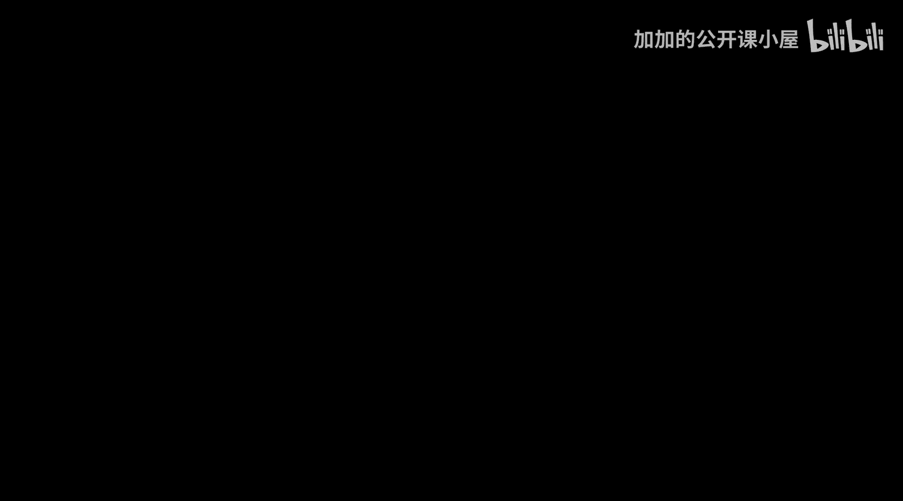
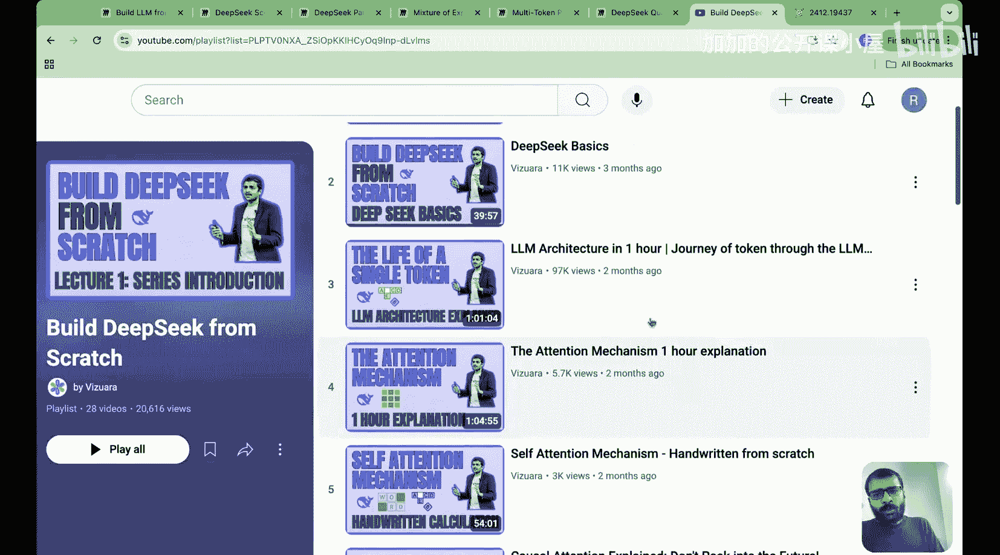
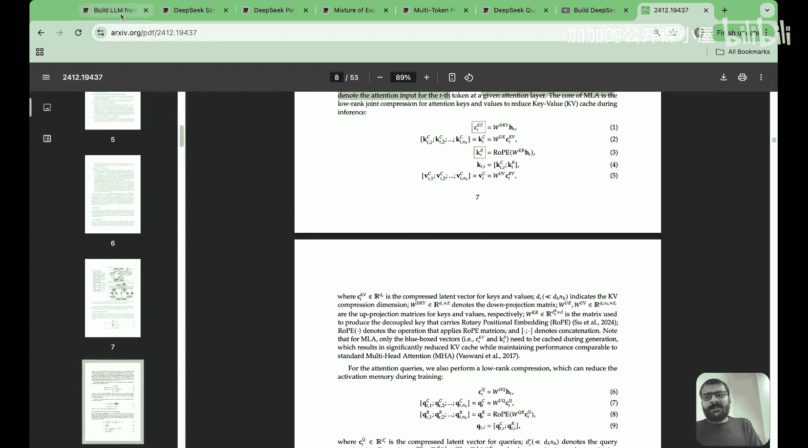
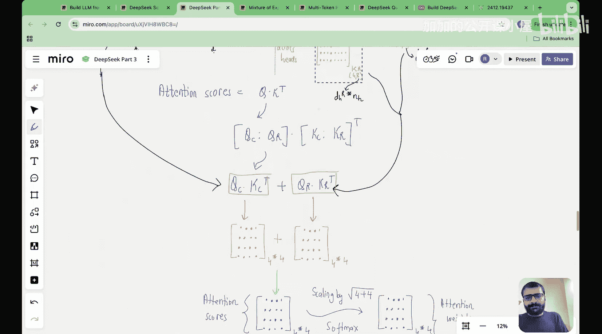

# Vizuara【中英⚡从零开始构建DeepSeek｜CS8803 Build DeepSeek from Scratch】 p29 P29 Build Deep Seek from Scratch 20 minute summary [BV1ryHpzTEKW_p29]

🎼Yeah。Hello everyone and welcome to this lecture in theBuild Deep Seek from Sctch series。

If you have made it this far in this lecture series。

 I want to take a moment to congratulate you because you have now learned some of the most advanced concepts of large language models which deepse actually used in their architecture。

In this video， I'm planning to give a quick summary of what all we have learned so far in this lecture series。

And I'll walk you through when the when we covered that particular lecture。

 what we covered in that particular lecture and how it fits。In the deepse Virgin 3 paper。

 So essentially if you go to Google and type deepse V3 P。

Youll be taken to this technical report and the whole goal of the series which we have seen so far is to walk you through as many aspects of this deeps architecture as possible。

 and I wanted to show this to you on a whiteboard plus on Google Collab code。So this is the playlist。

 we have around 30 lectures in this playlist so far and overall we have covered a huge number of things in this playlist initially we started out by looking at what exactly is deepse。

 what are large language models， what are emergent properties， why deepse really became so popular。

And in particular， we narrowed。The scope of these lectures to the following aspects first is the multi head latent attention。

Then we have the mixture of experts， then we have multi token prediction。

 then we have quantization and we have rotary positional encodings these five aspects were some of the major innovations which deep seek had in their architecture。

Which completely transformed the way they do pre training and the way they do inference with the language model which they develop。

And the really cool thing about deepse was that this paper is very tense。

 but if you go through it in detail they have really explained everything so for example elements in the paper which are just explained let's say in one one page or two pages it has taken a school to three lectures to explain that。

Particular concept because it's really dense， but if you go through all of these 30 lectures。

 I'm sure you will get a very deep understanding of all of these architectural concepts which we have covered so far。

 so it has taken us 30 lectures to cover。To cover these concepts starting from the basics of attention to multi head latent attention mixture of experts multi token prediction。

 quantization， rot prepositional encoings etc so let me now take you through the lecture of flow of how we plan the lectures first before coming to the latent attention part I wanted to explain to you the basics of the deep or the basics of the LLM architecture rather so we started this lecture series initially you'll see the videos which we had was deepse basics。

 the LLM architecture itself the attention mechanism the cell of attention mechanism。

 the causal attention mechanism and the multi head attention mechanism。Until this point。

 so in the lecture notes you'll see that we have the journey of a token through the LLM architecture。

 the need for the attention mechanism， how we went from rance to LSTMs to attention。

Then we covered the concept of self attention and after that we looked through the concept of self attention with trainable wheels here I introduced the idea of the trainable query matrix the trainable key matrix。

 the trainable value matrix and how we compute the context vectors from the input embedding matrix al right after this we learned about the causal causal attention mechanism。

The idea that to predict the next tokens， we cannot peek into the future。

So after learning about the puzzle attention we saw that these elements of the attention scores or the attention weight matrix which are about the diagonal are essentially set to zero。

 they don't contribute because we cannot peek into the future。

And then we covered a very important lecture on the multiha attention mechanism。

So the main idea of having multiple heads is to capture multiple perspectives self attention can only capture a single perspective in a given input sequence it cannot capture multiple perspectives so we saw why multi headd attention is needed we looked at the theory of this and we also looked at the coding implementation。

So the journey towards multiha attention was starting with self attention。

 then going to causal attention， then going to multiha attention。

So all of this was covered until the eighth lecture where we had a multi head attention from scratch。

Then we begin our journey towards understanding latent attention。

So the whole journey towards understanding latent attention covers four aspects， the key value cash。

The multi query attention， so let me just mark this with some different color of the key value cache。

The multiticquary attention。The group query attention and finally the multih latent attention。

So this multihill latent attention is how deep it completely transformed the attention mechanism。

So we looked at the key value cache where this entire story starts。

 the main issue is that when we do inference through LLMs we seem to be doing a lot of repeated calculations so keys and values need to be cache which is called as the key value cache。

But the disadvantage of a key value cash is that it takes up space。

 it takes up a huge amount of space。And to mitigate these disadvantages or to solve the KV cache memory problem。

 people had different types of mechanisms such as the multique attention and the group query attention where the attention waves were essentially shared across all the heads or groups of heads。

But this led to degradationitation in the language performance， and that's why deep seek。

Started to ask the question can we get the best of both ways can we have a low cache size as well as get a good language model performance that's where the idea of latent attention was born so they had a latent matrix so they took the input emdding matrix and projected into the latent matrix which has a much lower dimensional space。

And this looks like a very simple thing but actually it really solves the KV cache memory problem plus at the same time we don't degrade the language performance they have something called us the absorption trick where the queries are merged or the Wq rather is merged with the WUK so there is the projection matrix and the down projection matrix we actually spent a lot of time understanding latent attention so first we went through key value cache then multi query attention then group query attention and finally we were ready to understand the multi head latent attention。

We also quoted multih latent attention from scratch in Python。

 so to reach lecture number 13 we had to go through lecture number 12 up to 13。

 whereas if you see the deepse paper in the architecture section which they have。

 they do explain multih latent attention but it just explained in 10 length。

Also the main thing here is that the first version of the multihi latent attention which we saw that was not the version which deepse used what deepS actually did was they added rotary positional encodings instead of traditional positional encodings。

So then we had to learn about what exactly is rotary positional encodings and I took a very different approach to this journey to show you what rotary positional encoings are I first showed you what integer positional encoding is what binary positional encoding is and what sinusorial positional encoding is only after that I covered what is rotary positional encoding。

And we saw that in the rotary positional encoding we operate on the queries and the keys instead of operating on the token embeddings。

 we split the queries and the keys and then we rotate it and then we add it to the query and the key vector this does not contaminate the token embedding matrix or vector like it done in original positional embeddings。

So， why did we study about rotary positional encoings。

 the reason we studied about rotary positional encoings is because deep seek integrated multi latent attention with rope so we had to eventually move towards this。

So if you look at the lecture flow we have teacher and binary positional encodings。

 we have sinusoidial positional encodings， we had rotary positional encodings and then finally we had the lecture on how Deepsek exactly implemented latent attention and here I demonstrated how they integrated latent attention with rotarypositional encoding。

And this lecture took me two months to develop because this is not easy to explain in the paper they have these nine equations right 1。

2，3，4，5，6，7，8，9，101111 equations to explain latent attention its very difficult to understand what's going on from these equations so my task was to break it down to a simple level and to show you how they integrated latent attention with rotarypositionaledings and why this was such a challenging thing to do。

So essentially what they did is they divided the problem into two parts that's why they called it decoupled rope we essentially added new mates where the rope was applied a rot repositional encoding was applied and one matrix where rotarypositional encoding was not applied。

So they essentially solve this problem by dividing the one matrix with rope and one matrix without rope。

