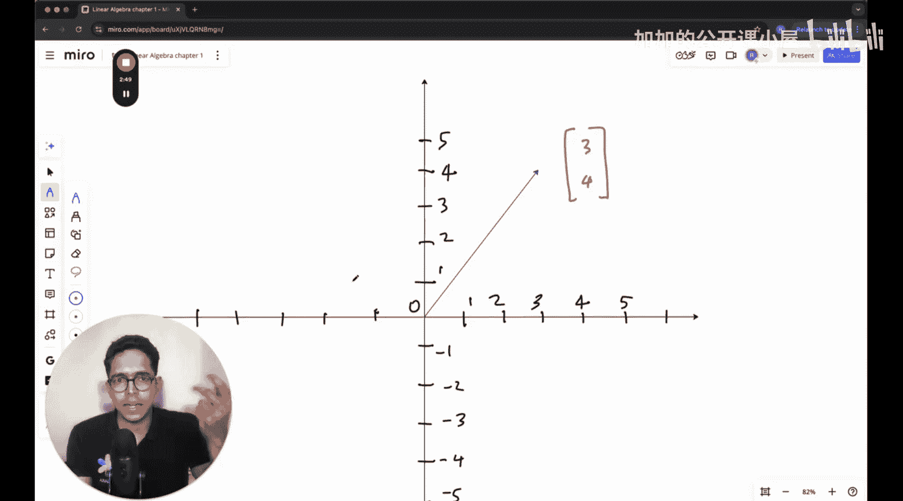

# Vizuara【中英⚡机器学习基础｜Foundations for Machine Learning】 p02 P2 Foundations for Machine Learning ｜ Linear Algebra ｜ Vector, Transformation, S [BV1wosSzREF7_p2]

🎼Yeah。

Hi， welcome to the course Foundations for Machine Learning and we'll be covering the mathematical foundations for machine learning in this module。

Particularly this lecture starts with the linear algebra and we'll be looking at linear algebra mostly from a machine learning standpoint。

 what exactly in linear algebra should we learn and should we understand deeply so that we can understand ML at a deep level so that is the objective of this part of the course。

So within linear algebra， we will be looking at mainly。Intuition， especially graphical intuition。

 so can you visualize the operations happening in linear algebra from a visual point of view and。😊。

How are these operations relevant to machine learning， So these this will be our focus rather than。

Teaching the entire depth of linear algebra。So lets start with the very basic idea within linear algebra that of a vector。

😊，In physics we define vector as something that has a magnitude and something that has direction and this vector can basically move around it need not be having its tail at origin right if you have a Xy coordinate system the vector can start from pretty much anywhere it can extend till somewhere and it has a direction magnitude。

In computer science， we have another type of vector in which we can store certain list of numbers。

 so the list of numbers could be about let's say details of a student who is having a student ID 347 age 20 and body weight。

70 kilogram something like this and if a collection of these numbers are existing like this as a list of numbers。

 essentially this is a three dimensional vector， so this is this is a representation of the vector。😊。

And。In linear algebra， especially for the purposes where we are discussing about machine learning。

 the vector is almost always rooted at the origin， so if we have a coordinate system。😊。

We will not be drawing so when you say rooted at the origin。

 I really hope you understand what I mean it is fairly trivial。

We won't be looking at vectors like this， so this has a certain magnitude and certain direction but rather the same magnitude same direction well be looking at a vector that looks more like this so the same vector but it is rooted at origin and this is the Xy coordinate plane。

😊，So we'll be looking at vectors like this and you will understand why we are talking about this in a short time。

😊，So。Typically。😊，In a two dimensional plane， xy plane。A vector has two dimensions， right。

 it has x dimension and y dimension。

This part is fairly trivial。