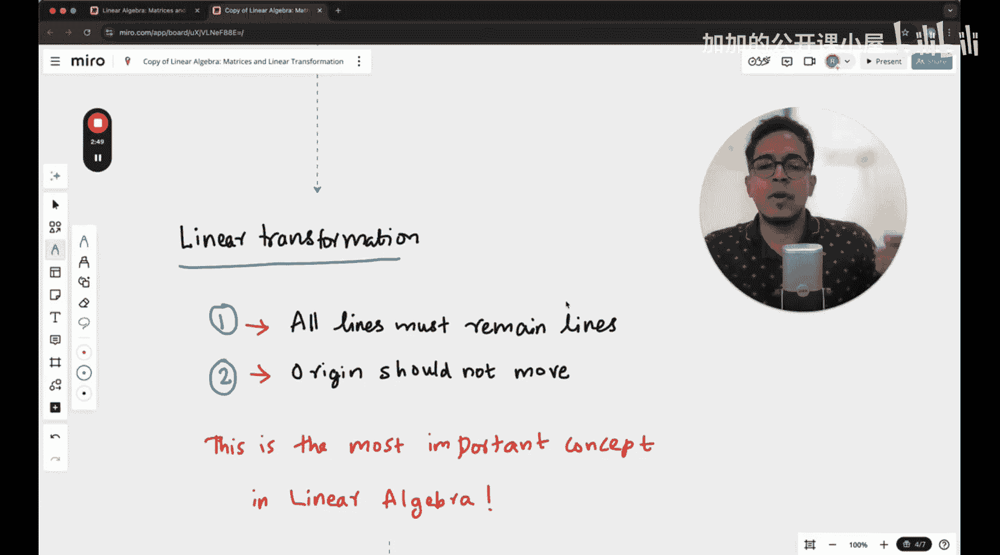

# Vizuara【中英⚡机器学习基础｜Foundations for Machine Learning】 p03 P3 Foundations for ML ｜ Linear Algebra ｜ Linear transformation as Matrix multipl [BV1wosSzREF7_p3]

🎼Yeah。

Hi， welcome to a new lecture from the Co Foundations for Machine Learning。

We are learning about linear algebra and specifically in this lecture well be looking at matrix multiplications。

😊，What we are trying to understand in this lecture is the intuition that matrix multiplication is essentially a linear transformation。

 so we'll see how that happens， how vectors are transformed in a linear fashion when you multiply them with matrices this is an operation that is commonly seen across machine learning so if you have a fairly good geometric or intuitive understanding of this whole idea it makes your foundations very very strong。

So let us start with what do we mean by a transformation？

A transformation is nothing but something that changes an input vector。To an output vector。

So here I have drawn a 2D space Xy， and I have a vector V1 and vector V2。

And a transformation is defined as you can think of it as a function F。

 which transforms the vector v1 into V2。So please note that in this lecture。

I'm not strictly following the convention of what should be input vector and what should be output vector as in I may be using the notation U or V interchangeably for input or output。

 but wherever its wherever I'm using V as an input vector or U as the output vector I'll be very clearly defining what is input and what is output so please don't get confused if you know if I'm not sticking with certain notations that you may be familiar with。

So a transformation is nothing but something that changes a vector into something else。

So here we see that the vector is still in the 2D space after transformation， but it has it you know。

 the head or its tip rather it has mode。Now there are several types of transformations。

 but specifically we are trying to learn about linear transformation and this is probably the cornerstone of linear algebra。

If there is one concept that you should absolutely master in linear algebra。

 it is definitely linear transformations。Linear transformation has two properties。

 as I have written here。All straight lines must remain as straight lines。This is the first property。

In a linear transformation。The second property is that the origin should not move。

 the origin should remain fixed。Now， let us see what the first point specifically means when I say origin should not move。

 I。I am pretty sure that you can imagine that really well。But。

When I say all lines must remain as lines。I'm not really certain that you are imagining the exact same thing that you are supposed to imagine。

