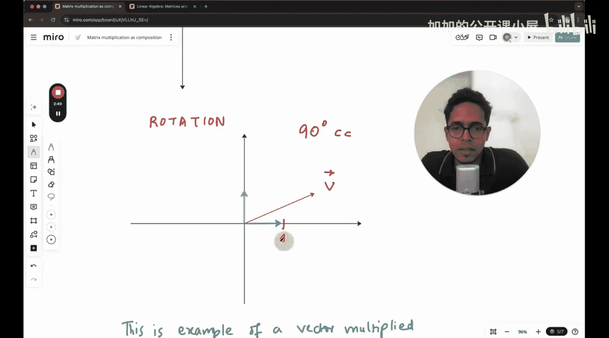

# Vizuara【中英⚡机器学习基础｜Foundations for Machine Learning】 p04 P4 Foundations for ML ｜ Linear Algebra ｜ Product of 2 matrices = Composite Trans [BV1wosSzREF7_p4]

Hi， welcome to a new lecture on foundations for machine learning。

And we are continuing to learn linear algebra this forms one of the biggest mathematical pillars or foundations for the entire machine learning journey for you。

So in the last lecture， we saw how。If a matrix is multiplying with a vector。

How it transforms the vector。So essentially we can look at a matrix as a vector transformation or linear transformation。

In this lecture， we will of course be doing a little bit of recap of that so that in case you haven't followed the last lecture。

 you can still understand what is going on in this lecture completely。And in addition to that。

 we will also see if one matrix is multiplying with another matrix。

How does that translate into a composite linear transformation， so we'll be learning both of this。

We will also do a small recap on how to track where a vector ends up after transformation by simply tracking what happens to the initial unique vectors INJ so welcome to today's lecture。

So。As we have been mentioning in this course， linear transformation。Is nothing but its a function。

 it's a function that transforms a vector a vector v into another vector v prime， let's say。

And how do we express this linear transformation linear transformation can be expressed in the form of a matrix so throughout this lecture we will be looking at a two dimensional plane so the transformation vector will be a 2 by 2 matrix a transformation matrix will be 2 by 2 in dimension and the vector will have only x and y dimensions。

So， if a vector is multiplied by a matrix it the transforms the vector so let us have a look at two examples。

 we looked at this in the last lecture but I just wanted to give you a small recap。So first。

 let us look at rotation transformation。Imagine that the transformation that is happening to any vector in a given xy space is rotation by 90 degree counterclockwise。

 so I will just write that here。90 degree。Countraclockwise。

So this is this is the vector that we are looking at vector v。

 we just want to know what happens to this vector。😊，Or where does this vector end up？

After rotating by 90 degree encounterclockwise。We can also define some actual coordinates。

 so maybe for ease of。Writing， I'll I'll。Keep this vector in such a position。Such that。

This is the length of this is 1 x axis， this is 2。

And this is one， so this green。