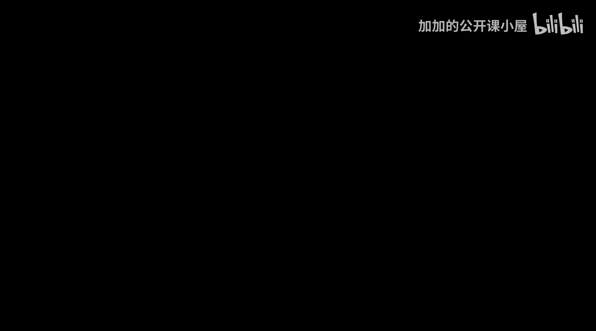
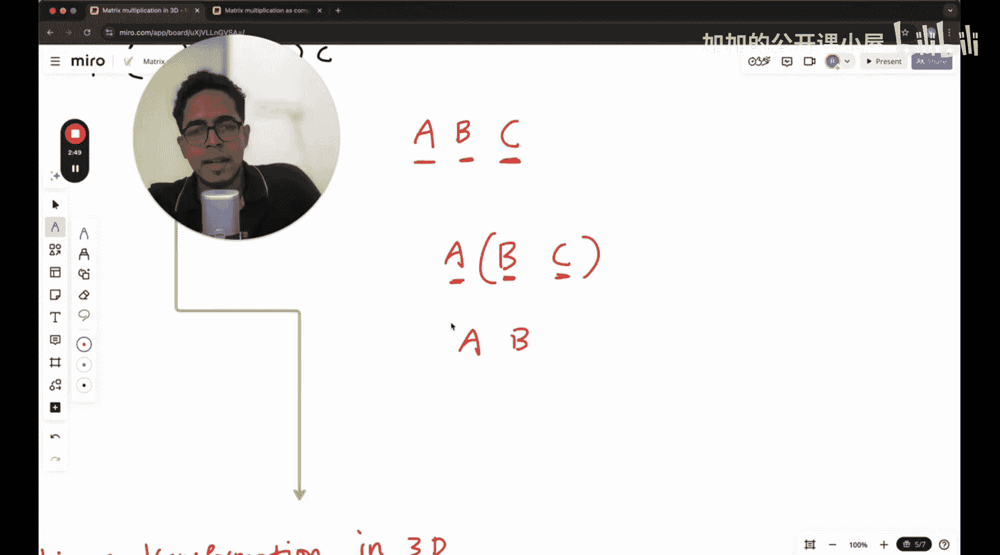

# Vizuara【中英⚡机器学习基础｜Foundations for Machine Learning】 p05 P5 Foundations for Machine Learning ｜ Linear Algebra ｜ 3D linear transformation [BV1wosSzREF7_p5]

Hi， welcome to a new lecture from the Co Foundations for Machine Learning。

We are continuing to learn linear algebra。In the previous two lectures。

We saw how matrix multiplication is directly related to a linear transformation。We also learned how。

If two matrices are being multiplied， it's like a cascade or like a。

Combination of two linear transformations applied back to back。And all of this we learned in 2D。

In this lecture， we will see some concepts very similar in 3D。

 which can also be generalized to any number of dimensions。

So this lecture will be relatively short because we are not going to look at everything in detail in 3D since we have already done that in 2D。

 but I just want to show you how things manifest in 3D just like how it did in 2D。So。

 when you were learning。Matx multiplications you might have heard of this associative property。

For proving something like a multiplied by B times C， if A B C are matrices。

 you can first multiply B and C， and to that you multiply A and you have had to prove that that is same as if you multiply A and B first and then multiply it with C。

So the way to prove this， so if you take 2 d as a。As your dimension。

 you can define generalized matrices ABC so A could be ABC D。

 B could be E FGH and C is IJKL these are the three matrices and then you can very easily prove this in a general sense by first taking the product of these two and multiplying this with the product of those two matrices that is one case。

And then that will be the left hand side of this equation。

 the right hand side of this equation will be simply taking the product of these two first and multiplying this with that。

 and you can show that left hand side equal to right hand side and that can help you prove this associatedso property。

But this is a painful exercise。😊，Because if you look at。The process of matrix multiplication itself。

It is nothing but it is like a transformation operation applied over vectors。

 so when we look at three matrices being multiplied like ABC。

What it is saying is you are applying three transformations to vectors back to back。

 so the first transformation is C。Then after that， you apply the transformation B and after you apply the transformation A。

So whether you denote it in brackets like this。What this is saying is also the same thing like you are having three linear transformation first you apply C。

 then you apply B and then you apply A。Or if you write it like this。

That also is saying the same thing you first apply the linear trans。

