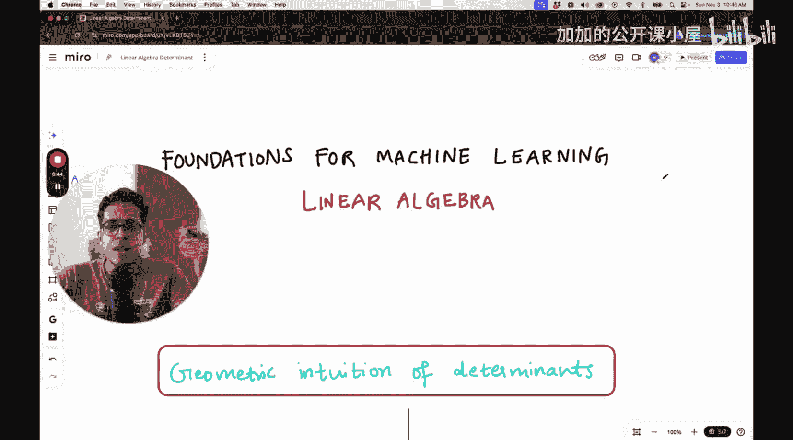
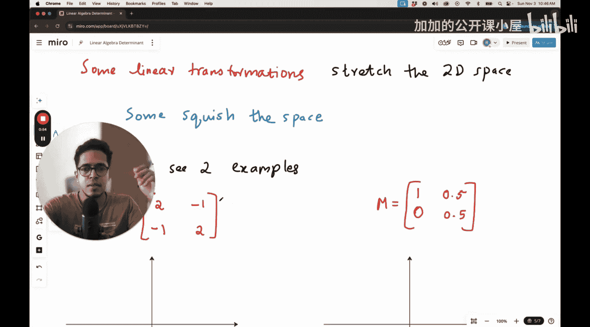
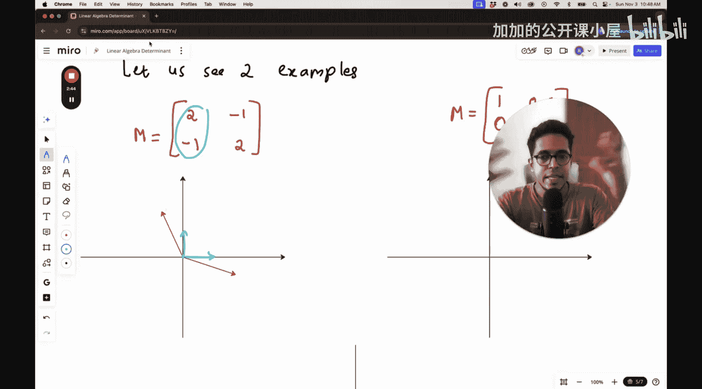
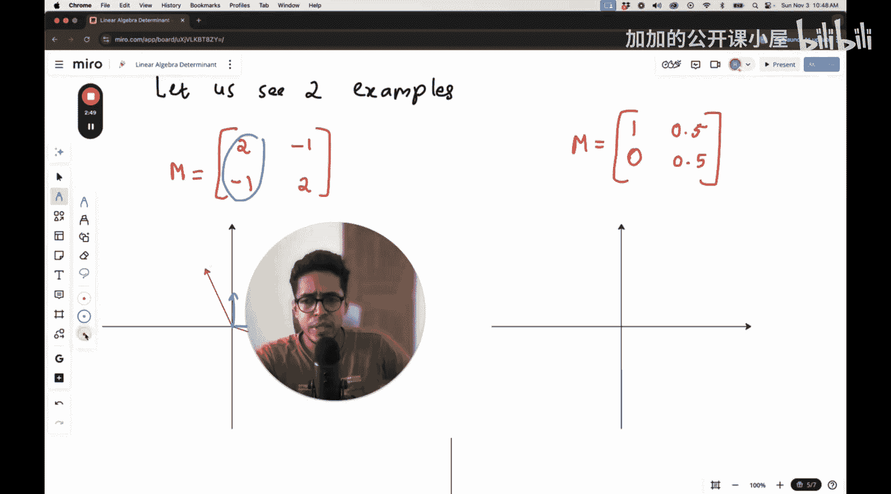

# Vizuara【中英⚡机器学习基础｜Foundations for Machine Learning】 p06 P6 Foundations for Machine Learning ｜ A simple physical intuition for determinan [BV1wosSzREF7_p6]

Hi， welcome to the course Foundations for Mach Learn and we are continuing to learn Linear algebra。

If you have ever found linear algebra to be boring or unintuitive。

 I assure you this lecture is going to change the way you look at linear algebra。

So in today's lecture， we'll be looking at determinants。Not from a mathematical point of view。

 which I' am sure many of you may be aware of， but more from a geometric or physical intuition point of view。

When I learned this for the first time。This intuition。

It really blew my mind because I never thought about determinants in that way。

 so what is that and how does the determinant relate to linear transformations that we have been learning so let' us look at that。

So we were learning about linear transformations so linear transformations can stretch or squish the 2D space we are looking at primarily 2D space example because it' is easy to draw so let's take a couple of examples right so here is a matrix M this is a transformation matrix and this corresponds to some kind of linear transformation of the vectors that are present in the 2D space。

Now let's see what happens to the 2D space when this transformation is going on so all we need to do is keep track of the I and J vectors right I is the unit vector in x j is the unit unit vector in j and to see where I lands the unit vector I lands all we need to do is look at the first column of the transformation matrix so that is where the unit vector I will land after the transformation so how does the I look like I should look like something like this。

2 minus1 right so along the x it is 2 along y it is minus1 and what happens to j j will go to minus21。

 the second column of the transformation matrix and that should look something like this。This is。

Minus1 and2， right， so this is J。So originally the unit vectors were like this。

I andJ and then now they have they have kind of been， you know， stretched。

So this is exactly what happens to every single unit vector every single vector in the in the 2D space not just the unit vectors。

 so overall you can see that generally some kind of extension is happening the vectors are getting elongated so the space is getting stretched so this is an example of a linear transformation that kind of stretches the space。

Now let let's see an example of squishing， so here I have written another linear transformation。😊。

Which can correspond to squishing operation So the unit vector I and its already。

