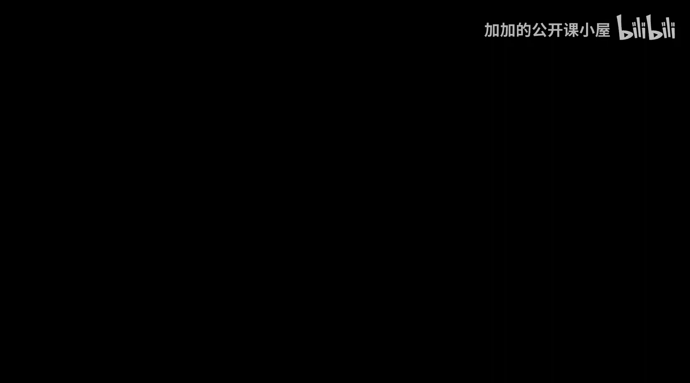
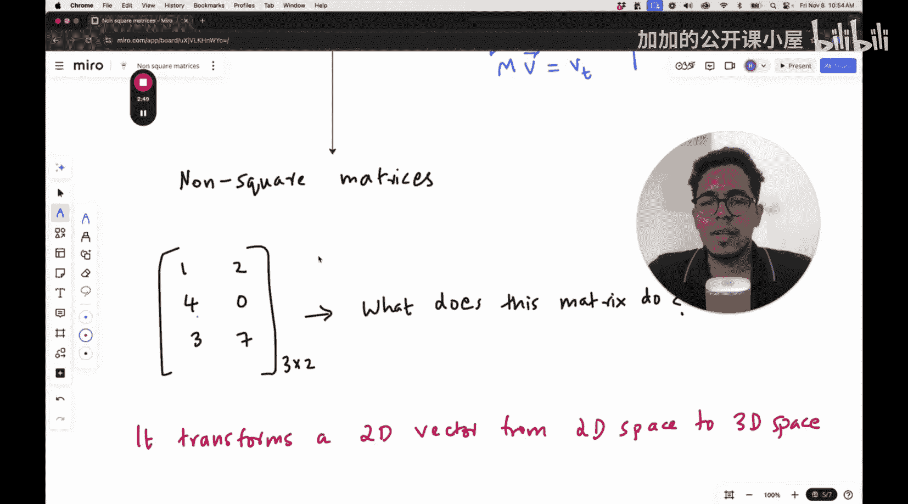

# Vizuara【中英⚡机器学习基础｜Foundations for Machine Learning】 p08 P8 Foundations for ML ｜ Linear Algebra ｜ Transformation with non-square matrices [BV1wosSzREF7_p8]

Hi， welcome back to the course Foundations for Mach learninging。

 we are continuing to learn mathematical foundations for machine learning， especially linear algebra。

😊，So far， we looked at how matrices are essentially representations of linear transformations in two dimensional or higher dimensional spaces。

And we also saw how different matrices can represent rotational transformation shearing or even composite transformations where rotation and shear can happen at the same time。

 and there could be scaling up or scaling down all of these transformations can be represented by matrices。

But you must have noticed one thing and a natural question may have come to you。

 which definitely happened for me when I was learning this for the first time。

So we always were looking at。Squire matrices so in 2D space we were mostly looking at2 by two matrices。

 so if we had a matrix that looked like this。Let's say。3，2，1，4。

Then this is a transformation in 2D where the I vector is transformed to this position 331 and the J vector is transformed to this position 24。

 so this transformation what it does to the I vector is such that the unit vector I will go to 1，2。

31 over here so this will be the new unit new equivalent of I so the new basis vector。And2，4 is。

Is this？So is this actually so oh sorry。24 is this guy。

 so this will be the new basis vector equivalent for J。

And now any vector in the xy plane we can represent using these new basis vectors so this is what we saw and if we have a matrix like this that can be called as M and if we have a vector v then this creates a new transform vector and that transform vector we can represent in terms of the new i vector which is this i transform and this is not necessarily a unit vector but it' is just a transform vector and the new J vector this。

So this is what we saw so far。Now， you may have a question， which is very。

Common is that what if this is not a square vector？In real life。

 you don't only deal with square vectors， you deal with rectangular sorry square matrices。

 you deal with matrices that are rectangular like non square matrices。So， this lecture is about。

What are the transformations that can ressell if the matrix itself is a non square matrix？

So let me take an example of a non square matrix， this is a3 by2 matrix。

 so you have two columns and three rows。What does this matrix do and on what type of vectors does this matrix？

