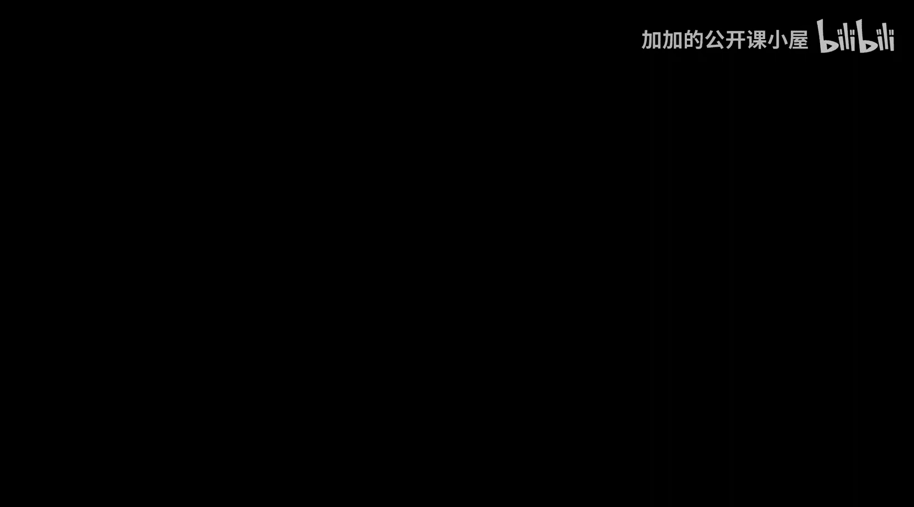
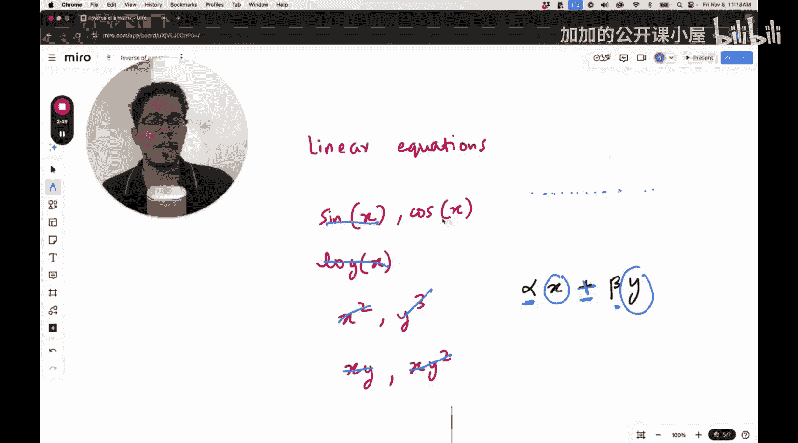

# Vizuara【中英⚡机器学习基础｜Foundations for Machine Learning】 p09 P9 Foundations for Machine Learning ｜ Matrix Inverse - Physical Meaning in Trans [BV1wosSzREF7_p9]

🎼。

Hi， welcome back to the course on foundations for machine learning。

 we are continuing to learn mathematical foundations and at the moment we are learning linear algebrabra。

So in the past lectures， we looked at linear transformation from the point of view of multiplying a vector with a matrix。

We learned that square matrices are basically linear transformations within the same dimension。

 so if you have a two dimensional plane Xy plane， we'll be looking at2 by2 square matrices that will transform vectors within the 2D space Xy plane into the same plane。

But we also learned later that if we have a non square matrix， let's say two by3 matrix。

 you are transforming from a three dimensional space。

 from a two dimensional space into a three dimensional space。

But the transformation although it increases the dimensionality， it does not change the span。

 so if in the originally the I vector and J vector if they could span the entire 2D space after transformation。

 it will still span a particular plane， but the 2D plane will not be the Xy plane。

 it will be another plane in the three dimensionmenal space。

So now what we will see this in this lecture is how can we perform the matrix inverse transformations and？

Are inverses of matrices same as？Physically looking at the vector that was transformed by a particular transformation transformed back into its original position。

 is that what matrix inverse means， we will see that through this lecture。😊。

So let's first look at a set of linear equations so what are linear equations linear equations are nothing but you are multiplying by a scaling factor so if you have x as a variable and if you have y as a variable linear equations will look in this shape alpha x plus beta y because each variable is multiplied by a scaling number alpha and beta and they are only added or subtracted together so it can be plus or minus。

😊，You will not multiply these two then it it will not be linear so basically x and y will not be multiplied this won't be linear x y square will not be linear because then you are mapping from a set of points which can belong to a line because let's say you have set of points that represent x alpha x is simply scaling up those points so if the point value is1 if alpha is 2 then you are scaling up by a factor of 2 and if beta if is 3 you are scaling in the value of this variable y by a factor of 3 which is a linear transformation and when you are adding also its a linear transformation or subtracting。

But squing x square is not linear， y cube is not linear， logarithm is not linear。

 sinusoidal or cosine， these are not linear transformations。

So in linear equations。😊。